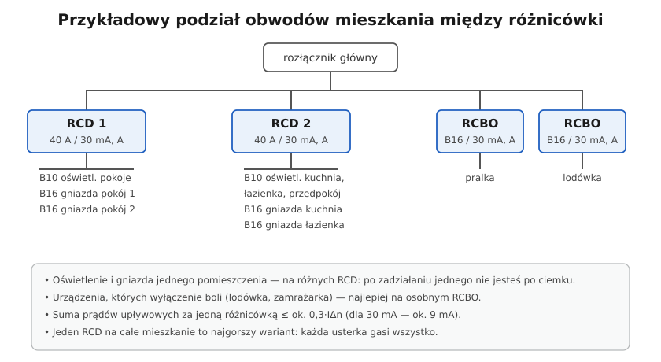

# 08.07 — Podział obwodów między wyłączniki różnicowoprądowe

> **Moduł:** [08 — Wyłączniki różnicowoprądowe](README.md) · **Oznaczenia:** 🏠📋 · **Zakres SEP:** (a) (b) (c) · **Status:** ✅ pełny
>
> **Czytaj:**
>
> - [Urządzenia ochronne różnicowoprądowe w mieszkaniu (Inżynier Budownictwa)](https://inzynierbudownictwa.pl/?p=7401)
> - Planowanie obwodów: [moduł 16](../16-planowanie-obwodow/README.md)
> - Rozdzielnica mieszkaniowa: [moduł 15](../15-rozdzielnica-mieszkaniowa/README.md)

[← poprzedni temat](08.06-dlaczego-roznicowka-wybija-przyczyny-i-szukanie.md) · [spis modułu](README.md) · (koniec modułu) →

## Po co to jest

Jedna różnicówka na całe mieszkanie spełnia wymaganie „RCD 30 mA na gniazdach”, ale każda usterka gasi wszystko — razem z lodówką i światłem, przy którym można by usterki poszukać. Dobry podział obwodów sprawia, że zadziałanie RCD jest drobną niedogodnością, a nie awarią. To także temat egzaminacyjny: selektywność RCD i dobór IΔn w układzie szeregowym.

## Po ludzku

**Zasady podziału:**

1. **Kilka RCD zamiast jednego.** W mieszkaniu co najmniej dwa, w domu więcej. Typowo jedna różnicówka na 2–3 obwody albo RCBO na obwód.
2. **Światło i gniazda tego samego pomieszczenia — pod różnymi RCD.** Jak wybije RCD gniazd, światło dalej działa i widać, co się dzieje.
3. **Urządzenia, których wyłączenie boli**, osobno: lodówka, zamrażarka, pompa obiegowa, brama, alarm — najlepiej RCBO.
4. **Suma prądów upływowych** za jedną różnicówką do ok. 0,3 IΔn ([08.06](08.06-dlaczego-roznicowka-wybija-przyczyny-i-szukanie.md)). Biuro domowe i kącik RTV nie powinny siedzieć na jednym RCD 30 mA.
5. **Każda różnicówka ma swój N.** Przewody N obwodów za danym RCD wychodzą z jego zacisku N (osobna listwa N dla każdego RCD). N różnych grup nigdy się nie łączy.

**Selektywność RCD.** Gdy dwie różnicówki są połączone szeregowo (np. 300 mA na początku i 30 mA na obwodach), ta wyżej musi być:

- **typu S** (selektywna, z opóźnieniem),
- o IΔn co najmniej **trzy razy** większym niż różnicówki za nią.

Bez tego przy upływie mogą zadziałać obie albo tylko ta wyżej.

**Trójfazowy RCD 4P** może chronić obwody jednofazowe rozłożone na trzy fazy (np. gniazda kuchni na L1, łazienki na L2, oświetlenie na L3). N jest wtedy wspólny dla tych obwodów, ale tylko w obrębie tego RCD.

## Schemat

## Pojęcia

| Pojęcie | Po ludzku | Termin normowy / symbol |
|---------|-----------|-------------------------|
| Grupa obwodów | Obwody za jednym RCD | — |
| Selektywność RCD | Przy upływie wyłącza tylko RCD najbliżej usterki | typ S + krotność IΔn |
| Listwa N | Szyna N dla obwodów jednej grupy | — |
| RCD 4P | Czterobiegunowa różnicówka 3L+N | — |

## Liczby do zapamiętania

| Wielkość | Wartość | Kiedy obowiązuje | Źródło |
|----------|---------|------------------|--------|
| Obwody na jeden RCD | najlepiej **1** (RCBO), zwykle **2–3** | mieszkania | praktyka, [Inżynier Budownictwa](https://inzynierbudownictwa.pl/?p=5443) |
| Suma upływu za RCD | ≤ **0,3 IΔn** | — | PN-HD 60364-5-53 |
| Selektywność RCD szeregowo | wyżej **typ S** i IΔn ≥ **3×** IΔn niższego | — | dane producentów |
| Prąd znamionowy RCD | ≥ prąd zabezpieczenia przed nim lub suma obciążeń wg producenta | — | instrukcje producentów |

## W praktyce

- **Zaplanuj podział na kartce** przed montażem: pomieszczenia, obwody, fazy, RCD. Sprawdź, czy żadne pomieszczenie nie gaśnie całkowicie po zadziałaniu jednego RCD.
- **Prąd znamionowy RCD** (25, 40, 63 A) dobierz tak, żeby nie był przeciążony: nie mniejszy niż zabezpieczenie przed nim albo zgodnie z tabelami producenta dla sumy wyłączników za nim.
- **Opisz rozdzielnicę:** który RCD chroni które obwody. Przy wybiciu od razu wiadomo, gdzie szukać.
- **W modernizowanej instalacji** sprawdź, czy N obwodów nie są połączone w puszkach (stare instalacje często mają wspólne N dla kilku obwodów). Takie połączenia trzeba rozdzielić przed montażem kilku RCD.

## Błędy i zagrożenia

- ⚠️ **Jeden RCD na całe mieszkanie** — każda usterka gasi wszystko, łącznie ze światłem.
- ⚠️ **Wspólna listwa N dla obwodów za różnymi RCD** — wybijanie bez wyraźnego powodu, a przy zadziałaniu jednego RCD obwody drugiego mogą mieć przerwany N.
- **Dwa RCD 30 mA w szeregu** — brak selektywności.
- **Lodówka na jednym RCD z gniazdami ogrodowymi** — po deszczu ciepła lodówka.

## Przykład

**Zadanie.** Dom jednorodzinny: obwody oświetlenia parteru i piętra, gniazda w 6 pomieszczeniach, kuchnia (2 obwody gniazd), łazienka, pralka, lodówka, kotłownia, gniazda zewnętrzne. Zaproponuj podział na RCD.

**Propozycja:**

- **RCD 1 (40 A / 30 mA, A):** oświetlenie parteru, gniazda pokoi na piętrze, gniazda łazienki.
- **RCD 2 (40 A / 30 mA, A):** oświetlenie piętra, gniazda pokoi na parterze, kuchnia — obwód 1.
- **RCD 3 (40 A / 30 mA, A):** kuchnia — obwód 2, kotłownia, oświetlenie zewnętrzne.
- **RCBO:** pralka; lodówka; gniazda zewnętrzne (często mokre — niech nie wyłączają niczego innego).

Sprawdzenie: w każdym pomieszczeniu światło i gniazda są pod różnymi aparatami, a urządzenia krytyczne i obwody narażone na wilgoć mają własne RCBO.

## Pytania SEP

1. **Jak zapewnić selektywność wyłączników różnicowoprądowych połączonych szeregowo?**

Odpowiedź

Wyłącznik położony bliżej zasilania powinien być wyłącznikiem selektywnym (typu S, ze zwłoką czasową) i mieć znamionowy prąd różnicowy co najmniej trzykrotnie większy niż wyłączniki za nim, np. 100 mA S lub 300 mA S przed 30 mA. Wtedy przy upływie w obwodzie zadziała tylko wyłącznik najbliższy miejsca uszkodzenia.

2. **Dlaczego nie zaleca się stosowania jednego wyłącznika różnicowoprądowego dla całej instalacji mieszkania?**

Odpowiedź

Bo każde zadziałanie, także zbędne, wyłącza całą instalację, łącznie z oświetleniem i urządzeniami, które powinny pracować stale (lodówka). Ponadto prądy upływowe wszystkich urządzeń sumują się na jednym wyłączniku, co zwiększa ryzyko zbędnych zadziałań. Zaleca się podział obwodów między kilka RCD lub stosowanie RCBO.

## Sprawdź się

1. Za RCD 300 mA typu S są dwa RCD 30 mA. Czy układ jest selektywny?

Odpowiedź

Tak: wyżej jest typ S, a 300 mA ≥ 3 × 30 mA.

2. Dlaczego N obwodów za RCD 1 nie może być połączony z N obwodów za RCD 2?

Odpowiedź

Bo część prądu powrotnego obwodu za RCD 1 popłynęłaby przez N drugiej grupy, z pominięciem przekładnika RCD 1. Oba RCD widziałyby różnicę prądów i wybijały. Do tego po wyłączeniu jednego RCD obwody drugiego mogłyby zostać z przerwanym N.

## Źródła

- [Inżynier Budownictwa — Urządzenia ochronne różnicowoprądowe w mieszkaniu](https://inzynierbudownictwa.pl/?p=7401) — które obwody w mieszkaniu wymagają RCD.
- [Inżynier Budownictwa — Podstawy doboru wyłączników różnicowoprądowych](https://inzynierbudownictwa.pl/?p=5443) — liczba obwodów na RCD, selektywność.
- PN-HD 60364-5-53 — dobór urządzeń ochronnych, selektywność.

---

[← poprzedni temat](08.06-dlaczego-roznicowka-wybija-przyczyny-i-szukanie.md) · [spis modułu](README.md) · (koniec modułu) →
