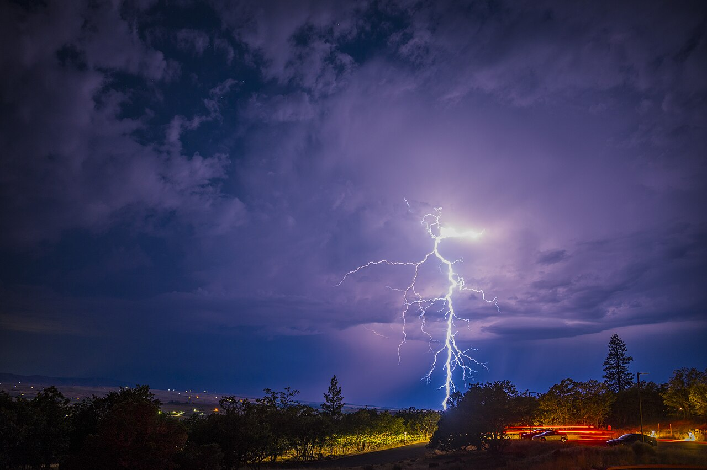
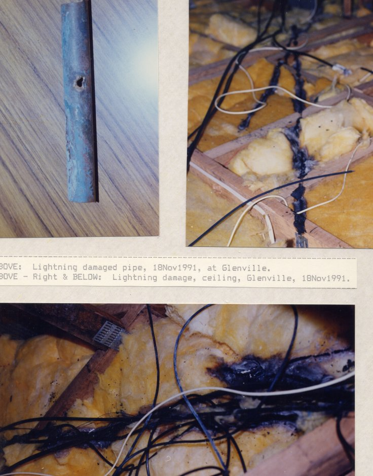
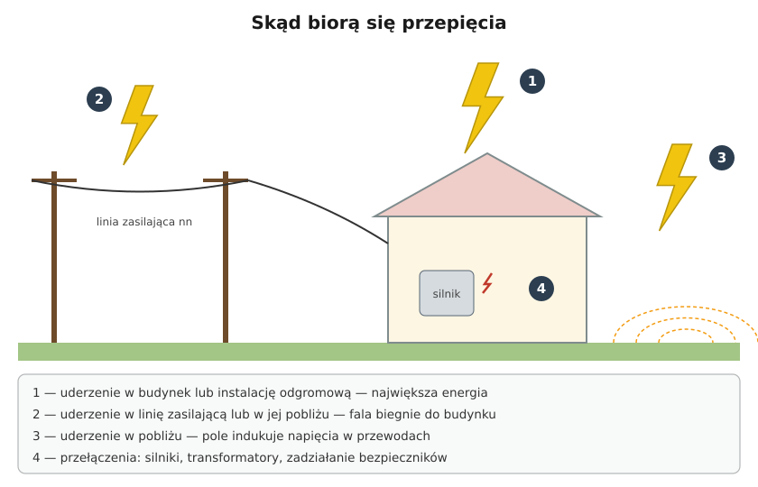
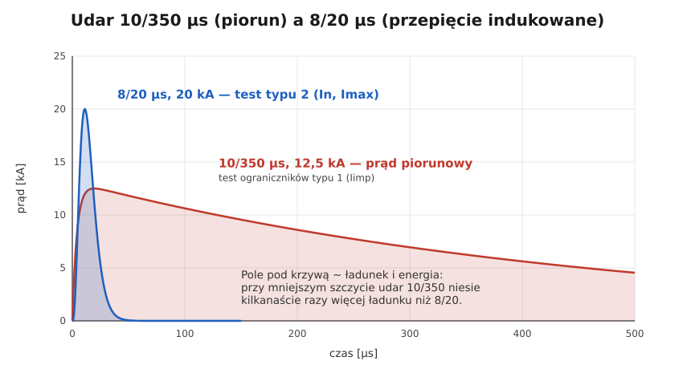

# 09.01 — Skąd biorą się przepięcia

> **Moduł:** [09 — Ochrona przeciwprzepięciowa](README.md) · **Oznaczenia:** 🏠📋 · **Zakres SEP:** (a) (c) · **Status:** ✅ pełny
>
> **Czytaj:**
>
> - PN-HD 60364-4-443 — ochrona przed przepięciami atmosferycznymi i łączeniowymi
> - PN-EN 62305-1 — ochrona odgromowa, zasady ogólne (parametry prądu piorunowego)
> - Indukcja: [03.02](../03-elektromagnetyzm-w-praktyce/03.02-indukcja-elektromagnetyczna-i-transformator.md)

← (początek modułu) · [spis modułu](README.md) · [następny temat →](09.02-kategorie-wytrzymalosci-udarowej-iiv.md)

## Po co to jest

Przepięcie trwa milionowe części sekundy, a potrafi spalić w jednej chwili router, sterownik pieca, płytę indukcyjną i telewizor. Zabezpieczenia nadprądowe i różnicówki są na to za wolne i reagują na coś innego. Żeby dobrać ochronę, trzeba najpierw wiedzieć, skąd przepięcia przychodzą i jaką mają energię. Na egzaminie: rodzaje przepięć i ich źródła.

## Po ludzku

**Przepięcie** to krótkotrwały wzrost napięcia znacznie ponad normalne 230/400 V. Nie chodzi o „trochę za wysokie napięcie w sieci”, tylko o impulsy rzędu tysięcy woltów, trwające mikrosekundy.

**Skąd się biorą:**

1. **Bezpośrednie uderzenie pioruna w budynek** (w instalację odgromową, antenę, komin). Część prądu piorunowego, który ma kilkadziesiąt kiloamperów, wpływa do instalacji przez uziemienie i połączenia wyrównawcze. Największa energia, największe zniszczenia.
2. **Uderzenie w linię zasilającą** albo w jej pobliżu. Fala przepięciowa biegnie przewodami do budynków, nawet kilkaset metrów i dalej. Szczególnie narażone są domy zasilane linią napowietrzną.
3. **Uderzenie w pobliżu** (drzewo, sąsiedni budynek, ziemia). Gwałtownie zmieniające się pole magnetyczne indukuje napięcia w pętlach przewodów ([03.02](../03-elektromagnetyzm-w-praktyce/03.02-indukcja-elektromagnetyczna-i-transformator.md)), także w przewodach telefonicznych, antenowych, sieciowych. Działa w promieniu nawet kilometra–dwóch.
4. **Przepięcia łączeniowe** — z wnętrza sieci i instalacji: wyłączanie silników, transformatorów, sprężarek, zadziałanie bezpieczników przy zwarciu, przełączenia w sieci energetycznej. Mniejsza energia, ale zdarzają się codziennie i powoli niszczą elektronikę.

**Dwa kształty udaru** pojawiają się w katalogach i normach:

- **10/350 μs** — odwzorowuje bezpośredni prąd piorunowy. Narasta w 10 μs, opada do połowy po 350 μs. Niesie ogromną energię.
- **8/20 μs** — odwzorowuje przepięcia indukowane i łączeniowe. Krótki impuls, dużo mniej energii.

**Przepięcia dorywcze (TOV)** to inna sprawa: np. przerwa w przewodzie PEN, po której na fazie pojawia się prawie 400 V przez sekundy lub dłużej. Ograniczniki przepięć nie są zbudowane do takich przepięć i same mogą się wtedy uszkodzić.

## Jak to wygląda

*Na co patrzeć: kanał pioruna to prąd kilkudziesięciu kiloamperów płynący przez kilkadziesiąt–kilkaset mikrosekund. Po uderzeniu prąd rozpływa się w gruncie, a w przewodach w promieniu setek metrów indukują się napięcia.*

*Na co patrzeć: prąd piorunowy wybrał drogę przez instalacje w budynku — przepalił otwór w rurze i spalił izolację przewodów w ociepleniu stropu. Po takim uderzeniu instalację trzeba sprawdzić w całości, także tam, gdzie z zewnątrz nic nie widać.*

## Schemat

## Pojęcia

| Pojęcie | Po ludzku | Termin normowy / symbol |
|---------|-----------|-------------------------|
| Przepięcie | Krótki impuls napięcia dużo wyższego niż znamionowe | przepięcie przejściowe |
| Przepięcie atmosferyczne | Od pioruna | — |
| Przepięcie łączeniowe | Od przełączeń w sieci i instalacji | — |
| Przepięcie dorywcze | Długotrwałe podwyższenie napięcia (np. przerwa PEN) | TOV |
| Udar 10/350 | Kształt prądu bezpośredniego pioruna | czas czoła / czas do półszczytu w μs |
| Udar 8/20 | Kształt prądu przepięć indukowanych | jw. |

## Liczby do zapamiętania

| Wielkość | Wartość | Kiedy obowiązuje | Źródło |
|----------|---------|------------------|--------|
| Prąd pioruna | typowo **kilkadziesiąt kA**, maksymalnie przyjmuje się do **200 kA** | wyładowania doziemne | PN-EN 62305-1 |
| Udar prądu piorunowego | **10/350 μs** | badanie SPD typu 1 | PN-EN 61643-11 |
| Udar przepięć indukowanych | **8/20 μs** | badanie SPD typu 2 | jw. |
| Udar napięciowy | **1,2/50 μs** | badanie wytrzymałości i SPD typu 3 | jw. |
| Zasięg szkodliwych przepięć indukowanych | do ok. **1–2 km** od uderzenia | — | materiały producentów SPD |

## W praktyce

- **Ocena narażenia budynku:** czy ma instalację odgromową? Czy jest zasilany linią napowietrzną? Czy wchodzą do niego przewody z zewnątrz (antena, telefon, kamera na bramie)? Każde „tak” zwiększa ryzyko i wymagania ([09.02](09.02-kategorie-wytrzymalosci-udarowej-iiv.md)).
- **Po burzy z uszkodzeniami:** sprawdź wskaźniki ograniczników przepięć, stan zabezpieczeń, a przy uderzeniu bezpośrednim — całą instalację pomiarami ([moduł 23](../23-pomiary-odbiorcze-i-okresowe/README.md)).
- **Przewody „z zewnątrz”** — antenowe, telekomunikacyjne, zasilanie bramy i oświetlenia ogrodu — też przenoszą przepięcia do środka. Ochrona dotyczy wszystkich, nie tylko zasilania.

## Błędy i zagrożenia

- ⚠️ **„Mam różnicówkę i wyłączniki, więc jestem chroniony przed burzą”** — nie. Zadziałają po fakcie albo wcale, bo przepięcie trwa mikrosekundy.
- **Liczenie na listwę przepięciową jako jedyną ochronę** — chroni kilka urządzeń w jednym miejscu i tylko przed niewielką energią ([09.03](09.03-ograniczniki-przepiec-typu-1-2-i-3.md)).
- **Lekceważenie przepięć łączeniowych** — nie widać ich, ale skracają życie elektroniki.

## Przykład

**Sytuacja.** Dom na wsi zasilany linią napowietrzną. Po burzy, w czasie której nie było widać uderzenia w dom, przestały działać: sterownik pieca, router i brama wjazdowa. Bezpieczniki i różnicówki nie zadziałały.

**Wyjaśnienie.** Uderzenie w pobliżu linii lub w samą linię wywołało falę przepięciową w przewodach zasilających (źródło 2) i indukowało napięcia w długich przewodach do bramy (źródło 3). Impuls trwał mikrosekundy — za krótko dla zabezpieczeń nadprądowych. Najbardziej podatne były urządzenia z elektroniką i długimi przewodami sygnałowymi.

**Wniosek.** Taki dom potrzebuje ograniczników przepięć w rozdzielnicy (przy linii napowietrznej — typu 1+2), a długie przewody zewnętrzne — ochrony na obu końcach ([09.04](09.04-montaz-ogranicznika-dlugosc-polaczen-i.md)).

## Pytania SEP

1. **Jakie są przyczyny powstawania przepięć w instalacjach niskiego napięcia?**

Odpowiedź

Przepięcia atmosferyczne: bezpośrednie wyładowania w obiekt lub jego instalację odgromową, wyładowania w linię zasilającą lub w jej pobliżu, wyładowania w pobliżu obiektu indukujące napięcia w pętlach przewodów. Przepięcia łączeniowe: wyłączanie odbiorników indukcyjnych (silników, transformatorów), zadziałanie bezpieczników przy zwarciu, przełączenia w sieci. Ponadto przepięcia dorywcze, np. przy przerwie w przewodzie PEN lub zwarciach w sieci.

2. **Czym różni się udar prądowy 10/350 μs od 8/20 μs?**

Odpowiedź

10/350 μs odwzorowuje bezpośredni prąd piorunowy: czas czoła 10 μs, czas do półszczytu 350 μs, bardzo duża energia i ładunek. Służy do badania ograniczników typu 1. 8/20 μs odwzorowuje przepięcia indukowane i łączeniowe: krótszy impuls o dużo mniejszej energii, stosowany do badania ograniczników typu 2.

## Sprawdź się

1. Dlaczego wyłącznik nadprądowy nie chroni przed przepięciem?

Odpowiedź

Bo reaguje na prąd, a nie na napięcie, i działa w milisekundach, a przepięcie trwa mikrosekundy. Przepięcie niszczy izolację i elektronikę, zanim jakikolwiek wyzwalacz zdąży zareagować.

## Źródła

- PN-HD 60364-4-443 — ochrona przed zaburzeniami napięciowymi, przepięcia atmosferyczne i łączeniowe.
- PN-EN 62305-1 — ochrona odgromowa, parametry prądu piorunowego.
- PN-EN 61643-11 — ograniczniki przepięć niskiego napięcia, udary probiercze.
- [OBO Bettermann — Pomoc w doborze ochrony przeciwprzepięciowej (PDF)](https://www.targikielce.pl/storage/file/core_files/2024/2/5/8e439cd97655a8b6b6795b59adb5d7c2/Pomoc-w-doborze-ochrony-przeciprzepieciowej-pl.pdf) — zasięg przepięć od wyładowań w pobliżu.

---

← (początek modułu) · [spis modułu](README.md) · [następny temat →](09.02-kategorie-wytrzymalosci-udarowej-iiv.md)
