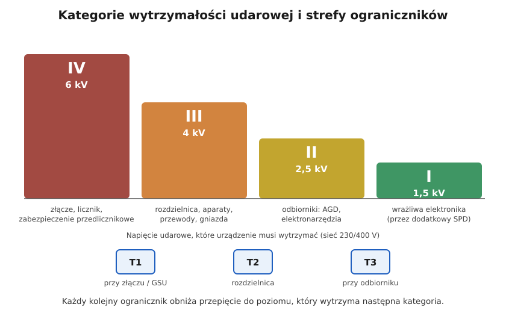

# 09.02 — Kategorie wytrzymałości udarowej I–IV

> **Moduł:** [09 — Ochrona przeciwprzepięciowa](README.md) · **Oznaczenia:** 🏠📋 · **Zakres SEP:** (a) (c) · **Status:** ✅ pełny
>
> **Czytaj:**
>
> - PN-HD 60364-4-443:2016 — kategorie przepięciowe, kiedy ochrona jest wymagana (443.4, 443.5)
> - [Hager — Ograniczniki przepięć SPD (PDF)](https://assets1.sc.hager.com/poland/pdf/26PL023_SPD_web.pdf)

[← poprzedni temat](09.01-skad-biora-sie-przepiecia.md) · [spis modułu](README.md) · [następny temat →](09.03-ograniczniki-przepiec-typu-1-2-i-3.md)

## Po co to jest

Nie wszystkie urządzenia są tak samo odporne. Licznik przy złączu wytrzyma impuls 6 kV, a sterownik pieca 1,5 kV. Kategorie wytrzymałości udarowej mówią, jakie przepięcie musi wytrzymać sprzęt w danym miejscu instalacji. Z nich wynika, jak nisko ograniczniki muszą „ściąć” przepięcie. Na egzaminie: kategorie I–IV i kiedy ochrona przeciwprzepięciowa jest wymagana.

## Po ludzku

Instalacja ma kilka „pięter”. Im bliżej sieci, tym wyższe przepięcia trafiają do urządzeń i tym bardziej odporne muszą one być:

| Kategoria | Gdzie | Musi wytrzymać (230/400 V) |
|-----------|-------|----------------------------|
| **IV** | początek instalacji: złącze, licznik, zabezpieczenie przedlicznikowe | **6 kV** |
| **III** | instalacja stała: rozdzielnica, aparaty, przewody, gniazda, łączniki | **4 kV** |
| **II** | odbiorniki zasilane z gniazd: AGD, elektronarzędzia | **2,5 kV** |
| **I** | wrażliwa elektronika, przyłączana przez dodatkową ochronę | **1,5 kV** |

**Ogranicznik przepięć (SPD) musi ściąć przepięcie poniżej wytrzymałości tego, co chroni.** Jeśli chcemy chronić odbiorniki kategorii II, napięcie za ogranicznikiem (razem ze spadkiem na jego przewodach, [09.04](09.04-montaz-ogranicznika-dlugosc-polaczen-i.md)) musi być niższe niż 2,5 kV. Elektronika kategorii I potrzebuje ogranicznika typu 3 blisko siebie.

**Kiedy ochrona przed przepięciami jest wymagana** (PN-HD 60364-4-443:2016). Gdy skutki przepięcia mogłyby:

- spowodować obrażenia lub śmierć ludzi,
- przerwać usługi publiczne albo zniszczyć dziedzictwo kulturowe,
- przerwać działalność handlową lub przemysłową,
- dotknąć wielu osób przebywających w jednym miejscu.

W pozostałych przypadkach decyduje **ocena ryzyka** (443.5). Bez oceny ryzyka ochronę trzeba zastosować. Odstępstwo dotyczy pojedynczych lokali mieszkalnych, w których łączna wartość instalacji i sprzętu nie uzasadnia ochrony. W domu pełnym elektroniki, z pompą ciepła i fotowoltaiką, ten argument zwykle nie działa.

**Ogranicznik typu 1** jest potrzebny, gdy budynek ma instalację odgromową. Przy zasilaniu linią napowietrzną zaleca się go jako pierwszy stopień ochrony.

## Schemat

## Pojęcia

| Pojęcie | Po ludzku | Termin normowy / symbol |
|---------|-----------|-------------------------|
| Kategoria wytrzymałości udarowej | Jak odporne na przepięcia jest urządzenie w danym miejscu | kategoria przepięciowa I–IV |
| Znamionowe napięcie udarowe wytrzymywane | Impuls, który urządzenie wytrzymuje bez przebicia | $U_W$ |
| Napięciowy poziom ochrony | Do jakiego napięcia SPD ścina przepięcie | $U_P$ |
| Ocena ryzyka | Obliczenie, czy ochrona się opłaca i jest potrzebna | 443.5, PN-EN 62305-2 |

## Liczby do zapamiętania

| Wielkość | Wartość | Kiedy obowiązuje | Źródło |
|----------|---------|------------------|--------|
| Kategoria IV | $U_W$ = **6 kV** | początek instalacji 230/400 V | PN-HD 60364-4-443, tab. 443.2 |
| Kategoria III | $U_W$ = **4 kV** | instalacja stała | jw. |
| Kategoria II | $U_W$ = **2,5 kV** | odbiorniki | jw. |
| Kategoria I | $U_W$ = **1,5 kV** | wrażliwa elektronika | jw. |
| Warunek doboru SPD | $U_P$ (z połączeniami) < $U_W$ chronionych urządzeń | — | PN-HD 60364-5-534 |
| SPD typu 1 | wymagany przy **instalacji odgromowej** | — | jw., materiały producentów |

## W praktyce

- **Dom jednorodzinny bez instalacji odgromowej, zasilany kablem:** SPD typu 2 w rozdzielnicy, a przy wrażliwej elektronice daleko od rozdzielnicy — typ 3 przy odbiorniku.
- **Dom z linią napowietrzną albo z instalacją odgromową:** SPD typu 1+2 (zespolony) w rozdzielnicy głównej, możliwie blisko złącza.
- **Mieszkanie w bloku:** ochrona typu 2 w rozdzielnicy mieszkaniowej; budynek powinien mieć ochronę typu 1 lub 2 w rozdzielnicy głównej — warto zapytać zarządcę.
- **Udokumentuj** decyzję: zastosowana ochrona albo wynik oceny ryzyka.

## Błędy i zagrożenia

- **Ogranicznik o $U_P$ = 2,5 kV „do ochrony elektroniki”** — wraz ze spadkiem na przewodach przepięcie przekroczy wytrzymałość odbiorników kategorii II.
- **Brak typu 1 w budynku z instalacją odgromową** — ogranicznik typu 2 nie wytrzyma części prądu piorunowego i ulegnie zniszczeniu.
- **Pominięcie ochrony, „bo nie ma obowiązku”** — bez oceny ryzyka ochronę stosuje się.

## Przykład

**Zadanie.** W rozdzielnicy domu jest SPD typu 2 o $U_P$ = 1,5 kV, połączony przewodami o łącznej długości 0,5 m. Sterownik pieca (kategoria I, 1,5 kV) jest 25 m dalej. Czy jest chroniony?

**Rozwiązanie.** Napięcie na zaciskach instalacji przy SPD: ok. $1{,}5 + 0{,}5 \cdot 1 = 2{,}0\ \mathrm{kV}$. To mniej niż 2,5 kV — odbiorniki kategorii II w pobliżu rozdzielnicy są chronione. Sterownik kategorii I (1,5 kV) — nie. Do tego jest dalej niż ok. 10 m od SPD, więc przepięcie na końcu przewodu może być jeszcze wyższe.

**Wniosek.** Przy sterowniku potrzebny jest SPD typu 3 (np. moduł w puszce lub gniazdo z ochroną).

## Pytania SEP

1. **Co oznaczają kategorie wytrzymałości udarowej (kategorie przepięciowe) urządzeń?**

Odpowiedź

Określają wymagane znamionowe napięcie udarowe wytrzymywane urządzeń w zależności od miejsca w instalacji. Dla sieci 230/400 V: kategoria IV — 6 kV (urządzenia na początku instalacji: liczniki, zabezpieczenia przedlicznikowe), III — 4 kV (urządzenia instalacji stałej: rozdzielnice, aparaty, przewody, gniazda), II — 2,5 kV (odbiorniki przyłączane do instalacji stałej, np. AGD), I — 1,5 kV (urządzenia wrażliwe, przyłączane przez dodatkowe środki ochrony).

2. **Kiedy wymagana jest ochrona przed przepięciami w instalacji budynku?**

Odpowiedź

Według PN-HD 60364-4-443: gdy przepięcie mogłoby spowodować obrażenia lub śmierć ludzi, przerwę w usługach publicznych lub zniszczenie dziedzictwa kulturowego, przerwę w działalności handlowej lub przemysłowej albo zagrozić wielu osobom w jednym miejscu. W pozostałych przypadkach na podstawie oceny ryzyka; jeśli jej nie wykonano, ochronę należy zastosować. Odstępstwo dopuszcza się dla pojedynczych lokali mieszkalnych, gdy wartość instalacji i wyposażenia nie uzasadnia ochrony. W budynkach z instalacją odgromową stosuje się ograniczniki typu 1.

## Sprawdź się

1. Do której kategorii należy pralka podłączona do gniazda? Jakie przepięcie musi wytrzymać?

Odpowiedź

Kategoria II — 2,5 kV.

## Źródła

- PN-HD 60364-4-443:2016 — tab. 443.2 (napięcia udarowe wytrzymywane), 443.4 i 443.5 (kiedy ochrona jest wymagana, ocena ryzyka).
- PN-HD 60364-5-534:2016 — dobór ograniczników przepięć.
- [Hager — Ograniczniki przepięć SPD](https://assets1.sc.hager.com/poland/pdf/26PL023_SPD_web.pdf) — typ 1 w budynkach z instalacją odgromową.
- [OBO Bettermann — Pomoc w doborze ochrony przeciwprzepięciowej](https://www.targikielce.pl/storage/file/core_files/2024/2/5/8e439cd97655a8b6b6795b59adb5d7c2/Pomoc-w-doborze-ochrony-przeciprzepieciowej-pl.pdf) — obowiązek ochrony bez oceny ryzyka, typ 1 przy instalacji odgromowej i linii napowietrznej.

---

[← poprzedni temat](09.01-skad-biora-sie-przepiecia.md) · [spis modułu](README.md) · [następny temat →](09.03-ograniczniki-przepiec-typu-1-2-i-3.md)
