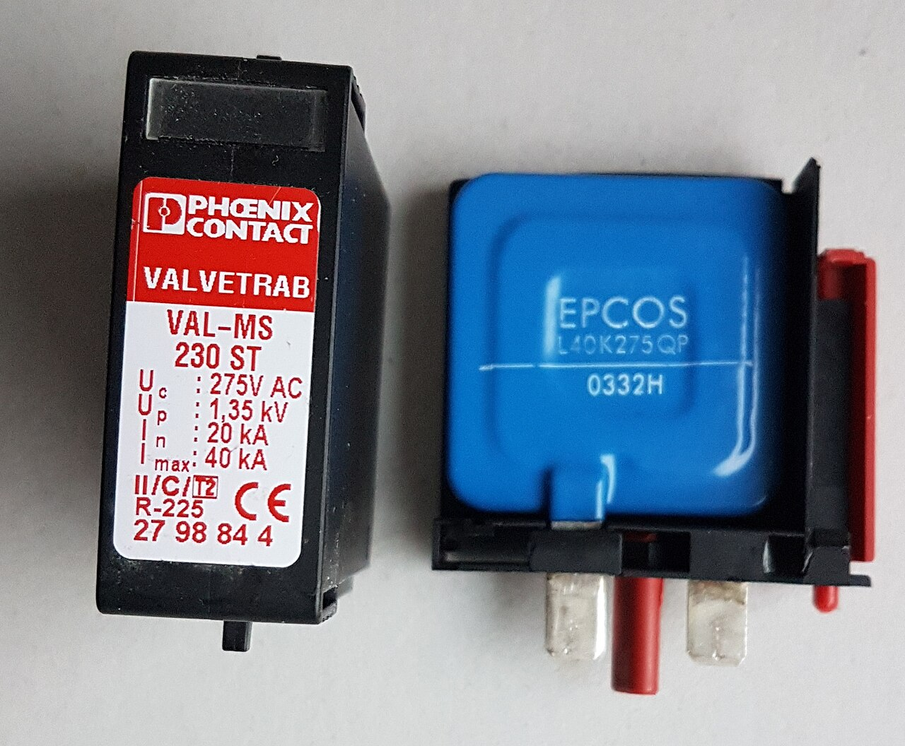
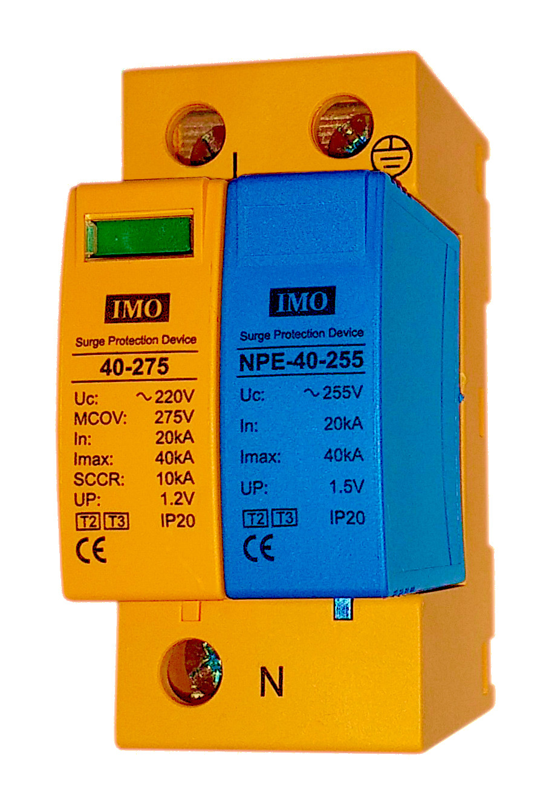
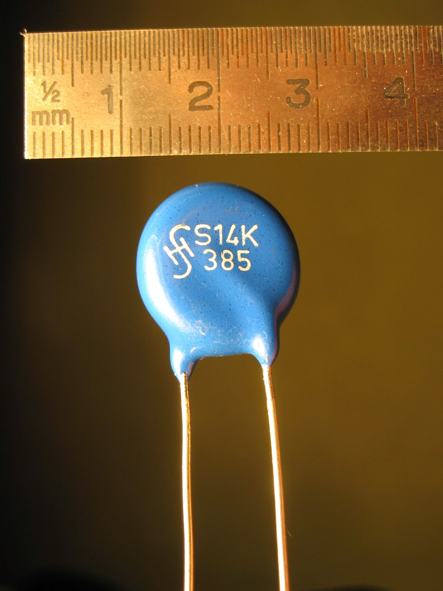
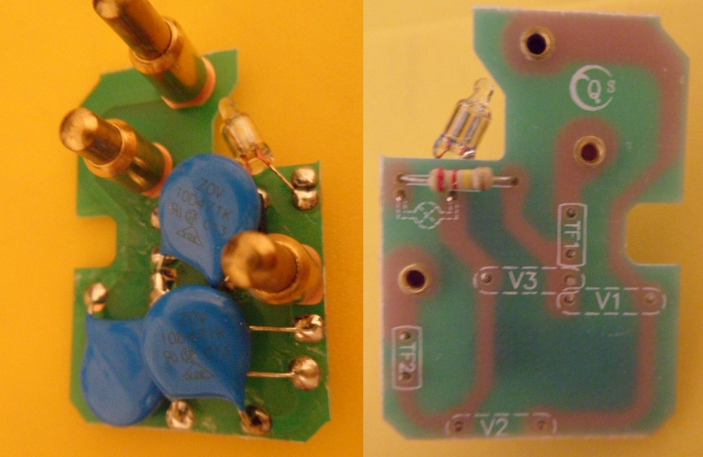

# 09.03 — Ograniczniki przepięć typu 1, 2 i 3

> **Moduł:** [09 — Ochrona przeciwprzepięciowa](README.md) · **Oznaczenia:** 🏠📋 · **Zakres SEP:** (a) (c) · **Status:** ✅ pełny
>
> **Czytaj:**
>
> - PN-EN 61643-11 — ograniczniki przepięć w sieciach niskiego napięcia (typy, parametry)
> - [Hager — Ograniczniki przepięć SPD (PDF)](https://assets1.sc.hager.com/poland/pdf/26PL023_SPD_web.pdf)

[← poprzedni temat](09.02-kategorie-wytrzymalosci-udarowej-iiv.md) · [spis modułu](README.md) · [następny temat →](09.04-montaz-ogranicznika-dlugosc-polaczen-i.md)

## Po co to jest

Ograniczniki przepięć (SPD, potocznie „ochronniki”) to aparaty, które w chwili przepięcia na moment zwierają przewody czynne z PE i odprowadzają impuls do ziemi, zanim dotrze do odbiorników. Mają trzy typy o różnej „sile”. Trzeba umieć odczytać tabliczkę i ustawić je we właściwej kolejności. Na egzaminie: typy ograniczników i ich parametry.

## Po ludzku

**Jak działa ogranicznik?** W normalnych warunkach ma bardzo dużą rezystancję i nic nie przewodzi. Gdy napięcie przekroczy próg, w ułamku mikrosekundy staje się przewodnikiem i odprowadza impuls do PE. Po przejściu impulsu wraca do stanu izolującego. Działa jak zawór bezpieczeństwa w kotle.

**Dwie technologie:**

- **Warystor** — tarczka z tlenku cynku. Im wyższe napięcie, tym lepiej przewodzi. Szybki, ale z każdym dużym udarem trochę się zużywa. Podstawa ograniczników typu 2 i 3.
- **Iskiernik** — dwie elektrody z przerwą. Przy przepięciu przeskakuje łuk i odprowadza ogromny prąd. Wytrzymuje udar piorunowy 10/350, ale ma wyższe napięcie zapłonu. Podstawa ograniczników typu 1.

**Trzy typy (klasy):**

| Typ | Badany udarem | Do czego | Gdzie |
|-----|---------------|----------|-------|
| **1** (T1, dawniej B) | **10/350 μs** — prąd $I_{imp}$ | część prądu piorunowego | rozdzielnica główna, przy złączu |
| **2** (T2, dawniej C) | **8/20 μs** — prąd $I_n$, $I_{max}$ | przepięcia indukowane i łączeniowe | każda rozdzielnica |
| **3** (T3, dawniej D) | udar kombinowany 1,2/50 + 8/20 | dokładna ochrona wrażliwych urządzeń | przy odbiorniku (moduł w puszce, gniazdo, listwa) |

Często spotyka się **ograniczniki zespolone T1+T2** — jeden aparat pełni rolę obu stopni. To wygodne w domach jednorodzinnych.

**Najważniejsze parametry na tabliczce:**

- **$U_C$** — najwyższe napięcie trwałej pracy. Dla sieci 230/400 V zwykle **275 V** (musi być co najmniej 1,1 × 230 V = 253 V w układzie TN).
- **$U_P$** — napięciowy poziom ochrony: do ilu kV ogranicznik ścina przepięcie (np. 1,2–1,5 kV dla typu 2).
- **$I_n$** — znamionowy prąd wyładowczy 8/20 (typ 2), np. 20 kA. Ogranicznik wytrzyma go wiele razy.
- **$I_{max}$** — największy prąd 8/20, który wytrzyma raz, np. 40 kA.
- **$I_{imp}$** — prąd udarowy 10/350 (typ 1), np. 12,5 kA na biegun.

**Zużycie i wskaźnik.** Ogranicznik ma wbudowany odłącznik termiczny. Gdy warystor się przegrzeje (zużycie, przepięcie dorywcze), odłącza się i wskaźnik zmienia kolor z zielonego na czerwony. Wtedy wymienia się wkładkę. Ogranicznik z czerwonym wskaźnikiem już nie chroni.

**Listwa przepięciowa** to w praktyce ogranicznik typu 3. Chroni kilka urządzeń przed niewielkimi przepięciami, ale bez typu 2 w rozdzielnicy szybko się zużywa i nie wytrzyma większego udaru.

## Jak to wygląda

*Na co patrzeć: na wkładce są wszystkie parametry — Uc 275 V, Up 1,35 kV, In 20 kA, Imax 40 kA i typ (II/C/T2 — trzy oznaczenia tej samej klasy w różnych systemach). W środku jest jeden duży warystor z odłącznikiem termicznym. Okienko na górze wkładki to wskaźnik stanu.*

*Na co patrzeć: dwa moduły w jednej obudowie — żółty chroni między L a N, niebieski między N a PE. To jednofazowa wersja układu 3+1 ([09.04](09.04-montaz-ogranicznika-dlugosc-polaczen-i.md)). Zielone okienko oznacza sprawny warystor.*

*Na co patrzeć: tak wygląda sam warystor — tarczka z tlenku cynku z dwiema nóżkami. W ogranicznikach do rozdzielnic są dużo większe, w listwach i zasilaczach — takie jak ten.*

*Na co patrzeć: w taniej listwie lub wtyczce przepięciowej siedzi kilka małych warystorów (L–N, L–PE, N–PE) i bezpiecznik. To ochrona typu 3: dobra jako ostatni stopień, ale bez typu 2 w rozdzielnicy zużyje się szybko.*

## Pojęcia

| Pojęcie | Po ludzku | Termin normowy / symbol |
|---------|-----------|-------------------------|
| Ogranicznik przepięć | Aparat odprowadzający przepięcie do PE | SPD |
| Warystor | Element, który przewodzi powyżej pewnego napięcia | MOV |
| Iskiernik | Przerwa iskrowa przewodząca po przeskoku łuku | — |
| Napięcie trwałej pracy | Napięcie, przy którym SPD może pracować bez końca | $U_C$ |
| Napięciowy poziom ochrony | Napięcie, do którego SPD ogranicza przepięcie | $U_P$ |
| Prąd udarowy | Prąd 10/350, który SPD typu 1 wytrzymuje | $I_{imp}$ |
| Znamionowy prąd wyładowczy | Prąd 8/20, który SPD typu 2 wytrzymuje wielokrotnie | $I_n$ |
| Odłącznik termiczny | Odłącza przegrzany warystor, przestawia wskaźnik | — |

## Liczby do zapamiętania

| Wielkość | Wartość | Kiedy obowiązuje | Źródło |
|----------|---------|------------------|--------|
| Typ 1 — udar probierczy | **10/350 μs**, $I_{imp}$ | — | PN-EN 61643-11 |
| Typ 2 — udar probierczy | **8/20 μs**, $I_n$, $I_{max}$ | — | jw. |
| Typ 3 — udar probierczy | kombinowany **1,2/50 + 8/20 μs** | — | jw. |
| $I_{imp}$ typu 1 bez analizy ryzyka | ≥ **12,5 kA** na biegun | instalacje 230/400 V | PN-HD 60364-5-534 |
| $I_n$ typu 2 | ≥ **5 kA** (typowo 20 kA) | jw. | jw. |
| $U_C$ w sieci 230/400 V | typowo **275 V** (≥ 1,1 × 230 V) | TN | jw., katalogi |
| $U_P$ typu 2 | typowo **1,2–1,5 kV** | — | katalogi producentów |
| Dawne oznaczenia | B = typ 1, C = typ 2, D = typ 3 | — | — |

## W praktyce

- **Dobierz typ do budynku** ([09.02](09.02-kategorie-wytrzymalosci-udarowej-iiv.md)): z instalacją odgromową lub linią napowietrzną — T1+T2, bez — T2, przy wrażliwych odbiornikach daleko od rozdzielnicy — dodatkowo T3.
- **Stopnie muszą ze sobą współpracować.** Używaj zestawów skoordynowanych przez producenta (T1 → T2 → T3). Iskiernik typu 1 i warystor typu 2 zamontowane tuż obok siebie bez koordynacji mogą działać tak, że cały udar przejmie słabszy warystor.
- **Sprawdzaj wskaźniki** po każdej silnej burzy i przy przeglądach. Ograniczniki z zestykiem sygnalizacyjnym można podłączyć do alarmu lub automatyki domowej.
- **Wkładki wymieniaj na te same** (typ, $U_C$, $U_P$), z wyłączonym zasilaniem ogranicznika.

## Błędy i zagrożenia

- ⚠️ **Czerwony wskaźnik zignorowany** — instalacja nie ma ochrony, a właściciel myśli, że ma.
- **Typ 2 tam, gdzie potrzebny typ 1** — ogranicznik zostanie zniszczony przez prąd piorunowy, często z pożarem obudowy.
- **Ogranicznik o $U_C$ za niskim** (np. 150 V w sieci 230 V) — przewodzi przy zwykłych wahaniach napięcia i szybko się niszczy.
- **„Mam listwę, nie potrzebuję SPD w rozdzielnicy”** — listwa nie wytrzyma udaru, który typ 2 przyjąłby bez problemu.

## Przykład

**Zadanie.** Odczytaj parametry ogranicznika: „T2, Uc 275 V, Up ≤ 1,3 kV, In 20 kA, Imax 40 kA, 3+1”. Czy nadaje się do domu w układzie TN-S, bez instalacji odgromowej, zasilanego kablem?

**Rozwiązanie.**

- T2 — przepięcia indukowane i łączeniowe; budynek bez instalacji odgromowej i z zasilaniem kablowym — typ 2 wystarcza.
- $U_C$ = 275 V ≥ 253 V — poprawne dla sieci 230 V.
- $U_P$ ≤ 1,3 kV — z przewodami ≤ 0,5 m ok. 1,8 kV, poniżej 2,5 kV — chroni odbiorniki kategorii II.
- $I_n$ = 20 kA ≥ 5 kA — z zapasem.
- 3+1 — poprawny układ dla TN-S i do montażu przed różnicówką ([09.04](09.04-montaz-ogranicznika-dlugosc-polaczen-i.md)).

**Wniosek.** Nadaje się.

## Pytania SEP

1. **Jakie typy ograniczników przepięć stosuje się w instalacjach niskiego napięcia i gdzie się je instaluje?**

Odpowiedź

Typ 1 (T1, dawniej B) — badany prądem udarowym 10/350 μs, odprowadza część prądu piorunowego; instaluje się go na początku instalacji (złącze, rozdzielnica główna), obowiązkowo w budynkach z instalacją odgromową. Typ 2 (T2, dawniej C) — badany prądem 8/20 μs, chroni przed przepięciami indukowanymi i łączeniowymi; instaluje się go w rozdzielnicach. Typ 3 (T3, dawniej D) — dokładna ochrona urządzeń wrażliwych, instalowany blisko odbiorników (gniazda, puszki, listwy).

2. **Jakie są podstawowe parametry ogranicznika przepięć?**

Odpowiedź

Najwyższe napięcie trwałej pracy $U_C$ (np. 275 V), napięciowy poziom ochrony $U_P$ (np. 1,5 kV), znamionowy prąd wyładowczy $I_n$ i maksymalny prąd wyładowczy $I_{max}$ (8/20 μs, typ 2), prąd udarowy $I_{imp}$ (10/350 μs, typ 1), a także wytrzymałość zwarciowa i największe dopuszczalne zabezpieczenie nadprądowe podane przez producenta.

3. **Jak działa warystor w ograniczniku przepięć?**

Odpowiedź

Warystor ma rezystancję silnie zależną od napięcia. Przy napięciu roboczym jego rezystancja jest bardzo duża i prąd praktycznie nie płynie. Gdy napięcie przekroczy próg, rezystancja gwałtownie maleje i warystor odprowadza prąd udaru do przewodu ochronnego, ograniczając napięcie na chronionych urządzeniach. Po ustąpieniu przepięcia wraca do stanu wysokiej rezystancji.

## Sprawdź się

1. Na wkładce jest napis „II/C/T2”. Co to znaczy?

Odpowiedź

To ten sam typ 2 w trzech systemach oznaczeń: klasa II (IEC), C (dawne oznaczenie niemieckie i polskie), T2 (PN-EN 61643-11).

## Źródła

- PN-EN 61643-11 — ograniczniki przepięć niskiego napięcia, typy i udary probiercze.
- PN-HD 60364-5-534:2016 — dobór ograniczników (minimalne $I_{imp}$ i $I_n$, $U_C$, koordynacja).
- [Hager — Ograniczniki przepięć SPD](https://assets1.sc.hager.com/poland/pdf/26PL023_SPD_web.pdf) — typy, przebiegi probiercze, układy CT1 i CT2.

---

[← poprzedni temat](09.02-kategorie-wytrzymalosci-udarowej-iiv.md) · [spis modułu](README.md) · [następny temat →](09.04-montaz-ogranicznika-dlugosc-polaczen-i.md)
