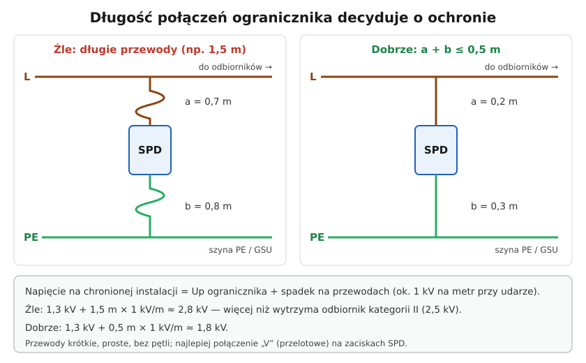
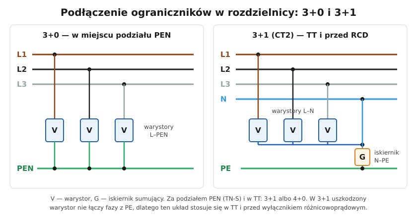

# 09.04 — Montaż ogranicznika: długość połączeń i zabezpieczenie

> **Moduł:** [09 — Ochrona przeciwprzepięciowa](README.md) · **Oznaczenia:** 🏠📋 · **Zakres SEP:** (a) (c) · **Status:** ✅ pełny
>
> **Czytaj:**
>
> - PN-HD 60364-5-534:2016 — montaż ograniczników przepięć
> - [DEHN — Podłączanie ograniczników przepięć (PDF)](https://www.dehn-international.com/sites/default/files/media/files/pl-anschluss-ableiter.pdf)
> - [Hager — Ograniczniki przepięć SPD (PDF)](https://assets1.sc.hager.com/poland/pdf/26PL023_SPD_web.pdf)

[← poprzedni temat](09.03-ograniczniki-przepiec-typu-1-2-i-3.md) · [spis modułu](README.md) · [następny temat →](09.05-ochrona-odgromowa-budynku-podstawy.md)

## Po co to jest

Ten sam ogranicznik może chronić świetnie albo prawie wcale — zależnie od tego, jak go podłączysz. Długie przewody, zły układ albo montaż za różnicówką potrafią zniweczyć ochronę i powodować zbędne wyłączenia. Na egzaminie: zasady montażu ograniczników.

## Po ludzku

**1. Krótkie przewody — najważniejsza zasada.** Prąd udaru narasta w mikrosekundy. Na indukcyjności przewodów odkłada się wtedy duże napięcie — orientacyjnie **ok. 1 kV na każdy metr** przewodu. To napięcie dodaje się do $U_P$ ogranicznika. Dlatego łączna długość przewodów od fazy do SPD i od SPD do szyny PE (**a + b**) nie powinna przekraczać **0,5 m**. Przewody prowadzi się prosto, bez pętli i zwojów. Najlepiej połączenie „V” (przelotowe): przewód fazowy wchodzi na zacisk SPD i z drugiego zacisku idzie dalej do aparatów.

**2. Miejsce — na początku instalacji.** SPD montuje się w rozdzielnicy głównej, możliwie blisko miejsca wprowadzenia zasilania i szyny wyrównawczej. Każde urządzenie dalej niż ok. **10 m** od SPD może dostać wyższe przepięcie niż $U_P$ — wtedy dodaje się kolejny stopień (T2 lub T3) blisko niego.

**3. Przed różnicówką.** Ogranicznik zamontowany za RCD przepuszcza prąd udaru przez RCD. To powoduje zbędne wyłączenia, a duży udar może uszkodzić różnicówkę. Dlatego SPD montuje się przed RCD.

**4. Właściwy układ** ([schemat poniżej](#schemat)):

- **3+0** (fazy do PEN) — w miejscu podziału PEN, gdzie instalacja jest jeszcze w układzie TN-C;
- **3+1** (fazy do N, N do PE przez iskiernik) albo **4+0** — za podziałem PEN (TN-S) i w układzie TT. Przed RCD i w TT stosuje się **3+1**: uszkodzony warystor nie tworzy wtedy połączenia fazy z PE.

**5. Zabezpieczenie nadprądowe ogranicznika.** Producent podaje największe dopuszczalne zabezpieczenie przed SPD (np. gG 125 A). Jeśli zabezpieczenie przed rozdzielnicą jest mniejsze — wystarczy ono. Jeśli większe — przed SPD trzeba dać osobne zabezpieczenie. Trzeba też zdecydować, co ważniejsze: ciągłość zasilania (zabezpieczenie w gałęzi SPD — po jego zadziałaniu instalacja działa, ale bez ochrony) czy ochrona (SPD bez osobnego zabezpieczenia — jego uszkodzenie wyłączy zasilanie).

**6. Przekrój przewodów.** Do PE: co najmniej **16 mm² Cu** dla typu 1 i **6 mm² Cu** dla typu 2. Przewody fazowe — według producenta.

## Schemat

## Pojęcia

| Pojęcie | Po ludzku | Termin normowy / symbol |
|---------|-----------|-------------------------|
| Długość połączeń a + b | Przewód od fazy do SPD + od SPD do PE | PN-HD 60364-5-534 |
| Połączenie „V” | Przewód wchodzi na SPD i z niego wychodzi dalej | połączenie przelotowe |
| Odległość ochronna | Jak daleko od SPD urządzenie jest jeszcze chronione | ok. 10 m |
| Układ 3+0 / 3+1 / 4+0 | Między którymi przewodami są warystory i iskiernik | CT1 / CT2 |
| Zabezpieczenie wstępne SPD | Bezpiecznik lub wyłącznik przed SPD | back-up |

## Liczby do zapamiętania

| Wielkość | Wartość | Kiedy obowiązuje | Źródło |
|----------|---------|------------------|--------|
| Długość połączeń a + b | ≤ **0,5 m** | każdy SPD | PN-HD 60364-5-534 |
| Spadek na przewodach przy udarze | ok. **1 kV/m** | orientacyjnie | materiały producentów |
| Odległość ochronna | ok. **10 m** | dalej — dodatkowy SPD | PN-HD 60364-5-534 |
| Przekrój przewodu do PE | ≥ **16 mm² Cu** (T1), ≥ **6 mm² Cu** (T2) | — | jw., Hager |
| Układ przed RCD i w TT | **3+1** (CT2) | — | jw. |
| Pomiar izolacji z SPD w obwodzie | napięcie probiercze **250 V DC**, ≥ **1 MΩ** | gdy SPD nie da się odłączyć | PN-HD 60364-6 |

## W praktyce

Montaż SPD typu 2 w rozdzielnicy domu (TN-C-S, podział PEN w rozdzielnicy):

1. Wyłącz zasilanie rozdzielnicy (zabezpieczenie przedlicznikowe lub rozłącznik w złączu), zabezpiecz, sprawdź brak napięcia ([00.01](../00-bezpieczenstwo-najpierw/00.01-piec-zasad-bezpiecznej-pracy-przy-urzadzeniach.md)).
2. Zamontuj SPD na szynie **za rozłącznikiem głównym, przed różnicówkami**, jak najbliżej szyny PE.
3. Podłącz fazy krótko, najlepiej „V” lub z grzebienia; PE — przewodem 6 mm² (lub większym) najkrótszą drogą do szyny PE.
4. Sprawdź, czy zabezpieczenie przed rozdzielnicą nie przekracza dopuszczalnego dla SPD.
5. Załącz, sprawdź wskaźniki (zielone).
6. Przy pomiarze rezystancji izolacji odłącz wkładki SPD albo mierz napięciem 250 V ([moduł 23](../23-pomiary-odbiorcze-i-okresowe/README.md)).
7. Opisz w dokumentacji i na rozdzielnicy: typ SPD, data montażu.

## Błędy i zagrożenia

- ⚠️ **Przewód PE do SPD długi „dookoła rozdzielnicy”** — ochrona praktycznie znika.
- ⚠️ **SPD za różnicówką** — zbędne wyłączenia przy burzy, możliwe uszkodzenie RCD.
- **Układ 3+0 w TT lub przed RCD** — uszkodzony warystor łączy fazę z PE.
- **Brak zabezpieczenia SPD przy zbyt dużym zabezpieczeniu przed nim** — zwarcie w zużytym warystorze może spowodować pożar.
- **Pomiar izolacji 500 V z podłączonym SPD** — fałszywy wynik „za mała rezystancja”, możliwe uszkodzenie SPD.

## Przykład

**Zadanie.** SPD typu 2 o $U_P$ = 1,3 kV podłączono przewodem 0,6 m do fazy i 0,9 m do szyny PE. Jakie napięcie dostanie instalacja przy udarze? Co poprawić?

$$U \approx U_P + (a + b) \cdot 1\ \mathrm{kV/m} = 1{,}3 + 1{,}5 = 2{,}8\ \mathrm{kV}$$

To więcej niż 2,5 kV dla odbiorników kategorii II — ochrona jest nieskuteczna.

**Poprawka.** Przenieść SPD bliżej szyny PE i wprowadzić fazy z grzebienia lub połączeniem „V”. Przy a + b = 0,4 m: $1{,}3 + 0{,}4 = 1{,}7\ \mathrm{kV}$.

## Pytania SEP

1. **Jakie zasady obowiązują przy montażu ograniczników przepięć?**

Odpowiedź

Ograniczniki montuje się na początku instalacji (w rozdzielnicy głównej), przed wyłącznikami różnicowoprądowymi. Łączna długość przewodów przyłączających (od przewodu fazowego do SPD i od SPD do szyny uziemiającej) nie powinna przekraczać 0,5 m; przewody prowadzi się prosto, bez pętli, najlepiej w połączeniu przelotowym „V”. Przewód do PE ma przekrój co najmniej 6 mm² Cu dla typu 2 i 16 mm² Cu dla typu 1. Układ połączeń dobiera się do układu sieci (3+0 w TN-C, 3+1 lub 4+0 w TN-S, 3+1 w TT i przed RCD). Ogranicznik musi mieć zabezpieczenie nadprądowe nie większe niż dopuszczone przez producenta. Urządzenia oddalone od ogranicznika o więcej niż ok. 10 m wymagają dodatkowej ochrony.

2. **Dlaczego przewody przyłączające ogranicznik przepięć muszą być jak najkrótsze?**

Odpowiedź

Bo przy szybko narastającym prądzie udaru na indukcyjności przewodów powstaje dodatkowe napięcie (ok. 1 kV na metr), które sumuje się z napięciowym poziomem ochrony ogranicznika. Długie przewody powodują, że do chronionych urządzeń dociera napięcie wyższe niż ich wytrzymałość udarowa.

## Sprawdź się

1. Dlaczego przed RCD stosuje się układ 3+1, a nie 3+0?

Odpowiedź

W 3+1 warystory są między fazami a N, a do PE prowadzi tylko iskiernik N–PE. Uszkodzony (zwarty) warystor tworzy zwarcie L–N, które wyłączy zabezpieczenie nadprądowe, a nie połączenie fazy z PE, które w TT lub przed RCD mogłoby nie zostać wyłączone i dać napięcie na obudowach.

## Źródła

- PN-HD 60364-5-534:2016 — dobór i montaż ograniczników przepięć (długość połączeń, przekroje, odległość ochronna, układy połączeń, zabezpieczenie SPD).
- PN-HD 60364-6 — pomiar rezystancji izolacji przy podłączonych SPD.
- [DEHN — Podłączanie ograniczników przepięć](https://www.dehn-international.com/sites/default/files/media/files/pl-anschluss-ableiter.pdf) — 0,5 m, połączenie „V”.
- [Hager — Ograniczniki przepięć SPD](https://assets1.sc.hager.com/poland/pdf/26PL023_SPD_web.pdf) — długości a + b, przekroje 6 i 16 mm², odległość 10 m.
- [Inżynier Budownictwa — Ochrona ograniczników przepięć, zmiany normowe](https://inzynierbudownictwa.pl/ochrona-ogranicznikow-przepiec-zmiany-normowe/) — odległość ochronna 10 m.

---

[← poprzedni temat](09.03-ograniczniki-przepiec-typu-1-2-i-3.md) · [spis modułu](README.md) · [następny temat →](09.05-ochrona-odgromowa-budynku-podstawy.md)
