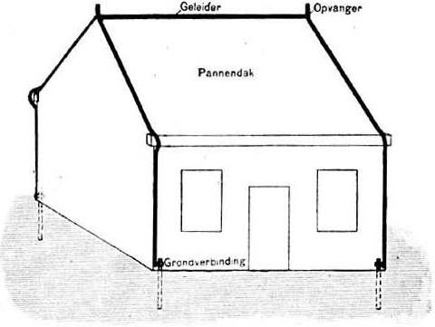
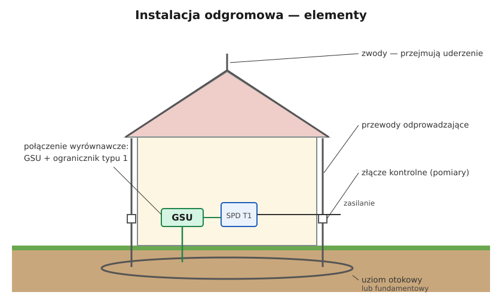

# 09.05 — Ochrona odgromowa budynku — podstawy

> **Moduł:** [09 — Ochrona przeciwprzepięciowa](README.md) · **Oznaczenia:** 🏠📋 · **Zakres SEP:** (a) (c) · **Status:** ✅ pełny
>
> **Czytaj:**
>
> - PN-EN 62305-1 do -4 — ochrona odgromowa
> - Uziemienia i połączenia wyrównawcze: [moduł 13](../13-uziemienia-i-wyrownanie/README.md)
> - Kontrola okresowa (Prawo budowlane, art. 62): [moduł 32](../32-przepisy-i-normy/README.md)

[← poprzedni temat](09.04-montaz-ogranicznika-dlugosc-polaczen-i.md) · [spis modułu](README.md) · (koniec modułu) →

## Po co to jest

Instalacja odgromowa (potocznie „piorunochron”) przejmuje uderzenie pioruna i bezpiecznie odprowadza prąd do ziemi, z dala od konstrukcji i instalacji budynku. Jej projekt to praca dla specjalisty, ale elektryk musi rozumieć, z czego się składa, jak współpracuje z instalacją elektryczną i jak ją sprawdzać. Na egzaminie: elementy instalacji odgromowej i jej badania.

## Po ludzku

Instalacja odgromowa to „kanał” dla prądu pioruna, który omija dom:

1. **Zwody** — metalowe pręty, linki lub siatka na dachu (na kalenicy, krawędziach, kominach). Piorun ma uderzyć w nie, a nie w pokrycie dachu.
2. **Przewody odprowadzające** — prowadzą prąd po ścianach do ziemi, najkrótszą drogą, w kilku miejscach wokół budynku, żeby prąd się rozdzielił.
3. **Złącza kontrolne** — rozłączalne połączenia, zwykle kilkadziesiąt centymetrów do ok. 1,5 m nad ziemią (albo w studzienkach), w których odłącza się przewód odprowadzający od uziomu do pomiarów.
4. **Uziom** — otokowy (taśma lub pręt w ziemi dookoła budynku) albo fundamentowy (w ławach). Rozprowadza prąd w gruncie.

**Połączenie z instalacją elektryczną.** Prąd piorunowy podnosi potencjał uziomu nawet o setki kilovoltów. Żeby nie przeskoczył na rury, przewody i urządzenia w budynku, wszystkie metalowe instalacje łączy się z główną szyną uziemiającą (połączenia wyrównawcze, [moduł 13](../13-uziemienia-i-wyrownanie/README.md)), a przewody zasilania — przez **ograniczniki typu 1**. Dlatego budynek z instalacją odgromową musi mieć SPD typu 1 ([09.03](09.03-ograniczniki-przepiec-typu-1-2-i-3.md)).

**Odstęp separujący.** Tam, gdzie nie ma połączenia wyrównawczego, instalacja odgromowa musi być oddalona od innych instalacji metalowych (np. przewodów elektrycznych na poddaszu, anteny, klimatyzatora) o obliczony odstęp, żeby nie doszło do przeskoku.

**Klasy instalacji odgromowej I–IV** określają, jak gęsto rozmieszczone są zwody i przewody odprowadzające. Klasa I jest najbardziej rygorystyczna. Dla domów mieszkalnych typowo stosuje się klasę III. O tym, czy budynek potrzebuje instalacji odgromowej i jakiej klasy, decyduje **analiza ryzyka** według PN-EN 62305-2 i przepisy dla danego rodzaju budynku.

**Badania.** Instalację odgromową sprawdza się razem z elektryczną w ramach kontroli okresowej budynku co najmniej raz na 5 lat (Prawo budowlane, art. 62). Ogląda się ciągłość i mocowania przewodów, stan połączeń i złączy, mierzy rezystancję uziemienia na rozłączonych złączach kontrolnych i ciągłość połączeń.

## Jak to wygląda

*Na co patrzeć: opisy są po niderlandzku — „Opvanger” to zwód, „Geleider” — przewód, „Grondverbinding” — połączenie z ziemią (uziom). Zwody biegną po kalenicy i krawędziach dachu, a w każdym narożniku budynku jest przewód odprowadzający do uziomu. Kilka przewodów dzieli prąd pioruna na mniejsze części.*

## Schemat

## Pojęcia

| Pojęcie | Po ludzku | Termin normowy / symbol |
|---------|-----------|-------------------------|
| Instalacja odgromowa | Zwody + przewody odprowadzające + uziom | urządzenie piorunochronne, LPS |
| Zwód | Element na dachu, który „łapie” piorun | zwód pionowy, poziomy, siatka |
| Przewód odprowadzający | Prowadzi prąd pioruna do ziemi | — |
| Złącze kontrolne | Rozłączalne połączenie do pomiarów | — |
| Uziom otokowy / fundamentowy | Metal w ziemi dookoła budynku / w fundamencie | uziom typu B |
| Połączenie wyrównawcze piorunowe | Połączenie instalacji metalowych z GSU i SPD typu 1 | — |
| Odstęp separujący | Minimalna odległość od innych instalacji metalowych | s |
| Klasa LPS | Jak „gęsta” jest instalacja odgromowa | I–IV |

## Liczby do zapamiętania

| Wielkość | Wartość | Kiedy obowiązuje | Źródło |
|----------|---------|------------------|--------|
| Klasy instalacji odgromowej | **I–IV** (I najostrzejsza) | — | PN-EN 62305-3 |
| Typowy odstęp przewodów odprowadzających | I–II **10 m**, III **15 m**, IV **20 m** | wokół obwodu budynku | jw. |
| Wymiar oczek siatki zwodów | I **5×5**, II **10×10**, III **15×15**, IV **20×20 m** | — | jw. |
| Promień toczącej się kuli | I **20 m**, II **30 m**, III **45 m**, IV **60 m** | — | jw. |
| Rezystancja uziemienia | zalecana **< 10 Ω** | pomiar na rozłączonym złączu | jw. |
| Kontrola okresowa | co najmniej **raz na 5 lat** | instalacja elektryczna i piorunochronna | Prawo budowlane, art. 62 ust. 1 pkt 2 |
| Ograniczniki w budynku z LPS | **typ 1** | — | PN-HD 60364-5-534 |

## W praktyce

- **Nie wolno samodzielnie „przerabiać” instalacji odgromowej** (np. przy wymianie dachu, montażu fotowoltaiki, klimatyzatora) bez sprawdzenia odstępów separujących i połączeń. Panele PV na dachu z instalacją odgromową to temat dla projektanta ([moduł 26](../26-fotowoltaika-pompy-wallboxy/README.md)).
- **Antena i maszt na dachu** — w zasięgu ochrony zwodów albo połączone z instalacją odgromową zgodnie z projektem; przewód antenowy przez ogranicznik przepięć.
- **Po uderzeniu pioruna** — oględziny instalacji odgromowej (nadtopienia, zerwane mocowania), pomiar uziemienia, sprawdzenie SPD i instalacji elektrycznej.
- **Pomiar rezystancji uziemienia** przy rozłączonym złączu kontrolnym, metodą techniczną lub miernikiem uziemień ([moduł 23](../23-pomiary-odbiorcze-i-okresowe/README.md)).

## Błędy i zagrożenia

- ⚠️ **Instalacja odgromowa bez SPD typu 1** — przy uderzeniu prąd przeskakuje do instalacji elektrycznej przez urządzenia.
- ⚠️ **Przewody elektryczne poprowadzone tuż przy przewodzie odprowadzającym** bez zachowania odstępu — przeskok i pożar.
- **Skorodowane, rozłączone złącza kontrolne** — instalacja odgromowa nie ma połączenia z ziemią, a nikt tego nie wie bez pomiaru.
- **Antena na maszcie powyżej zwodów, niepołączona** — „najwyższy punkt” poza ochroną.

## Przykład

**Zadanie.** Dom jednorodzinny o obwodzie ścian 48 m, instalacja odgromowa klasy III. Ile przewodów odprowadzających trzeba przewidzieć?

$$n = \frac{48\ \mathrm{m}}{15\ \mathrm{m}} = 3{,}2 \Rightarrow 4$$

Przewody rozmieszcza się możliwie równomiernie, zwykle w narożnikach, przy czym norma wymaga co najmniej dwóch.

**Wniosek.** Cztery przewody odprowadzające w narożnikach budynku, każdy ze złączem kontrolnym, połączone z uziomem otokowym.

## Pytania SEP

1. **Z jakich elementów składa się instalacja odgromowa?**

Odpowiedź

Z urządzenia piorunochronnego zewnętrznego: zwodów (pionowych, poziomych, siatki) przejmujących wyładowanie, przewodów odprowadzających prowadzących prąd do ziemi, złączy kontrolnych umożliwiających pomiary oraz uziomów (otokowego, fundamentowego lub pionowych). Wewnętrzne urządzenie piorunochronne obejmuje połączenia wyrównawcze (z ogranicznikami przepięć typu 1 na przewodach czynnych) oraz zachowanie odstępów separujących.

2. **Jakie badania wykonuje się w instalacji piorunochronnej i jak często?**

Odpowiedź

Oględziny (stan zwodów, przewodów, mocowań, połączeń i złączy, korozja), sprawdzenie ciągłości połączeń oraz pomiar rezystancji uziemienia przy rozłączonych złączach kontrolnych. Kontrolę instalacji piorunochronnej wykonuje się w ramach kontroli okresowej obiektu co najmniej raz na 5 lat (art. 62 ust. 1 pkt 2 Prawa budowlanego), a także po każdym uderzeniu pioruna i po pracach, które mogły ją naruszyć.

## Sprawdź się

1. Po co jest złącze kontrolne?

Odpowiedź

Żeby można było odłączyć przewód odprowadzający od uziomu i zmierzyć rezystancję uziemienia danego uziomu oraz sprawdzić ciągłość przewodu.

## Źródła

- PN-EN 62305-1 — zasady ogólne; PN-EN 62305-2 — zarządzanie ryzykiem; PN-EN 62305-3 — uszkodzenia fizyczne obiektów i zagrożenie życia (klasy LPS, odstępy, siatki, kula); PN-EN 62305-4 — urządzenia elektryczne i elektroniczne w obiektach.
- Prawo budowlane, art. 62 ust. 1 pkt 2 — kontrola instalacji elektrycznej i piorunochronnej co najmniej raz na 5 lat.
- [Hager — Ograniczniki przepięć SPD](https://assets1.sc.hager.com/poland/pdf/26PL023_SPD_web.pdf) — typ 1 w obiektach z instalacją odgromową.

---

[← poprzedni temat](09.04-montaz-ogranicznika-dlugosc-polaczen-i.md) · [spis modułu](README.md) · (koniec modułu) →
