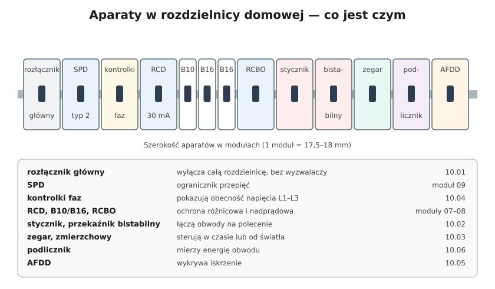

# 10.01 — Rozłącznik izolacyjny — wyłącznik główny

> **Moduł:** [10 — Aparatura modułowa](README.md) · **Oznaczenia:** 🏠 · **Zakres SEP:** (a) (c) · **Status:** ✅ pełny
>
> **Czytaj:**
>
> - PN-HD 60364-4-46 i PN-HD 60364-5-53 — odłączanie izolacyjne i łączenie
> - PN-EN 60947-3 (rozłączniki przemysłowe), PN-EN 60669-2-4 (rozłączniki izolacyjne domowe)
> - Pięć zasad bezpiecznej pracy: [00.01](../00-bezpieczenstwo-najpierw/00.01-piec-zasad-bezpiecznej-pracy-przy-urzadzeniach.md)

← (początek modułu) · [spis modułu](README.md) · [następny temat →](10.02-stycznik-modulowy-i-przekaznik-bistabilny.md)

## Po co to jest

Pierwszy aparat w rozdzielnicy zwykle nie chroni przed niczym — po prostu pozwala wyłączyć całą instalację jednym ruchem. Do tego musi wyłączać pewnie, z widoczną przerwą, i dać się zablokować. Trzeba odróżniać odłącznik, rozłącznik i wyłącznik, bo każdy umie co innego. Na egzaminie: różnica między tymi aparatami i do czego służy rozłącznik izolacyjny.

## Po ludzku

**Trzy aparaty, trzy umiejętności:**

| Aparat | Przerywa prąd obciążenia? | Wyłącza sam przy zwarciu? | Zapewnia przerwę izolacyjną? |
|--------|---------------------------|---------------------------|------------------------------|
| **Odłącznik** | nie — tylko bez obciążenia | nie | tak |
| **Rozłącznik** | tak — prąd roboczy | nie | rozłącznik izolacyjny — tak |
| **Wyłącznik** | tak — także zwarciowy | tak (ma wyzwalacze) | zależnie od typu |

**Rozłącznik izolacyjny** to „główny włącznik” rozdzielnicy. Łączy i przerywa prąd roboczy całej instalacji, a w położeniu „wyłączony” zapewnia przerwę między stykami, przez którą napięcie nie przeskoczy. Nie ma wyzwalaczy, więc sam się nie wyłączy — od tego są zabezpieczenia przed nim i za nim.

**Po co, skoro przed rozdzielnicą jest zabezpieczenie przedlicznikowe?** Bo wkładki przedlicznikowe często są w zaplombowanej tablicy na klatce, a mieszkaniec lub elektryk musi móc wyłączyć swoją instalację u siebie. Dźwignia rozłącznika w położeniu „0” jest jasnym sygnałem: wszystko za mną jest odłączone.

**Ile biegunów?**

- w układzie TN-C-S z podziałem PEN przed rozdzielnicą — zwykle **3P** (trzy fazy) albo **4P** (z N);
- w układzie **TT** odłącza się też **N**, więc **4P** (lub 2P w instalacji jednofazowej);
- **PEN nigdy nie przechodzi przez łącznik** — nie wolno go przerywać.

**Blokada.** Wiele rozłączników ma możliwość założenia kłódki w położeniu „0”. To realizuje drugą z pięciu zasad: zabezpieczenie przed ponownym załączeniem ([00.01](../00-bezpieczenstwo-najpierw/00.01-piec-zasad-bezpiecznej-pracy-przy-urzadzeniach.md)).

## Schemat

## Pojęcia

| Pojęcie | Po ludzku | Termin normowy / symbol |
|---------|-----------|-------------------------|
| Odłącznik | Daje przerwę izolacyjną, ale nie wolno nim przerywać prądu | odłącznik |
| Rozłącznik | Łączy i przerywa prąd roboczy | rozłącznik |
| Rozłącznik izolacyjny | Rozłącznik z przerwą izolacyjną | PN-EN 60947-3 |
| Wyłącznik | Łączy, przerywa i sam wyłącza zwarcia | wyłącznik |
| Przerwa izolacyjna | Odstęp styków, który wytrzymuje napięcie | odłączanie izolacyjne |
| Rozłącznik bezpiecznikowy | Rozłącznik z wkładkami topikowymi | — |

## Liczby do zapamiętania

| Wielkość | Wartość | Kiedy obowiązuje | Źródło |
|----------|---------|------------------|--------|
| Typowy rozłącznik główny mieszkania | **40–63 A**, 3P lub 4P (1P+N w instalacji 1-fazowej) | — | katalogi producentów |
| Bieguny w układzie TT | odłącza się **L i N** | — | PN-HD 60364-4-46 |
| PEN | **nigdy** przez łącznik | — | PN-HD 60364-5-54 |
| Szerokość modułu | **17,5–18 mm** | aparaty na szynę TH35 | PN-EN 60715 |

## W praktyce

- **Przed pracą w rozdzielnicy** wyłącz rozłącznik, zablokuj go (kłódka, tabliczka „Nie załączać”), sprawdź brak napięcia na zaciskach za nim. Pamiętaj, że zaciski wejściowe rozłącznika i wszystko przed nim są nadal pod napięciem.
- **Prąd znamionowy rozłącznika** nie mniejszy niż zabezpieczenie przed nim. Rozłącznik 40 A za wkładką 63 A może się przegrzać przy przeciążeniu, którego wkładka jeszcze nie wyłączy.
- **Wytrzymałość zwarciowa** rozłącznika jest podawana razem z zabezpieczeniem, które go chroni. Sprawdź w karcie katalogowej.
- **Opisz** rozłącznik na rozdzielnicy: „Wyłącznik główny mieszkania”.

## Błędy i zagrożenia

- ⚠️ **„Wyłączyłem główny, więc w rozdzielnicy nie ma napięcia”** — zaciski wejściowe rozłącznika, przewody zasilające i często SPD przed nim są pod napięciem.
- ⚠️ **Rozłącznik przerywający PEN** — przy rozłączonym PEN obudowy mogą dostać napięcie.
- **Odłącznik użyty jak rozłącznik** (otwierany pod obciążeniem) — łuk na stykach.
- **Wyłącznik nadprądowy jako „główny”** o prądzie zbliżonym do wyłączników obwodów — brak selektywności ([07.07](../07-zabezpieczenia-nadpradowe/07.07-selektywnosc-zabezpieczen.md)).

## Przykład

**Sytuacja.** Elektryk ma wymienić wyłącznik nadprądowy w rozdzielnicy mieszkania. Wyłącza rozłącznik główny, ale nie sprawdza braku napięcia, bo „przecież wszystko zgasło”.

**Co mogło pójść źle?** Rozłącznik mógł być podłączony odwrotnie (zasilanie na dolnych zaciskach), mógł mieć sklejony styk w jednym biegunie albo w rozdzielnicy mógł być obwód zasilany sprzed rozłącznika (np. dzwonek, SPD, osobny podlicznik). Bez sprawdzenia braku napięcia każda z tych sytuacji kończy się dotknięciem części pod napięciem.

**Wniosek.** Wyłączenie rozłącznika to dopiero pierwszy krok. Kolejne: zabezpieczenie przed załączeniem i sprawdzenie braku napięcia na każdym przewodzie, którego się dotyka.

## Pytania SEP

1. **Czym różni się odłącznik, rozłącznik i wyłącznik?**

Odpowiedź

Odłącznik zapewnia widoczną lub wskazaną przerwę izolacyjną, ale nie jest przeznaczony do przerywania prądu obciążenia — łączy się nim w stanie bezprądowym. Rozłącznik łączy i przerywa prądy robocze (obciążenia), a rozłącznik izolacyjny dodatkowo zapewnia przerwę izolacyjną. Wyłącznik łączy i przerywa prądy robocze oraz zwarciowe i ma wyzwalacze, które samoczynnie otwierają go przy przeciążeniu lub zwarciu.

2. **Do czego służy rozłącznik izolacyjny w rozdzielnicy mieszkaniowej?**

Odpowiedź

Do załączania i wyłączania zasilania całej instalacji pod obciążeniem oraz do odłączenia izolacyjnego na czas prac, z możliwością zabezpieczenia przed ponownym załączeniem. Nie ma wyzwalaczy, więc nie pełni funkcji zabezpieczenia — ochronę zapewniają zabezpieczenia przed nim i za nim.

## Sprawdź się

1. Czy rozłącznikiem w układzie TT wystarczy odłączyć same fazy?

Odpowiedź

Nie. W układzie TT przewód N może mieć napięcie względem ziemi i lokalnego uziomu, więc odłącza się go razem z fazami.

## Źródła

- PN-HD 60364-4-46 i PN-HD 60364-5-53 — odłączanie izolacyjne i łączenie.
- PN-EN 60947-3 — rozłączniki, odłączniki, rozłączniki izolacyjne.
- PN-HD 60364-5-54 — przewód PEN, zakaz przerywania.

---

← (początek modułu) · [spis modułu](README.md) · [następny temat →](10.02-stycznik-modulowy-i-przekaznik-bistabilny.md)
