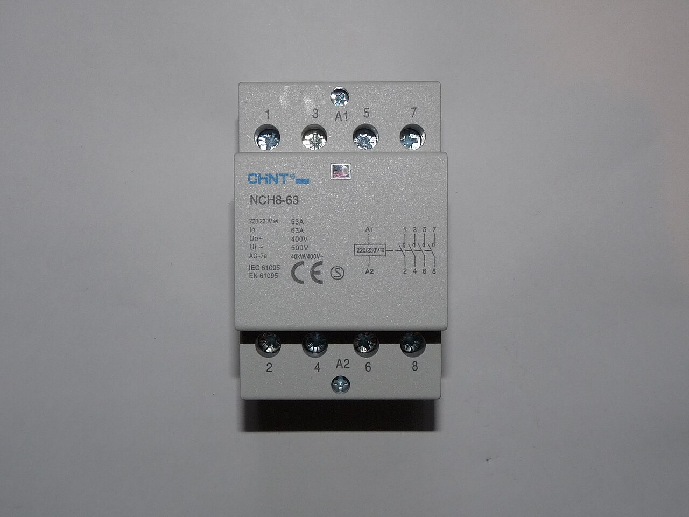
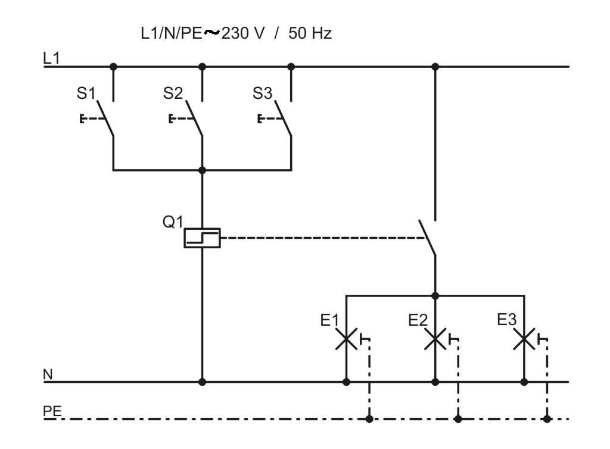
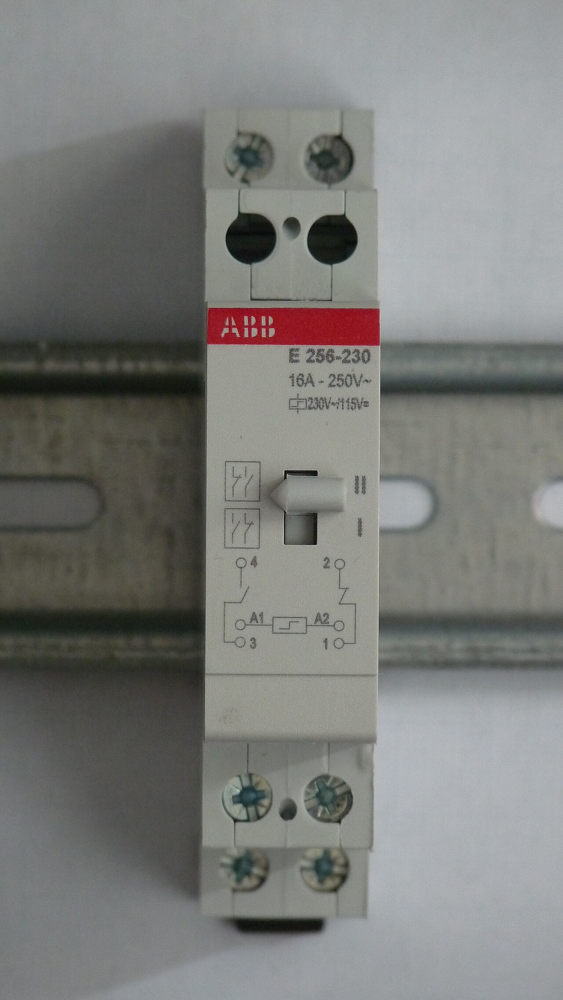
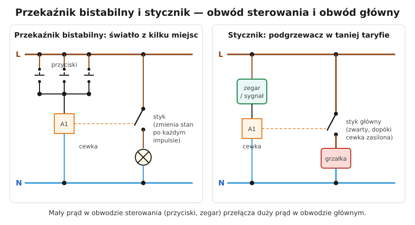

# 10.02 — Stycznik modułowy i przekaźnik bistabilny

> **Moduł:** [10 — Aparatura modułowa](README.md) · **Oznaczenia:** 🏠 · **Zakres SEP:** (a) (c) · **Status:** ✅ pełny
>
> **Czytaj:**
>
> - PN-EN 61095 — styczniki elektromechaniczne do użytku domowego
> - PN-EN 60669-2-2 — łączniki zdalnie sterowane (przekaźniki bistabilne)
> - Jak działa stycznik: [03.03](../03-elektromagnetyzm-w-praktyce/03.03-elektromagnes-w-pracy-przekaznik-i-stycznik.md)

[← poprzedni temat](10.01-rozlacznik-izolacyjny-wylacznik-glowny.md) · [spis modułu](README.md) · [następny temat →](10.03-programatory-czasowe-i-wylaczniki-zmierzchowe.md)

## Po co to jest

Stycznik i przekaźnik bistabilny pozwalają przełączać duże prądy lub wiele punktów małym sygnałem: zegarem, przyciskiem, czujnikiem, sterownikiem. W domu sterują podgrzewaczem w taniej taryfie, ogrzewaniem, oświetleniem z wielu miejsc. Trzeba umieć je podłączyć i rozróżnić obwód sterowania od obwodu głównego.

## Po ludzku

**Stycznik modułowy** ([03.03](../03-elektromagnetyzm-w-praktyce/03.03-elektromagnes-w-pracy-przekaznik-i-stycznik.md)) to elektromagnes ze stykami. Gdy na cewkę (zaciski **A1–A2**) podasz napięcie, styki główne się zamykają. Gdy napięcie zniknie, sprężyna je otwiera. Stycznik jest załączony **tylko tak długo, jak długo cewka ma zasilanie**.

Zastosowania w domu:

- **podgrzewacz wody lub ogrzewanie w taryfie nocnej** — cewkę steruje zegar albo sygnał z licznika;
- **duże grupy oświetlenia** sterowane czujnikiem lub zegarem o słabszych stykach;
- **„wyłącznik wszystkiego”** przy drzwiach — odcina gniazda z żelazkiem i grzałkami po wyjściu z domu;
- **pompa, wentylator** sterowane przez termostat.

Styczniki modułowe mają zwykle 20, 25, 40 lub 63 A i 1–4 styki. Wersje „ciche” (bezszumowe) nie buczą — to ważne w rozdzielnicy w przedpokoju.

**Przekaźnik bistabilny** (impulsowy) zmienia stan po każdym **impulsie** na cewce: raz włącza, raz wyłącza, i **pamięta** położenie bez zasilania cewki. Steruje się nim **przyciskami chwilowymi** (jak dzwonkowe), połączonymi równolegle. Dzięki temu jedno światło można włączać z dowolnej liczby miejsc zwykłym przewodem 3-żyłowym do przycisków — zamiast łańcucha łączników schodowych i krzyżowych ([06.02](../06-osprzet-instalacyjny/06.02-laczniki-jednobiegunowy-dwubiegunowy.md)).

**Kategorie użytkowania** na tabliczce mówią, do jakiego obciążenia styk się nadaje:

- **AC-1 / AC-7a** — obciążenia rezystancyjne (grzałki),
- **AC-7b, AC-3** — silniki,
- oświetlenie LED ma duże prądy załączania — producenci podają osobno, ile zasilaczy LED wolno załączać.

## Jak to wygląda

*Na co patrzeć: styki główne mają pary zacisków 1–2, 3–4, 5–6, 7–8, a cewka — A1 i A2. Na froncie jest schemat styków i napięcie cewki. Ten stycznik zajmuje 3 moduły i przełącza do 63 A.*

*Na co patrzeć: przyciski S1–S3 są połączone równolegle i podają fazę na cewkę Q1 tylko na czas naciśnięcia. Styk Q1 (przerywana linia) zapala lub gasi lampy E1–E3. Każdy przycisk działa tak samo — można ich dodać dowolnie dużo.*

*Na co patrzeć: przekaźnik bistabilny zajmuje jeden moduł. Na froncie jest schemat: cewka A1–A2 z symbolem przekaźnika impulsowego i dwa styki (1–2 i 3–4). Dźwignią można przełączyć styki ręcznie — przydatne przy uruchamianiu i szukaniu usterek.*

## Schemat

## Pojęcia

| Pojęcie | Po ludzku | Termin normowy / symbol |
|---------|-----------|-------------------------|
| Cewka | Elektromagnes, który przyciąga styki | A1–A2 |
| Styk zwierny | Zamyka się po zasileniu cewki | NO |
| Styk rozwierny | Otwiera się po zasileniu cewki | NC |
| Obwód sterowania | Mały prąd: przyciski, zegar, termostat | — |
| Obwód główny | Duży prąd: odbiornik | — |
| Kategoria użytkowania | Do jakiego obciążenia nadaje się styk | AC-1, AC-3, AC-7a, AC-7b |
| Przekaźnik bistabilny | Zmienia stan po każdym impulsie i pamięta go | łącznik zdalnie sterowany |

## Liczby do zapamiętania

| Wielkość | Wartość | Kiedy obowiązuje | Źródło |
|----------|---------|------------------|--------|
| Typowe styczniki modułowe | **20 / 25 / 40 / 63 A**, 1–4 styki | — | katalogi producentów |
| Napięcie cewki | zwykle **230 V AC** (bywa 24 V AC/DC) | — | jw. |
| Typowy przekaźnik bistabilny | **16 A**, 1 moduł | — | jw. |
| Kategorie AC-7a / AC-7b | rezystancyjne / silnikowe obciążenia domowe | — | PN-EN 61095 |

## W praktyce

- **Zabezpiecz obwód sterowania** osobnym małym wyłącznikiem (np. B6) albo z obwodu głównego, zgodnie z instrukcją. Opisz, skąd zasilana jest cewka — w razie prac trzeba odłączyć oba obwody.
- **Przyciski z podświetleniem** (lampką neonową lub LED) przy przekaźniku bistabilnym przepuszczają mały prąd przez cewkę. Mogą powodować samoczynne przełączanie lub buczenie. Stosuj przyciski bez podświetlenia albo podświetlenie z osobnym zaciskiem N.
- **Grzałka 3 kW przez stycznik** — styk w kategorii AC-7a/AC-1 o prądzie co najmniej 16 A, przewody i zabezpieczenie dobrane do obwodu głównego ([07.06](../07-zabezpieczenia-nadpradowe/07.06-koordynacja-zabezpieczenia-z-przewodem.md)).
- **Styczniki obok siebie** w rozdzielnicy grzeją się — producenci zalecają przekładki dystansowe przy pracy ciągłej z pełnym prądem.

## Błędy i zagrożenia

- ⚠️ **Wyłączenie „stycznikiem” obwodu przed pracą** — stycznik nie zapewnia przerwy izolacyjnej, a sterowanie może go załączyć. Odłącza się zabezpieczeniem lub rozłącznikiem.
- **Stycznik bez zabezpieczenia obwodu sterowania** — zwarcie w przewodach do przycisków nie ma kto wyłączyć.
- **Za słaby styk dla LED** — sklejenie styków przy prądzie załączania.
- **Pomylenie A1–A2 ze stykami** — zasilenie cewki przez odbiornik, który nie zadziała.

## Przykład

**Zadanie.** Podgrzewacz wody 2 kW ma się włączać tylko w taryfie nocnej. Masz zegar sterujący ze stykiem 16 A i stycznik 25 A. Jak to połączyć?

**Rozwiązanie.**

1. Obwód główny: wyłącznik B16 → styk stycznika (1–2) → podgrzewacz → N. Prąd $2000/230 \approx 8{,}7$ A — styk 25 A ma duży zapas.
2. Obwód sterowania: faza (np. z tego samego B16) → styk zegara → A1 cewki → A2 → N.
3. Zegar ustawiony na godziny taryfy nocnej. Stycznik przejmuje prąd grzałki, a styk zegara przełącza tylko cewkę.

**Dlaczego nie bezpośrednio przez zegar?** Styk zegara 16 A by wystarczył, ale przy codziennym łączeniu grzałki zużywa się szybciej, a jego wymiana jest droższa. Stycznik jest tańszy i łatwiej wymienialny. Przy większych mocach (np. 3 × 3 kW) zegar w ogóle nie dałby rady.

## Pytania SEP

1. **Jak działa stycznik i do czego się go stosuje?**

Odpowiedź

Stycznik to łącznik elektromagnetyczny: po podaniu napięcia na cewkę elektromagnes przyciąga zworę, która zamyka styki główne (zwierne) i ewentualnie otwiera rozwierne. Po zaniku napięcia cewki sprężyna otwiera styki. Służy do częstego załączania i wyłączania obwodów odbiorczych pod obciążeniem, sterowanego zdalnie lub automatycznie (zegar, termostat, przyciski), np. silników, grzałek, oświetlenia.

2. **Czym różni się przekaźnik bistabilny od stycznika?**

Odpowiedź

Przekaźnik bistabilny zmienia stan styków po każdym impulsie podanym na cewkę i utrzymuje go bez zasilania cewki. Steruje się nim przyciskami chwilowymi. Stycznik utrzymuje styki zamknięte tylko tak długo, jak długo cewka jest zasilana, i wymaga ciągłego sygnału (np. styku zegara, termostatu).

## Sprawdź się

1. Światło w długim korytarzu ma być włączane z pięciu miejsc. Jak to zrobić najprościej?

Odpowiedź

Przekaźnikiem bistabilnym w rozdzielnicy i pięcioma przyciskami połączonymi równolegle. Alternatywa — dwa łączniki schodowe i trzy krzyżowe — wymaga więcej przewodów i łączników.

## Źródła

- PN-EN 61095 — styczniki elektromechaniczne do użytku domowego i podobnego (kategorie AC-7a, AC-7b).
- PN-EN 60669-2-2 — łączniki elektromagnetyczne zdalnie sterowane.
- Katalogi styczników modułowych i przekaźników bistabilnych (prądy, liczba zasilaczy LED).

---

[← poprzedni temat](10.01-rozlacznik-izolacyjny-wylacznik-glowny.md) · [spis modułu](README.md) · [następny temat →](10.03-programatory-czasowe-i-wylaczniki-zmierzchowe.md)
