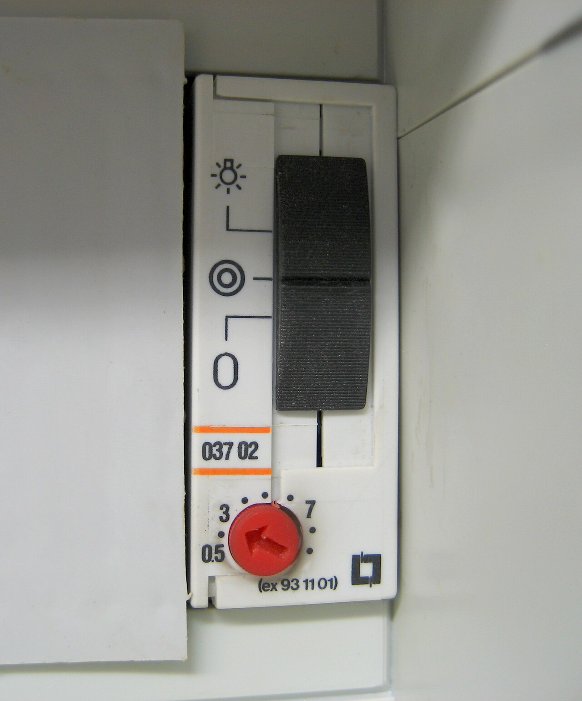
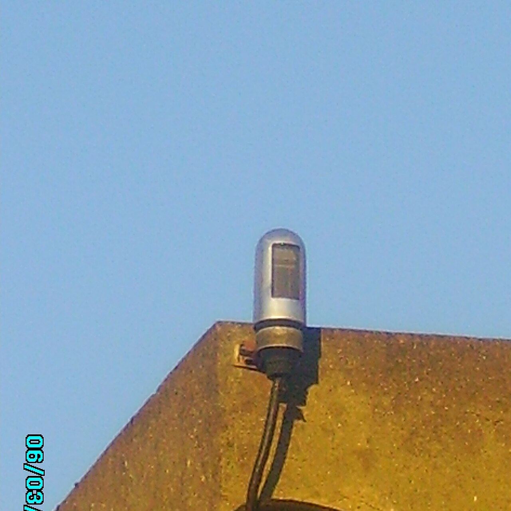

# 10.03 — Programatory czasowe i wyłączniki zmierzchowe

> **Moduł:** [10 — Aparatura modułowa](README.md) · **Oznaczenia:** 🏠 · **Zakres SEP:** (a) (c) · **Status:** ✅ pełny
>
> **Czytaj:**
>
> - Katalogi producentów: zegary sterujące, wyłączniki zmierzchowe, automaty schodowe
> - Oświetlenie i źródła LED: [moduł 18](../18-oswietlenie/README.md)

[← poprzedni temat](10.02-stycznik-modulowy-i-przekaznik-bistabilny.md) · [spis modułu](README.md) · [następny temat →](10.04-kontrolki-faz-przekazniki-zaniku-fazy-i.md)

## Po co to jest

Oświetlenie klatki schodowej, które gaśnie samo po dwóch minutach, lampy ogrodowe zapalane o zmierzchu, pompa cyrkulacyjna działająca rano i wieczorem — to robią aparaty sterujące w czasie lub od światła. Są proste, ale źle ustawione lub źle podłączone potrafią świecić całą noc albo wcale.

## Po ludzku

**Zegar sterujący (programator)** włącza i wyłącza styk o ustawionych godzinach.

- **mechaniczny (tarczowy)** — wciska się segmenty na tarczy (np. co 15 minut); prosty, odporny, mniej dokładny;
- **cyfrowy tygodniowy** — program na każdy dzień, ma rezerwę zasilania (bateria lub kondensator), żeby przy zaniku napięcia nie stracić czasu;
- **astronomiczny** — sam liczy godziny wschodu i zachodu słońca dla podanej lokalizacji. Zastępuje czujnik zmierzchowy bez czujnika na zewnątrz.

**Wyłącznik zmierzchowy** mierzy natężenie światła czujnikiem umieszczonym na zewnątrz i włącza obwód, gdy zrobi się ciemniej niż ustawiony próg (w luksach). Ma **opóźnienie** (kilkadziesiąt sekund), żeby nie reagował na reflektory przejeżdżającego samochodu albo na chmurę. Czujnik nie może „widzieć” lampy, którą steruje — inaczej lampa sama się wyłączy po zapaleniu.

**Automat schodowy** (wyłącznik czasowy) po naciśnięciu dowolnego przycisku włącza światło na ustawiony czas, np. 1–5 minut, i sam wyłącza. Lepsze modele ostrzegają przed wyłączeniem (mrugnięcie) i pozwalają przedłużyć czas kolejnym naciśnięciem.

**Duże obciążenia** — przez stycznik. Zegar lub zmierzchowy ma styk np. 16 A rezystancyjnie, ale dużo mniej dla LED ([10.02](10.02-stycznik-modulowy-i-przekaznik-bistabilny.md)).

## Jak to wygląda

*Na co patrzeć: przełącznik u góry wybiera tryb — stałe świecenie (np. przy sprzątaniu klatki), praca automatyczna albo wyłączenie. Czerwone pokrętło ustawia czas świecenia w minutach.*

*Na co patrzeć: czujnik jest na zewnątrz, skierowany w niebo, z dala od lamp, którymi steruje. Montuje się go tak, żeby nie zasłaniały go liście ani nie oświetlały go latarnie i reflektory samochodów.*

## Pojęcia

| Pojęcie | Po ludzku | Termin normowy / symbol |
|---------|-----------|-------------------------|
| Zegar sterujący | Włącza o zadanych godzinach | programator czasowy |
| Zegar astronomiczny | Sam liczy wschód i zachód słońca | — |
| Rezerwa chodu | Ile zegar pamięta czas bez zasilania | — |
| Wyłącznik zmierzchowy | Włącza, gdy zrobi się ciemno | próg w luksach [lx] |
| Automat schodowy | Włącza na ustawiony czas po naciśnięciu przycisku | wyłącznik czasowy |

## Liczby do zapamiętania

| Wielkość | Wartość | Kiedy obowiązuje | Źródło |
|----------|---------|------------------|--------|
| Próg zmierzchowy | regulowany, typowo **od kilku do ok. 100 lx** | — | katalogi producentów |
| Opóźnienie zmierzchowego | **kilkadziesiąt sekund** | eliminuje błyski | jw. |
| Czas automatu schodowego | typowo **0,5–10 min** | — | jw. |
| Styk zegara / zmierzchowego | typowo **16 A** rezystancyjnie, mniej dla LED | — | jw. |

## W praktyce

- **Automat schodowy — przyciski bez podświetlenia** albo podświetlane z zaciskiem N; inaczej światło może się nie wyłączać.
- **Sprawdź schemat podłączenia** automatu: istnieją wersje 3- i 4-przewodowe (przyciski zasilane fazą albo osobny obwód przycisków).
- **Zegar cyfrowy po zaniku napięcia** — sprawdź, czy rezerwa chodu wystarczyła i czy zegar sam przestawia czas letni.
- **Zmierzchowy reaguje źle?** Najczęściej czujnik widzi lampę albo jest zabrudzony. Przesuń czujnik lub zmień próg.

## Błędy i zagrożenia

- **Czujnik zmierzchowy oświetlony sterowaną lampą** — lampa miga (włącza się, rozjaśnia czujnik, wyłącza).
- **Grupa LED bezpośrednio na styku zegara** — sklejony styk, światło świeci bez przerwy.
- **Przycisk podświetlany przy automacie schodowym** — światło nie gaśnie.
- ⚠️ **Praca przy oprawie „bo jest wyłączona automatem”** — automat może ją załączyć w każdej chwili. Odłącza się zabezpieczeniem i sprawdza brak napięcia.

## Przykład

**Zadanie.** Oświetlenie ogrodu: 12 opraw LED po 10 W. Ma się zapalać o zmierzchu i gasnąć o 23:00. Jak to zrobić?

**Rozwiązanie.** Wyłącznik zmierzchowy (zapala) i zegar (wyłącza) połączone szeregowo w obwodzie cewki stycznika albo jeden zegar astronomiczny z programem „zachód słońca – 23:00”. Moc 120 W to mało, ale 12 zasilaczy LED ma duży prąd załączania, więc sprawdź, czy styk zegara jest do tego przeznaczony, albo daj stycznik z oznaczeniem do LED.

## Pytania SEP

1. **Do czego służą wyłącznik zmierzchowy i automat schodowy i jak się je podłącza?**

Odpowiedź

Wyłącznik zmierzchowy załącza obwód (zwykle oświetlenia zewnętrznego), gdy natężenie światła spadnie poniżej ustawionego progu, i wyłącza, gdy się rozjaśni; jego czujnik umieszcza się na zewnątrz, tak by nie był oświetlany przez sterowane lampy. Automat schodowy po naciśnięciu przycisku załącza oświetlenie na nastawiony czas. Oba aparaty zasila się z obwodu przez zabezpieczenie, ich styk włącza się w przewód fazowy obwodu oświetlenia, a przy dużych obciążeniach steruje się nimi cewką stycznika.

## Sprawdź się

1. Czym różni się zegar astronomiczny od zwykłego zegara tygodniowego?

Odpowiedź

Zegar astronomiczny sam oblicza godziny wschodu i zachodu słońca dla zadanej lokalizacji i daty, więc może zastąpić czujnik zmierzchowy. Zegar tygodniowy działa tylko według stałych godzin.

## Źródła

- Katalogi i instrukcje producentów zegarów sterujących, wyłączników zmierzchowych i automatów schodowych (progi, czasy, schematy podłączenia).
- PN-EN 60669-2-3 — łączniki ze zwłoką czasową (automaty schodowe).

---

[← poprzedni temat](10.02-stycznik-modulowy-i-przekaznik-bistabilny.md) · [spis modułu](README.md) · [następny temat →](10.04-kontrolki-faz-przekazniki-zaniku-fazy-i.md)
