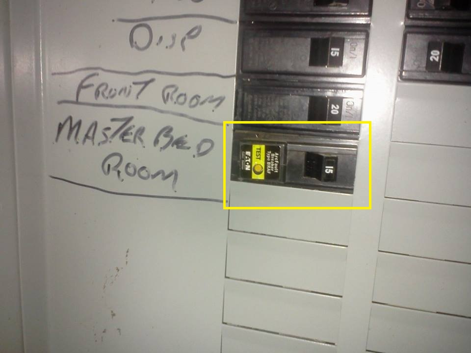
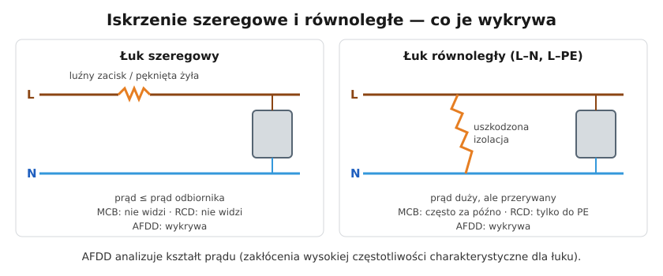

# 10.05 — Detektory iskrzenia AFDD

> **Moduł:** [10 — Aparatura modułowa](README.md) · **Oznaczenia:** 🏠 · **Zakres SEP:** (a) (c) · **Status:** ✅ pełny
>
> **Czytaj:**
>
> - PN-EN 62606 — urządzenia do detekcji zwarć łukowych (AFDD)
> - PN-HD 60364-4-42 — ochrona przed skutkami oddziaływania cieplnego
> - [S. Czapp — Wymagania stawiane urządzeniom do detekcji zwarć łukowych (PG)](https://pub.pg.edu.pl/en/download/149426-wymagania-stawiane-urzadzeniom-do-detekcji-zwarc-lukowych-w-instalacjach-niskiego-napiecia)

[← poprzedni temat](10.04-kontrolki-faz-przekazniki-zaniku-fazy-i.md) · [spis modułu](README.md) · [następny temat →](10.06-podliczniki-energii.md)

## Po co to jest

Wiele pożarów instalacji zaczyna się od iskrzenia: luźny zacisk, pęknięta żyła w przedłużaczu przygniecionym meblem, gwóźdź wbity w przewód. Prąd w obwodzie jest przy tym normalny, więc wyłącznik nadprądowy nie reaguje, a jeśli łuk nie ucieka do PE — różnicówka też. Detektor iskrzenia (AFDD) jest zbudowany właśnie do tego.

## Po ludzku

**Dwa rodzaje łuku:**

- **Łuk szeregowy** — w przewodzie, którym płynie prąd odbiornika: na luźnym zacisku, pękniętej żyle, przetartym przewodzie. Prąd łuku = prąd odbiornika, czasem mniejszy. **Wyłącznik nadprądowy go nie widzi, różnicówka też nie** (nie ma prądu różnicowego).
- **Łuk równoległy** — między L a N albo L a PE przez uszkodzoną izolację. Prąd jest duży, ale przerywany, więc wyłącznik nadprądowy reaguje często za późno. Różnicówka widzi tylko łuk do PE.

**Jak działa AFDD?** Elektronika analizuje kształt prądu w obwodzie. Łuk powoduje charakterystyczne zakłócenia wysokiej częstotliwości i nieregularności przebiegu. Detektor odróżnia je od „normalnych” iskier — szczotek odkurzacza, łącznika, zasilacza impulsowego — i wyłącza obwód.

**W jakiej postaci?** Zwykle jako aparat zespolony **AFDD + wyłącznik nadprądowy** (często 2 moduły) albo **AFDD + RCBO**. Sam AFDD musi mieć zabezpieczenie nadprądowe. Ma przycisk testu i często diody pokazujące przyczynę wyłączenia.

**Czy jest obowiązkowy?** W Polsce nie. Norma PN-HD 60364-4-42 **zaleca** go w miejscach, gdzie pożar jest szczególnie groźny:

- w sypialniach i pomieszczeniach do spania,
- w pomieszczeniach z materiałami łatwopalnymi (stodoły, warsztaty stolarskie, magazyny),
- w budynkach z materiałów palnych (drewniane, szkieletowe),
- tam, gdzie ogień rozprzestrzenia się szybko, i tam, gdzie są przedmioty niezastąpione.

W niektórych krajach (USA, Niemcy) AFDD są obowiązkowe dla wybranych obwodów.

## Jak to wygląda

*Na co patrzeć: to amerykański odpowiednik AFDD (AFCI) w obwodzie sypialni — tam jest obowiązkowy od lat. Wygląda jak zwykły wyłącznik, ale ma przycisk testu. Europejskie AFDD mają postać aparatów modułowych na szynę TH35.*

## Schemat

## Pojęcia

| Pojęcie | Po ludzku | Termin normowy / symbol |
|---------|-----------|-------------------------|
| Detektor iskrzenia | Aparat wykrywający łuk w obwodzie | AFDD (PN-EN 62606) |
| Łuk szeregowy | Łuk w przewodzie prądu odbiornika | — |
| Łuk równoległy | Łuk między przewodami lub do PE | — |
| AFCI | Amerykańska nazwa podobnego aparatu | — |

## Liczby do zapamiętania

| Wielkość | Wartość | Kiedy obowiązuje | Źródło |
|----------|---------|------------------|--------|
| Wyłączenie łuku 2,5 A | w ciągu **1 s** | łuki o małym prądzie | PN-EN 62606 (za opracowaniem PG) |
| Wyłączenie łuku 63 A | w ciągu **0,12 s** | jw. | jw. |
| Prądy znamionowe AFDD | **6–63 A** | — | jw. |
| Status w Polsce | **zalecany**, nie obowiązkowy | sypialnie, materiały palne, budynki drewniane | PN-HD 60364-4-42 |

## W praktyce

- **Dom drewniany lub szkieletowy, poddasze z sypialniami, warsztat** — dobry kandydat na AFDD w obwodach gniazd i oświetlenia.
- **AFDD nie naprawia złych połączeń.** Zadziałanie AFDD to sygnał, że gdzieś iskrzy. Szukaj luźnych zacisków, uszkodzonych przedłużaczy, przegrzanych gniazd.
- **Zbędne zadziałania** zdarzają się przy niektórych odkurzaczach, elektronarzędziach lub zasilaczach. Diody na aparacie podpowiadają, czy przyczyną był łuk szeregowy, równoległy czy przepięcie.
- **Przycisk testu** — zgodnie z instrukcją producenta, podobnie jak w RCD.

## Błędy i zagrożenia

- ⚠️ **„Mam AFDD, nie muszę dokręcać zacisków”** — AFDD wykrywa skutek, nie usuwa przyczyny.
- **AFDD bez zabezpieczenia nadprądowego** (jeśli kupiony jako osobny moduł).
- **Ignorowanie wielokrotnych zadziałań** i wymiana na zwykły wyłącznik.

## Przykład

**Sytuacja.** W sypialni z gniazdem za łóżkiem AFDD wyłącza obwód raz na kilka dni, zawsze wieczorem. Odbiorniki: lampka nocna i ładowarka telefonu, razem kilkanaście watów.

**Diagnoza.** Przy tak małym prądzie przeciążenie nie wchodzi w grę. Wskaźnik na AFDD pokazuje łuk szeregowy. Przy oględzinach okazuje się, że przedłużacz za łóżkiem jest przygnieciony nogą łóżka i jedna żyła jest w środku prawie przerwana. Wieczorem, przy przesuwaniu łóżka, żyła iskrzy.

**Wniosek.** Bez AFDD przedłużacz iskrzyłby dalej, nagrzewając izolację tuż przy materacu. Przedłużacz do wymiany.

## Pytania SEP

1. **Do czego służą urządzenia do detekcji zwarć łukowych (AFDD)?**

Odpowiedź

Do wykrywania iskrzenia (łuku elektrycznego) w obwodzie — szeregowego, występującego np. na luźnych połączeniach i uszkodzonych żyłach, oraz równoległego, między przewodami — i wyłączania obwodu, zanim łuk spowoduje pożar. Wykrywają łuki, na które nie reagują wyłączniki nadprądowe (prąd nie przekracza znamionowego) ani różnicowoprądowe (brak prądu różnicowego). Zaleca się je w miejscach o szczególnym zagrożeniu pożarowym (PN-HD 60364-4-42).

## Sprawdź się

1. Dlaczego łuk szeregowy nie jest wykrywany przez wyłącznik różnicowoprądowy?

Odpowiedź

Bo prąd łuku płynie w przewodzie fazowym i wraca przewodem neutralnym — suma prądów w przekładniku pozostaje równa zeru.

## Źródła

- PN-EN 62606 — wymagania ogólne dla urządzeń do detekcji zwarć łukowych.
- PN-HD 60364-4-42 — ochrona przed skutkami oddziaływania cieplnego (zalecenie stosowania AFDD).
- [S. Czapp — Wymagania stawiane urządzeniom do detekcji zwarć łukowych w instalacjach niskiego napięcia](https://pub.pg.edu.pl/en/download/149426-wymagania-stawiane-urzadzeniom-do-detekcji-zwarc-lukowych-w-instalacjach-niskiego-napiecia) — rodzaje łuków, czasy wyłączania, zalecane miejsca, status w Polsce.

---

[← poprzedni temat](10.04-kontrolki-faz-przekazniki-zaniku-fazy-i.md) · [spis modułu](README.md) · [następny temat →](10.06-podliczniki-energii.md)
