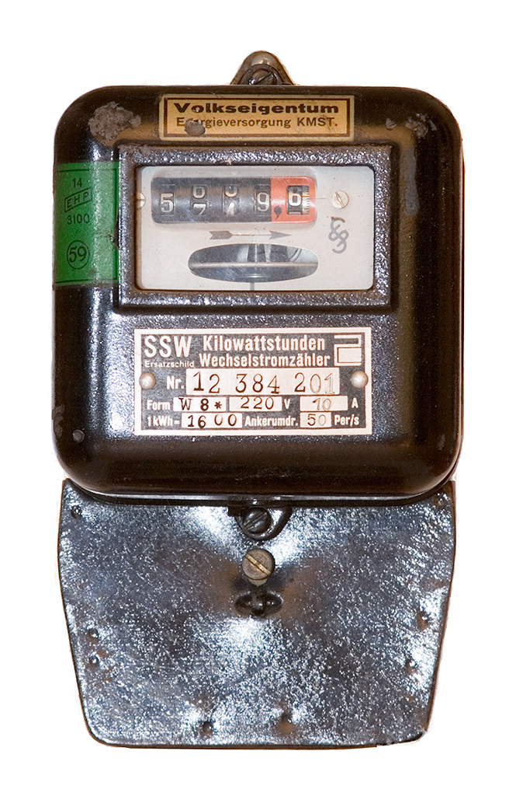
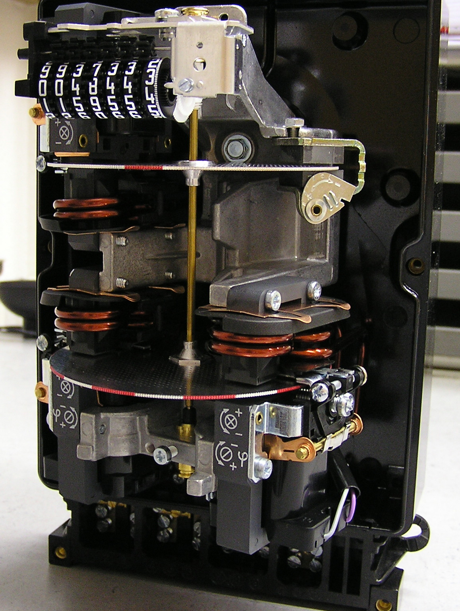

# 10.06 — Podliczniki energii

> **Moduł:** [10 — Aparatura modułowa](README.md) · **Oznaczenia:** 🏠 · **Zakres SEP:** (a) (c) · **Status:** ✅ pełny
>
> **Czytaj:**
>
> - PN-EN 50470-1 i -3 — liczniki energii czynnej, klasy A, B, C
> - Dyrektywa 2014/32/UE (MID) — przyrządy pomiarowe
> - Moc i energia: [01.04](../01-prad-napiecie-opor/01.04-moc-i-energia-waty-kilowatogodziny-i-rachunek.md)

[← poprzedni temat](10.05-detektory-iskrzenia-afdd.md) · [spis modułu](README.md) · (koniec modułu) →

## Po co to jest

Podlicznik mierzy energię zużytą przez wybrany obwód: pompę ciepła, ładowarkę samochodu, mieszkanie na wynajem, warsztat. Daje wiedzę, gdzie idą pieniądze, i podstawę do rozliczeń z najemcą. Trzeba umieć go wybrać (bezpośredni czy przez przekładniki, z certyfikatem czy bez) i podłączyć.

## Po ludzku

**Licznik główny** (przed rozdzielnicą) należy do operatora sieci i jest podstawą rachunku. **Podlicznik** montuje właściciel w swojej rozdzielnicy, za licznikiem głównym, na wybranym obwodzie.

**Na co patrzeć przy wyborze:**

- **jedno- czy trójfazowy** — trójfazowy mierzy każdą fazę i sumę;
- **pomiar bezpośredni** (prąd płynie przez licznik, zwykle do 63–100 A) czy **półpośredni** przez przekładniki prądowe (większe prądy);
- **klasa dokładności** — B (ok. 1 %) albo A (ok. 2 %);
- **certyfikat MID** — wymagany, gdy na podstawie wskazań rozlicza się z kimś pieniądze (najemca, wspólnota);
- **wyjście danych** — impulsowe **S0**, **Modbus**, **M-Bus**, Wi-Fi — do automatyki domu, zarządzania energią PV ([moduł 27](../27-inteligentny-dom/README.md));
- **dwukierunkowy** — przy fotowoltaice mierzy pobór i oddawanie osobno.

**Stare liczniki indukcyjne** (z wirującą tarczą) mają na tabliczce **stałą licznika**, np. 375 obr/kWh. Liczba obrotów tarczy w czasie pozwala obliczyć moc. Elektroniczne liczniki mają zamiast tego diodę migającą np. 1000 razy na kWh.

## Jak to wygląda

*Na co patrzeć: liczydło bębnowe pokazuje zużytą energię w kWh, a tabliczka — napięcie, prąd i stałą licznika (obroty tarczy na kWh). Takie liczniki wciąż spotyka się w starych domach, ale jako podliczniki stosuje się dziś modułowe liczniki elektroniczne.*

*Na co patrzeć: w środku są elektromagnesy prądowe i napięciowe, które napędzają aluminiowe tarcze. Prędkość obrotu jest proporcjonalna do mocy czynnej. Licznik elektroniczny robi to samo cyfrowo i jest dużo mniejszy.*

## Pojęcia

| Pojęcie | Po ludzku | Termin normowy / symbol |
|---------|-----------|-------------------------|
| Podlicznik | Licznik właściciela na wybranym obwodzie | — |
| Pomiar bezpośredni | Prąd obciążenia płynie przez licznik | — |
| Pomiar półpośredni | Licznik mierzy przez przekładniki prądowe | przekładnik prądowy |
| MID | Certyfikat dopuszczający licznik do rozliczeń | dyrektywa 2014/32/UE |
| Stała licznika | Ile obrotów tarczy / impulsów na 1 kWh | obr/kWh, imp/kWh |
| Wyjście S0 | Wyjście impulsowe do zliczania energii | — |

## Liczby do zapamiętania

| Wielkość | Wartość | Kiedy obowiązuje | Źródło |
|----------|---------|------------------|--------|
| Klasa B / A | błąd ok. **1 % / 2 %** | liczniki energii czynnej | PN-EN 50470-3 |
| Pomiar bezpośredni | zwykle do **63–100 A** | podliczniki modułowe | katalogi producentów |
| Moc z obrotów tarczy | $P = \dfrac{3600 \cdot n}{C \cdot t}$ [kW] | n — obroty, C — obr/kWh, t — s | — |
| Szerokość podlicznika | **1–2 moduły** (1-faz.), **3–4 moduły** (3-faz.) | — | katalogi |

## W praktyce

- **Podłączenie:** za zabezpieczeniem obwodu (albo przed nim, według instrukcji), zgodnie z oznaczeniem zacisków wejście/wyjście. Zamiana wejścia z wyjściem w liczniku dwukierunkowym daje ujemne lub zamienione wskazania.
- **Rozliczenia z najemcą** — tylko licznik z MID, z zapisem stanu przy przekazaniu lokalu.
- **Trójfazowy podlicznik** — sprawdź kolejność faz i czy każdy przekładnik (przy pomiarze półpośrednim) jest na „swojej” fazie.
- **Nie ingeruj w licznik główny** i jego plomby — to własność operatora ([00.03](../00-bezpieczenstwo-najpierw/00.03-co-wolno-zrobic-samemu-a-co-wymaga-uprawnien-i.md)).

## Błędy i zagrożenia

- **Podlicznik bez MID do rozliczeń pieniężnych** — wskazania można podważyć.
- **Zamienione wejście i wyjście** — błędny pomiar.
- **Przekraczanie prądu maksymalnego** licznika bezpośredniego — przegrzewanie zacisków.
- ⚠️ **Praca przy przekładnikach prądowych pod obciążeniem** — rozwarcie obwodu wtórnego przekładnika powoduje na nim niebezpieczne napięcie ([moduł 25](../25-transformatory-ups-agregaty/README.md)).

## Przykład

**Zadanie.** Tarcza starego licznika o stałej C = 375 obr/kWh wykonała 25 obrotów w ciągu 60 s. Jaka jest moc pobierana przez instalację?

$$P = \frac{3600 \cdot n}{C \cdot t} = \frac{3600 \cdot 25}{375 \cdot 60} = 4\ \mathrm{kW}$$

**Sprawdzenie sensu.** 25 obrotów to $25/375 \approx 0{,}067$ kWh w ciągu minuty, a w ciągu godziny 60 razy więcej, czyli 4 kWh — średnio 4 kW. Ta sama metoda działa z diodą licznika elektronicznego: liczysz mignięcia zamiast obrotów.

## Pytania SEP

1. **Jak na podstawie licznika energii wyznaczyć moc pobieraną przez odbiornik?**

Odpowiedź

Liczy się obroty tarczy (w liczniku indukcyjnym) lub impulsy diody (w liczniku elektronicznym) w zmierzonym czasie i korzysta ze stałej licznika C (obr/kWh lub imp/kWh): $P = 3600 \cdot n / (C \cdot t)$, gdzie P w kW, n — liczba obrotów lub impulsów, t — czas w sekundach. W czasie pomiaru powinien pracować tylko badany odbiornik.

2. **Czym jest licznik z certyfikatem MID i kiedy jest wymagany?**

Odpowiedź

To licznik, który przeszedł ocenę zgodności według dyrektywy o przyrządach pomiarowych (2014/32/UE). Jest wymagany, gdy na podstawie wskazań licznika rozlicza się należności między stronami, np. przy refakturowaniu energii najemcy.

## Sprawdź się

1. Licznik elektroniczny ma stałą 1000 imp/kWh. Dioda mignęła 20 razy w 30 s. Jaka jest moc?

Odpowiedź

$P = 3600 \cdot 20 / (1000 \cdot 30) = 2{,}4$ kW.

## Źródła

- PN-EN 50470-1 i PN-EN 50470-3 — liczniki energii elektrycznej czynnej, klasy dokładności.
- Dyrektywa 2014/32/UE (MID) — przyrządy pomiarowe.
- Katalogi podliczników modułowych (zakresy prądów, wyjścia S0 i Modbus).

---

[← poprzedni temat](10.05-detektory-iskrzenia-afdd.md) · [spis modułu](README.md) · (koniec modułu) →
