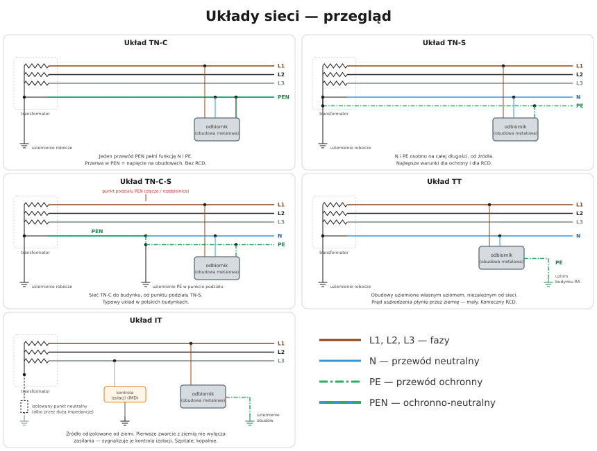

# 11.01 — Co oznaczają litery w nazwie układu sieci

> **Moduł:** [11 — Układy sieci: TN, TT, IT](README.md) · **Oznaczenia:** 🟢📋 · **Zakres SEP:** (a) (b) · **Status:** ✅ pełny
>
> **Czytaj:**
>
> - PN-HD 60364-1 — układy sieci (312.2)
> - Przewody L, N, PE, PEN: [02.02](../02-prad-przemienny-230-400/02.02-faza-przewod-neutralny-i-przewod-ochronny-l-n-pe.md)

← (początek modułu) · [spis modułu](README.md) · [następny temat →](11.02-uklad-tn-c.md)

## Po co to jest

Litery TN-C-S, TT czy IT mówią, jak źródło i obudowy urządzeń są połączone z ziemią. Od tego zależy, którędy popłynie prąd przy uszkodzeniu, jak duży będzie i co go wyłączy. Bez tej wiedzy nie da się dobrać ochrony przeciwporażeniowej ani bezpiecznie modernizować instalacji. Na egzaminie to jedno z pewnych pytań.

## Po ludzku

Nazwa układu ma dwie litery i czasem dopisek.

**Pierwsza litera — jak źródło (transformator) jest połączone z ziemią:**

- **T** (fr. *terre* — ziemia) — punkt neutralny transformatora jest **uziemiony** bezpośrednio;
- **I** (*isolé* — izolowany) — źródło jest **odizolowane** od ziemi albo uziemione przez dużą impedancję.

**Druga litera — jak obudowy urządzeń są połączone z ziemią:**

- **T** — obudowy mają **własne uziemienie**, niezależne od uziemienia źródła;
- **N** (*neutre*) — obudowy są połączone przewodem z **uziemionym punktem neutralnym źródła**.

**Dopisek po myślniku (tylko w układach TN) — jak prowadzone są N i PE:**

- **S** (*séparé*) — przewód ochronny **PE i neutralny N są osobne**;
- **C** (*combiné*) — obie funkcje pełni **jeden przewód PEN**;
- **C-S** — najpierw PEN, potem rozdzielony na N i PE.

| Układ | Źródło | Obudowy | N i PE |
|-------|--------|---------|--------|
| **TN-C** | uziemione | przez przewód do punktu neutralnego | jeden PEN |
| **TN-S** | uziemione | jw. | osobno od źródła |
| **TN-C-S** | uziemione | jw. | PEN, potem osobno |
| **TT** | uziemione | własny uziom | N z sieci, PE do własnego uziomu |
| **IT** | izolowane | własne uziemienie | N zwykle nie prowadzony |

**Jaki układ masz w domu?** W Polsce sieć niskiego napięcia jest najczęściej w układzie TN-C (cztery przewody: L1, L2, L3, PEN), a instalacja w budynku — w TN-S. Razem daje to **TN-C-S**. Układ sieci określa operator w warunkach przyłączenia.

## Schemat

## Pojęcia

| Pojęcie | Po ludzku | Termin normowy / symbol |
|---------|-----------|-------------------------|
| Układ sieci | Sposób połączenia źródła i obudów z ziemią | układ sieci (PN-HD 60364-1) |
| Uziemienie robocze | Uziemienie punktu neutralnego transformatora | uziemienie funkcjonalne sieci |
| Uziemienie ochronne | Uziemienie obudów urządzeń | — |
| Część przewodząca dostępna | Metalowa obudowa urządzenia | — |
| Przewód PEN | Jeden przewód pełniący funkcję N i PE | PEN |

## Liczby do zapamiętania

| Wielkość | Wartość | Kiedy obowiązuje | Źródło |
|----------|---------|------------------|--------|
| 1. litera | **T** — źródło uziemione, **I** — izolowane | — | PN-HD 60364-1, 312.2 |
| 2. litera | **T** — obudowy uziemione osobno, **N** — połączone z punktem neutralnym | — | jw. |
| Dopisek | **S** — N i PE osobno, **C** — wspólny PEN | układy TN | jw. |
| Typowo w Polsce | sieć **TN-C**, budynek **TN-S** → **TN-C-S** | — | warunki przyłączenia OSD |

## W praktyce

- **Sprawdź warunki przyłączenia** albo zapytaj operatora, w jakim układzie jest sieć. Zwłaszcza na wsi — część sieci pracuje w układzie TT, a wtedy nie wolno łączyć PE z N.
- **Przy modernizacji starego mieszkania** ustal, gdzie jest punkt podziału PEN i czy w ogóle istnieje ([11.04](11.04-uklad-tn-c-s-i-punkt-rozdzialu-pen.md)).
- **Na schemacie rozdzielnicy** zapisz układ sieci — od niego zależą: rodzaj ochrony, układ SPD ([09.04](../09-ochrona-przeciwprzepieciowa/09.04-montaz-ogranicznika-dlugosc-polaczen-i.md)), liczba biegunów rozłączników.

## Błędy i zagrożenia

- ⚠️ **Łączenie PE z N „bo tak zawsze się robi”** w budynku zasilanym z sieci TT — instalacja przestaje odpowiadać układowi sieci, a w razie uszkodzenia w sieci na obudowach może pojawić się napięcie.
- **Mylenie liter** — „T” na pierwszym miejscu dotyczy źródła, na drugim — obudów.

## Przykład

**Zadanie.** Odczytaj układ: źródło uziemione, obudowy połączone z punktem neutralnym, do budynku przychodzą cztery przewody L1, L2, L3, PEN, a w rozdzielnicy głównej PEN jest rozdzielony na N i PE.

**Rozwiązanie.** Źródło uziemione → T. Obudowy przez przewód do punktu neutralnego → N. Do budynku PEN, potem osobno → C-S. Układ **TN-C-S**.

## Pytania SEP

1. **Co oznaczają litery w oznaczeniach układów sieci TN, TT, IT?**

Odpowiedź

Pierwsza litera określa związek źródła z ziemią: T — bezpośrednie uziemienie jednego punktu (zwykle neutralnego), I — wszystkie części czynne izolowane od ziemi lub jeden punkt uziemiony przez impedancję. Druga litera określa związek części przewodzących dostępnych z ziemią: T — bezpośrednie uziemienie, niezależne od uziemienia źródła, N — bezpośrednie połączenie z uziemionym punktem źródła. Kolejne litery w układach TN: S — funkcje ochronna i neutralna realizowane przez oddzielne przewody, C — połączone w jednym przewodzie PEN.

2. **W jakim układzie sieci pracuje typowa instalacja w budynku mieszkalnym w Polsce?**

Odpowiedź

Najczęściej w układzie TN-C-S: sieć rozdzielcza niskiego napięcia jest w układzie TN-C (przewody L1, L2, L3, PEN), a w złączu lub rozdzielnicy głównej budynku przewód PEN rozdziela się na N i PE, dalej instalacja pracuje w układzie TN-S. Spotyka się też sieci w układzie TT.

## Sprawdź się

1. Co oznacza druga litera „T” w nazwie TT?

Odpowiedź

Że obudowy urządzeń są uziemione własnym uziomem, niezależnym od uziemienia źródła.

## Źródła

- PN-HD 60364-1 — postanowienia podstawowe, układy sieci (312.2).
- PN-HD 60364-4-41 — ochrona przeciwporażeniowa w poszczególnych układach (411.4–411.6).

---

← (początek modułu) · [spis modułu](README.md) · [następny temat →](11.02-uklad-tn-c.md)
