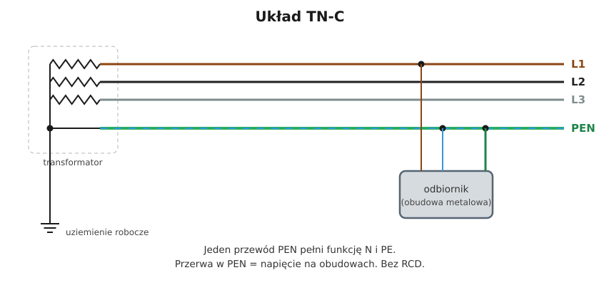

# 11.02 — Układ TN-C

> **Moduł:** [11 — Układy sieci: TN, TT, IT](README.md) · **Oznaczenia:** 🟢📋 · **Zakres SEP:** (a) (b) · **Status:** ✅ pełny
>
> **Czytaj:**
>
> - PN-HD 60364-5-54 — przewody ochronne i PEN (543.4)
> - Stare instalacje dwuprzewodowe: [moduł 21](../21-stare-instalacje/README.md)

[← poprzedni temat](11.01-co-oznaczaja-litery-w-nazwie-ukladu-sieci.md) · [spis modułu](README.md) · [następny temat →](11.03-uklad-tn-s.md)

## Po co to jest

Układ TN-C to dziś przede wszystkim sieć rozdzielcza operatora i stare instalacje w budynkach, w których do gniazd idą tylko dwa przewody. Trzeba rozumieć jego słabość — przerwę w PEN — żeby wiedzieć, dlaczego w nowych instalacjach go nie ma i dlaczego w starych bywa groźny.

## Po ludzku

W TN-C jeden przewód **PEN** pełni dwie role naraz: przewodu neutralnego (wraca nim prąd roboczy) i ochronnego (łączy obudowy z punktem neutralnym). Oszczędza to jedną żyłę, ale ma poważne wady:

1. **Przerwa w PEN = napięcie na obudowach.** Jeśli PEN się przerwie, obudowa urządzenia połączona z PEN za przerwą łączy się przez odbiornik z fazą. Na metalowej obudowie pralki pojawia się prawie pełne napięcie fazowe — a nic tego nie wyłączy, bo nie ma zwarcia.
2. **Nie da się zastosować różnicówki.** PEN niesie prąd roboczy i prąd uszkodzenia jednocześnie, więc RCD nie ma czego porównać ([08.01](../08-wylaczniki-roznicowopradowe/08.01-zasada-dzialania-wylacznika-roznicowopradowego.md)).
3. **Prąd roboczy płynie po obudowach i rurach.** Wszystko połączone z PEN niesie część prądu N, co powoduje zakłócenia i korozję.

Dlatego **PEN może mieć przekrój co najmniej 10 mm² Cu (16 mm² Al)** i tylko w instalacjach ułożonych na stałe. W praktyce oznacza to, że **obwody odbiorcze w budynkach (1,5–4 mm²) nie mogą być wykonane w TN-C**.

**Stare instalacje.** W mieszkaniach budowanych dawniej obwody były dwuprzewodowe, a ochronę realizowano „zerowaniem”: bolec gniazda łączono z przewodem neutralnym w gnieździe ([12.06](../12-ochrona-przeciwporazeniowa/12.06-dawne-nazwy-zerowanie-uziemienie-ochronne.md)). To jest TN-C z przewodem PEN o przekroju 1,5–2,5 mm² — z wszystkimi wadami powyżej, a dodatkowo przy zamianie L z N w gnieździe bolec ma od razu fazę.

## Schemat

## Pojęcia

| Pojęcie | Po ludzku | Termin normowy / symbol |
|---------|-----------|-------------------------|
| PEN | Przewód ochronno-neutralny | PEN |
| Przerwa PEN | Rozłączenie przewodu PEN w sieci lub instalacji | — |
| Zerowanie | Dawna nazwa ochrony w TN-C (bolec połączony z N) | samoczynne wyłączenie w TN-C |
| Instalacja dwuprzewodowa | Obwody tylko z L i N (PEN) | — |

## Liczby do zapamiętania

| Wielkość | Wartość | Kiedy obowiązuje | Źródło |
|----------|---------|------------------|--------|
| Minimalny przekrój PEN | **10 mm² Cu / 16 mm² Al** | instalacje stałe | PN-HD 60364-5-54, 543.4.1 |
| RCD w TN-C | **nie stosuje się** | — | PN-HD 60364-4-41 |
| Przewodów w sieci TN-C (3-faz.) | **4** (L1, L2, L3, PEN) | — | — |
| Napięcie na obudowie przy przerwie PEN | do ok. **230 V** | najgorszy przypadek | — |

## W praktyce

- **Nowe obwody** — zawsze trzy- lub pięcioprzewodowe (z osobnym PE), w układzie TN-S za punktem podziału PEN.
- **Stara instalacja dwuprzewodowa** — modernizacja: nowe przewody z PE do wydzielonej szyny PE w rozdzielnicy, punkt podziału PEN, różnicówki ([moduł 21](../21-stare-instalacje/README.md)).
- **Do czasu modernizacji** — nie dokładaj nowych gniazd z „mostkiem” bolca do N. Urządzenia klasy II są w takiej instalacji bezpieczniejsze niż klasy I.

## Błędy i zagrożenia

- ⚠️ **Mostek bolec–N w gnieździe** (zerowanie w gnieździe) — przy przerwie N przed gniazdem lub zamianie L z N obudowa urządzenia dostaje fazę.
- ⚠️ **Różnicówka w obwodzie TN-C** — nie zadziała przy uszkodzeniu albo będzie wybijać bez sensu.
- **Łącznik lub bezpiecznik w przewodzie PEN** — jego otwarcie to przerwa PEN.

## Przykład

**Sytuacja.** W starym bloku w obwodzie dwuprzewodowym poluzowało się połączenie N (PEN) w puszce. W gnieździe za puszką bolec jest połączony z N. Podłączona jest pralka (klasa I, 2 kW).

**Co się dzieje?** Za przerwą przewód N gniazda nie jest już połączony z punktem neutralnym. Przez grzałkę pralki łączy się z fazą. Bolec gniazda, a więc obudowa pralki, ma prawie 230 V względem ziemi. Pralka nie pracuje (nie ma obwodu), ale jej obudowa jest „pod prądem”. Dotknięcie obudowy i kranu — porażenie. Zabezpieczenie nie zadziała, bo nie ma zwarcia.

**Wniosek.** Właśnie dlatego w nowych instalacjach PE jest osobnym przewodem, a w starych mostek bolec–N jest jednym z najgroźniejszych rozwiązań.

## Pytania SEP

1. **Jakie są wady układu TN-C?**

Odpowiedź

Przerwa w przewodzie PEN powoduje pojawienie się napięcia na częściach przewodzących dostępnych połączonych z PEN za miejscem przerwy. Nie można stosować wyłączników różnicowoprądowych. Prąd roboczy przewodu neutralnego płynie przez przewody ochronne i połączone z nimi części metalowe, co powoduje zakłócenia elektromagnetyczne i korozję. Przewód PEN musi mieć przekrój co najmniej 10 mm² Cu (16 mm² Al), więc układu nie stosuje się w obwodach odbiorczych.

2. **Jaki jest minimalny przekrój przewodu PEN?**

Odpowiedź

10 mm² dla przewodu miedzianego i 16 mm² dla aluminiowego, wyłącznie w instalacjach ułożonych na stałe (PN-HD 60364-5-54).

## Sprawdź się

1. Czy w obwodzie dwuprzewodowym 2,5 mm² wolno zrobić nowe gniazdo z mostkiem bolca do N?

Odpowiedź

Nie. Przewód o przekroju 2,5 mm² nie może pełnić funkcji PEN (minimum 10 mm² Cu), a mostek grozi napięciem na obudowie przy przerwie N lub zamianie L z N. Trzeba doprowadzić osobny przewód PE.

## Źródła

- PN-HD 60364-5-54 — 543.4 (przewody PEN, minimalny przekrój, zasady).
- PN-HD 60364-4-41 — 411.4 (układ TN), ograniczenia stosowania RCD.

---

[← poprzedni temat](11.01-co-oznaczaja-litery-w-nazwie-ukladu-sieci.md) · [spis modułu](README.md) · [następny temat →](11.03-uklad-tn-s.md)
