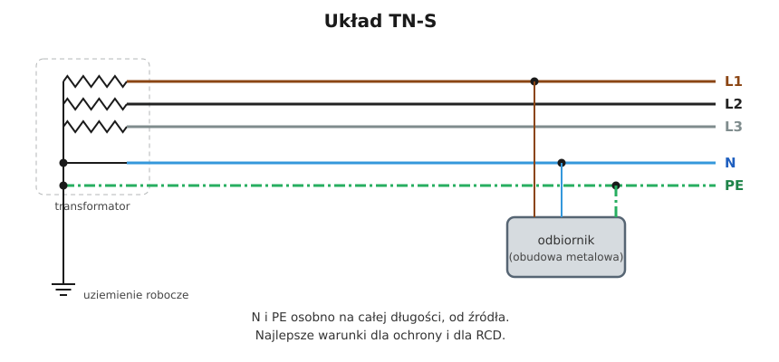

# 11.03 — Układ TN-S

> **Moduł:** [11 — Układy sieci: TN, TT, IT](README.md) · **Oznaczenia:** 🟢📋 · **Zakres SEP:** (a) (b) · **Status:** ✅ pełny
>
> **Czytaj:**
>
> - PN-HD 60364-4-41 — 411.4 (układ TN)

[← poprzedni temat](11.02-uklad-tn-c.md) · [spis modułu](README.md) · [następny temat →](11.04-uklad-tn-c-s-i-punkt-rozdzialu-pen.md)

## Po co to jest

TN-S to układ, w którym N i PE są osobnymi przewodami na całej drodze od transformatora. W domu spotkasz go „od punktu podziału”, w zakładach z własną stacją — od samego transformatora. To najlepszy układ dla ochrony przeciwporażeniowej, różnicówek i kompatybilności elektromagnetycznej.

## Po ludzku

W TN-S punkt neutralny transformatora jest uziemiony, a od niego biegną dwa osobne przewody: **N** (prąd roboczy) i **PE** (ochronny, normalnie bez prądu). Obudowy urządzeń są połączone z PE.

**Zalety:**

- **przerwa N nie powoduje napięcia na obudowach** — PE jest osobny;
- **różnicówki działają poprawnie** — prąd roboczy wraca przez N, a prąd uszkodzenia przez PE, z pominięciem przekładnika;
- **przez PE i metalowe konstrukcje nie płynie prąd roboczy** — mniej zakłóceń dla elektroniki;
- **zwarcie fazy z obudową to zwarcie metaliczne** przez PE — duży prąd i szybkie zadziałanie zabezpieczenia.

**Jak działa ochrona?** Przy uszkodzeniu izolacji prąd płynie: faza → obudowa → PE → punkt neutralny transformatora. Pętla jest w całości metalowa, więc impedancja jest mała, prąd duży, a wyłącznik nadprądowy wyłącza w czasie poniżej 0,4 s ([12.03](../12-ochrona-przeciwporazeniowa/12.03-warunek-skutecznosci-samoczynnego-wylaczenia.md)).

**Zasada święta:** w układzie TN-S przewodów N i PE **nie łączy się nigdzie** poza punktem neutralnym źródła (albo punktem podziału PEN w TN-C-S).

## Schemat

## Pojęcia

| Pojęcie | Po ludzku | Termin normowy / symbol |
|---------|-----------|-------------------------|
| TN-S | N i PE osobno od źródła | — |
| Pętla zwarcia | Droga prądu przy zwarciu fazy z obudową | $Z_s$ |
| Prąd przewodu ochronnego | Prąd upływowy płynący PE w sprawnej instalacji | — |

## Liczby do zapamiętania

| Wielkość | Wartość | Kiedy obowiązuje | Źródło |
|----------|---------|------------------|--------|
| Czas wyłączenia obwodów odbiorczych | **0,4 s** (230 V) | TN, gniazda ≤ 63 A, odbiory stałe ≤ 32 A | PN-HD 60364-4-41, tab. 41.1 |
| Czas wyłączenia obwodów rozdzielczych | **5 s** | TN | jw., 411.3.2.3 |
| Warunek ochrony | $Z_s \cdot I_a \le U_0$ | TN | jw., 411.4.4 |
| Przewodów w obwodzie 3-faz. | **5** (L1, L2, L3, N, PE) | — | — |

## W praktyce

- **Za punktem podziału PEN** prowadź wszystkie obwody trzy- lub pięcioprzewodowo, z osobną szyną N i PE w każdej rozdzielnicy.
- **W rozdzielnicy podrzędnej** (np. na piętrze, w garażu) N i PE są na osobnych, odizolowanych od siebie szynach — bez mostka.
- **Sprawdzenie:** przy odłączonym zasilaniu i odłączonym mostku w punkcie podziału rezystancja między N a PE w instalacji powinna być duża (pomiar izolacji, [moduł 23](../23-pomiary-odbiorcze-i-okresowe/README.md)).

## Błędy i zagrożenia

- ⚠️ **Mostek N–PE w rozdzielnicy podrzędnej lub w gnieździe** — powrót do TN-C za tym punktem, wybijanie RCD, prąd roboczy w PE.
- **N podłączony do szyny PE „bo zabrakło miejsca na listwie N”** — to samo.

## Przykład

**Zadanie.** Garaż zasilany z domu przewodem 5-żyłowym. W rozdzielnicy garażu elektryk połączył N i PE na jednej szynie „dla pewności”. Co się stanie?

**Rozwiązanie.** Od tego miejsca prąd roboczy obwodów garażu płynie częściowo przez PE do domu. Różnicówka w domu chroniąca obwód garażu zobaczy różnicę prądów i będzie wybijać przy obciążeniu. Jeśli różnicówka jest w garażu za tym mostkiem — będzie działać, ale prąd N popłynie przez PE i wszystkie metalowe elementy połączone z PE w domu. To błąd: N i PE muszą być na osobnych szynach.

## Pytania SEP

1. **Jakie są cechy i zalety układu TN-S?**

Odpowiedź

Punkt neutralny źródła jest uziemiony, a przewód neutralny N i ochronny PE są prowadzone oddzielnie na całej długości. Przerwa przewodu N nie powoduje napięcia na częściach przewodzących dostępnych, można stosować wyłączniki różnicowoprądowe, przez przewody ochronne nie płynie prąd roboczy (lepsza kompatybilność elektromagnetyczna), a pętla zwarcia przy uszkodzeniu jest metaliczna, co zapewnia duży prąd zwarciowy i szybkie samoczynne wyłączenie.

## Sprawdź się

1. Dlaczego w TN-S różnicówka działa, a w TN-C nie?

Odpowiedź

W TN-S prąd uszkodzenia wraca przewodem PE, który omija przekładnik RCD, więc pojawia się różnica prądów. W TN-C prąd uszkodzenia wraca przewodem PEN, który przechodziłby przez przekładnik razem z prądem roboczym.

## Źródła

- PN-HD 60364-4-41 — 411.4 (układ TN), tab. 41.1 (czasy wyłączenia).
- PN-HD 60364-5-54 — przewody ochronne.

---

[← poprzedni temat](11.02-uklad-tn-c.md) · [spis modułu](README.md) · [następny temat →](11.04-uklad-tn-c-s-i-punkt-rozdzialu-pen.md)
