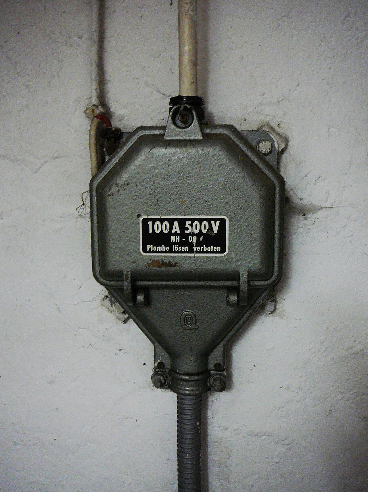
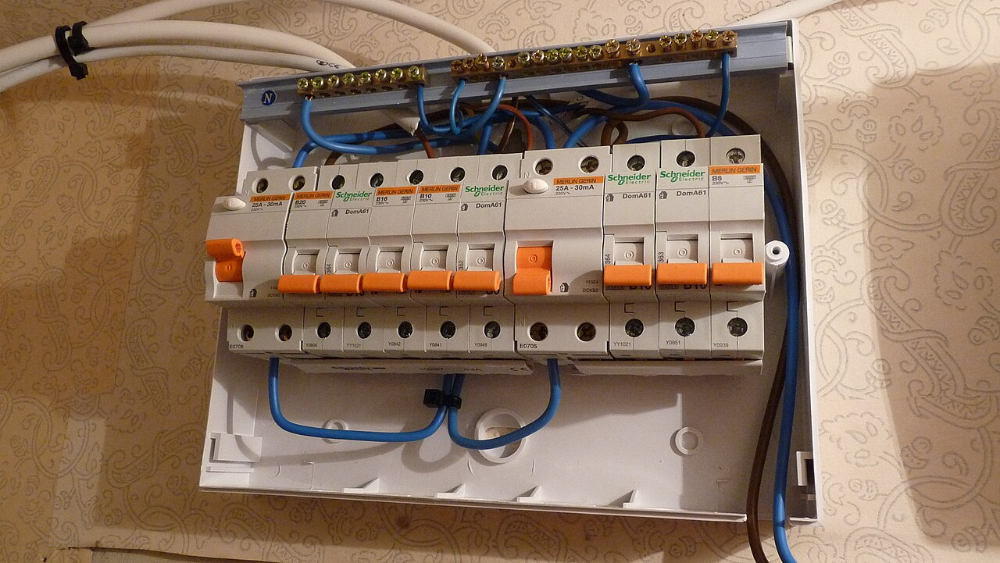
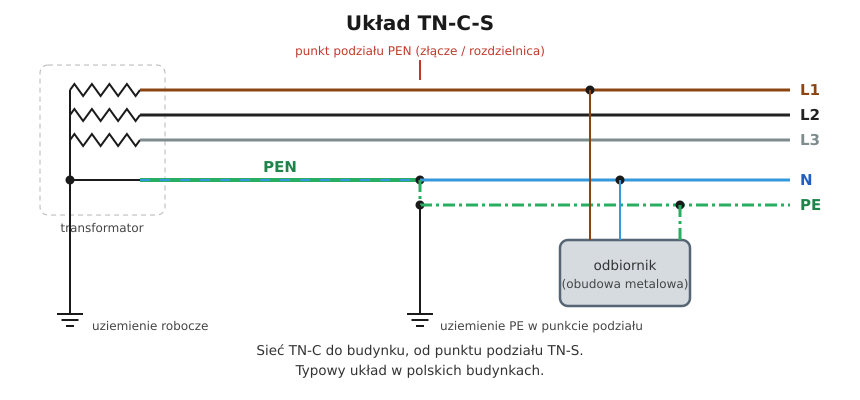
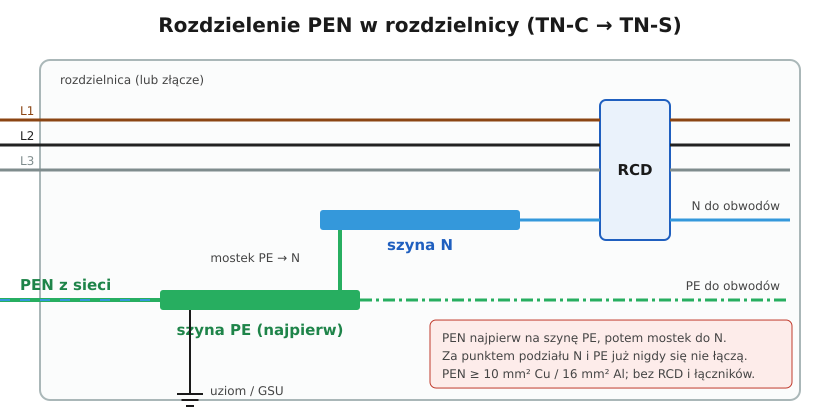

# 11.04 — Układ TN-C-S i punkt rozdziału PEN

> **Moduł:** [11 — Układy sieci: TN, TT, IT](README.md) · **Oznaczenia:** 🟢📋 · **Zakres SEP:** (a) (b) · **Status:** ✅ pełny
>
> **Czytaj:**
>
> - PN-HD 60364-5-54, 543.4 — przewody PEN i ich rozdzielanie
> - Połączenia wyrównawcze i uziom: [moduł 13](../13-uziemienia-i-wyrownanie/README.md)
> - Złącze i WLZ: [moduł 14](../14-od-slupa-do-gniazdka/README.md)

[← poprzedni temat](11.03-uklad-tn-s.md) · [spis modułu](README.md) · [następny temat →](11.05-uklad-tt.md)

## Po co to jest

Większość polskich budynków ma układ TN-C-S. Najważniejsze miejsce w nim to **punkt rozdziału PEN** — od tego, jak jest wykonany, zależy bezpieczeństwo całej instalacji. Błędy w tym miejscu (brak rozdziału, ponowne połączenie N z PE, słabe połączenie PEN) są przyczyną najgroźniejszych awarii. Na egzaminie: gdzie i jak rozdziela się PEN.

## Po ludzku

Sieć operatora dochodzi do budynku czterema przewodami (L1, L2, L3, PEN). W pewnym miejscu — **w złączu albo w rozdzielnicy głównej budynku** — PEN rozdziela się na dwa przewody: N i PE. Od tego punktu instalacja pracuje w układzie TN-S.

**Jak rozdziela się PEN:**

1. PEN przyłącza się **najpierw do zacisku (szyny) PE**.
2. Od szyny PE robi się **mostek do szyny N**.
3. Punkt podziału **uziemia się** — łączy z uziomem budynku i główną szyną uziemiającą (GSU, [moduł 13](../13-uziemienia-i-wyrownanie/README.md)).
4. **Za punktem podziału N i PE nigdy się już nie łączą.**

**Dlaczego najpierw PE?** Bo funkcja ochronna jest ważniejsza. Jeśli kiedyś poluzuje się mostek do N, odbiorniki przestaną działać, ale obudowy nadal będą połączone z siecią przez PE.

**Przerwa PEN przed punktem podziału** (w sieci, w złączu) to najgroźniejsza awaria: punkt N instalacji przestaje być związany z transformatorem. Napięcia faz „pływają” — na najmniej obciążonej fazie może pojawić się prawie 400 V, a na szynie PE napięcie względem ziemi „dalekiej”. Ratuje dobry uziom w punkcie podziału i połączenia wyrównawcze, które trzymają wszystkie metalowe części na podobnym potencjale ([10.04](../10-aparatura-modulowa/10.04-kontrolki-faz-przekazniki-zaniku-fazy-i.md)).

## Jak to wygląda

*Na co patrzeć: w złączu kończy się sieć operatora i zaczyna instalacja odbiorcy. Złącze jest plombowane. Punkt podziału PEN bywa w złączu albo dalej, w rozdzielnicy głównej budynku — trzeba to sprawdzić w dokumentacji lub na miejscu.*

*Na co patrzeć: u góry są dwie osobne listwy N — po jednej dla każdej różnicówki. Niebieskie przewody N obwodów wychodzą z listwy „swojej” różnicówki. Za punktem podziału PEN listwa PE jest jeszcze jedną, osobną szyną, połączoną z przewodem PE zasilania, a nie z żadną z listew N.*

## Schemat

## Pojęcia

| Pojęcie | Po ludzku | Termin normowy / symbol |
|---------|-----------|-------------------------|
| Punkt podziału PEN | Miejsce rozdzielenia PEN na N i PE | — |
| Mostek PE–N | Połączenie szyny PE z szyną N w punkcie podziału | — |
| GSU | Główna szyna uziemiająca budynku | główny zacisk uziemiający |
| Przerwa PEN | Rozłączenie PEN przed punktem podziału | — |

## Liczby do zapamiętania

| Wielkość | Wartość | Kiedy obowiązuje | Źródło |
|----------|---------|------------------|--------|
| Punkt podziału | **jeden**, w złączu lub rozdzielnicy głównej | — | PN-HD 60364-5-54, praktyka OSD |
| Kolejność | PEN → **szyna PE** → mostek → szyna N | — | PN-HD 60364-5-54, 543.4.3 |
| Po podziale | N i PE **nigdy** się nie łączą | — | jw. |
| Minimalny przekrój PEN | **10 mm² Cu / 16 mm² Al** | — | jw., 543.4.1 |
| Przerwa PEN — napięcie fazy | do ok. **400 V** | najgorszy przypadek | — |

## W praktyce

- **Ustal, gdzie jest punkt podziału** — w złączu, w rozdzielnicy głównej budynku czy (w starym bloku) wcale. W mieszkaniu w bloku najczęściej przychodzi już N i PE z rozdzielnicy budynku albo PEN, który trzeba rozdzielić w rozdzielnicy mieszkaniowej.
- **Połączenia PEN** — mocne, zabezpieczone przed poluzowaniem, okresowo sprawdzane. Luźny PEN w złączu to awaria całego domu.
- **Uziemienie punktu podziału** — przez GSU do uziomu fundamentowego lub otokowego. Im lepszy uziom, tym mniejsze skutki przerwy PEN w sieci.
- **Za punktem podziału** RCD, a PE prowadzony z pominięciem RCD ([11.03](11.03-uklad-tn-s.md)).

## Błędy i zagrożenia

- ⚠️ **Drugi punkt połączenia N z PE** za punktem podziału (w rozdzielnicy piętrowej, w gnieździe, w oprawie) — prąd roboczy w PE, wybijanie RCD.
- ⚠️ **PEN przez rozłącznik lub RCD** — przerwa PEN „na życzenie”.
- **PEN najpierw na szynę N, a PE z mostka** — poluzowany mostek odcina ochronę.
- **Brak uziemienia punktu podziału** — przy przerwie PEN w sieci napięcie na PE nie ma dokąd odpłynąć.

## Przykład

**Zadanie.** Dom: PEN rozdzielony w złączu. W rozdzielnicy głównej domu są osobne szyny N i PE. Do rozdzielnicy w garażu idzie przewód 5×4. Czy w garażu wolno połączyć N i PE?

**Rozwiązanie.** Nie. Punkt podziału jest jeden — w złączu. Od niego w całej instalacji N i PE są rozdzielone. W rozdzielnicy garażu N i PE na osobnych szynach, a PE garażu można dodatkowo połączyć z lokalnym uziomem i połączeniami wyrównawczymi garażu ([moduł 13](../13-uziemienia-i-wyrownanie/README.md)).

## Pytania SEP

1. **Gdzie i w jaki sposób rozdziela się przewód PEN w układzie TN-C-S?**

Odpowiedź

W złączu lub w rozdzielnicy głównej budynku. Przewód PEN przyłącza się do zacisku lub szyny przewodu ochronnego PE, a od niej wykonuje połączenie (mostek) do szyny przewodu neutralnego N. Punkt podziału uziemia się i łączy z główną szyną uziemiającą. Za punktem podziału przewodów N i PE nie wolno ponownie łączyć ani przyłączać N do żadnej innej uziemionej części instalacji.

2. **Jakie są skutki przerwania przewodu PEN przed punktem jego podziału?**

Odpowiedź

Punkt neutralny instalacji traci połączenie z punktem neutralnym transformatora. Przy niesymetrycznym obciążeniu napięcia fazowe w instalacji zmieniają się — na najmniej obciążonej fazie mogą wzrosnąć do wartości bliskiej napięciu międzyfazowemu (ok. 400 V), co niszczy odbiorniki. Na przewodzie PE i połączonych z nim częściach może pojawić się napięcie względem ziemi, którego ograniczeniu służą uziemienie punktu podziału i połączenia wyrównawcze.

## Sprawdź się

1. Dlaczego PEN łączy się najpierw z szyną PE, a nie N?

Odpowiedź

Bo ważniejsza jest funkcja ochronna. Poluzowany mostek PE–N spowoduje tylko przerwę w zasilaniu odbiorników, a nie utratę połączenia obudów z siecią.

## Źródła

- PN-HD 60364-5-54 — 543.4 (przewody PEN: przekrój, rozdzielanie, zakaz ponownego łączenia).
- PN-HD 60364-4-41 — 411.4 (układ TN).
- [Schneider Electric — Electrical Installation Guide, Conductor sizing](https://www.electrical-installation.org/enwiki/Conductor_sizing) 🇬🇧 — minimalny przekrój PEN 10 mm² Cu / 16 mm² Al.

---

[← poprzedni temat](11.03-uklad-tn-s.md) · [spis modułu](README.md) · [następny temat →](11.05-uklad-tt.md)
