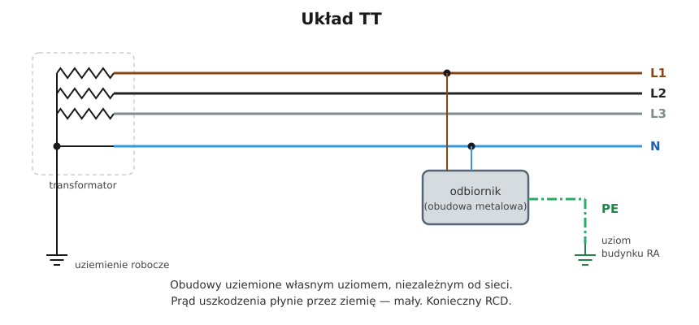

# 11.05 — Układ TT

> **Moduł:** [11 — Układy sieci: TN, TT, IT](README.md) · **Oznaczenia:** 🟢📋 · **Zakres SEP:** (a) (b) · **Status:** ✅ pełny
>
> **Czytaj:**
>
> - PN-HD 60364-4-41 — 411.5 (układ TT)
> - Uziomy i pomiar rezystancji uziemienia: [moduł 13](../13-uziemienia-i-wyrownanie/README.md), [moduł 23](../23-pomiary-odbiorcze-i-okresowe/README.md)

[← poprzedni temat](11.04-uklad-tn-c-s-i-punkt-rozdzialu-pen.md) · [spis modułu](README.md) · [następny temat →](11.06-uklad-it.md)

## Po co to jest

W układzie TT obudowy urządzeń są uziemione własnym uziomem budynku, niezależnym od sieci. Spotyka się go na wsi, przy niektórych sieciach napowietrznych, na placach budowy, kempingach. Rządzi się innymi zasadami niż TN — przede wszystkim bez różnicówki ochrona zwykle nie działa.

## Po ludzku

Operator uziemia punkt neutralny transformatora (uziemienie robocze, RB), a do budynku dostarcza L1, L2, L3 i N. **Przewodu PE z sieci nie ma.** Budynek ma własny uziom (RA), a przewód PE instalacji łączy obudowy z tym uziomem.

**Co się dzieje przy uszkodzeniu?** Prąd płynie: faza → obudowa → PE → uziom budynku → **ziemia** → uziemienie transformatora → z powrotem. W pętli są dwie rezystancje uziemień, typowo kilka–kilkadziesiąt omów. Prąd uszkodzenia jest więc mały:

$$I \approx \frac{U_0}{R_A + R_B} = \frac{230}{30 + 5} \approx 6{,}6\ \mathrm{A}$$

Wyłącznik B16 przy 6,6 A nawet nie drgnie, a na obudowie przez cały czas jest napięcie $6{,}6 \cdot 30 \approx 200\ \mathrm{V}$ względem ziemi. **Dlatego w TT ochronę przy uszkodzeniu realizuje wyłącznik różnicowoprądowy.** Warunek:

$$R_A \cdot I_{\Delta n} \le 50\ \mathrm{V}$$

Dla RCD 30 mA wystarczy uziom poniżej ok. 1667 Ω, dla 300 mA — poniżej 167 Ω. W praktyce i tak dąży się do małej rezystancji uziomu, bo jest też uziomem odgromowym i wyrównawczym.

**Inne zasady w TT:**

- **N nie wolno łączyć z PE** w budynku — N należy do sieci, PE do lokalnego uziomu;
- rozłączniki i zabezpieczenia **odłączają też N**;
- czasy wyłączenia obwodów odbiorczych przy 230 V: **0,2 s** (krócej niż w TN);
- ograniczniki przepięć przed RCD — w układzie **3+1** ([09.04](../09-ochrona-przeciwprzepieciowa/09.04-montaz-ogranicznika-dlugosc-polaczen-i.md)).

## Schemat

## Pojęcia

| Pojęcie | Po ludzku | Termin normowy / symbol |
|---------|-----------|-------------------------|
| Uziemienie robocze | Uziemienie punktu neutralnego transformatora | $R_B$ |
| Uziom budynku | Uziemienie obudów w budynku | $R_A$ |
| Uziemienie ochronne | Dawna nazwa ochrony w TT | samoczynne wyłączenie w TT |

## Liczby do zapamiętania

| Wielkość | Wartość | Kiedy obowiązuje | Źródło |
|----------|---------|------------------|--------|
| Warunek ochrony z RCD | $R_A \cdot I_{\Delta n} \le 50\ \mathrm{V}$ | TT | PN-HD 60364-4-41, 411.5.3 |
| Czas wyłączenia obwodów odbiorczych | **0,2 s** (230 V) | TT, gniazda ≤ 63 A, stałe ≤ 32 A | jw., tab. 41.1 |
| Czas wyłączenia obwodów rozdzielczych | **1 s** | TT | jw., 411.3.2.4 |
| $R_A$ max dla RCD 30 / 100 / 300 mA | ok. **1667 / 500 / 167 Ω** | z warunku 50 V | obliczenie |
| Prąd uszkodzenia | kilka–kilkanaście A | typowe uziomy | — |

## W praktyce

- **Ochrona przy uszkodzeniu = RCD.** W TT każdy obwód (albo grupa) musi być za wyłącznikiem różnicowoprądowym. Na początku instalacji często RCD 300 mA typu S, dalej 30 mA na obwodach ([08.07](../08-wylaczniki-roznicowopradowe/08.07-podzial-obwodow-miedzy-wylaczniki.md)).
- **Zmierz rezystancję uziomu** przy odbiorze i okresowo ([moduł 23](../23-pomiary-odbiorcze-i-okresowe/README.md)). Uziom może się pogorszyć (korozja, wysychanie gruntu).
- **N i PE osobno w całej instalacji**, bez żadnego połączenia.
- **Odłączenie do prac:** odłączaj też N — w TT może mieć napięcie względem lokalnej ziemi.

## Błędy i zagrożenia

- ⚠️ **Mostek N–PE w budynku zasilanym z TT** — instalacja „udaje” TN, a przy przerwie N w sieci lub uszkodzeniu w sieci napięcie przenosi się na obudowy.
- ⚠️ **TT bez RCD** z założeniem, że „wyłącznik nadprądowy wyłączy” — przy typowych uziomach nie wyłączy.
- **Uziom nigdy niemierzony** — warunek może przestać być spełniony.

## Przykład

**Zadanie.** Dom w układzie TT, zmierzona rezystancja uziomu $R_A$ = 95 Ω. Obwody gniazd za RCD 30 mA, a obwód pompy w studni — za RCD 300 mA. Czy warunek ochrony jest spełniony?

- RCD 30 mA: $95 \cdot 0{,}03 = 2{,}85\ \mathrm{V} \le 50\ \mathrm{V}$ — tak.
- RCD 300 mA: $95 \cdot 0{,}3 = 28{,}5\ \mathrm{V} \le 50\ \mathrm{V}$ — tak.

**Uwaga.** Pompa w studni to urządzenie w miejscu wilgotnym — ochrona uzupełniająca 30 mA byłaby lepsza ([moduł 17](../17-pomieszczenia-szczegolne/README.md)).

## Pytania SEP

1. **Na czym polega ochrona przy uszkodzeniu w układzie TT?**

Odpowiedź

Części przewodzące dostępne łączy się przewodem ochronnym z uziomem instalacji, niezależnym od uziemienia roboczego sieci. Przy uszkodzeniu izolacji prąd płynie przez uziom instalacji i ziemię do uziemienia źródła. Jest on zwykle za mały do szybkiego zadziałania zabezpieczeń nadprądowych, dlatego stosuje się wyłączniki różnicowoprądowe i sprawdza warunek $R_A \cdot I_{\Delta n} \le 50$ V, gdzie $R_A$ — suma rezystancji uziomu i przewodu ochronnego. Czas wyłączenia obwodów odbiorczych 230 V nie może przekroczyć 0,2 s.

2. **Dlaczego w układzie TT nie wolno łączyć przewodu N z PE w instalacji odbiorczej?**

Odpowiedź

Bo przewód N należy do sieci uziemionej w stacji, a PE do niezależnego uziomu instalacji. Ich połączenie zmienia układ w nieprawidłowy TN bez gwarancji skuteczności ochrony, powoduje przepływ prądu roboczego przez uziom i przewody ochronne, a przy przerwie N w sieci lub uszkodzeniach w sieci przenosi napięcie na części przewodzące dostępne.

## Sprawdź się

1. Jaka może być największa rezystancja uziomu przy RCD 100 mA w TT?

Odpowiedź

$R_A \le 50 / 0{,}1 = 500\ \Omega$.

## Źródła

- PN-HD 60364-4-41 — 411.5 (układ TT, warunek $R_A \cdot I_{\Delta n} \le 50$ V), tab. 41.1.
- PN-HD 60364-5-54 — uziomy i przewody uziemiające.

---

[← poprzedni temat](11.04-uklad-tn-c-s-i-punkt-rozdzialu-pen.md) · [spis modułu](README.md) · [następny temat →](11.06-uklad-it.md)
