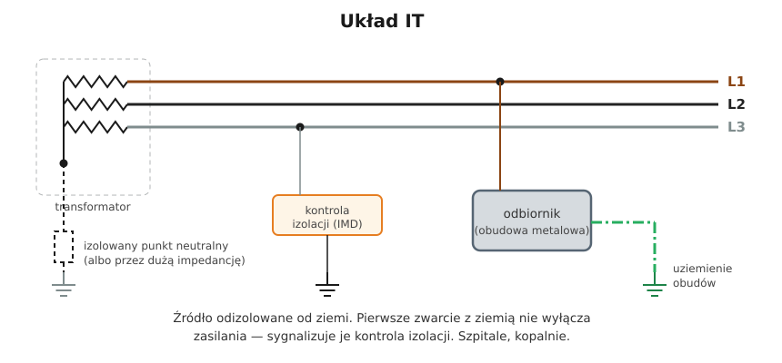

# 11.06 — Układ IT

> **Moduł:** [11 — Układy sieci: TN, TT, IT](README.md) · **Oznaczenia:** 🟢📋 · **Zakres SEP:** (a) (b) · **Status:** ✅ pełny
>
> **Czytaj:**
>
> - PN-HD 60364-4-41 — 411.6 (układ IT)
> - PN-HD 60364-7-710 — pomieszczenia medyczne

[← poprzedni temat](11.05-uklad-tt.md) · [spis modułu](README.md) · (koniec modułu) →

## Po co to jest

Układ IT stosuje się tam, gdzie wyłączenie zasilania przy pierwszym uszkodzeniu byłoby groźniejsze niż samo uszkodzenie: na sali operacyjnej, w kopalni, w niektórych procesach przemysłowych. W domu go nie spotkasz, ale komisja pyta o niego regularnie.

## Po ludzku

W IT źródło (transformator, generator) jest **odizolowane od ziemi** albo uziemione przez dużą impedancję. Obudowy urządzeń są uziemione.

**Pierwsze zwarcie z ziemią** (np. faza dotyka uziemionej obudowy) **nie powoduje wyłączenia**. Prąd nie ma którędy wrócić do źródła — płynie tylko niewielki prąd przez pojemności przewodów względem ziemi. Napięcie na obudowie jest małe. Instalacja pracuje dalej, a uszkodzenie sygnalizuje **urządzenie do kontroli stanu izolacji (IMD)**. Obsługa musi je znaleźć i usunąć jak najszybciej.

**Drugie zwarcie** na innej fazie to już zwarcie międzyfazowe przez obudowy. Wtedy zabezpieczenie musi wyłączyć zasilanie — tak jak w TN albo TT, zależnie od sposobu uziemienia obudów.

**Przewodu N zwykle się nie prowadzi** — norma zaleca, żeby go nie rozprowadzać, bo komplikuje to ochronę.

**Gdzie:**

- **sale operacyjne i intensywnej terapii** — tzw. IT medyczny: transformator separacyjny, kontrola izolacji, sygnalizacja na sali (PN-HD 60364-7-710);
- **kopalnie**, przemysł chemiczny, instalacje okrętowe;
- zasilanie z agregatu lub UPS w szczególnych zastosowaniach.

## Schemat

## Pojęcia

| Pojęcie | Po ludzku | Termin normowy / symbol |
|---------|-----------|-------------------------|
| Układ IT | Źródło izolowane od ziemi | — |
| Pierwsze zwarcie | Pierwsze połączenie fazy z ziemią lub obudową | pierwsze doziemienie |
| Kontrola stanu izolacji | Urządzenie stale mierzące rezystancję izolacji sieci | IMD |
| IT medyczny | Układ IT w pomieszczeniach medycznych grupy 2 | PN-HD 60364-7-710 |
| Sieć ochronna | Dawna nazwa ochrony w IT | — |

## Liczby do zapamiętania

| Wielkość | Wartość | Kiedy obowiązuje | Źródło |
|----------|---------|------------------|--------|
| Pierwsze zwarcie | **bez wyłączenia**, sygnalizacja | — | PN-HD 60364-4-41, 411.6 |
| Warunek przy pierwszym zwarciu | $R_A \cdot I_d \le 50\ \mathrm{V}$ | $I_d$ — prąd pierwszego zwarcia | jw., 411.6.2 |
| Drugie zwarcie | **wyłączenie** jak w TN lub TT | — | jw., 411.6.4 |
| Przewód N | zaleca się **nie prowadzić** | — | jw. |

## W praktyce

- **Sygnał IMD to nie fałszywy alarm.** Trzeba znaleźć uszkodzenie, zanim pojawi się drugie.
- **IT medyczny** to specjalistyczna dziedzina — prace tylko przez osoby z odpowiednią wiedzą i według procedur szpitala.
- **Pomiary w IT** — specyficzne (kontrola izolacji, prąd pierwszego zwarcia). Zwykły tester gniazd pokaże w IT dziwne wyniki.

## Błędy i zagrożenia

- ⚠️ **Ignorowanie sygnału kontroli izolacji** — drugie zwarcie na innej fazie spowoduje zwarcie międzyfazowe przez obudowy i wyłączenie w najmniej odpowiednim momencie.
- **Uziemienie punktu neutralnego „dla porządku”** — zamienia IT w TN i likwiduje jego sens.

## Przykład

**Sytuacja.** Na sali operacyjnej zapala się lampka i słychać sygnał kontroli izolacji. Trwa zabieg.

**Co to znaczy?** Rezystancja izolacji sieci IT spadła poniżej progu — prawdopodobnie jedno z urządzeń ma doziemienie. Zasilanie działa, zabieg może trwać. Sygnał akustyczny można wyciszyć, ale służba techniczna musi zlokalizować uszkodzenie (np. odłączając kolejno urządzenia po zabiegu) i usunąć je, zanim wystąpi drugie.

## Pytania SEP

1. **Na czym polega układ sieci IT i gdzie się go stosuje?**

Odpowiedź

Wszystkie części czynne źródła są izolowane od ziemi lub jeden punkt jest uziemiony przez dużą impedancję, a części przewodzące dostępne są uziemione. Pierwsze zwarcie z ziemią nie wymaga wyłączenia zasilania, bo prąd zwarcia jest bardzo mały, ale musi być sygnalizowane przez urządzenie do kontroli stanu izolacji i szybko usunięte. Drugie zwarcie musi powodować samoczynne wyłączenie. Układ stosuje się tam, gdzie ciągłość zasilania jest szczególnie ważna: w pomieszczeniach medycznych grupy 2 (sale operacyjne), w kopalniach, w niektórych zakładach przemysłowych i na statkach.

## Sprawdź się

1. Dlaczego w IT pierwsze zwarcie fazy z obudową nie powoduje dużego prądu?

Odpowiedź

Bo źródło nie jest uziemione — prąd nie ma drogi powrotnej przez ziemię do źródła poza małymi prądami pojemnościowymi przewodów.

## Źródła

- PN-HD 60364-4-41 — 411.6 (układ IT).
- PN-HD 60364-7-710 — pomieszczenia medyczne (IT medyczny).

---

[← poprzedni temat](11.05-uklad-tt.md) · [spis modułu](README.md) · (koniec modułu) →
