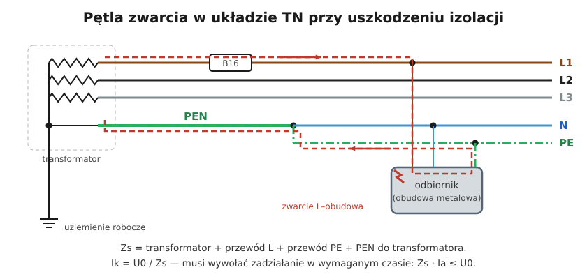

# 12.02 — Ochrona przy uszkodzeniu: samoczynne wyłączenie zasilania

> **Moduł:** [12 — Ochrona przeciwporażeniowa](README.md) · **Oznaczenia:** 📋 · **Zakres SEP:** (a) (b) (d) · **Status:** ✅ pełny
>
> **Czytaj:**
>
> - PN-HD 60364-4-41 — 411 (samoczynne wyłączenie zasilania)
> - Czasy wyłączenia: [04.04](../04-prad-a-czlowiek/04.04-maksymalne-czasy-samoczynnego-wylaczenia.md)
> - Połączenia wyrównawcze: [moduł 13](../13-uziemienia-i-wyrownanie/README.md)

[← poprzedni temat](12.01-ochrona-podstawowa-izolacja-obudowy-przegrody.md) · [spis modułu](README.md) · [następny temat →](12.03-warunek-skutecznosci-samoczynnego-wylaczenia.md)

## Po co to jest

Izolacja może się zestarzeć, pęknąć, zawilgnąć. Wtedy faza dotyka metalowej obudowy pralki, piekarnika, grzejnika. Ochrona przy uszkodzeniu sprawia, że taka obudowa nie pozostaje pod groźnym napięciem. Najczęściej realizuje się ją przez samoczynne wyłączenie zasilania. Na egzaminie: na czym polega i z czego się składa.

## Po ludzku

**Samoczynne wyłączenie zasilania** to trzy elementy, które działają razem:

1. **Uziemienie ochronne / przewód PE** — wszystkie metalowe obudowy (części przewodzące dostępne) połączone przewodem ochronnym z punktem uziemionym. Dzięki temu uszkodzenie izolacji zamienia się w zwarcie, a nie w „cichą” obudowę pod napięciem.
2. **Połączenia wyrównawcze ochronne** — główna szyna uziemiająca łączy PE z rurami wody, gazu, ogrzewania, konstrukcją budynku (części przewodzące obce). W czasie zwarcia wszystko, czego można jednocześnie dotknąć, ma podobny potencjał ([moduł 13](../13-uziemienia-i-wyrownanie/README.md)).
3. **Zabezpieczenie, które wyłączy w wymaganym czasie** — wyłącznik nadprądowy, bezpiecznik albo RCD, dobrane tak, żeby przy zwarciu fazy z obudową zadziałały szybciej niż czas z tablicy (np. 0,4 s w TN) ([04.04](../04-prad-a-czlowiek/04.04-maksymalne-czasy-samoczynnego-wylaczenia.md)).

Jeśli brakuje któregokolwiek — ochrona nie działa: bez PE nie ma zwarcia, bez wyrównania jest duże napięcie dotykowe, bez szybkiego zabezpieczenia napięcie trwa za długo.

**Jak to wygląda w układach:**

- **TN** — prąd zwarcia płynie metalowym PE, jest duży, wyłącza wyłącznik nadprądowy;
- **TT** — prąd płynie przez ziemię, jest mały, wyłącza RCD ([11.05](../11-uklady-sieci/11.05-uklad-tt.md));
- **IT** — pierwsze zwarcie sygnalizowane, drugie wyłączane ([11.06](../11-uklady-sieci/11.06-uklad-it.md)).

**Inne środki ochrony przy uszkodzeniu** (bez wyłączania): izolacja podwójna lub wzmocniona, separacja elektryczna ([12.04](12.04-izolacja-podwojna-separacja-elektryczna-selv-i.md)).

## Schemat

## Pojęcia

| Pojęcie | Po ludzku | Termin normowy / symbol |
|---------|-----------|-------------------------|
| Ochrona przy uszkodzeniu | Gdy zawiedzie izolacja podstawowa | dawniej: ochrona przed dotykiem pośrednim, ochrona dodatkowa |
| Część przewodząca dostępna | Metalowa obudowa urządzenia | — |
| Część przewodząca obca | Metal niebędący częścią instalacji: rury, grzejniki, konstrukcja | — |
| Samoczynne wyłączenie zasilania | Zabezpieczenie odcina zasilanie przy zwarciu z obudową | 411 |
| Połączenie wyrównawcze ochronne | Łączenie części przewodzących z PE | — |

## Liczby do zapamiętania

| Wielkość | Wartość | Kiedy obowiązuje | Źródło |
|----------|---------|------------------|--------|
| Czas wyłączenia TN | **0,4 s** (230 V), **5 s** — obwody rozdzielcze | obwody odbiorcze ≤ 63 A gniazd. / ≤ 32 A stałe | PN-HD 60364-4-41, tab. 41.1 |
| Czas wyłączenia TT | **0,2 s** (230 V), **1 s** — obwody rozdzielcze | jw. | jw. |
| Napięcie dotykowe dopuszczalne | $U_L$ = **50 V AC** | warunki normalne | [04.03](../04-prad-a-czlowiek/04.03-napiecie-dotykowe-i-krokowe-napiecia.md) |
| Elementy | **PE + wyrównanie + zabezpieczenie** | wszystkie trzy | 411.3 |

## W praktyce

- **Każde gniazdo i każda oprawa metalowa** w nowej instalacji ma PE.
- **Sprawdzenie ochrony**: ciągłość przewodów ochronnych i połączeń wyrównawczych, impedancja pętli zwarcia (TN) albo rezystancja uziomu i działanie RCD (TT) ([12.03](12.03-warunek-skutecznosci-samoczynnego-wylaczenia.md), [moduł 23](../23-pomiary-odbiorcze-i-okresowe/README.md)).
- **Nie odłączaj PE od urządzenia**, nawet jeśli „wybija różnicówkę” — to usuwa ochronę, a nie usterkę.

## Błędy i zagrożenia

- ⚠️ **Brak PE w obwodzie** z urządzeniami klasy I — uszkodzenie izolacji daje obudowę pod napięciem bez wyłączenia.
- ⚠️ **Za długi obwód z za dużym zabezpieczeniem** — zwarcie z obudową wyłączane po sekundach.
- **Brak połączeń wyrównawczych** — przy zwarciu duża różnica napięć między obudową a rurą.

## Przykład

**Sytuacja.** W piekarniku (klasa I) przetarł się przewód wewnątrz i faza dotyka obudowy. Obwód: TN-C-S, B16, impedancja pętli 0,9 Ω.

**Co się dzieje?** Prąd zwarcia $230 / 0{,}9 \approx 255\ \mathrm{A}$ — ponad 5 × 16 = 80 A, więc B16 wyłącza natychmiast (milisekundy). Przez ten czas napięcie na obudowie względem rury z wodą jest ograniczone połączeniami wyrównawczymi. Piekarnik jest wyłączony, użytkownik widzi zadziałany wyłącznik.

**Bez PE:** zwarcia nie ma, piekarnik działa dalej, a jego obudowa ma 230 V względem ziemi — aż ktoś jej dotknie, opierając się o zlew.

## Pytania SEP

1. **Na czym polega ochrona przy uszkodzeniu przez samoczynne wyłączenie zasilania?**

Odpowiedź

Części przewodzące dostępne łączy się z przewodem ochronnym (uziemienie ochronne lub połączenie z punktem neutralnym w TN), wykonuje połączenia wyrównawcze ochronne z częściami przewodzącymi obcymi, a zabezpieczenie (nadprądowe lub różnicowoprądowe) dobiera tak, by przy zwarciu między przewodem fazowym a częścią przewodzącą dostępną lub przewodem ochronnym samoczynnie wyłączyło zasilanie w czasie nie dłuższym niż wymagany (np. w TN 230 V: 0,4 s dla obwodów odbiorczych, 5 s dla rozdzielczych).

2. **Jakie środki ochrony przy uszkodzeniu przewiduje norma?**

Odpowiedź

Samoczynne wyłączenie zasilania (z uziemieniem ochronnym i połączeniami wyrównawczymi), izolację podwójną lub wzmocnioną, separację elektryczną oraz — jako środki łączące ochronę podstawową i przy uszkodzeniu — bardzo niskie napięcie SELV i PELV. W instalacjach nadzorowanych przez osoby wykwalifikowane także izolowanie stanowiska i nieuziemione połączenia wyrównawcze miejscowe.

3. **Czym różni się część przewodząca dostępna od części przewodzącej obcej?**

Odpowiedź

Część przewodząca dostępna to dostępna przewodząca część urządzenia elektrycznego (np. metalowa obudowa), która normalnie nie jest pod napięciem, ale może się znaleźć pod napięciem przy uszkodzeniu izolacji. Część przewodząca obca nie należy do instalacji elektrycznej, ale może wprowadzić potencjał, zwykle ziemi (rury wodne, gazowe, grzejniki, konstrukcje metalowe).

## Sprawdź się

1. Które z trzech elementów samoczynnego wyłączenia brakuje w starej instalacji dwuprzewodowej z bolcem niepodłączonym?

Odpowiedź

Przewodu ochronnego (PE). Bez niego uszkodzenie izolacji nie powoduje zwarcia i nie ma czego wyłączać.

## Źródła

- PN-HD 60364-4-41 — 411 (samoczynne wyłączenie zasilania), tab. 41.1, 410.3 (środki ochrony).
- PN-HD 60364-5-54 — przewody ochronne i połączenia wyrównawcze.

---

[← poprzedni temat](12.01-ochrona-podstawowa-izolacja-obudowy-przegrody.md) · [spis modułu](README.md) · [następny temat →](12.03-warunek-skutecznosci-samoczynnego-wylaczenia.md)
