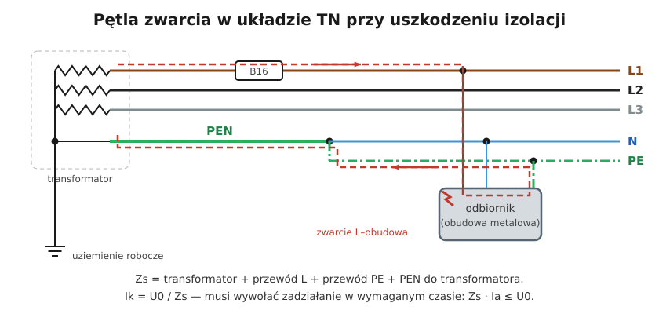
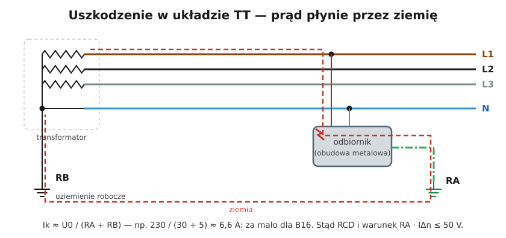

# 12.03 — Warunek skuteczności samoczynnego wyłączenia

> **Moduł:** [12 — Ochrona przeciwporażeniowa](README.md) · **Oznaczenia:** 📋 · **Zakres SEP:** (a) (b) (d) · **Status:** ✅ pełny
>
> **Czytaj:**
>
> - PN-HD 60364-4-41 — 411.4.4 (TN), 411.5.3 (TT)
> - PN-HD 60364-6 — sprawdzanie skuteczności samoczynnego wyłączenia
> - [E. Musiał — Pomiar impedancji pętli zwarciowej według PN-HD 60364-6 (Inżynier Budownictwa)](https://inzynierbudownictwa.pl/?p=11360)

[← poprzedni temat](12.02-ochrona-przy-uszkodzeniu-samoczynne-wylaczenie.md) · [spis modułu](README.md) · [następny temat →](12.04-izolacja-podwojna-separacja-elektryczna-selv-i.md)

## Po co to jest

Samo podłączenie PE i wstawienie wyłącznika nie wystarczy. Prąd zwarcia musi być na tyle duży, żeby zabezpieczenie zadziałało w wymaganym czasie. To się liczy i mierzy. Na egzaminie to najważniejszy warunek do zapamiętania i najczęstsze zadanie rachunkowe.

## Po ludzku

**Układ TN:**

$$Z_s \cdot I_a \le U_0$$

- $Z_s$ — impedancja pętli zwarcia: transformator + przewód fazowy + przewód ochronny do miejsca zwarcia i z powrotem;
- $I_a$ — prąd, który zapewnia zadziałanie zabezpieczenia w wymaganym czasie (0,4 s lub 5 s);
- $U_0$ — napięcie fazowe względem ziemi, 230 V.

Inaczej: **największa dopuszczalna impedancja pętli** to $Z_{s,max} = U_0 / I_a$.

**Skąd wziąć $I_a$:**

- wyłącznik nadprądowy: prąd zadziałania natychmiastowego — **B: 5 In, C: 10 In, D: 20 In** ([07.04](../07-zabezpieczenia-nadpradowe/07.04-charakterystyki-b-c-i-d.md));
- wkładka topikowa: z charakterystyki producenta dla 0,4 s lub 5 s;
- wyłącznik różnicowoprądowy: $I_{\Delta n}$ (dla 30 mA warunek jest praktycznie zawsze spełniony).

**Układ TT** (z RCD):

$$R_A \cdot I_{\Delta n} \le 50\ \mathrm{V}$$

**Zapas na nagrzanie przewodów.** Impedancję mierzy się na zimnej instalacji. Przy zwarciu przewody są cieplejsze, a ich rezystancja większa. Dlatego wynik pomiaru porównuje się często z wartością z zapasem:

$$Z_{s(zmierzone)} \le \frac{2}{3} \cdot \frac{U_0}{I_a}$$

Ten współczynnik 1,5 pochodzi z informacyjnego załącznika normy i nie wszyscy autorzy uważają go za konieczny ([Musiał](https://inzynierbudownictwa.pl/?p=11360)), ale w praktyce pomiarowej jest powszechny.

**Co zrobić, gdy warunek nie jest spełniony:**

1. mniejszy prąd $I_a$ — charakterystyka B zamiast C, mniejszy prąd znamionowy;
2. mniejsza impedancja — większy przekrój, krótszy obwód;
3. wyłącznik różnicowoprądowy w obwodzie;
4. połączenia wyrównawcze miejscowe dodatkowe ([12.05](12.05-ochrona-uzupelniajaca.md)).

## Schemat

## Pojęcia

| Pojęcie | Po ludzku | Termin normowy / symbol |
|---------|-----------|-------------------------|
| Impedancja pętli zwarcia | „Opór” całej drogi prądu zwarcia | $Z_s$ |
| Prąd zapewniający zadziałanie | Prąd, przy którym zabezpieczenie zadziała w wymaganym czasie | $I_a$ |
| Napięcie fazowe | Napięcie L względem ziemi | $U_0$ = 230 V |
| Rezystancja uziomu z przewodem | Suma rezystancji uziomu i PE (TT) | $R_A$ |

## Liczby do zapamiętania

| Wielkość | Wartość | Kiedy obowiązuje | Źródło |
|----------|---------|------------------|--------|
| Warunek TN | $Z_s \cdot I_a \le U_0$ | — | PN-HD 60364-4-41, 411.4.4 |
| Warunek TT | $R_A \cdot I_{\Delta n} \le 50$ V | z RCD | jw., 411.5.3 |
| $I_a$ wyłączników B / C / D | **5 / 10 / 20 × In** | 0,4 s i 5 s | PN-EN 60898-1 |
| $Z_{s,max}$ B10 / B16 / B20 / B25 | **4,60 / 2,88 / 2,30 / 1,84 Ω** | TN, 230 V | obliczenie |
| $Z_{s,max}$ C10 / C16 / C20 | **2,30 / 1,44 / 1,15 Ω** | jw. | obliczenie |
| Ocena pomiaru z zapasem | $Z_s \le \tfrac{2}{3} \cdot U_0 / I_a$ | pomiar „na zimno” | PN-HD 60364-6, zał. informacyjny |

## W praktyce

- **Pomiar** impedancji pętli w każdym gnieździe i na końcu każdego obwodu, miernikiem pętli; przy RCD — miernikiem z funkcją pomiaru bez wyzwalania RCD ([moduł 23](../23-pomiary-odbiorcze-i-okresowe/README.md)).
- **W protokole** wpisuje się zmierzone $Z_s$, wartość dopuszczalną i ocenę.
- **Długie obwody** (garaż, ogród, budynek gospodarczy) — sprawdź warunek już na etapie projektu: oblicz rezystancję przewodów ([01.06](../01-prad-napiecie-opor/01.06-grzanie-przewodow-i-spadek-napiecia.md)).

## Błędy i zagrożenia

- ⚠️ **Zmiana B16 na C16 „bo wybija”** bez pomiaru pętli — dopuszczalna impedancja spada o połowę.
- **Ocena pętli bez zapasu** przy wyniku tuż pod granicą — po nagrzaniu warunek może nie być spełniony.
- **Pomiar pętli przez RCD zwykłym miernikiem** — RCD wybija, pomiar nieudany albo fałszywy.

## Przykład

**Zadanie.** Obwód gniazd w garażu: B16, przewód 2,5 mm² Cu, długość 45 m, impedancja w rozdzielnicy (od strony sieci) 0,35 Ω. Czy warunek samoczynnego wyłączenia jest spełniony? Ocenić z zapasem 2/3.

**Rezystancja przewodów (L + PE, 2 × 45 m):**

$$R = \frac{0{,}0175 \cdot 90}{2{,}5} = 0{,}63\ \Omega$$

$$Z_s \approx 0{,}35 + 0{,}63 = 0{,}98\ \Omega$$

**Dopuszczalne:** $230 / 80 = 2{,}88\ \Omega$; z zapasem $\tfrac{2}{3} \cdot 2{,}88 = 1{,}92\ \Omega$.

**Wniosek.** 0,98 Ω < 1,92 Ω — warunek spełniony z dużym zapasem. Dla C16: $\tfrac{2}{3} \cdot 1{,}44 = 0{,}96\ \Omega$ — wynik 0,98 Ω jest już na granicy, więc C16 nie byłby dobrym wyborem.

## Pytania SEP

1. **Jaki warunek musi być spełniony, aby samoczynne wyłączenie zasilania w układzie TN było skuteczne?**

Odpowiedź

$Z_s \cdot I_a \le U_0$, gdzie $Z_s$ — impedancja pętli zwarcia obejmującej źródło, przewód fazowy do miejsca zwarcia i przewód ochronny między miejscem zwarcia a źródłem, $I_a$ — prąd zapewniający samoczynne zadziałanie urządzenia wyłączającego w wymaganym czasie (dla wyłączników nadprądowych prąd zadziałania bezzwłocznego, np. 5 In dla B), $U_0$ — napięcie znamionowe względem ziemi. Spełnienie warunku sprawdza się pomiarem impedancji pętli zwarcia, w praktyce z zapasem na wzrost rezystancji przewodów przy nagrzaniu.

2. **Jaki warunek musi być spełniony w układzie TT?**

Odpowiedź

Przy zastosowaniu wyłącznika różnicowoprądowego: $R_A \cdot I_{\Delta n} \le 50$ V, gdzie $R_A$ — suma rezystancji uziomu i przewodu ochronnego części przewodzących dostępnych, $I_{\Delta n}$ — znamionowy prąd różnicowy. Czas wyłączenia obwodów odbiorczych 230 V nie może przekroczyć 0,2 s.

3. **Jaka jest największa dopuszczalna impedancja pętli zwarcia dla obwodu zabezpieczonego wyłącznikiem C10 w układzie TN 230 V?**

Odpowiedź

$I_a = 10 \cdot 10 = 100$ A, więc $Z_{s,max} = 230 / 100 = 2{,}3\ \Omega$. Przy ocenie pomiaru z zapasem: $\tfrac{2}{3} \cdot 2{,}3 \approx 1{,}53\ \Omega$.

## Sprawdź się

1. Zmierzona impedancja pętli w gnieździe wynosi 1,7 Ω. Które z wyłączników spełnią warunek z zapasem 2/3: B10, B16, B20?

Odpowiedź

B10: $\tfrac{2}{3} \cdot 4{,}6 = 3{,}07$ Ω — tak. B16: $\tfrac{2}{3} \cdot 2{,}88 = 1{,}92$ Ω — tak. B20: $\tfrac{2}{3} \cdot 2{,}3 = 1{,}53$ Ω — nie.

## Źródła

- PN-HD 60364-4-41 — 411.4.4 (warunek w TN), 411.5.3 (warunek w TT), tab. 41.1.
- PN-HD 60364-6 — sprawdzanie skuteczności samoczynnego wyłączenia zasilania.
- [E. Musiał — Pomiar impedancji pętli zwarciowej według normy PN-HD 60364-6](https://inzynierbudownictwa.pl/?p=11360) — współczynnik 1,5 przy ocenie wyników, jego pochodzenie i krytyka.

---

[← poprzedni temat](12.02-ochrona-przy-uszkodzeniu-samoczynne-wylaczenie.md) · [spis modułu](README.md) · [następny temat →](12.04-izolacja-podwojna-separacja-elektryczna-selv-i.md)
