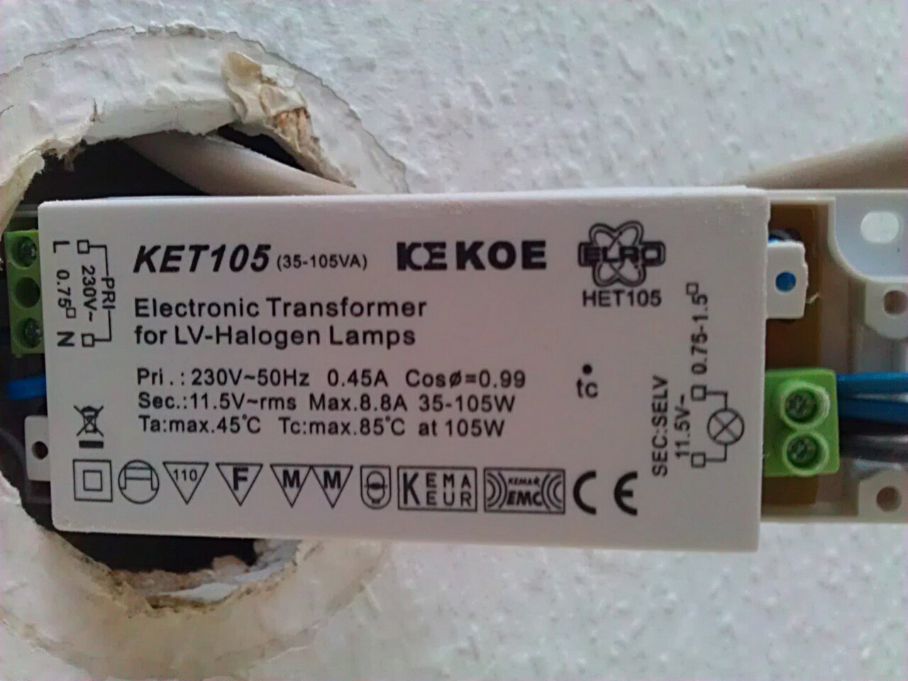
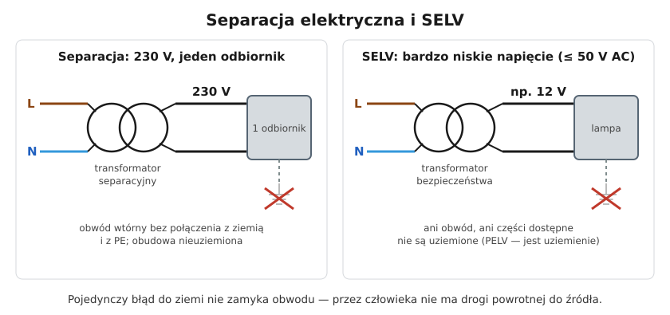

# 12.04 — Izolacja podwójna, separacja elektryczna, SELV i PELV

> **Moduł:** [12 — Ochrona przeciwporażeniowa](README.md) · **Oznaczenia:** 📋 · **Zakres SEP:** (a) (b) (d) · **Status:** ✅ pełny
>
> **Czytaj:**
>
> - PN-HD 60364-4-41 — 412 (izolacja podwójna), 413 (separacja), 414 (SELV i PELV)
> - PN-EN 61558-2-4 i 61558-2-6 — transformatory separacyjne i bezpieczeństwa
> - Klasy ochronności: [06.06](../06-osprzet-instalacyjny/06.06-klasy-ochronnosci-urzadzen-0-i-ii-iii.md)

[← poprzedni temat](12.03-warunek-skutecznosci-samoczynnego-wylaczenia.md) · [spis modułu](README.md) · [następny temat →](12.05-ochrona-uzupelniajaca.md)

## Po co to jest

Nie każda ochrona polega na wyłączaniu. Izolacja podwójna, separacja elektryczna i bardzo niskie napięcie chronią, bo w ogóle nie dopuszczają do groźnego napięcia na ciele człowieka. Spotkasz je w elektronarzędziach, oświetleniu 12 V, łazienkach, zbiornikach i na budowie. Na egzaminie: SELV, PELV, FELV i separacja.

## Po ludzku

**Izolacja podwójna lub wzmocniona.** Do izolacji podstawowej dochodzi druga, niezależna warstwa (albo jedna wzmocniona, równoważna dwóm). Uszkodzenie jednej warstwy nie odsłania części pod napięciem. To urządzenia **klasy II** ([06.06](../06-osprzet-instalacyjny/06.06-klasy-ochronnosci-urzadzen-0-i-ii-iii.md)) — nie mają PE i nie wolno go do nich przyłączać.

**Separacja elektryczna.** Odbiornik zasila się z **transformatora separacyjnego**, którego obwód wtórny **nie jest połączony z ziemią ani z PE**. Jeśli człowiek stojący na ziemi dotknie jednego przewodu obwodu wtórnego, prąd nie ma drogi powrotnej do źródła — obwód się nie zamyka. Zasady:

- najlepiej **jeden odbiornik** na jeden transformator (przy większej liczbie — dodatkowe warunki);
- obwód wtórny i obudowa odbiornika **nie są uziemione** i nie są połączone z PE;
- napięcie obwodu separowanego do 500 V, długość ograniczona (zalecenie: iloczyn napięcia i długości ≤ 100 000 V·m, długość ≤ 500 m);
- przewody obwodu separowanego oddzielone od innych obwodów i widoczne na całej długości, jeśli są ruchome.

Przykład: gniazdo do golarki w łazience z wbudowanym transformatorem separacyjnym, zasilanie elektronarzędzia w zbiorniku metalowym.

**SELV i PELV — bardzo niskie napięcie.** Napięcie **nie większe niż 50 V AC lub 120 V DC** (bez tętnień), ze źródła bezpiecznego: transformatora bezpieczeństwa, akumulatora, zasilacza z odpowiednią izolacją.

- **SELV** — obwód **nieuziemiony**, części dostępne nieuziemione;
- **PELV** — obwód może być **uziemiony** (np. ze względów funkcjonalnych), części dostępne mogą być połączone z PE;
- **FELV** — bardzo niskie napięcie tylko funkcjonalne, bez wymagań bezpiecznego źródła — **nie jest środkiem ochrony**, traktuje się je jak zwykły obwód.

Przy bardzo niskim napięciu ochrona podstawowa (izolacja, obudowy) nie jest wymagana tylko przy napięciu do **25 V AC / 60 V DC w warunkach suchych**. W innych warunkach — tylko do **12 V AC / 30 V DC**. Powyżej tych wartości części czynne izoluje się lub osłania.

**Gniazda i wtyczki SELV/PELV** muszą być niewymienne z gniazdami innych napięć.

## Jak to wygląda

*Na co patrzeć: na tabliczce jest wejście (Pri. 230 V) i wyjście (Sec. 11,5 V) oraz oznaczenie SELV przy zaciskach wtórnych. To zasilacz bezpieczny — po stronie 12 V przewody i lampa nie wymagają ochrony przy uszkodzeniu. Uwaga: strona 230 V transformatora (zaciski L, N) to zwykły obwód instalacji.*

## Schemat

## Pojęcia

| Pojęcie | Po ludzku | Termin normowy / symbol |
|---------|-----------|-------------------------|
| Izolacja podwójna | Dwie niezależne warstwy izolacji | klasa II, 412 |
| Separacja elektryczna | Odbiornik zasilany z transformatora separacyjnego, bez uziemienia | 413 |
| SELV | Bardzo niskie napięcie bezpieczne, nieuziemione | ≤ 50 V AC / 120 V DC |
| PELV | Bardzo niskie napięcie ochronne, może być uziemione | jw. |
| FELV | Bardzo niskie napięcie funkcjonalne — nie chroni | — |
| Transformator bezpieczeństwa | Źródło SELV/PELV z izolacją wzmocnioną | PN-EN 61558-2-6 |
| Transformator separacyjny | Źródło obwodu separowanego | PN-EN 61558-2-4 |

## Liczby do zapamiętania

| Wielkość | Wartość | Kiedy obowiązuje | Źródło |
|----------|---------|------------------|--------|
| SELV / PELV | ≤ **50 V AC**, ≤ **120 V DC** (bez tętnień) | — | PN-HD 60364-4-41, 414 |
| Bez ochrony podstawowej | do **25 V AC / 60 V DC** (sucho), do **12 V AC / 30 V DC** (pozostałe) | SELV, PELV | jw., 414.4.5 |
| Separacja — napięcie | do **500 V** | obwód separowany | jw., 413 |
| Separacja — długość | iloczyn **U · L ≤ 100 000 V·m**, **L ≤ 500 m** | zalecenie | jw. |
| Separacja — odbiorniki | zasadniczo **1** na źródło | — | jw., 413.1.2 |

## W praktyce

- **Oświetlenie 12 V** zasilaj z zasilaczy oznaczonych jako SELV (transformator bezpieczeństwa). Zwykły „zasilacz LED” bez takiego oznaczenia nie musi zapewniać separacji.
- **Prace w zbiornikach, kotłach, ciasnych przestrzeniach metalowych** — narzędzia zasilane z SELV albo przez separację, transformator poza zbiornikiem ([moduł 17](../17-pomieszczenia-szczegolne/README.md)).
- **Separacja**: obudowy odbiornika nie łącz z PE „dla bezpieczeństwa” — połączenie z ziemią niszczy separację.
- **Urządzenie klasy II** — nie podłączaj PE, nawet jeśli w przewodzie jest żyła żółto-zielona (zaizoluj ją).

## Błędy i zagrożenia

- ⚠️ **Autotransformator lub dzielnik jako źródło „bezpiecznego” napięcia** — nie ma separacji od sieci.
- ⚠️ **Kilka odbiorników na jednym transformatorze separacyjnym** bez połączeń wyrównawczych — dwa uszkodzenia na różnych przewodach dają napięcie między obudowami.
- **Uziemienie obwodu wtórnego w separacji** — zamienia ochronę w zwykły obwód bez wyłączania.
- **Gniazdo 12 V, do którego wchodzi wtyczka 230 V** — ktoś pomyli napięcia.

## Przykład

**Zadanie.** Do pracy wewnątrz metalowego zbiornika potrzebna jest lampa ręczna. Masz: lampę 230 V klasy I, lampę 230 V klasy II i lampę 24 V z transformatorem bezpieczeństwa. Którą wybrać?

**Rozwiązanie.** Wewnątrz zbiornika (przestrzeń ograniczona, przewodzące ściany, często wilgoć) stosuje się SELV — **lampę 24 V z transformatorem bezpieczeństwa**, a transformator umieszcza się **poza zbiornikiem**. Lampa klasy II jest lepsza od klasy I, ale uszkodzenie obudowy przy uderzeniu o ścianę zbiornika odsłoni 230 V, a człowiek ma doskonały kontakt z „ziemią”. Szczegółowe wymagania — [moduł 17](../17-pomieszczenia-szczegolne/README.md).

## Pytania SEP

1. **Czym różni się SELV od PELV i FELV?**

Odpowiedź

Wszystkie to bardzo niskie napięcia (do 50 V AC lub 120 V DC). SELV — bezpieczne: zasilane ze źródła bezpiecznego (np. transformatora bezpieczeństwa), obwód i części dostępne nie są uziemione. PELV — ochronne: źródło bezpieczne, ale obwód lub części dostępne mogą być uziemione. FELV — funkcjonalne: nie spełnia wymagań dla źródła bezpiecznego lub separacji i nie jest środkiem ochrony przeciwporażeniowej; obwody FELV chroni się jak obwody o napięciu sieciowym.

2. **Na czym polega ochrona przez separację elektryczną?**

Odpowiedź

Odbiornik zasila się z transformatora separacyjnego (lub równoważnego źródła), którego obwód wtórny nie ma połączenia z ziemią ani z innymi obwodami, a części przewodzące dostępne odbiornika nie są uziemione ani połączone z przewodem ochronnym. Pojedyncze uszkodzenie izolacji nie powoduje przepływu prądu przez człowieka do ziemi, bo nie ma zamkniętego obwodu. Zasadniczo z jednego źródła zasila się jeden odbiornik, a napięcie obwodu separowanego nie przekracza 500 V.

3. **Jakie źródła zasilania można stosować dla obwodów SELV i PELV?**

Odpowiedź

Transformator bezpieczeństwa (PN-EN 61558-2-6), źródło zapewniające równoważny stopień bezpieczeństwa (np. przetwornica z uzwojeniami o odpowiedniej izolacji), źródło elektrochemiczne (akumulator, bateria) lub inne źródło niezależne od obwodów o wyższym napięciu (np. agregat), a także urządzenia elektroniczne spełniające wymagania norm dla źródeł SELV.

## Sprawdź się

1. Lampka 12 V na zasilaczu z oznaczeniem SELV. Czy jej metalową obudowę trzeba połączyć z PE?

Odpowiedź

Nie — w SELV części dostępne nie są uziemiane ani łączone z PE.

## Źródła

- PN-HD 60364-4-41 — 412 (izolacja podwójna lub wzmocniona), 413 (separacja elektryczna), 414 (SELV i PELV), 411.7 (FELV).
- PN-EN 61558-2-4 — transformatory separacyjne; PN-EN 61558-2-6 — transformatory bezpieczeństwa.

---

[← poprzedni temat](12.03-warunek-skutecznosci-samoczynnego-wylaczenia.md) · [spis modułu](README.md) · [następny temat →](12.05-ochrona-uzupelniajaca.md)
