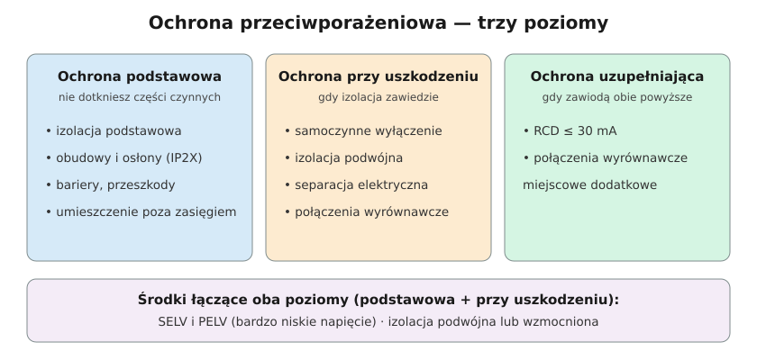

# 12.05 — Ochrona uzupełniająca

> **Moduł:** [12 — Ochrona przeciwporażeniowa](README.md) · **Oznaczenia:** 📋 · **Zakres SEP:** (a) (b) (d) · **Status:** ✅ pełny
>
> **Czytaj:**
>
> - PN-HD 60364-4-41 — 415 (ochrona uzupełniająca)
> - Różnicówki 30 mA: [08.02](../08-wylaczniki-roznicowopradowe/08.02-prad-roznicowy-znamionowy-30-ma-100-ma-300-ma.md)
> - Łazienki: [moduł 17](../17-pomieszczenia-szczegolne/README.md)

[← poprzedni temat](12.04-izolacja-podwojna-separacja-elektryczna-selv-i.md) · [spis modułu](README.md) · [następny temat →](12.06-dawne-nazwy-zerowanie-uziemienie-ochronne.md)

## Po co to jest

Ochrona podstawowa i przy uszkodzeniu mogą zawieść jednocześnie albo człowiek może je obejść — na przykład wkładając śrubokręt do gniazda albo przecinając przewód pod napięciem. Ochrona uzupełniająca to ostatnia warstwa na takie sytuacje. Na egzaminie: jakie środki obejmuje i kiedy jest wymagana.

## Po ludzku

**Dwa środki ochrony uzupełniającej:**

1. **Wyłącznik różnicowoprądowy o IΔn ≤ 30 mA** — wyłącza, gdy prąd ucieka do ziemi przez człowieka, zanim dojdzie do migotania komór ([08.02](../08-wylaczniki-roznicowopradowe/08.02-prad-roznicowy-znamionowy-30-ma-100-ma-300-ma.md)). Działa także przy dotyku bezpośrednim, czego nie zapewnia samoczynne wyłączenie nadprądowe.
2. **Połączenia wyrównawcze miejscowe dodatkowe** — łączą ze sobą wszystkie części przewodzące, których można dotknąć jednocześnie (obudowy urządzeń, rury, grzejniki, wanna metalowa) w danym pomieszczeniu. Jeśli wszystko ma ten sam potencjał, nie ma między nimi napięcia, nawet gdy zabezpieczenie wyłączy z opóźnieniem.

**Ochrona uzupełniająca nie zastępuje** ochrony podstawowej ani przy uszkodzeniu. Różnicówka bez PE zadziała dopiero, gdy prąd popłynie przez człowieka.

**Kiedy RCD 30 mA jest wymagany** (PN-HD 60364-4-41:2017):

- gniazda do 32 A ogólnego użytku,
- urządzenia ruchome do 32 A na zewnątrz,
- oświetlenie w lokalach mieszkalnych,
- pomieszczenia szczególne (łazienki, sauny, place budowy) według arkuszy części 7 ([moduł 17](../17-pomieszczenia-szczegolne/README.md)).

**Połączenia wyrównawcze miejscowe dodatkowe** stosuje się m.in. tam, gdzie nie da się dotrzymać czasu samoczynnego wyłączenia, i w pomieszczeniach szczególnych zgodnie z ich arkuszami. Ich skuteczność sprawdza się warunkiem rezystancji między częściami jednocześnie dostępnymi: $R \le 50\ \mathrm{V} / I_a$.

## Schemat

## Pojęcia

| Pojęcie | Po ludzku | Termin normowy / symbol |
|---------|-----------|-------------------------|
| Ochrona uzupełniająca | Gdy zawiodą inne środki lub przy nieostrożności | 415 |
| Połączenia wyrównawcze miejscowe dodatkowe | Łączenie metalowych elementów w jednym pomieszczeniu | 415.2 |
| Części jednocześnie dostępne | Części, których można dotknąć naraz (ok. 2,5 m) | — |

## Liczby do zapamiętania

| Wielkość | Wartość | Kiedy obowiązuje | Źródło |
|----------|---------|------------------|--------|
| RCD ochrony uzupełniającej | IΔn ≤ **30 mA** | — | PN-HD 60364-4-41, 415.1 |
| Obowiązkowo RCD 30 mA | gniazda ≤ 32 A, urządzenia ruchome na zewnątrz ≤ 32 A, oświetlenie w mieszkaniach | — | jw., 411.3.3, 411.3.4 |
| Warunek połączeń dodatkowych | $R \le 50\ \mathrm{V} / I_a$ (AC) | między częściami jednocześnie dostępnymi | jw., 415.2.2 |

## W praktyce

- **Każdy obwód gniazd i oświetlenia w mieszkaniu za RCD 30 mA**, z sensownym podziałem ([08.07](../08-wylaczniki-roznicowopradowe/08.07-podzial-obwodow-miedzy-wylaczniki.md)).
- **Połączenia wyrównawcze miejscowe** w łazience, kotłowni, pomieszczeniach z wieloma metalowymi instalacjami — według arkuszy części 7 i projektu ([moduł 13](../13-uziemienia-i-wyrownanie/README.md)).
- **Przy modernizacji starej instalacji** RCD to najtańszy krok poprawiający bezpieczeństwo, ale bez doprowadzenia PE ochrona jest niepełna.

## Błędy i zagrożenia

- ⚠️ **„Mam różnicówkę, więc PE nie jest potrzebny”** — RCD zadziała dopiero po przepływie prądu przez człowieka.
- **RCD 30 mA zastąpiony 100 mA lub zmostkowany**, bo wybijał.
- **Połączenia wyrównawcze „na skróty”** przez rury z elementami plastikowymi (złączki PEX) — przerwa w połączeniu, której nie widać.

## Przykład

**Sytuacja.** Dziecko wkłada metalowy klucz do otworu fazy w gnieździe i dotyka drugą ręką grzejnika.

**Co chroni?** Ochrona podstawowa została obejściona. Ochrona przy uszkodzeniu nie ma tu zastosowania — nie ma uszkodzenia izolacji, jest dotyk bezpośredni. Prąd płynie: faza → klucz → ręka → ciało → grzejnik → PE / ziemia. Różnicówka 30 mA widzi różnicę i wyłącza w ułamku sekundy. Wyłącznik nadprądowy nic by nie zrobił — kilkadziesiąt miliamperów to dla niego nic.

**Wniosek.** Właśnie dlatego RCD 30 mA jest obowiązkowy w obwodach gniazd. A przesłony torów prądowych w gniazdach ([06.01](../06-osprzet-instalacyjny/06.01-gniazda-wtyczkowe-jednofazowe-z-bolcem.md)) wzmacniają ochronę podstawową tam, gdzie są dzieci.

## Pytania SEP

1. **Na czym polega ochrona uzupełniająca i jakie środki się do niej zalicza?**

Odpowiedź

Na zapewnieniu ochrony w przypadku uszkodzenia środków ochrony podstawowej lub przy uszkodzeniu albo nieostrożności użytkownika. Zalicza się do niej wyłączniki różnicowoprądowe o znamionowym prądzie różnicowym nie większym niż 30 mA oraz połączenia wyrównawcze ochronne miejscowe dodatkowe. Ochrona uzupełniająca nie może być jedynym środkiem ochrony — stosuje się ją jako uzupełnienie ochrony podstawowej i przy uszkodzeniu.

2. **Do czego służą połączenia wyrównawcze miejscowe dodatkowe?**

Odpowiedź

Do wyrównania potencjałów części przewodzących dostępnych i obcych, których można dotknąć jednocześnie, tak by przy uszkodzeniu napięcie między nimi nie przekroczyło wartości dopuszczalnej. Stosuje się je, gdy nie można dotrzymać wymaganego czasu samoczynnego wyłączenia oraz w pomieszczeniach o zwiększonym zagrożeniu porażeniem, zgodnie z wymaganiami dla tych pomieszczeń.

## Sprawdź się

1. Czy RCD 30 mA chroni przed porażeniem przy dotknięciu jednocześnie L i N?

Odpowiedź

Nie, jeśli człowiek jest odizolowany od ziemi — prąd płynie z L przez ciało do N i wraca przez przekładnik, więc nie ma prądu różnicowego.

## Źródła

- PN-HD 60364-4-41:2017 — 411.3.3, 411.3.4, 415.1 (RCD), 415.2 (połączenia wyrównawcze miejscowe dodatkowe).

---

[← poprzedni temat](12.04-izolacja-podwojna-separacja-elektryczna-selv-i.md) · [spis modułu](README.md) · [następny temat →](12.06-dawne-nazwy-zerowanie-uziemienie-ochronne.md)
