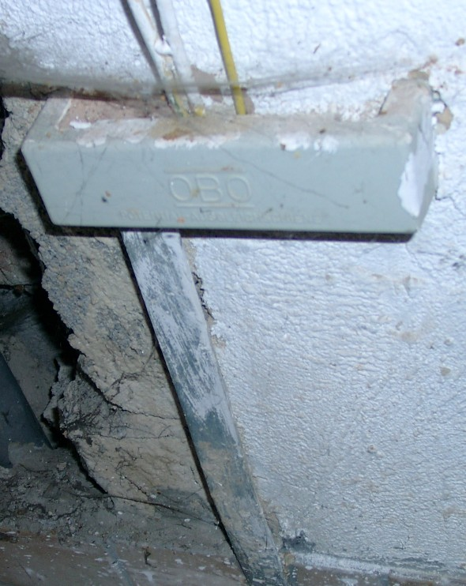
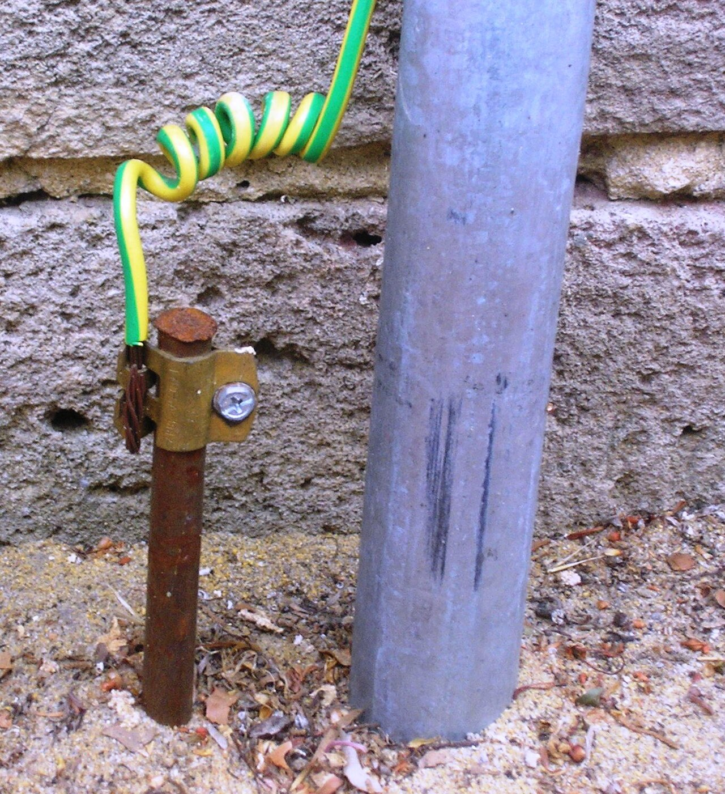
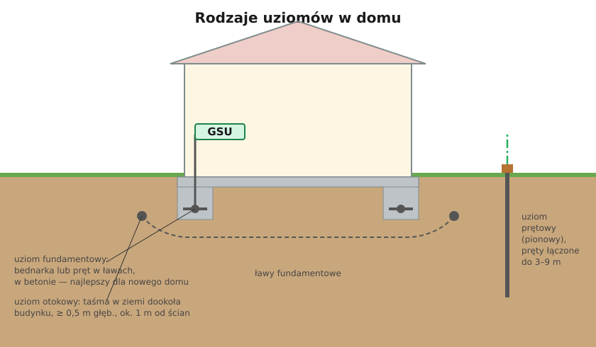

# 13.01 — Uziom: fundamentowy, otokowy, prętowy

> **Moduł:** [13 — Uziemienia i połączenia wyrównawcze](README.md) · **Oznaczenia:** 🏠📋 · **Zakres SEP:** (a) (b) (c) · **Status:** ✅ pełny
>
> **Czytaj:**
>
> - PN-HD 60364-5-54 — uziomy (542.2, tab. 54.1)
> - [Instalacje uziemiające — zalecenia norm (Inżynier Budownictwa)](https://inzynierbudownictwa.pl/?p=9271)
> - Instalacja odgromowa: [09.05](../09-ochrona-przeciwprzepieciowa/09.05-ochrona-odgromowa-budynku-podstawy.md)

← (początek modułu) · [spis modułu](README.md) · [następny temat →](13.02-rezystancja-uziemienia-od-czego-zalezy.md)

## Po co to jest

Uziom to metalowa część instalacji zakopana w ziemi albo zatopiona w betonie fundamentu. Łączy instalację z ziemią: odprowadza prądy uszkodzeniowe, piorunowe i przepięciowe, a w układzie TT jest podstawą ochrony przeciwporażeniowej. Na egzaminie: rodzaje uziomów i z czego wolno je wykonać.

## Po ludzku

**Uziom fundamentowy** — stalowa taśma (bednarka) lub pręt ułożony w betonie ław fundamentowych, połączony ze zbrojeniem. Beton jest wilgotny i dobrze styka się z gruntem na dużej powierzchni, więc taki uziom ma małą rezystancję i nie koroduje (chroni go beton). Wyprowadza się z niego **końcówki** do głównej szyny uziemiającej i do instalacji odgromowej. W nowym budynku to najlepsze i najtańsze rozwiązanie — trzeba o nim pomyśleć na etapie fundamentów, bo potem się go nie dołoży.

**Uziom otokowy** — taśma lub drut ułożone w ziemi dookoła budynku, na głębokości co najmniej 0,5 m i ok. 1 m od ścian. Stosuje się go, gdy nie ma uziomu fundamentowego, i jako uziom instalacji odgromowej.

**Uziom prętowy (pionowy)** — pręty wbijane w ziemię, łączone odcinkami na głębokość kilku metrów. Sięga głębszych, zwykle wilgotniejszych warstw gruntu. Szybki do wykonania przy istniejącym budynku.

**Uziomy naturalne** — metalowe elementy, które i tak są w ziemi: zbrojenie fundamentów, metalowe konstrukcje. Rur z cieczami i gazami palnymi **nie wolno** używać jako uziomu. Wodociąg metalowy nie może być jedynym uziomem — ktoś może go wymienić na plastikowy.

**Materiały** muszą wytrzymać korozję w ziemi przez dziesiątki lat: stal ocynkowana ogniowo, stal nierdzewna, miedź, stal pokryta miedzią — o minimalnych wymiarach z normy (tabela poniżej). Połączenia w ziemi spawa się albo wykonuje złączkami przeznaczonymi do tego i zabezpiecza przed korozją.

## Jak to wygląda

*Na co patrzeć: płaska stalowa taśma to wyprowadzenie uziomu fundamentowego. Kończy się w skrzynce szyny wyrównawczej, do której dochodzi żółto-zielony przewód. Takie wyprowadzenie musi być dostępne — przez nie mierzy się i sprawdza uziom.*

*Na co patrzeć: zacisk na pręcie łączy uziom z przewodem uziemiającym. Zacisk i koniec pręta są narażone na korozję — muszą być dostępne do oględzin i pomiarów.*

## Schemat

## Pojęcia

| Pojęcie | Po ludzku | Termin normowy / symbol |
|---------|-----------|-------------------------|
| Uziom | Metal w ziemi lub betonie łączący instalację z ziemią | uziom |
| Uziom fundamentowy | Taśma lub pręt w betonie fundamentu | — |
| Uziom otokowy | Taśma w ziemi dookoła budynku | uziom typu B (PN-EN 62305-3) |
| Uziom prętowy | Pręty wbite pionowo | uziom typu A |
| Uziom naturalny | Metal, który i tak jest w ziemi (zbrojenie) | — |
| Bednarka | Płaska stalowa taśma ocynkowana | — |

## Liczby do zapamiętania

| Wielkość | Wartość | Kiedy obowiązuje | Źródło |
|----------|---------|------------------|--------|
| Taśma stalowa ocynkowana | ≥ **90 mm²**, grubość ≥ **3 mm** | uziom | PN-HD 60364-5-54, tab. 54.1 |
| Pręt stalowy ocynkowany | średnica ≥ **16 mm** | uziom pionowy | jw. |
| Pręt stalowy pokryty miedzią | średnica ≥ **14 mm**, powłoka **250 μm** | jw. | jw. |
| Taśma miedziana | ≥ **50 mm²**, grubość **2 mm** | — | jw. |
| Uziom otokowy | głębokość ≥ **0,5 m**, ok. **1 m** od ścian | — | PN-EN 62305-3 |
| Rury z gazem lub cieczami palnymi | **nie wolno** jako uziom | — | PN-HD 60364-5-54 |

## W praktyce

- **Nowy dom:** uziom fundamentowy w projekcie i wykonany przez ekipę od fundamentów, z wyprowadzeniami w miejscu GSU i przy przewodach odprowadzających instalacji odgromowej. Zrób zdjęcia przed zalaniem betonem.
- **Istniejący dom bez uziomu:** uziom otokowy lub prętowy, połączony z GSU. Przy TT — rezystancja dobrana do warunku z RCD ([11.05](../11-uklady-sieci/11.05-uklad-tt.md)).
- **Połączenia w ziemi** — spawane albo złączkami do uziomów; miejsce połączenia zabezpiecz przed korozją (taśma antykorozyjna, masa bitumiczna).
- **Nie łącz w ziemi stali ocynkowanej z miedzią** bez zabezpieczenia — korozja galwaniczna zje stal.

## Błędy i zagrożenia

- ⚠️ **Rura gazowa jako uziom** — niedopuszczalne.
- **Uziom tylko przez wodociąg** — po wymianie rury na plastikową instalacja zostaje bez uziomu i nikt o tym nie wie.
- **Brak wyprowadzeń z uziomu fundamentowego** — uziom jest, ale nie da się go podłączyć.
- **Zwykły pręt zbrojeniowy (czarna stal) w ziemi** zamiast pręta uziomowego — koroduje w kilka lat.

## Przykład

**Sytuacja.** Budowa domu w stanie fundamentów. Inwestor pyta, czy uziom „zrobi się później, przy instalacji elektrycznej”.

**Odpowiedź.** Uziom fundamentowy wykonuje się teraz: bednarka 30×4 mm (stal ocynkowana) ułożona w ławach, połączona ze zbrojeniem co kilka metrów, z wyprowadzeniami w miejscu przyszłej GSU (np. pomieszczenie techniczne) i w narożnikach dla instalacji odgromowej. Koszt — materiał i godzina pracy. Później zostaje tylko uziom otokowy lub prętowy: więcej pracy, wykopy, często gorsza rezystancja.

## Pytania SEP

1. **Jakie rodzaje uziomów stosuje się w instalacjach elektrycznych?**

Odpowiedź

Uziomy sztuczne: fundamentowe (taśma lub pręt w betonie fundamentu), otokowe (taśma lub drut w ziemi dookoła obiektu), poziome (taśmy, druty), pionowe — prętowe (pręty wbijane) i rurowe, płytowe, kratowe. Uziomy naturalne: metalowe elementy umieszczone w ziemi w innym celu, np. zbrojenie fundamentów, konstrukcje stalowe. Nie wolno stosować jako uziomów rurociągów z cieczami i gazami palnymi.

2. **Z jakich materiałów wykonuje się uziomy?**

Odpowiedź

Ze stali ocynkowanej ogniowo, stali nierdzewnej, miedzi i stali pokrytej miedzią, o wymiarach nie mniejszych niż podane w normie (np. taśma stalowa ocynkowana 90 mm² i grubości 3 mm, pręt stalowy ocynkowany o średnicy 16 mm, taśma miedziana 50 mm²). Materiał musi być odporny na korozję w danym gruncie.

## Sprawdź się

1. Dlaczego uziom fundamentowy ma zwykle mniejszą rezystancję niż kilka prętów?

Odpowiedź

Bo styka się z gruntem przez dużą powierzchnię betonu fundamentów, który jest stale wilgotny, a jego długość to cały obwód budynku.

## Źródła

- PN-HD 60364-5-54 — 542.2 (uziomy), tab. 54.1 (minimalne wymiary).
- PN-EN 62305-3 — uziomy instalacji odgromowej (otokowy, typ A i B).
- [Inżynier Budownictwa — Instalacje uziemiające, zalecenia norm](https://inzynierbudownictwa.pl/?p=9271) — wymiary uziomów, głębokość otokowego, uziom fundamentowy.

---

← (początek modułu) · [spis modułu](README.md) · [następny temat →](13.02-rezystancja-uziemienia-od-czego-zalezy.md)
