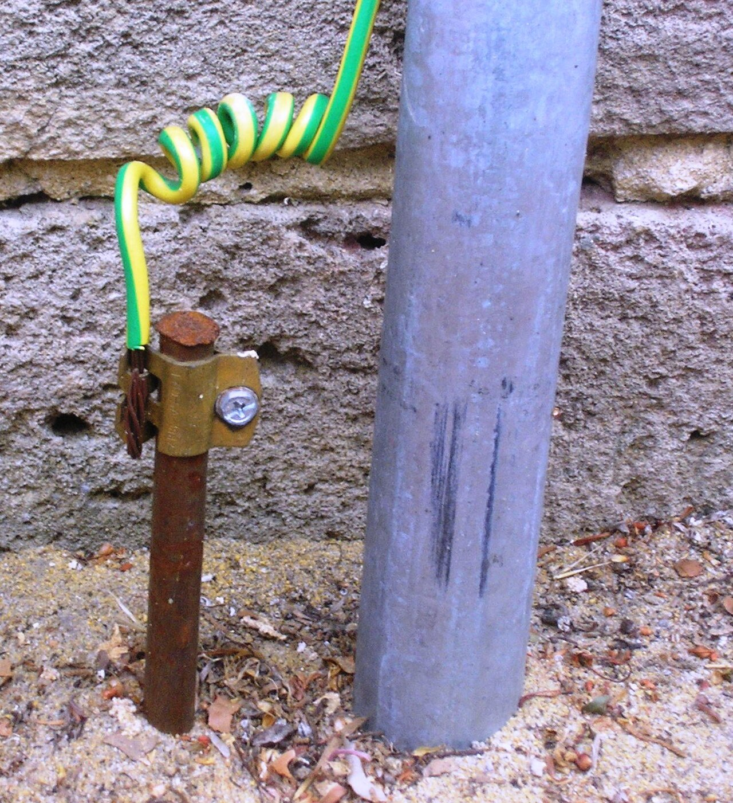
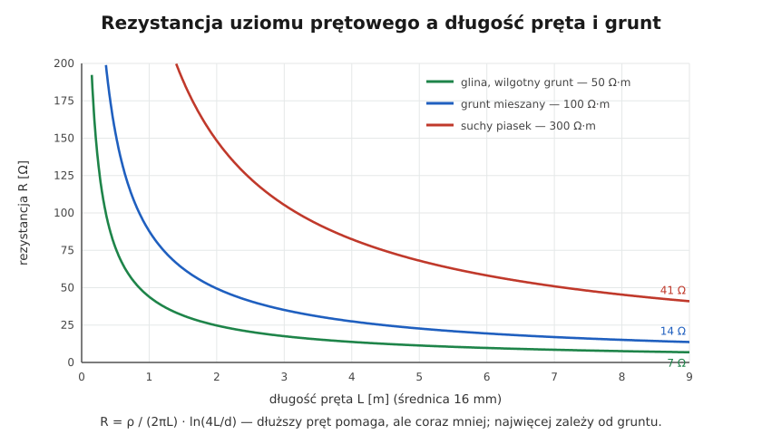

# 13.02 — Rezystancja uziemienia — od czego zależy

> **Moduł:** [13 — Uziemienia i połączenia wyrównawcze](README.md) · **Oznaczenia:** 🏠📋 · **Zakres SEP:** (a) (b) (c) · **Status:** ✅ pełny
>
> **Czytaj:**
>
> - PN-HD 60364-5-54 — wymagania dla uziemień
> - Pomiar rezystancji uziemienia: [moduł 23](../23-pomiary-odbiorcze-i-okresowe/README.md)

[← poprzedni temat](13.01-uziom-fundamentowy-otokowy-pretowy.md) · [spis modułu](README.md) · [następny temat →](13.03-glowna-szyna-uziemiajaca.md)

## Po co to jest

Uziom ma „rezystancję uziemienia” — opór, jaki stawia prądowi wypływającemu do gruntu. W układzie TT od niej zależy skuteczność ochrony, w instalacji odgromowej — bezpieczne odprowadzenie prądu pioruna. Trzeba wiedzieć, od czego zależy, dlaczego zmienia się z porą roku i jak ją poprawić.

## Po ludzku

Prąd, który wpływa do uziomu, rozpływa się w gruncie na wszystkie strony. Opór, jaki napotyka, zależy od:

1. **rezystywności gruntu ρ** — najważniejsze. Wilgotna glina przewodzi dobrze, suchy piasek i skała bardzo słabo. Różnica to nawet kilkadziesiąt razy;
2. **wymiarów i kształtu uziomu** — dłuższy pręt, dłuższa taśma, większa powierzchnia styku = mniejsza rezystancja. Ale korzyść maleje — dwa razy dłuższy pręt nie daje dwa razy mniejszej rezystancji;
3. **głębokości** — głębiej grunt jest zwykle wilgotniejszy i nie zamarza;
4. **wilgotności i temperatury** — suche lato i mróz zwiększają rezystancję;
5. **stanu połączeń i korozji** — skorodowane połączenia dokładają oporu.

**Kilka prętów** obok siebie działa lepiej niż jeden, ale tylko gdy są rozstawione co najmniej na odległość równą ich długości. Pręty stojące blisko siebie „przeszkadzają” sobie nawzajem.

**Ile powinna wynosić?** Nie ma jednej liczby dla wszystkiego:

- **układ TT** — warunek $R_A \cdot I_{\Delta n} \le 50$ V ([11.05](../11-uklady-sieci/11.05-uklad-tt.md)),
- **instalacja odgromowa i ogólnie** — zaleca się poniżej **10 Ω**,
- **punkt podziału PEN w TN-C-S** — im mniej, tym lepiej, wartości może określać operator.

## Jak to wygląda

*Na co patrzeć: pręt wchodzi pionowo w grunt. Jego rezystancja zależy od tego, jak głęboko sięga i jaki jest grunt w tym miejscu. Przy pomiarze rozłącza się go od instalacji, żeby mierzyć sam uziom.*

## Schemat

## Pojęcia

| Pojęcie | Po ludzku | Termin normowy / symbol |
|---------|-----------|-------------------------|
| Rezystancja uziemienia | Opór uziomu dla prądu wpływającego do ziemi | $R_E$, $R_A$ |
| Rezystywność gruntu | Jak dobrze grunt przewodzi | ρ [Ω·m] |
| Współczynnik sezonowy | Poprawka na porę roku przy pomiarze | — |
| Strefa oddziaływania | Obszar gruntu, w którym rozpływa się prąd uziomu | — |

## Liczby do zapamiętania

| Wielkość | Wartość | Kiedy obowiązuje | Źródło |
|----------|---------|------------------|--------|
| Uziom prętowy | $R \approx \dfrac{\rho}{2\pi L} \ln\dfrac{4L}{d}$ | grunt jednorodny | wzór teoretyczny |
| Szybkie oszacowanie pręta | $R \approx \rho / L$ | L — długość w m | reguła praktyczna |
| Zalecana rezystancja ogólnie / odgromowa | **< 10 Ω** | — | PN-EN 62305-3, [Inżynier Budownictwa](https://inzynierbudownictwa.pl/?p=9271) |
| Warunek TT | $R_A \le 50\ \mathrm{V} / I_{\Delta n}$ | z RCD | PN-HD 60364-4-41 |
| Rezystywność gruntu (rząd) | glina **kilkadziesiąt**, piasek suchy **setki–tysiące** Ω·m | — | literatura |
| Rozstaw prętów | ≥ **długość pręta** | uziomy wielokrotne | praktyka |

## W praktyce

- **Za duża rezystancja?** Kolejne pręty (rozstawione), dłuższy pręt sięgający wilgotniejszej warstwy, taśma pozioma łącząca pręty, w ostateczności poprawa gruntu wokół uziomu.
- **Mierz w złych warunkach** (sucho, mróz) albo uwzględnij współczynnik sezonowy — w wilgotny dzień uziom wyjdzie lepszy niż jest naprawdę.
- **Pomiar na rozłączonym złączu kontrolnym** — inaczej zmierzysz równoległe połączenie z innymi uziomami (wodociąg, sieć) ([moduł 23](../23-pomiary-odbiorcze-i-okresowe/README.md)).

## Błędy i zagrożenia

- **Kilka prętów wbitych obok siebie co 50 cm** — prawie jak jeden pręt.
- **Pomiar w deszczowy dzień bez poprawki** — zawyżona ocena uziomu.
- **Brak okresowych pomiarów** — korozja i wysychanie gruntu stopniowo pogarszają uziom.

## Przykład

**Zadanie.** Dom w układzie TT, grunt piaszczysty ρ ≈ 300 Ω·m. Ile mniej więcej da pręt 6 m i czy wystarczy dla RCD 30 mA? A dla 300 mA?

$$R \approx \frac{300}{2\pi \cdot 6} \ln\frac{4 \cdot 6}{0{,}016} \approx 7{,}96 \cdot 7{,}31 \approx 58\ \Omega$$

**Warunek:** RCD 30 mA: $58 \cdot 0{,}03 = 1{,}7$ V ≤ 50 V — tak. RCD 300 mA: $58 \cdot 0{,}3 = 17{,}4$ V ≤ 50 V — tak.

**Wniosek.** Dla ochrony przeciwporażeniowej wystarczy. Dla instalacji odgromowej (zalecane < 10 Ω) trzeba dużo więcej: uziomu otokowego lub kilku dłuższych prętów.

## Pytania SEP

1. **Od czego zależy rezystancja uziemienia?**

Odpowiedź

Od rezystywności gruntu (rodzaju gruntu, jego wilgotności, temperatury, zamarznięcia), od wymiarów, kształtu i głębokości ułożenia uziomu, od liczby i rozstawienia elementów uziomu wielokrotnego oraz od stanu połączeń i korozji. Zmienia się z porą roku — największa jest przy suchym gruncie i mrozie.

2. **Jak można zmniejszyć rezystancję uziemienia?**

Odpowiedź

Wydłużając uziom pionowy, by sięgał głębszych, wilgotniejszych warstw, dodając kolejne elementy uziomu rozstawione w odległości nie mniejszej niż ich długość, łącząc je uziomem poziomym (otokowym), wykorzystując uziom fundamentowy, a w szczególnych przypadkach zmieniając właściwości gruntu wokół uziomu.

## Sprawdź się

1. Dlaczego pomiar rezystancji uziemienia wykonuje się na rozłączonym złączu kontrolnym?

Odpowiedź

Żeby zmierzyć sam badany uziom, a nie jego równoległe połączenie z innymi uziomami (przez PE, sieć, wodociąg), które dałoby zaniżony, mylący wynik.

## Źródła

- PN-HD 60364-5-54 — uziomy i uziemienia.
- PN-EN 62305-3 — uziomy instalacji odgromowej.
- [Inżynier Budownictwa — Instalacje uziemiające, zalecenia norm](https://inzynierbudownictwa.pl/?p=9271) — zalecana rezystancja do 10 Ω.

---

[← poprzedni temat](13.01-uziom-fundamentowy-otokowy-pretowy.md) · [spis modułu](README.md) · [następny temat →](13.03-glowna-szyna-uziemiajaca.md)
