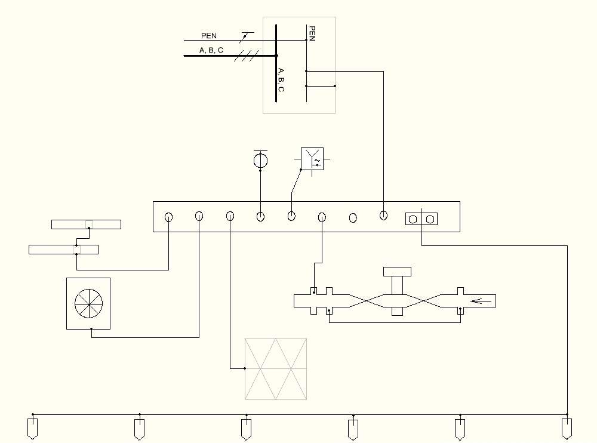
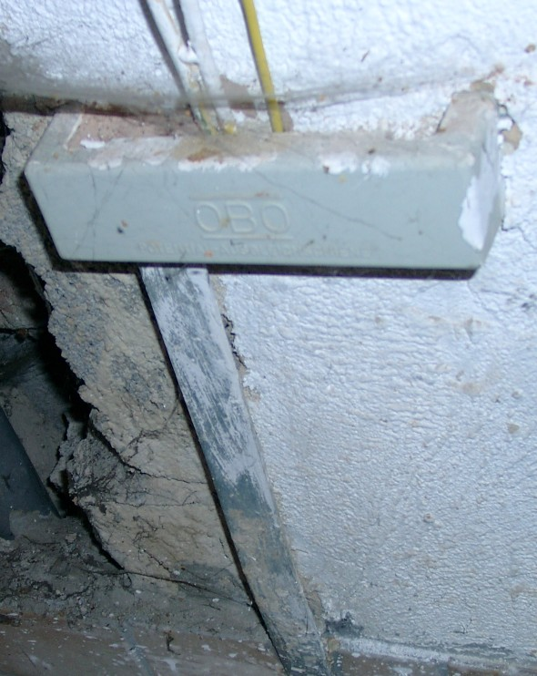
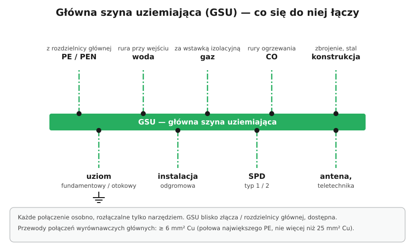

# 13.03 — Główna szyna uziemiająca

> **Moduł:** [13 — Uziemienia i połączenia wyrównawcze](README.md) · **Oznaczenia:** 🏠📋 · **Zakres SEP:** (a) (b) (c) · **Status:** ✅ pełny
>
> **Czytaj:**
>
> - PN-HD 60364-5-54 — 542.4 (główny zacisk uziemiający)
> - Rozdzielenie PEN: [11.04](../11-uklady-sieci/11.04-uklad-tn-c-s-i-punkt-rozdzialu-pen.md)

[← poprzedni temat](13.02-rezystancja-uziemienia-od-czego-zalezy.md) · [spis modułu](README.md) · [następny temat →](13.04-polaczenia-wyrownawcze-ochronne-glowne.md)

## Po co to jest

Główna szyna uziemiająca (GSU, w normie: główny zacisk uziemiający) to „węzeł” całego systemu ochronnego budynku. Spotykają się na niej uziom, przewód ochronny instalacji i wszystkie metalowe instalacje wchodzące do budynku. Każdy elektryk musi umieć ją znaleźć, sprawdzić i poprawnie do niej podłączyć.

## Po ludzku

GSU to metalowa szyna (zwykle miedziana lub mosiężna, w obudowie) z kilkoma zaciskami. Montuje się ją **blisko miejsca wprowadzenia zasilania** — przy złączu, w rozdzielnicy głównej, w pomieszczeniu technicznym.

**Co się do niej łączy:**

- **przewód uziemiający** od uziomu (fundamentowego, otokowego),
- **przewód PE** (albo punkt podziału PEN) z rozdzielnicy głównej,
- **przewody połączeń wyrównawczych głównych** — do rur wody, gazu (za wstawką izolacyjną), ogrzewania, metalowej konstrukcji, kanałów wentylacji ([13.04](13.04-polaczenia-wyrownawcze-ochronne-glowne.md)),
- **instalacja odgromowa** i **ograniczniki przepięć**,
- ekrany i przewody ochronne telekomunikacji, anten.

**Zasady:**

- każdy przewód pod **osobnym zaciskiem**;
- odłączenie przewodu możliwe **tylko narzędziem** (żeby nikt nie odłączył „przypadkiem”) — a jednocześnie musi być możliwe, bo do pomiarów odłącza się uziom;
- szyna **dostępna**, opisana, nie zamurowana.

## Jak to wygląda

*Na co patrzeć: szyna w środku jest jedynym miejscem, w którym spotykają się wszystkie przewody ochronne i wyrównawcze. Rurociąg z armaturą (np. z wodomierzem) ma mostek omijający armaturę — żeby jej wymiana nie przerwała połączenia. Na dole linia z uziomami.*

*Na co patrzeć: w obudowie szyny kończy się bednarka z uziomu i zaczynają przewody wyrównawcze. Obudowa chroni zaciski, ale musi dać się otworzyć do pomiarów.*

## Schemat

## Pojęcia

| Pojęcie | Po ludzku | Termin normowy / symbol |
|---------|-----------|-------------------------|
| GSU | Główna szyna uziemiająca budynku | główny zacisk uziemiający (MET) |
| Przewód uziemiający | Od GSU do uziomu | przewód uziemiający |
| Przewód połączenia wyrównawczego | Od GSU do rury, konstrukcji | przewód wyrównawczy |
| Wstawka izolacyjna | Kawałek rury z izolatorem na rurze gazowej | — |

## Liczby do zapamiętania

| Wielkość | Wartość | Kiedy obowiązuje | Źródło |
|----------|---------|------------------|--------|
| Przewód uziemiający | ≥ **6 mm² Cu** lub **50 mm² Fe**; bez aluminium | — | PN-HD 60364-5-54, 542.3.1 |
| Przewód uziemiający z instalacją odgromową | ≥ **16 mm² Cu** lub **50 mm² Fe** | — | jw. |
| Przewody wyrównawcze główne | ≥ **6 mm² Cu** (½ największego PE, nie trzeba > 25 mm² Cu) | — | jw., 544.1 |
| Odłączanie przewodów | każdy osobno, **tylko narzędziem** | — | jw., 542.4 |

## W praktyce

- **Szukając GSU w starym budynku** — piwnica, okolice złącza, wejście rur wodnych. Bywa, że jej nie ma i przewody są „przykręcone” do rury.
- **Przy modernizacji** dodaj GSU, jeśli jej brak, i doprowadź do niej wszystkie połączenia wyrównawcze. Opisz każdy przewód (np. „woda”, „gaz”, „uziom”).
- **Przed pomiarem uziomu** odłącz przewód uziemiający na GSU (lub na złączu kontrolnym) — i pamiętaj, żeby podłączyć go z powrotem.

## Błędy i zagrożenia

- ⚠️ **Kilka przewodów pod jednym zaciskiem** — odkręcenie jednego rozłącza wszystkie.
- **GSU zamurowana lub zabudowana** — nie da się jej sprawdzić ani zmierzyć uziomu.
- **Przewód do rury gazowej przed wstawką izolacyjną** (od strony sieci gazowej) — narusza ochronę katodową gazociągu i jest niezgodny z wymaganiami dostawcy gazu.

## Przykład

**Sytuacja.** W piwnicy bloku przy rozdzielnicy głównej jest szyna z czterema przewodami żółto-zielonymi i jednym zaciskiem wolnym. Brak opisów.

**Co zrobić przed pracami?** Ustalić, co jest czym: przewód do uziomu, PE z rozdzielnicy, woda, ogrzewanie. Zmierzyć ciągłość każdego połączenia do jego drugiego końca. Opisać przewody trwałymi oznacznikami. Brak połączenia z instalacją gazową lub z metalowymi kanałami — dopisać do listy usterek do usunięcia.

## Pytania SEP

1. **Jakie przewody przyłącza się do głównej szyny uziemiającej?**

Odpowiedź

Przewody uziemiające (od uziomów), przewody ochronne (PE lub PEN instalacji), przewody połączeń wyrównawczych ochronnych głównych (do metalowych rur wody, gazu, ogrzewania, konstrukcji budynku, kanałów wentylacji) oraz, jeśli występują, przewody uziemień funkcjonalnych, instalacji odgromowej i ograniczników przepięć. Każdy przewód powinien być przyłączony osobno, a jego odłączenie możliwe tylko za pomocą narzędzia.

## Sprawdź się

1. Dlaczego przewód do rury z wodomierzem prowadzi się z mostkiem omijającym wodomierz?

Odpowiedź

Żeby wymiana lub demontaż wodomierza nie przerwały połączenia wyrównawczego rury za wodomierzem.

## Źródła

- PN-HD 60364-5-54 — 542.3 (przewody uziemiające), 542.4 (główny zacisk uziemiający), 544.1 (przewody wyrównawcze główne).

---

[← poprzedni temat](13.02-rezystancja-uziemienia-od-czego-zalezy.md) · [spis modułu](README.md) · [następny temat →](13.04-polaczenia-wyrownawcze-ochronne-glowne.md)
