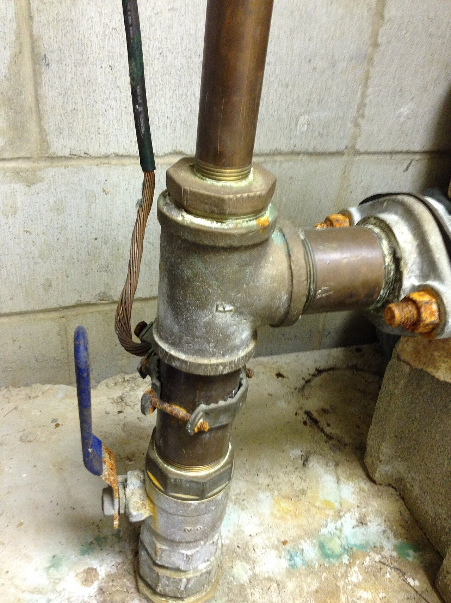
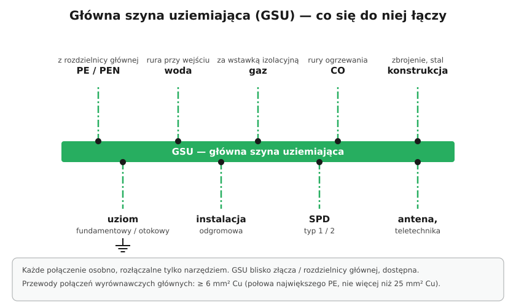

# 13.04 — Połączenia wyrównawcze ochronne główne

> **Moduł:** [13 — Uziemienia i połączenia wyrównawcze](README.md) · **Oznaczenia:** 🏠📋 · **Zakres SEP:** (a) (b) (c) · **Status:** ✅ pełny
>
> **Czytaj:**
>
> - PN-HD 60364-4-41 — 411.3.1.2 (połączenia wyrównawcze ochronne)
> - PN-HD 60364-5-54 — 544.1

[← poprzedni temat](13.03-glowna-szyna-uziemiajaca.md) · [spis modułu](README.md) · [następny temat →](13.05-polaczenia-wyrownawcze-miejscowe.md)

## Po co to jest

Połączenia wyrównawcze główne sprawiają, że wszystkie metalowe elementy w budynku, których można jednocześnie dotknąć, mają podobny potencjał. Gdy w instalacji jest zwarcie albo z zewnątrz (siecią, rurą) przychodzi obcy potencjał, między kranem a obudową pralki nie pojawia się groźne napięcie. To drugi z trzech filarów samoczynnego wyłączenia ([12.02](../12-ochrona-przeciwporazeniowa/12.02-ochrona-przy-uszkodzeniu-samoczynne-wylaczenie.md)).

## Po ludzku

Wyobraź sobie, że PE w budynku jest na potencjale 0 V, a metalowa rura wodna przychodzi z zewnątrz i jest połączona z ziemią „gdzieś daleko”. Przy zwarciu w instalacji przewód PE na chwilę ma np. 100 V względem dalekiej ziemi. Jeśli rura nie jest połączona z PE, między obudową (100 V) a kranem (0 V) jest 100 V — dokładnie tam, gdzie stoi człowiek z mokrymi rękami.

**Połączenia wyrównawcze główne** łączą z GSU wszystkie **części przewodzące obce wprowadzane do budynku**:

- metalowe rury wody, gazu (za wstawką izolacyjną od strony budynku), ogrzewania,
- metalowe konstrukcje, zbrojenie (jeśli dostępne),
- metalowe kanały wentylacji i klimatyzacji,
- metalowe powłoki kabli telekomunikacyjnych (za zgodą właściciela).

Dzięki temu wszystko „pływa” razem: przy uszkodzeniu napięcie między dowolnymi dwoma dostępnymi metalowymi częściami pozostaje małe.

**Rury plastikowe** nie są częściami przewodzącymi obcymi — nie łączy się ich. Ale rura plastikowa z metalowym odcinkiem przy wejściu do budynku — sam ten odcinek, jeśli wprowadza potencjał ziemi, trzeba ocenić.

## Jak to wygląda

*Na co patrzeć: opaska zaciskowa na rurze i przyłączony do niej przewód — tak wykonuje się połączenie wyrównawcze z rurą. Opaska musi być przeznaczona do tego celu, a rura oczyszczona do metalu. Połączenie powinno być dostępne.*

## Schemat

## Pojęcia

| Pojęcie | Po ludzku | Termin normowy / symbol |
|---------|-----------|-------------------------|
| Połączenie wyrównawcze ochronne główne | Łączy z GSU metal wchodzący do budynku | — |
| Część przewodząca obca | Metal spoza instalacji, który może wprowadzić potencjał | — |
| Opaska uziemiająca | Obejma do przyłączenia przewodu do rury | — |

## Liczby do zapamiętania

| Wielkość | Wartość | Kiedy obowiązuje | Źródło |
|----------|---------|------------------|--------|
| Przekrój przewodu wyrównawczego głównego | ≥ **½ największego PE** instalacji | — | PN-HD 60364-5-54, 544.1 |
| Minimum | **6 mm² Cu**, 16 mm² Al, 50 mm² Fe | — | jw. |
| Maksimum wymagane | **25 mm² Cu** (lub równoważny) | — | jw. |
| Gaz | połączenie **za wstawką izolacyjną** (od strony budynku) | — | wymagania dostawców gazu |

## W praktyce

- **Opaski** na rury — dedykowane, z blaszką kontaktową, na oczyszczonej rurze, przy wejściu do budynku.
- **Wodomierz, zawory, złączki** z uszczelkami mogą przerwać ciągłość rury — prowadź mostek albo łącz za nimi.
- **Po każdej wymianie instalacji wodnej lub grzewczej** sprawdź, czy połączenia wyrównawcze dalej istnieją.
- **Pomiar ciągłości** połączeń wyrównawczych — omomierzem małym prądem, między GSU a każdą podłączoną rurą ([moduł 23](../23-pomiary-odbiorcze-i-okresowe/README.md)).

## Błędy i zagrożenia

- ⚠️ **Brak połączenia wyrównawczego z metalową rurą wodną** — przy zwarciu duże napięcie między armaturą a obudowami urządzeń.
- **Połączenie z rurą gazową przed wstawką izolacyjną** — niezgodne z wymaganiami gazowni.
- **Opaska na pomalowanej rurze** — brak styku, połączenie tylko „na oko”.

## Przykład

**Zadanie.** W domu zmierzono przy zwarciu w piekarniku impedancję pętli tak, że prąd zwarcia wynosi 300 A. Przewód PE od rozdzielnicy do piekarnika (2,5 mm², 15 m) ma rezystancję $0{,}0175 \cdot 15 / 2{,}5 = 0{,}105\ \Omega$. Jakie napięcie pojawi się na obudowie piekarnika względem PE rozdzielnicy?

$$U = I \cdot R_{PE} = 300 \cdot 0{,}105 \approx 32\ \mathrm{V}$$

**A względem kranu?** Jeśli rura wodna jest połączona z GSU (a GSU z PE rozdzielnicy) — ok. 32 V przez ułamek sekundy, dopóki wyłącznik nie zadziała. Jeśli rura nie jest połączona i ma potencjał dalekiej ziemi — napięcie może być znacznie większe, bo dochodzi spadek na przewodach zasilających i PEN.

## Pytania SEP

1. **Jaki jest cel stosowania połączeń wyrównawczych ochronnych głównych i co się nimi łączy?**

Odpowiedź

Celem jest wyrównanie potencjałów części przewodzących w budynku, aby przy uszkodzeniu izolacji lub przeniesieniu potencjału z zewnątrz napięcie między częściami dostępnymi jednocześnie było jak najmniejsze. Z główną szyną uziemiającą łączy się przewody ochronne, uziemiające oraz części przewodzące obce wprowadzane do budynku: metalowe rury wody, gazu (za wstawką izolacyjną), ogrzewania, metalowe konstrukcje, zbrojenie, metalowe kanały wentylacyjne, powłoki kabli.

2. **Jaki przekrój muszą mieć przewody połączeń wyrównawczych głównych?**

Odpowiedź

Nie mniejszy niż połowa przekroju największego przewodu ochronnego instalacji, ale nie mniejszy niż 6 mm² Cu (16 mm² Al, 50 mm² Fe); nie wymaga się większego niż 25 mm² Cu (PN-HD 60364-5-54, 544.1).

## Sprawdź się

1. Czy plastikową rurę wodną trzeba łączyć z GSU?

Odpowiedź

Nie — rura z tworzywa nie jest częścią przewodzącą obcą. Ocenia się tylko metalowe elementy (np. metalowy odcinek przy wejściu do budynku).

## Źródła

- PN-HD 60364-4-41 — 411.3.1.2 (połączenia wyrównawcze ochronne główne).
- PN-HD 60364-5-54 — 544.1 (przekroje przewodów wyrównawczych głównych).

---

[← poprzedni temat](13.03-glowna-szyna-uziemiajaca.md) · [spis modułu](README.md) · [następny temat →](13.05-polaczenia-wyrownawcze-miejscowe.md)
