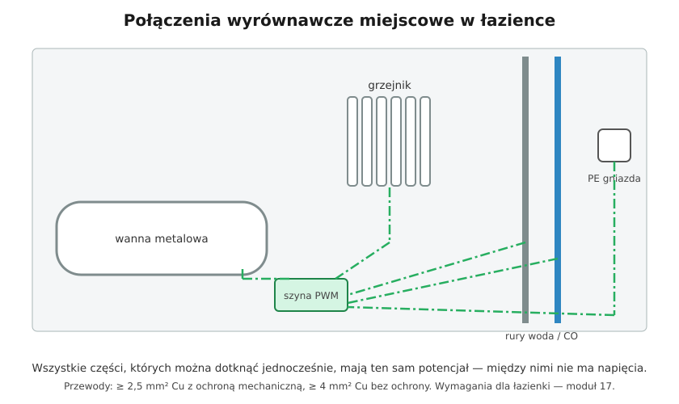

# 13.05 — Połączenia wyrównawcze miejscowe

> **Moduł:** [13 — Uziemienia i połączenia wyrównawcze](README.md) · **Oznaczenia:** 🏠📋 · **Zakres SEP:** (a) (b) (c) · **Status:** ✅ pełny
>
> **Czytaj:**
>
> - PN-HD 60364-4-41 — 415.2 (połączenia wyrównawcze miejscowe dodatkowe)
> - PN-HD 60364-5-54 — 544.2
> - Łazienki i pomieszczenia szczególne: [moduł 17](../17-pomieszczenia-szczegolne/README.md)

[← poprzedni temat](13.04-polaczenia-wyrownawcze-ochronne-glowne.md) · [spis modułu](README.md) · [następny temat →](13.06-przekroje-przewodow-ochronnych-i-wyrownawczych.md)

## Po co to jest

W łazience, kotłowni czy na basenie człowiek ma mokre ręce, bose stopy i wokół siebie dużo metalu. Tam nawet krótkie napięcie między wanną a grzejnikiem jest groźne. Połączenia wyrównawcze miejscowe łączą wszystkie te metalowe części w jednym pomieszczeniu, tak żeby między nimi nie było różnicy napięć.

## Po ludzku

**Połączenia wyrównawcze miejscowe dodatkowe** to przewody łączące w jednym pomieszczeniu:

- zaciski PE urządzeń i gniazd (części przewodzące dostępne),
- metalowe rury, grzejniki, wannę, brodzik, metalowe kratki odpływowe (części przewodzące obce),
- metalowe konstrukcje dostępne w tym pomieszczeniu.

Przewody zbiega się zwykle w **lokalnej szynie (puszce) wyrównawczej**, połączonej z PE.

**Kiedy się je stosuje:**

- tam, gdzie wymagają tego arkusze dla pomieszczeń szczególnych (łazienki, sauny, baseny, gospodarstwa rolne, pomieszczenia medyczne) — [moduł 17](../17-pomieszczenia-szczegolne/README.md);
- jako ochronę uzupełniającą, gdy nie da się dotrzymać czasu samoczynnego wyłączenia ([12.05](../12-ochrona-przeciwporazeniowa/12.05-ochrona-uzupelniajaca.md)).

**Warunek skuteczności:** rezystancja między częściami jednocześnie dostępnymi $R \le 50\ \mathrm{V} / I_a$, gdzie $I_a$ — prąd zadziałania zabezpieczenia. Przy RCD 30 mA warunek jest łatwy, przy wyłączniku nadprądowym — trzeba mieć dobre połączenia.

**Co z rurami z tworzywa?** Nie łączy się ich. Łączy się tylko elementy metalowe, które mogą wprowadzić potencjał.

## Schemat

## Pojęcia

| Pojęcie | Po ludzku | Termin normowy / symbol |
|---------|-----------|-------------------------|
| Połączenia wyrównawcze miejscowe dodatkowe | Łączą metal w jednym pomieszczeniu | 415.2 |
| Szyna (puszka) PWM | Lokalny punkt zbiorczy przewodów wyrównawczych | — |
| Części jednocześnie dostępne | Takie, których można dotknąć naraz | — |

## Liczby do zapamiętania

| Wielkość | Wartość | Kiedy obowiązuje | Źródło |
|----------|---------|------------------|--------|
| Warunek skuteczności | $R \le 50\ \mathrm{V} / I_a$ | AC | PN-HD 60364-4-41, 415.2.2 |
| Przewód między dwiema częściami dostępnymi | przewodność ≥ **mniejszego z PE** | — | PN-HD 60364-5-54, 544.2.1 |
| Przewód między częścią dostępną a obcą | przewodność ≥ **½ PE** | — | jw., 544.2.2 |
| Minimalny przekrój | **2,5 mm² Cu** z ochroną mechaniczną, **4 mm² Cu** bez ochrony | — | jw., 544.2.3 |

## W praktyce

- **Planuj puszkę wyrównawczą** przed położeniem płytek — przewody do wanny i rur prowadzi się w ścianie, zanim wanna zostanie zabudowana.
- **Przyłączenie do wanny** — dedykowany zacisk lub opaska na nóżce lub rurze odpływowej metalowej.
- **Pomiar ciągłości** po zakończeniu prac — między szyną wyrównawczą a każdym połączonym elementem.
- **Po wymianie wanny na akrylową i rur na PEX** część połączeń przestaje być potrzebna — ale nie usuwaj połączenia z grzejnikiem, jeśli zostaje metalowy.

## Błędy i zagrożenia

- **Przewód do wanny zatynkowany bez zacisku dostępnego** — po latach nie wiadomo, czy jest połączony.
- **Łączenie przez taśmę lub drut owinięty wokół rury** — brak trwałego styku.
- **Mylenie połączeń miejscowych z PE obwodu** — PE gniazda nie zastępuje połączenia wanny z resztą.

## Przykład

**Zadanie.** Łazienka: obwód zabezpieczony B16 ($I_a$ = 80 A) bez RCD (stara instalacja). Jaka może być największa rezystancja połączenia wyrównawczego między obudową pralki a grzejnikiem?

$$R \le \frac{50}{80} = 0{,}625\ \Omega$$

Z RCD 30 mA: $R \le 50 / 0{,}03 \approx 1667\ \Omega$ — warunek praktycznie zawsze spełniony. Dlatego w łazience obwody i tak muszą mieć RCD 30 mA ([moduł 17](../17-pomieszczenia-szczegolne/README.md)).

## Pytania SEP

1. **Gdzie stosuje się połączenia wyrównawcze miejscowe dodatkowe i jaki jest ich cel?**

Odpowiedź

W pomieszczeniach o zwiększonym zagrożeniu porażeniem (łazienki, sauny, baseny, pomieszczenia rolnicze, medyczne — zgodnie z wymaganiami arkuszy części 7 normy) oraz tam, gdzie nie można dotrzymać wymaganego czasu samoczynnego wyłączenia. Celem jest wyrównanie potencjałów wszystkich części przewodzących dostępnych i obcych, których można dotknąć jednocześnie, tak by napięcie między nimi przy uszkodzeniu nie przekroczyło wartości dopuszczalnej.

2. **Jaki minimalny przekrój muszą mieć przewody połączeń wyrównawczych miejscowych?**

Odpowiedź

2,5 mm² Cu, jeśli są chronione przed uszkodzeniem mechanicznym, i 4 mm² Cu bez takiej ochrony. Ponadto przewód łączący dwie części przewodzące dostępne musi mieć przewodność nie mniejszą niż mniejszy z przyłączonych przewodów ochronnych, a łączący część dostępną z obcą — nie mniejszą niż połowa przekroju odpowiedniego przewodu ochronnego.

## Sprawdź się

1. Przewód wyrównawczy do grzejnika prowadzony w ścianie w peszlu — jaki minimalny przekrój?

Odpowiedź

2,5 mm² Cu (chroniony mechanicznie). Bez ochrony — 4 mm² Cu.

## Źródła

- PN-HD 60364-4-41 — 415.2 (połączenia wyrównawcze miejscowe dodatkowe, warunek $R \le 50\ \mathrm{V}/I_a$).
- PN-HD 60364-5-54 — 544.2 (przekroje).
- PN-HD 60364-7-701 — łazienki (moduł 17).

---

[← poprzedni temat](13.04-polaczenia-wyrownawcze-ochronne-glowne.md) · [spis modułu](README.md) · [następny temat →](13.06-przekroje-przewodow-ochronnych-i-wyrownawczych.md)
