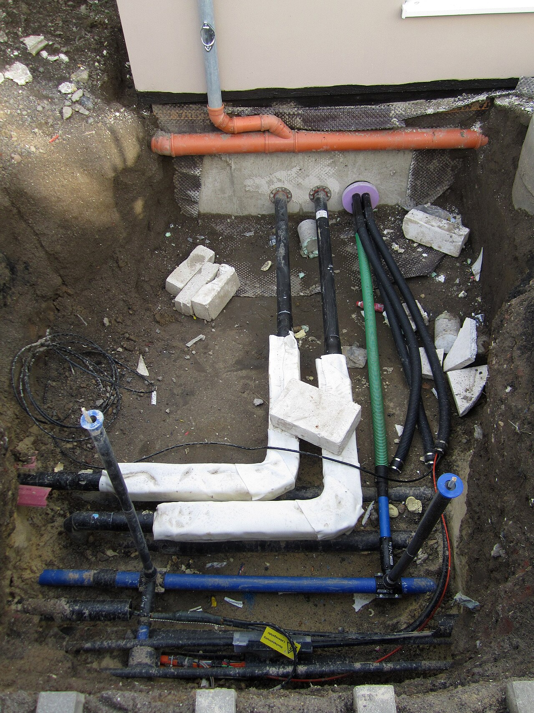
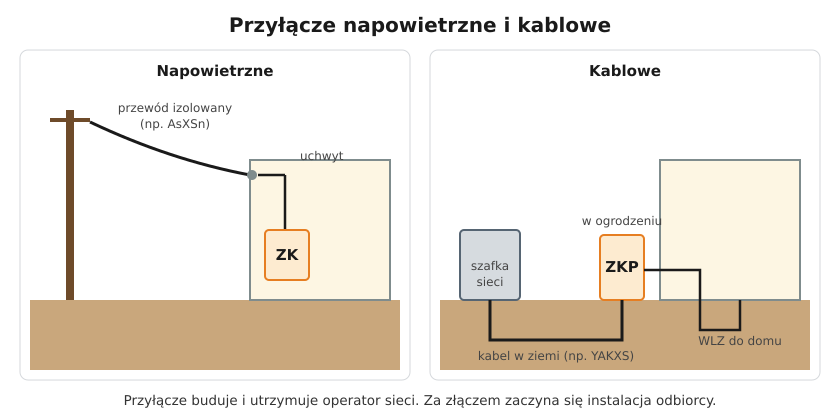

# 14.01 — Przyłącze napowietrzne i kablowe

> **Moduł:** [14 — Od słupa do gniazdka](README.md) · **Oznaczenia:** 🏠📋 · **Zakres SEP:** (a) (b) · **Status:** ✅ pełny
>
> **Czytaj:**
>
> - Prawo energetyczne, art. 7 — przyłączanie do sieci
> - Kable w ziemi: [05.06](../05-przewody-i-kable/05.06-przewody-bezhalogenowe-i-kable-ziemne.md)

← (początek modułu) · [spis modułu](README.md) · [następny temat →](14.02-zlacze-i-granica-wlasnosci.md)

## Po co to jest

Przyłącze to odcinek sieci, który dostarcza energię od linii operatora do budynku. Buduje go i utrzymuje operator systemu dystrybucyjnego (OSD), ale elektryk musi wiedzieć, jak wygląda, co z niego wynika dla instalacji i jak przebiega procedura przyłączenia nowego domu. Na egzaminie: rodzaje przyłączy i granica własności.

## Po ludzku

**Przyłącze napowietrzne.** Od słupa linii niskiego napięcia do budynku biegną przewody w powietrzu. Dziś są to przewody izolowane skręcone w wiązkę (np. AsXSn), mocowane uchwytem do ściany lub stojaka dachowego. Dalej przewody prowadzi się do złącza. Wada: narażone na wiatr, oblodzenie, gałęzie i bezpośrednie przepięcia ([09.01](../09-ochrona-przeciwprzepieciowa/09.01-skad-biora-sie-przepiecia.md)).

**Przyłącze kablowe.** Od szafki kablowej sieci (albo od słupa, przez rurę osłonową) kabel w ziemi (np. YAKXS 4×35) biegnie do złącza na granicy działki lub w ścianie budynku. Dziś zdecydowana większość nowych przyłączy w miastach i na osiedlach.

**Kto co buduje?** Przyłącze — operator, na podstawie umowy o przyłączenie. Od złącza w głąb działki i budynku — odbiorca (instalacja, WLZ, rozdzielnice).

**Procedura przyłączenia nowego domu (w skrócie):**

1. wniosek do OSD o **warunki przyłączenia** (moc przyłączeniowa, liczba faz, miejsce złącza);
2. **umowa o przyłączenie** i opłata przyłączeniowa;
3. operator buduje przyłącze i złącze;
4. odbiorca wykonuje instalację, a uprawniony elektryk przeprowadza **pomiary odbiorcze** i wystawia protokół lub oświadczenie ([moduł 23](../23-pomiary-odbiorcze-i-okresowe/README.md));
5. **zgłoszenie gotowości** instalacji, umowa sprzedaży lub kompleksowa, montaż licznika.

## Jak to wygląda

*Na co patrzeć: do budynku wchodzi kilka przyłączy obok siebie — każde w swojej rurze osłonowej, przez uszczelnione przepusty w ścianie. Kabel energetyczny jest jednym z nich. Przy wykopach w pobliżu budynku zawsze trzeba się spodziewać przyłączy.*

## Schemat

## Pojęcia

| Pojęcie | Po ludzku | Termin normowy / symbol |
|---------|-----------|-------------------------|
| OSD | Operator sieci dystrybucyjnej (np. lokalny dystrybutor) | operator systemu dystrybucyjnego |
| Przyłącze | Odcinek od sieci do złącza budynku | — |
| Warunki przyłączenia | Dokument operatora: moc, miejsce, parametry | — |
| Przewód AsXSn | Izolowany przewód napowietrzny skręcony w wiązkę | — |
| Kabel YAKXS | Kabel aluminiowy w izolacji XLPE do ziemi | — |

## Liczby do zapamiętania

| Wielkość | Wartość | Kiedy obowiązuje | Źródło |
|----------|---------|------------------|--------|
| Napięcie przyłącza nn | **230/400 V** | gospodarstwa domowe | — |
| Liczba żył przyłącza 3-faz. | **4** (L1, L2, L3, PEN) | sieć TN-C | — |
| Głębokość kabla nn w ziemi | ≥ **0,7 m** | — | N SEP-E-004 ([05.06](../05-przewody-i-kable/05.06-przewody-bezhalogenowe-i-kable-ziemne.md)) |
| Kto buduje przyłącze | **operator (OSD)** | na podstawie umowy o przyłączenie | Prawo energetyczne, art. 7 |

## W praktyce

- **Przed planowaniem domu** sprawdź, skąd i jak operator może cię zasilić. Złącze na granicy działki, dostępne od strony ulicy, to standard.
- **Przy linii napowietrznej** planuj ochronę przeciwprzepięciową typu 1+2 ([09.03](../09-ochrona-przeciwprzepieciowa/09.03-ograniczniki-przepiec-typu-1-2-i-3.md)).
- **Kopiąc przy budynku** — mapa uzbrojenia terenu, ostrożne odkrywanie ręczne w pobliżu przyłączy.
- **Uszkodzone przyłącze** (zerwany przewód po burzy, odkryty kabel) — dzwoń do pogotowia energetycznego operatora, nie naprawiaj sam ([00.04](../00-bezpieczenstwo-najpierw/00.04-czerwone-flagi-kiedy-przerwac-prace-i-wezwac.md)).

## Błędy i zagrożenia

- ⚠️ **Samodzielne prace przy przyłączu lub przewodach na stojaku dachowym** — to sieć operatora pod napięciem, bez możliwości wyłączenia przez odbiorcę.
- ⚠️ **Zerwany przewód przyłącza na ziemi** — strefa napięcia krokowego ([04.03](../04-prad-a-czlowiek/04.03-napiecie-dotykowe-i-krokowe-napiecia.md)).
- **Drzewa i rusztowania przy przewodach napowietrznych** — przecieranie izolacji.

## Przykład

**Sytuacja.** Działka z istniejącą linią napowietrzną wzdłuż drogi. Inwestor chce zasilić dom kablem, „żeby nie było drutów nad podwórkiem”.

**Odpowiedź.** W warunkach przyłączenia operator określi, czy możliwe jest przyłącze kablowe ze słupa (kabel ze słupa w rurze osłonowej, w ziemi do złącza ZKP w ogrodzeniu). Często jest to standardowe rozwiązanie. Złącze ZKP z licznikiem w ogrodzeniu, dalej WLZ kablem do domu — to już po stronie inwestora.

## Pytania SEP

1. **Jakie rodzaje przyłączy stosuje się do zasilania budynków z sieci niskiego napięcia?**

Odpowiedź

Przyłącza napowietrzne — wykonane przewodami (dziś izolowanymi) od słupa linii napowietrznej do budynku lub złącza, oraz przyłącza kablowe — wykonane kablem ułożonym w ziemi od sieci kablowej, szafki kablowej lub słupa (w rurze osłonowej) do złącza. Przyłącze kończy się w złączu, które jest miejscem rozgraniczenia sieci operatora i instalacji odbiorcy.

2. **Jak przebiega przyłączenie nowego obiektu do sieci?**

Odpowiedź

Odbiorca składa do operatora wniosek o określenie warunków przyłączenia, operator wydaje warunki, strony zawierają umowę o przyłączenie, operator buduje przyłącze i złącze. Odbiorca wykonuje instalację, która powinna zostać sprawdzona pomiarami przez osobę z odpowiednimi kwalifikacjami. Następnie odbiorca zgłasza gotowość instalacji, zawiera umowę sprzedaży lub kompleksową, a operator montuje licznik i załącza zasilanie.

## Sprawdź się

1. Kto jest właścicielem przewodu przyłącza napowietrznego biegnącego ze słupa do domu?

Odpowiedź

Zwykle operator sieci — przyłącze jest częścią sieci aż do złącza. Szczegóły granicy własności określa umowa ([14.02](14.02-zlacze-i-granica-wlasnosci.md)).

## Źródła

- Prawo energetyczne, art. 7 — przyłączanie do sieci, warunki i umowa o przyłączenie.
- N SEP-E-004 — linie kablowe.

---

← (początek modułu) · [spis modułu](README.md) · [następny temat →](14.02-zlacze-i-granica-wlasnosci.md)
