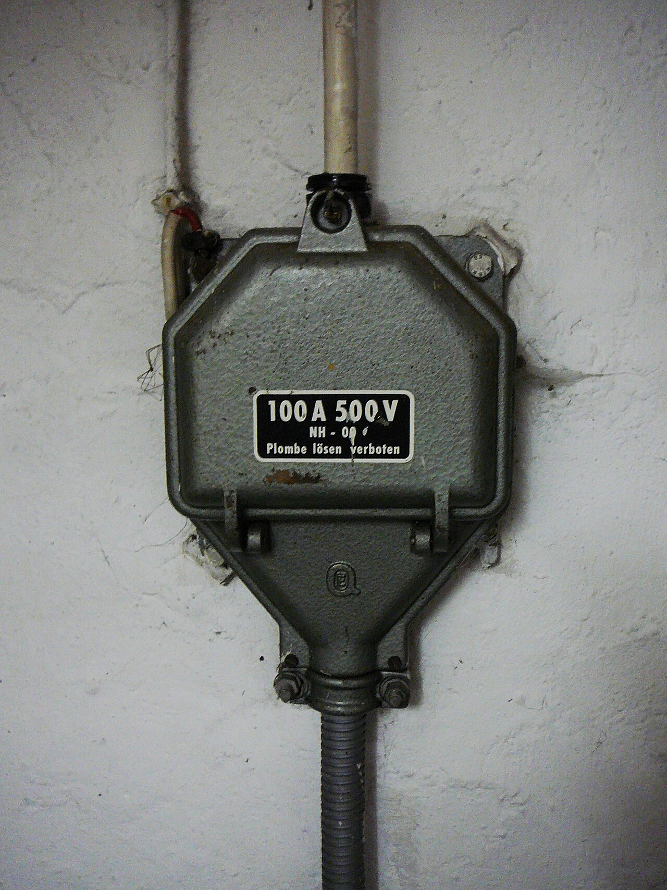
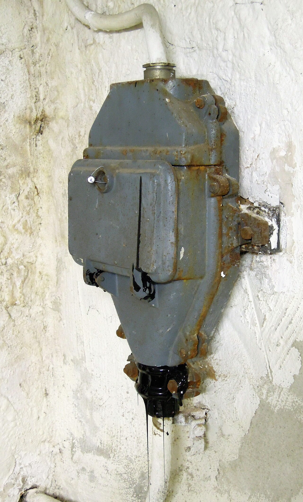
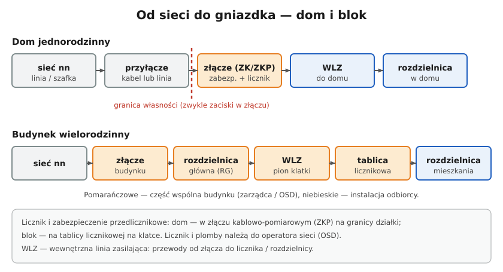

# 14.02 — Złącze i granica własności

> **Moduł:** [14 — Od słupa do gniazdka](README.md) · **Oznaczenia:** 🏠📋 · **Zakres SEP:** (a) (b) · **Status:** ✅ pełny
>
> **Czytaj:**
>
> - Warunki przyłączenia i umowa — granica własności
> - Rozdzielenie PEN: [11.04](../11-uklady-sieci/11.04-uklad-tn-c-s-i-punkt-rozdzialu-pen.md)

[← poprzedni temat](14.01-przylacze-napowietrzne-i-kablowe.md) · [spis modułu](README.md) · [następny temat →](14.03-licznik-i-zabezpieczenie-przedlicznikowe.md)

## Po co to jest

Złącze to skrzynka, w której kończy się sieć operatora, a zaczyna instalacja odbiorcy. Od tego, gdzie leży granica własności, zależy, kto odpowiada za awarię, kto może coś otworzyć i za co płacisz. Na egzaminie: co to jest złącze i gdzie jest granica własności.

## Po ludzku

**Złącze** to obudowa (dziś z tworzywa, dawniej żeliwna) z podstawami bezpiecznikowymi i zaciskami. Dochodzi do niego przyłącze, wychodzi z niego linia do odbiorcy. Często jest w niej punkt podziału PEN ([11.04](../11-uklady-sieci/11.04-uklad-tn-c-s-i-punkt-rozdzialu-pen.md)).

**Rodzaje (oznaczenia spotykane w praktyce):**

- **ZK** — złącze kablowe: zabezpieczenia przyłączowe i zaciski;
- **ZKP** — złącze kablowo-pomiarowe: złącze i licznik w jednej szafce, typowe dla domów jednorodzinnych, w ogrodzeniu, dostępne od ulicy;
- **złącze napowietrzne** — na ścianie lub słupie, przy przyłączu napowietrznym.

**Granica własności** jest określona w umowie o przyłączenie. Zwykle są to **zaciski prądowe w złączu** — na wyjściu zabezpieczeń (lub licznika) w stronę odbiorcy. Wszystko przed nią (przyłącze, zabezpieczenia przyłączowe, licznik) należy do operatora, wszystko za nią (WLZ, rozdzielnice, instalacja) — do odbiorcy.

**Plomby.** Pokrywy złącza i licznika są plombowane. Zerwanie plomby jest naruszeniem umowy i może być traktowane jak nielegalny pobór energii. Jeśli musisz coś zrobić w złączu (np. wymienić przepaloną wkładkę), dzwoń do operatora.

## Jak to wygląda

*Na co patrzeć: tabliczka podaje prąd i napięcie złącza. Kabel przyłącza wchodzi od dołu. W środku są podstawy bezpiecznikowe i zaciski — za pokrywą z plombą. Odbiorca nie otwiera złącza.*

*Na co patrzeć: stare złącza żeliwne nadal pracują w wielu budynkach. Mają skorodowane obudowy, stare izolacje i brak wyraźnego punktu podziału PEN. Ich wymiana to sprawa operatora — warto ją zgłosić, jeśli złącze jest w złym stanie.*

## Schemat

## Pojęcia

| Pojęcie | Po ludzku | Termin normowy / symbol |
|---------|-----------|-------------------------|
| Złącze | Skrzynka na granicy sieci i instalacji | złącze |
| ZK / ZKP | Złącze kablowe / kablowo-pomiarowe | — |
| Granica własności | Miejsce, gdzie kończy się sieć operatora | miejsce dostarczania energii |
| Zabezpieczenie przyłączowe | Bezpieczniki w złączu (zwykle NH) | — |
| Plomba | Zabezpieczenie przed otwarciem bez wiedzy operatora | — |

## Liczby do zapamiętania

| Wielkość | Wartość | Kiedy obowiązuje | Źródło |
|----------|---------|------------------|--------|
| Granica własności | zwykle **zaciski w złączu** | wg umowy o przyłączenie | umowa z OSD |
| Złącze ZKP | złącze + **licznik** w jednej szafce | domy jednorodzinne | praktyka OSD |
| Dostęp do złącza | **od strony drogi publicznej** | nowe przyłącza | wymagania OSD |

## W praktyce

- **Ustal granicę własności** z umowy lub dokumentów — przy awarii od razu wiadomo, czy dzwonić do operatora, czy do elektryka.
- **Złącze w ogrodzeniu** — musi mieć wolny dostęp. Nie obsadzaj go krzewami, nie zamykaj w zabudowie śmietnika.
- **Wkładka w złączu się przepaliła?** Najpierw sprawdź swoją instalację (czy nie ma zwarcia), potem zgłoś awarię operatorowi.
- **Punkt podziału PEN** w złączu — sprawdź w dokumentacji, czy jest, czy PEN przychodzi do twojej rozdzielnicy ([11.04](../11-uklady-sieci/11.04-uklad-tn-c-s-i-punkt-rozdzialu-pen.md)).

## Błędy i zagrożenia

- ⚠️ **Otwieranie złącza i wymiana wkładek przez odbiorcę** — praca przy urządzeniach operatora pod napięciem, bez uprawnień i zgody; zerwanie plomb.
- **Zabudowanie złącza** — operator nie ma dostępu, odczyt i awarie się komplikują.
- **Podłączanie się przed licznikiem** — nielegalny pobór energii.

## Przykład

**Sytuacja.** Wieczorem w całym domu zgasło światło. W rozdzielnicy wszystkie wyłączniki są załączone, rozłącznik główny też. W złączu ZKP w ogrodzeniu wyświetlacz licznika jest wygaszony.

**Diagnoza.** Licznik nie ma zasilania — problem jest przed nim: przepalona wkładka w złączu albo awaria sieci. Sprawdź, czy sąsiedzi mają prąd. Jeśli tak — prawdopodobnie zabezpieczenie przyłączowe; zgłoś awarię operatorowi. Nie otwieraj zaplombowanej części złącza.

## Pytania SEP

1. **Co to jest złącze i gdzie zwykle przebiega granica własności między siecią a instalacją odbiorcy?**

Odpowiedź

Złącze to urządzenie (obudowa z zabezpieczeniami przyłączowymi i zaciskami), w którym kończy się przyłącze sieci operatora i zaczyna instalacja odbiorcy. Granicę własności określa umowa o przyłączenie — zwykle są to zaciski prądowe w złączu (na wyjściu zabezpieczeń lub układu pomiarowego w stronę instalacji odbiorcy). Elementy przed granicą należą do operatora, za nią — do odbiorcy.

## Sprawdź się

1. Czy odbiorca może sam wymienić przepaloną wkładkę w złączu kablowym przed licznikiem?

Odpowiedź

Nie. Złącze i zabezpieczenia przedlicznikowe należą do operatora i są plombowane. Wymienia je operator (pogotowie energetyczne).

## Źródła

- Prawo energetyczne, art. 7 — umowa o przyłączenie (miejsce rozgraniczenia własności).
- Wymagania techniczne operatorów (OSD) dla złączy i układów pomiarowych.

---

[← poprzedni temat](14.01-przylacze-napowietrzne-i-kablowe.md) · [spis modułu](README.md) · [następny temat →](14.03-licznik-i-zabezpieczenie-przedlicznikowe.md)
