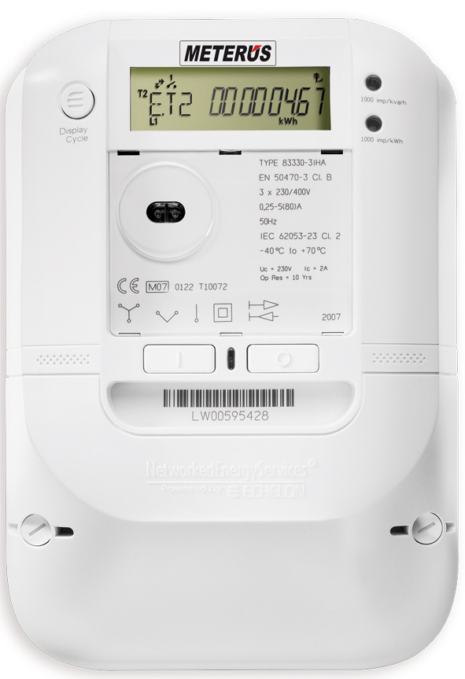
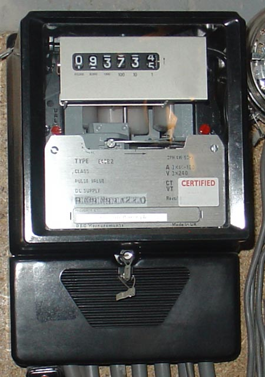

# 14.03 — Licznik i zabezpieczenie przedlicznikowe

> **Moduł:** [14 — Od słupa do gniazdka](README.md) · **Oznaczenia:** 🏠📋 · **Zakres SEP:** (a) (b) · **Status:** ✅ pełny
>
> **Czytaj:**
>
> - Wymiana wkładek: [07.02](../07-zabezpieczenia-nadpradowe/07.02-bezpieczniki-topikowe-wkladki-gg-gwintowe-i.md)
> - Selektywność z zabezpieczeniem przedlicznikowym: [07.07](../07-zabezpieczenia-nadpradowe/07.07-selektywnosc-zabezpieczen.md)

[← poprzedni temat](14.02-zlacze-i-granica-wlasnosci.md) · [spis modułu](README.md) · [następny temat →](14.04-wewnetrzna-linia-zasilajaca-wlz.md)

## Po co to jest

Licznik i zabezpieczenie przedlicznikowe to ostatnie elementy operatora przed twoją instalacją. Zabezpieczenie ogranicza, ile mocy możesz pobrać, i chroni przewody przed licznikiem. Licznik — liczy energię i coraz częściej wysyła dane zdalnie. Trzeba wiedzieć, co z nich wynika dla instalacji: jaka moc jest dostępna, co się stanie przy przeciążeniu, jak dobrać zabezpieczenia w rozdzielnicy.

## Po ludzku

**Zabezpieczenie przedlicznikowe** to wkładki topikowe gG (np. 3 × 25 A) albo wyłącznik przedlicznikowy (często selektywny). Jego prąd znamionowy wynika z **mocy przyłączeniowej** z umowy ([14.05](14.05-moc-przylaczeniowa-i-taryfy.md)). Gdy pobierasz za dużo — zadziała, a cały dom albo mieszkanie zostanie bez prądu.

**Ile mocy daje dane zabezpieczenie?** Teoretycznie:

- jednofazowo: $P \approx 230\ \mathrm{V} \cdot I_n$ (25 A → ok. 5,75 kW),
- trójfazowo: $P \approx \sqrt{3} \cdot 400\ \mathrm{V} \cdot I_n \approx 0{,}69 \cdot I_n$ kW (25 A → ok. 17 kW),

ale tylko przy równomiernym obciążeniu faz. Jedna faza obciążona bardziej niż inne wyłączy wcześniej. Operator przypisuje zabezpieczenie do mocy przyłączeniowej według własnych tabel.

**Licznik** należy do operatora. Spotkasz:

- liczniki indukcyjne z tarczą (stare, [10.06](../10-aparatura-modulowa/10.06-podliczniki-energii.md)),
- liczniki elektroniczne jedno- i wielostrefowe,
- **liczniki zdalnego odczytu (LZO)** — wysyłają dane do operatora, pozwalają na taryfy wielostrefowe i dynamiczne, mają wyświetlacz z wieloma rejestrami (np. strefa dzienna i nocna, energia pobrana i oddana).

**Prosument** (fotowoltaika) ma licznik dwukierunkowy — liczy osobno energię pobraną z sieci i oddaną do sieci ([moduł 26](../26-fotowoltaika-pompy-wallboxy/README.md)).

## Jak to wygląda

*Na co patrzeć: wyświetlacz pokazuje kolejne rejestry (energia w strefach, moc, data). Dioda impulsowa miga proporcjonalnie do pobieranej mocy — można z niej oszacować moc ([10.06](../10-aparatura-modulowa/10.06-podliczniki-energii.md)). Plomby na pokrywie zacisków należą do operatora.*

*Na co patrzeć: liczydło pokazuje kWh. Takie liczniki są stopniowo wymieniane na elektroniczne liczniki zdalnego odczytu. Wymianę przeprowadza operator, bez kosztów po stronie odbiorcy.*

## Pojęcia

| Pojęcie | Po ludzku | Termin normowy / symbol |
|---------|-----------|-------------------------|
| Zabezpieczenie przedlicznikowe | Bezpieczniki lub wyłącznik przed licznikiem | — |
| Licznik zdalnego odczytu | Licznik, który sam wysyła dane do operatora | LZO |
| Układ pomiarowy | Licznik i jego otoczenie (przekładniki, zabezpieczenia) | — |
| Licznik dwukierunkowy | Liczy energię pobraną i oddaną osobno | — |
| Prosument | Odbiorca, który też produkuje energię | — |

## Liczby do zapamiętania

| Wielkość | Wartość | Kiedy obowiązuje | Źródło |
|----------|---------|------------------|--------|
| Moc jednofazowa | $P \approx 230 \cdot I_n$ | 25 A → ok. **5,75 kW** | obliczenie |
| Moc trójfazowa | $P \approx \sqrt{3} \cdot 400 \cdot I_n$ | 25 A → ok. **17 kW** | obliczenie, przy symetrii |
| Selektywność gG | stosunek ≥ **1,6** | wkładki szeregowo | [07.07](../07-zabezpieczenia-nadpradowe/07.07-selektywnosc-zabezpieczen.md) |
| Właściciel licznika i zabezpieczenia | **operator (OSD)** | — | umowa |

## W praktyce

- **Zabezpieczenia w twojej rozdzielnicy** mają być mniejsze i selektywne względem przedlicznikowego — inaczej każde zwarcie w gnieździe gasi cały dom ([07.07](../07-zabezpieczenia-nadpradowe/07.07-selektywnosc-zabezpieczen.md)).
- **Rozkładaj obwody na fazy** równomiernie — jedna przeciążona faza wyłączy zabezpieczenie przedlicznikowe przy dużo mniejszej łącznej mocy.
- **Planujesz pompę ciepła, wallbox, płytę indukcyjną?** Sprawdź moc przyłączeniową, zanim kupisz urządzenia. Zwiększenie mocy wymaga wniosku do operatora.
- **Zadziałało zabezpieczenie przedlicznikowe** — to sygnał przeciążenia lub zwarcia przy niedostatecznej selektywności. Wymiana przez operatora.

## Błędy i zagrożenia

- ⚠️ **Samodzielne „wzmocnienie” zabezpieczenia przedlicznikowego** — przewody WLZ i przyłącze nie są na to dobrane; poza tym to urządzenie operatora.
- **Wszystkie grzałki na jednej fazie** — wyłączanie przedlicznikowego przy mocy, która w teorii się mieści.
- **Ingerencja w licznik** — nielegalny pobór, kary.

## Przykład

**Zadanie.** Dom: zabezpieczenie przedlicznikowe 3 × 20 A. Chcesz włączyć jednocześnie płytę indukcyjną 7,2 kW (3-faz., równo rozłożoną), czajnik 2,2 kW na L1 i pralkę 2 kW na L1. Czy L1 wytrzyma?

- płyta: $7200 / 3 = 2400$ W na fazę → $2400/230 \approx 10{,}4$ A na L1;
- czajnik: $2200/230 \approx 9{,}6$ A;
- pralka (grzanie): $2000/230 \approx 8{,}7$ A.

Razem na L1 ok. **28,7 A** > 20 A. To przeciążenie ok. 1,4 × In — wkładka gG zadziała po pewnym czasie (od kilku do kilkudziesięciu minut, zależnie od charakterystyki), a przy dłuższej pracy na pewno. Na L2 i L3 jest tylko po 10,4 A.

**Wniosek.** Pralkę przenieść na L2, czajnik zostawić na L1 — wtedy L1 ≈ 20 A, L2 ≈ 19 A. Przy takich mocach i tak blisko granicy — warto rozważyć zwiększenie mocy przyłączeniowej.

## Pytania SEP

1. **Jaką rolę pełni zabezpieczenie przedlicznikowe?**

Odpowiedź

Chroni przewody przyłącza lub wewnętrznej linii zasilającej przed licznikiem przed skutkami przeciążeń i zwarć, ogranicza moc pobieraną przez odbiorcę do wartości wynikającej z mocy przyłączeniowej i stanowi zabezpieczenie nadrzędne dla zabezpieczeń instalacji odbiorcy, z którymi powinno być selektywne. Należy do operatora i jest plombowane.

## Sprawdź się

1. Jaką największą moc teoretycznie można pobrać jednofazowo przy zabezpieczeniu przedlicznikowym 32 A?

Odpowiedź

$230 \cdot 32 \approx 7{,}4$ kW.

## Źródła

- Prawo energetyczne — układy pomiarowe, liczniki zdalnego odczytu.
- PN-EN 60269-1 — selektywność wkładek gG.

---

[← poprzedni temat](14.02-zlacze-i-granica-wlasnosci.md) · [spis modułu](README.md) · [następny temat →](14.04-wewnetrzna-linia-zasilajaca-wlz.md)
