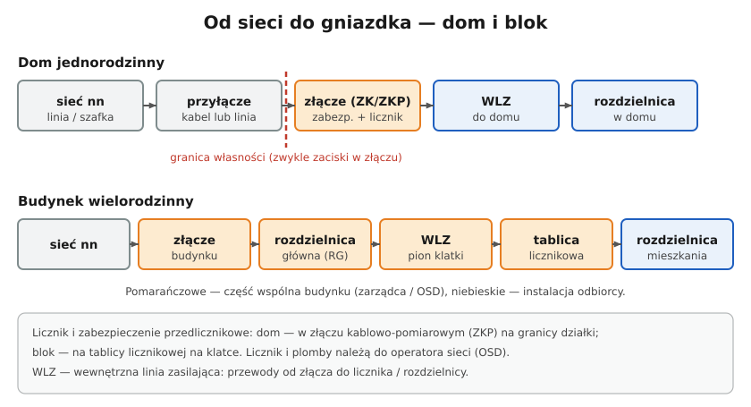

# 14.04 — Wewnętrzna linia zasilająca (WLZ)

> **Moduł:** [14 — Od słupa do gniazdka](README.md) · **Oznaczenia:** 🏠📋 · **Zakres SEP:** (a) (b) · **Status:** ✅ pełny
>
> **Czytaj:**
>
> - N SEP-E-002 — instalacje elektryczne w budynkach mieszkalnych
> - Spadek napięcia: [01.06](../01-prad-napiecie-opor/01.06-grzanie-przewodow-i-spadek-napiecia.md)
> - Obciążalność przewodów: [05.04](../05-przewody-i-kable/05.04-przekroj-i-obciazalnosc-pradowa.md)

[← poprzedni temat](14.03-licznik-i-zabezpieczenie-przedlicznikowe.md) · [spis modułu](README.md) · [następny temat →](14.05-moc-przylaczeniowa-i-taryfy.md)

## Po co to jest

Wewnętrzna linia zasilająca (WLZ) to „kręgosłup” budynku: przewody od złącza do liczników i rozdzielnic mieszkań. W bloku to pion na klatce schodowej, w domu — kabel ze złącza w ogrodzeniu do rozdzielnicy. Od jej stanu zależy, czy w mieszkaniach jest stabilne napięcie i czy przerwa PEN nie wyłączy pół budynku. Na egzaminie: co to jest WLZ i jakie ma wymagania.

## Po ludzku

**WLZ** to linia od złącza (lub rozdzielnicy głównej budynku) do układów pomiarowych i dalej do rozdzielnic odbiorców.

**W domu jednorodzinnym** — kabel lub przewód od złącza ZKP do rozdzielnicy w domu (np. YKY 5×10 albo 5×16 w ziemi).

**W bloku** — z rozdzielnicy głównej (RG) w piwnicy biegnie **pion WLZ** przez klatkę schodową. Na piętrach odgałęzia się do **tablic licznikowych**, a z nich przewody do rozdzielnic w mieszkaniach.

**Wymagania:**

- **przekrój** dobrany do obciążenia wszystkich zasilanych odbiorców (z uwzględnieniem jednoczesności) i do zabezpieczenia;
- **mały spadek napięcia** — WLZ jest wspólna dla wielu odbiorców, więc ma „zużyć” niewielką część dopuszczalnego spadku; reszta zostaje dla instalacji w mieszkaniu;
- **żyły miedziane** w nowych budynkach;
- **pięć przewodów** (L1, L2, L3, N, PE) za punktem podziału PEN — w nowych budynkach;
- **dostępność i ochrona** — w szachtach lub rurach, z możliwością wymiany.

**Stare bloki** mają często WLZ aluminiową, czteroprzewodową (TN-C), przegrzewającą się przy dzisiejszych obciążeniach. Jej modernizacja to sprawa wspólnoty lub spółdzielni i warunek, żeby mieszkańcy mogli zwiększać moc.

## Schemat

## Pojęcia

| Pojęcie | Po ludzku | Termin normowy / symbol |
|---------|-----------|-------------------------|
| WLZ | Przewody od złącza do liczników i rozdzielnic | wewnętrzna linia zasilająca |
| Rozdzielnica główna budynku | Rozdzielnica w piwnicy bloku, za złączem | RG |
| Tablica licznikowa | Szafka z licznikami na klatce | — |
| Współczynnik jednoczesności | Jaka część mocy wszystkich odbiorców pracuje naraz | $k_j$ |

## Liczby do zapamiętania

| Wielkość | Wartość | Kiedy obowiązuje | Źródło |
|----------|---------|------------------|--------|
| Spadek napięcia od licznika do odbiornika | ≤ **3 %** | instalacje w budynkach mieszkalnych | N SEP-E-002 |
| Spadek napięcia w WLZ | rzędu **0,5 %** (dla mocy do ok. 100 kVA) | zalecenie | N SEP-E-002 |
| Przewody WLZ w nowych budynkach | **5 żył Cu** (L1–L3, N, PE) | za punktem podziału PEN | praktyka, [11.04](../11-uklady-sieci/11.04-uklad-tn-c-s-i-punkt-rozdzialu-pen.md) |

## W praktyce

- **Dom:** WLZ ze złącza do rozdzielnicy — dobierz przekrój do zabezpieczenia przedlicznikowego i długości (spadek napięcia). Typowo 5×10 lub 5×16 Cu; przy dłuższych trasach — oblicz.
- **Blok:** problemy z napięciem w mieszkaniu (migotanie, spadki przy włączaniu czajnika u sąsiada) mogą wynikać z przeciążonej lub starej WLZ. Zgłoś to zarządcy.
- **Przerwa PEN w WLZ starego bloku** daje objawy jak w [10.04](../10-aparatura-modulowa/10.04-kontrolki-faz-przekazniki-zaniku-fazy-i.md) — w wielu mieszkaniach naraz.

## Błędy i zagrożenia

- ⚠️ **Prace przy pionie WLZ bez wyłączenia w RG** — to część wspólna, zasilana przed licznikami; wymaga uzgodnień z zarządcą i często z operatorem.
- **Za mały przekrój WLZ w domu** — spadki napięcia, grzanie, problemy z pompą ciepła i falownikiem PV.
- **Dokładanie mocy w mieszkaniach bez modernizacji WLZ** — przegrzewanie przewodów w pionie.

## Przykład

**Zadanie.** WLZ domu: 25 m, YKY 5×10 Cu, prąd obliczeniowy 25 A na fazę (symetrycznie). Oblicz spadek napięcia.

Dla obwodu trójfazowego symetrycznego (bez N), w przybliżeniu:

$$\Delta U = \sqrt{3} \cdot I \cdot R = \sqrt{3} \cdot 25 \cdot \frac{0{,}0175 \cdot 25}{10} \approx 1{,}89\ \mathrm{V}$$

$$\Delta U\% = \frac{1{,}89}{400} \cdot 100\% \approx 0{,}47\ \%$$

**Wniosek.** Mieści się w ok. 0,5 % dla WLZ. Zostaje ok. 2,5 % dla obwodów w domu.

## Pytania SEP

1. **Co to jest wewnętrzna linia zasilająca i jakie są wymagania wobec niej?**

Odpowiedź

To linia zasilająca w budynku łącząca złącze (lub rozdzielnicę główną) z układami pomiarowymi i rozdzielnicami odbiorców. Powinna mieć przekrój dobrany do obciążenia z uwzględnieniem współczynnika jednoczesności, zabezpieczenia i dopuszczalnego spadku napięcia (niewielkiego, rzędu 0,5 %, tak by na instalację odbiorcy pozostało do ok. 3 %), być wykonana przewodami miedzianymi, w układzie z oddzielnymi przewodami N i PE, ułożona w sposób umożliwiający wymianę i chroniona przed uszkodzeniami.

## Sprawdź się

1. Dlaczego dopuszczalny spadek napięcia w WLZ jest dużo mniejszy niż w instalacji mieszkania?

Odpowiedź

Bo WLZ jest wspólna i jej spadek „zużywa” zapas napięcia wszystkich odbiorców. Większość dopuszczalnego spadku zostawia się na obwody wewnątrz mieszkań.

## Źródła

- N SEP-E-002 — instalacje elektryczne w budynkach mieszkalnych, podstawy planowania (spadki napięcia, WLZ).
- PN-HD 60364-5-52 — dobór przewodów, spadek napięcia.

---

[← poprzedni temat](14.03-licznik-i-zabezpieczenie-przedlicznikowe.md) · [spis modułu](README.md) · [następny temat →](14.05-moc-przylaczeniowa-i-taryfy.md)
