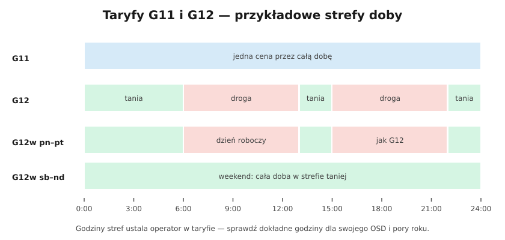

# 14.05 — Moc przyłączeniowa i taryfy

> **Moduł:** [14 — Od słupa do gniazdka](README.md) · **Oznaczenia:** 🏠📋 · **Zakres SEP:** (a) (b) · **Status:** ✅ pełny
>
> **Czytaj:**
>
> - Prawo energetyczne — umowy, taryfy
> - Taryfa twojego operatora i sprzedawcy — godziny stref

[← poprzedni temat](14.04-wewnetrzna-linia-zasilajaca-wlz.md) · [spis modułu](README.md) · (koniec modułu) →

## Po co to jest

Moc przyłączeniowa decyduje, ile urządzeń możesz włączyć jednocześnie, a taryfa — ile zapłacisz za energię zależnie od pory dnia. Planując pompę ciepła, wallbox albo bojler, trzeba wiedzieć, czy moc wystarczy i czy opłaca się przenieść pobór na tańsze godziny.

## Po ludzku

**Moc przyłączeniowa** — zapisana w umowie o przyłączenie, największa moc, na jaką zbudowano przyłącze. Od niej zależy zabezpieczenie przedlicznikowe ([14.03](14.03-licznik-i-zabezpieczenie-przedlicznikowe.md)).

**Moc umowna** — moc zamówiona w umowie dystrybucyjnej lub kompleksowej, nie większa niż przyłączeniowa.

**Zwiększenie mocy** — wniosek do operatora o nowe warunki przyłączenia. Czasem wystarczy wymiana zabezpieczenia, czasem trzeba przebudować przyłącze lub WLZ.

**Taryfy dla gospodarstw domowych (grupa G):**

- **G11** — jedna cena przez całą dobę;
- **G12** — dwie strefy: tańsza (zwykle noc i kilka godzin po południu) i droższa;
- **G12w** — jak G12, a w weekendy cała doba w strefie tańszej;
- **G13** i inne — więcej stref;
- **ceny dynamiczne** — cena zmienia się co godzinę, zależnie od rynku; wymagają licznika zdalnego odczytu.

Godziny stref ustala operator w taryfie i mogą się różnić między operatorami i porami roku.

**Kiedy G12 ma sens?** Gdy duża część zużycia da się przenieść na tańsze godziny: ogrzewanie elektryczne lub pompa ciepła z buforem, podgrzewacz wody, ładowanie samochodu, pralka i zmywarka z opóźnionym startem. Przy zwykłym zużyciu „jak leci” G11 bywa tańsza.

**Elektryk może pomóc** — sterując urządzeniami według strefy: stycznik z zegarem lub sygnałem z licznika ([10.02](../10-aparatura-modulowa/10.02-stycznik-modulowy-i-przekaznik-bistabilny.md)), automatyka domu ([moduł 27](../27-inteligentny-dom/README.md)).

## Schemat

## Pojęcia

| Pojęcie | Po ludzku | Termin normowy / symbol |
|---------|-----------|-------------------------|
| Moc przyłączeniowa | Największa moc, na którą zbudowano przyłącze | — |
| Moc umowna | Moc zamówiona w umowie, ≤ przyłączeniowej | — |
| Taryfa | Zestaw cen i stref czasowych | G11, G12, G12w, G13 |
| Strefa czasowa | Godziny o jednej cenie | — |
| Współczynnik jednoczesności | Ile z zainstalowanej mocy pracuje naraz | $k_j$ |

## Liczby do zapamiętania

| Wielkość | Wartość | Kiedy obowiązuje | Źródło |
|----------|---------|------------------|--------|
| Moc umowna | ≤ **moc przyłączeniowa** | — | umowa z OSD |
| Moc 3-faz. a zabezpieczenie | $P \approx 0{,}69 \cdot I_n$ [kW] | symetryczne obciążenie | obliczenie |
| G12 — strefa tańsza | zwykle **noc + kilka godzin po południu** | wg taryfy OSD | taryfy operatorów |
| G12w | **weekend cały w strefie tańszej** | wg taryfy OSD | jw. |

## W praktyce

- **Bilans mocy przed zakupem urządzeń:** zsumuj moce urządzeń, które mogą pracować jednocześnie (pompa ciepła, płyta, piekarnik, wallbox, bojler) i porównaj z mocą przyłączeniową. Uwzględnij rozkład na fazy.
- **Wallbox** — ustaw ograniczenie prądu ładowania albo przekaźnik priorytetowy ([10.04](../10-aparatura-modulowa/10.04-kontrolki-faz-przekazniki-zaniku-fazy-i.md)), żeby nie wyłączał zabezpieczenia przedlicznikowego.
- **Zmiana taryfy** — u sprzedawcy/operatora; przy liczniku jednostrefowym może wymagać wymiany licznika (robi to operator).

## Błędy i zagrożenia

- **Kupno pompy ciepła 9 kW i wallboxa 11 kW przy mocy przyłączeniowej 12 kW** bez planu — wyłączenia zabezpieczenia przedlicznikowego.
- **G12 bez przenoszenia zużycia** — droższa energia w dzień przewyższa oszczędność w nocy.

## Przykład

**Zadanie.** Dom z G12: podgrzewacz wody 3 kW pracuje 2 h dziennie. Różnica cen między strefą droższą a tańszą wynosi 0,40 zł/kWh (przykład). Ile zaoszczędzisz rocznie, przenosząc grzanie na noc?

$$E = 3\ \mathrm{kW} \cdot 2\ \mathrm{h} \cdot 365 = 2190\ \mathrm{kWh}$$

$$\text{oszczędność} \approx 2190 \cdot 0{,}40 \approx 876\ \mathrm{zł}$$

**Wniosek.** Stycznik z zegarem za kilkadziesiąt złotych zwraca się w kilka tygodni — pod warunkiem, że zbiornik jest wystarczający na dzienne zużycie.

## Pytania SEP

1. **Czym różni się moc przyłączeniowa od mocy umownej?**

Odpowiedź

Moc przyłączeniowa to moc określona w umowie o przyłączenie, dla której zaprojektowano i wykonano przyłącze i dobrano zabezpieczenie przedlicznikowe. Moc umowna to moc zamówiona przez odbiorcę w umowie dystrybucyjnej lub kompleksowej; nie może być większa od mocy przyłączeniowej.

2. **Jakie taryfy stosuje się dla odbiorców w gospodarstwach domowych?**

Odpowiedź

Taryfy grupy G: G11 (jednostrefowa — jedna cena przez całą dobę), G12 (dwustrefowa — strefa tańsza i droższa w ciągu doby), G12w (dwustrefowa z całym weekendem w strefie tańszej), a także taryfy z większą liczbą stref (np. G13) i z cenami dynamicznymi. Godziny stref określa taryfa operatora.

## Sprawdź się

1. Zabezpieczenie przedlicznikowe 3 × 25 A. Jaka jest teoretyczna maksymalna moc przy symetrycznym obciążeniu?

Odpowiedź

$\sqrt{3} \cdot 400 \cdot 25 \approx 17{,}3$ kW.

## Źródła

- Prawo energetyczne — umowy o przyłączenie, umowy kompleksowe i dystrybucyjne, ceny dynamiczne.
- Taryfy operatorów systemów dystrybucyjnych (strefy czasowe grup G).

---

[← poprzedni temat](14.04-wewnetrzna-linia-zasilajaca-wlz.md) · [spis modułu](README.md) · (koniec modułu) →
