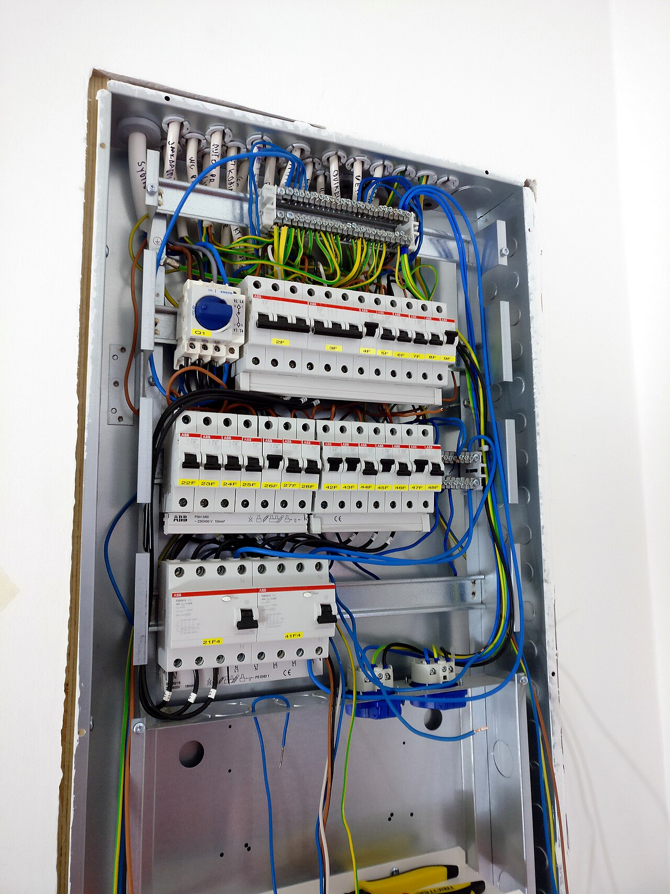
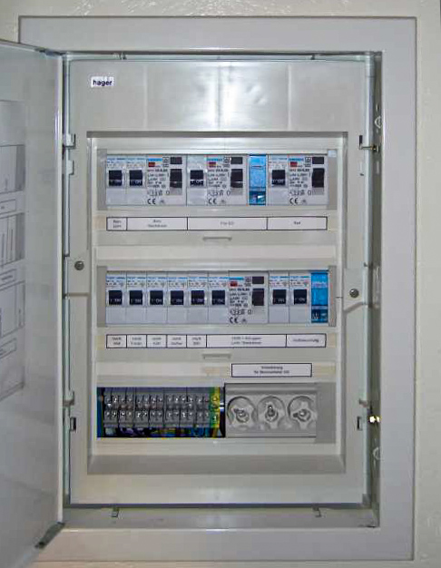
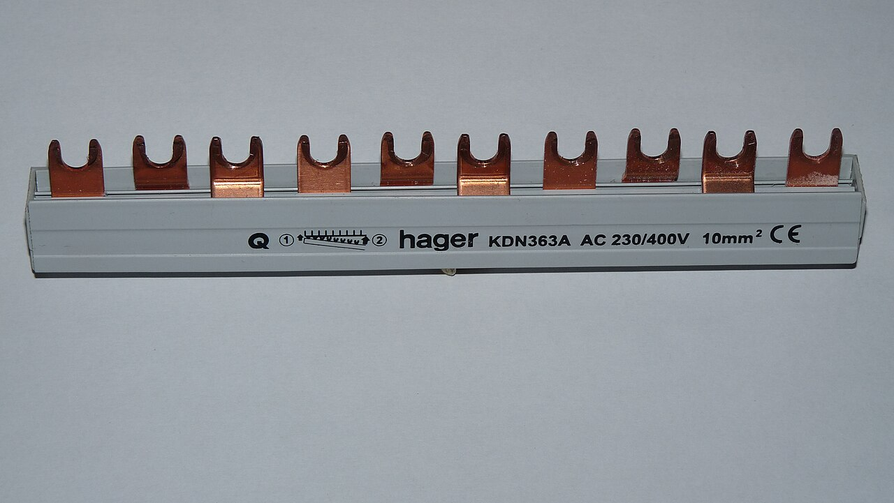
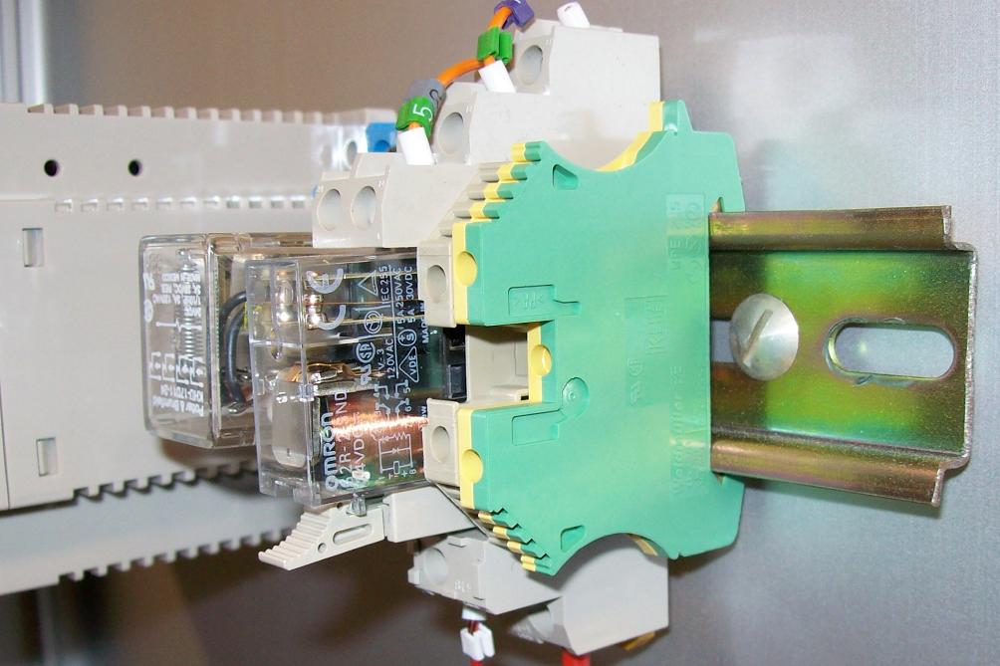
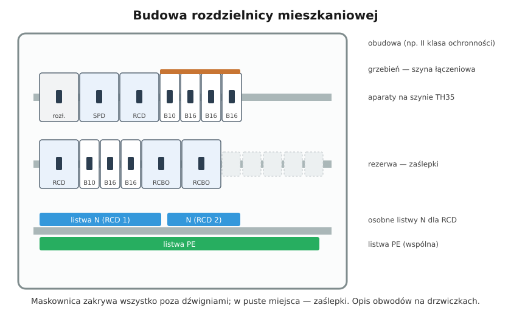

# 15.01 — Budowa rozdzielnicy: obudowa, szyna TH35, listwy N i PE, mostki

> **Moduł:** [15 — Rozdzielnica mieszkaniowa](README.md) · **Oznaczenia:** 🏠📋 · **Zakres SEP:** (a) (b) (c) · **Status:** ✅ pełny
>
> **Czytaj:**
>
> - PN-EN 61439-3 — rozdzielnice przeznaczone do obsługi przez osoby niewykwalifikowane
> - PN-EN 60715 — szyna TH35
> - Aparaty modułowe: [10.01](../10-aparatura-modulowa/10.01-rozlacznik-izolacyjny-wylacznik-glowny.md)

← (początek modułu) · [spis modułu](README.md) · [następny temat →](15.02-schemat-jednokreskowy-jak-czytac-i-jak-rysowac.md)

## Po co to jest

Rozdzielnica mieszkaniowa to miejsce, gdzie zbiegają się wszystkie obwody, zabezpieczenia i przewody ochronne. Dobra rozdzielnica jest czytelna, ma zapas miejsca, osobne listwy N dla każdej różnicówki i porządnie poprowadzone przewody. Zła — to plątanina, w której nikt po latach nie znajdzie usterki. Ten temat opisuje jej elementy.

## Po ludzku

**Obudowa.**

- **natynkowa** — na ścianę; łatwa do montażu i rozbudowy;
- **podtynkowa** — w wnęce w murze; estetyczna, trzeba ją zaplanować przed tynkami;
- **do ścian g-k** — z łapami do płyty.

Obudowy z tworzywa są zwykle w **II klasie ochronności** (nie łączy się ich z PE). Metalowe — w I klasie: obudowę i drzwiczki łączy się z PE. Liczba **rzędów** × **modułów w rzędzie** (np. 3 × 12) określa pojemność.

**Szyna TH35** (zwana też DIN) — stalowa szyna o szerokości 35 mm, na którą zatrzaskuje się aparaty. Szerokość aparatów mierzy się w **modułach** (ok. 18 mm).

**Listwy zaciskowe:**

- **N** — osobna, izolowana listwa dla każdej grupy różnicowoprądowej ([08.07](../08-wylaczniki-roznicowopradowe/08.07-podzial-obwodow-miedzy-wylaczniki.md));
- **PE** — wspólna, połączona z przewodem ochronnym zasilania (i z obudową metalową).

**Grzebienie (szyny łączeniowe)** — miedziane listwy z „zębami”, które łączą zaciski wielu aparatów jednym ruchem zamiast mostkowania przewodami. Bywają jedno-, trójfazowe i z N.

**Maskownica i zaślepki** — przykrywają wszystko poza dźwigniami aparatów; puste miejsca zaślepia się ([12.01](../12-ochrona-przeciwporazeniowa/12.01-ochrona-podstawowa-izolacja-obudowy-przegrody.md)).

**Zapas miejsca** — zostaw wolne moduły na przyszłe obwody (wallbox, klimatyzacja, PV). Przy planowaniu przyjmuje się zwykle 20–30 % rezerwy.

## Jak to wygląda

*Na co patrzeć: u góry są listwy N i PE z przewodami wszystkich obwodów. Aparaty w rzędach łączą grzebienie. Przewody wchodzące od góry mają opisane końce. Po lewej stronie widać zapas długości — przewody da się przełożyć bez przedłużania.*

*Na co patrzeć: maskownica zostawia na wierzchu tylko dźwignie aparatów. Pod każdym aparatem jest opis obwodu. Tak wygląda rozdzielnica gotowa do użytkowania — wszystkie części czynne za osłoną.*

*Na co patrzeć: grzebień ma przekrój (tu 10 mm²) i dopuszczalny prąd. Zęby wchodzą pod zaciski aparatów. Nieużywane zęby zostawia się w osłonie albo zakrywa osłonkami, żeby nie były dostępne.*

*Na co patrzeć: profil szyny — dwa zagięte brzegi, na które zatrzaskuje się aparaty i złączki. Złączki żółto-zielone są połączone z szyną (funkcja PE), szare — izolowane.*

## Schemat

## Pojęcia

| Pojęcie | Po ludzku | Termin normowy / symbol |
|---------|-----------|-------------------------|
| Rozdzielnica mieszkaniowa | Skrzynka z zabezpieczeniami obwodów | rozdzielnica do obsługi przez osoby niewykwalifikowane (PN-EN 61439-3) |
| Szyna TH35 (DIN) | Szyna montażowa 35 mm | PN-EN 60715 |
| Moduł | Szerokość jednego aparatu | ok. 17,5–18 mm |
| Grzebień | Listwa łącząca zaciski aparatów | szyna łączeniowa |
| Maskownica | Osłona aparatów | — |
| Listwa N / PE | Zaciski przewodów N / PE obwodów | — |

## Liczby do zapamiętania

| Wielkość | Wartość | Kiedy obowiązuje | Źródło |
|----------|---------|------------------|--------|
| Szyna montażowa | **35 mm** (TH35) | — | PN-EN 60715 |
| Szerokość modułu | ok. **17,5–18 mm** | — | katalogi |
| Wyłącznik nadprądowy 1P | **1 moduł** | — | jw. |
| RCD 2P / 4P | **2 / 4 moduły** | — | jw. |
| Rezerwa miejsca | **20–30 %** | planowanie | praktyka, N SEP-E-002 |
| Stopień ochrony obudowy | co najmniej **IP2X** od frontu, typowo IP30–IP40 | wnętrza | [06.05](../06-osprzet-instalacyjny/06.05-stopnie-ochrony-ip.md) |

## W praktyce

- **Dobieraj rozdzielnicę „o rząd większą”**, niż wychodzi z policzenia aparatów.
- **Plastikowa obudowa II klasy** — nie wkręcaj w nią metalowych elementów połączonych z PE na zewnątrz; zachowaj izolację.
- **Grzebień zasilaj** zgodnie z instrukcją — przy dużych prądach w środku, nie na końcu.
- **Miejsce montażu:** dostępne, nie w łazience, nie za meblami w zabudowie, na wysokości wygodnej do obsługi.

## Błędy i zagrożenia

- ⚠️ **Brak zaślepek w maskownicy** — dostęp do części pod napięciem.
- **Jedna listwa N dla kilku RCD** — wybijanie różnicówek ([08.07](../08-wylaczniki-roznicowopradowe/08.07-podzial-obwodow-miedzy-wylaczniki.md)).
- **Za mała rozdzielnica** — przewody ściśnięte, przegrzewanie, brak miejsca na nowe obwody.
- **Mostkowanie aparatów przewodami „w pętelkę”** zamiast grzebieniem — luźne zaciski z dwoma przewodami.

## Przykład

**Zadanie.** Policz moduły dla mieszkania: rozłącznik 3P, SPD 3+1, 2 × RCD 4P, 8 wyłączników 1P, 1 wyłącznik 3P (płyta), 3 RCBO (po 2 moduły), kontrolki faz (1 moduł). Jaką rozdzielnicę wybrać?

$$3 + 4 + 2 \cdot 4 + 8 + 3 + 3 \cdot 2 + 1 = 33\ \text{moduły}$$

Z rezerwą ok. 25 %: $33 \cdot 1{,}25 \approx 41$ modułów. Wybór: rozdzielnica **3 × 14 = 42** albo **4 × 12 = 48** moduły (wygodniej przy listwach N dla kilku grup).

## Pytania SEP

1. **Z jakich elementów składa się rozdzielnica mieszkaniowa?**

Odpowiedź

Z obudowy (natynkowej lub podtynkowej, z tworzywa lub metalowej) z drzwiczkami, szyn montażowych TH35, aparatów (rozłącznik główny, ograniczniki przepięć, wyłączniki różnicowoprądowe i nadprądowe, ewentualnie inne aparaty modułowe), szyn łączeniowych (grzebieni), listew zaciskowych N i PE, maskownicy z zaślepkami, przepustów do wprowadzenia przewodów oraz opisu obwodów i schematu.

## Sprawdź się

1. Dlaczego w rozdzielnicy z dwiema różnicówkami są dwie listwy N?

Odpowiedź

Bo przewody N obwodów za każdą różnicówką muszą wracać przez jej przekładnik. Wspólna listwa N połączyłaby N obu grup i różnicówki by wybijały.

## Źródła

- PN-EN 61439-3 — rozdzielnice do obsługi przez osoby niewykwalifikowane.
- PN-EN 60715 — szyny montażowe.
- N SEP-E-002 — instalacje w budynkach mieszkalnych (rezerwa miejsca, wyposażenie rozdzielnic).

---

← (początek modułu) · [spis modułu](README.md) · [następny temat →](15.02-schemat-jednokreskowy-jak-czytac-i-jak-rysowac.md)
