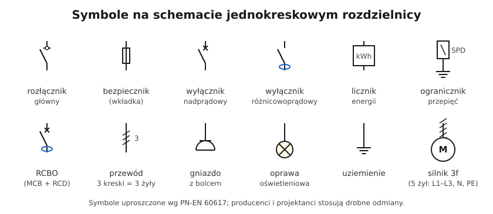
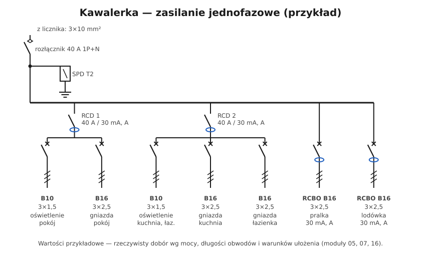

# 15.02 — Schemat jednokreskowy — jak czytać i jak rysować

> **Moduł:** [15 — Rozdzielnica mieszkaniowa](README.md) · **Oznaczenia:** 🏠📋 · **Zakres SEP:** (a) (b) (c) · **Status:** ✅ pełny
>
> **Czytaj:**
>
> - PN-EN 60617 — symbole graficzne na schematach
> - Aparaty: moduły [07](../07-zabezpieczenia-nadpradowe/README.md), [08](../08-wylaczniki-roznicowopradowe/README.md), [10](../10-aparatura-modulowa/README.md)

[← poprzedni temat](15.01-budowa-rozdzielnicy-obudowa-szyna-th35-listwy-n.md) · [spis modułu](README.md) · [następny temat →](15.03-oznaczanie-obwodow-i-opis-rozdzielnicy.md)

## Po co to jest

Schemat jednokreskowy pokazuje całą rozdzielnicę na jednej kartce: skąd przychodzi zasilanie, jakie są aparaty, jak są pogrupowane i jakie obwody z nich wychodzą. Bez niego nie da się sensownie zaplanować rozdzielnicy, przeprowadzić pomiarów ani szukać usterek. Na egzaminie mogą poprosić o narysowanie schematu prostej rozdzielnicy.

## Po ludzku

**Jednokreskowy**, bo każdy tor rysuje się **jedną linią**, niezależnie od tego, ile ma przewodów. Liczbę żył pokazują **ukośne kreski** na linii albo opis (3×2,5, 5×2,5).

**Jak czytać** — od góry do dołu:

1. **zasilanie** — skąd (z licznika, ze złącza), jakim przewodem;
2. **aparaty główne** — rozłącznik, ograniczniki przepięć;
3. **szyna** — pozioma linia, z której odchodzą grupy;
4. **grupy** — różnicówki i wyłączniki pod nimi;
5. **obwody** — na dole, przy każdym: numer, aparat, przewód, przeznaczenie, czasem faza i moc.

**Jak rysować** — kolejno: lista obwodów (pomieszczenia, odbiorniki, moce) → podział na grupy RCD ([08.07](../08-wylaczniki-roznicowopradowe/08.07-podzial-obwodow-miedzy-wylaczniki.md)) → przydział faz → aparaty i przewody ([07.06](../07-zabezpieczenia-nadpradowe/07.06-koordynacja-zabezpieczenia-z-przewodem.md)) → rysunek. Schemat wkłada się do kieszeni w drzwiczkach rozdzielnicy i dołącza do dokumentacji.

## Schemat

## Pojęcia

| Pojęcie | Po ludzku | Termin normowy / symbol |
|---------|-----------|-------------------------|
| Schemat jednokreskowy | Rozdzielnica narysowana jedną linią na tor | schemat zasadniczy uproszczony |
| Kreski na przewodzie | Liczba żył | PN-EN 60617 |
| Zestawienie obwodów | Tabela: numer, aparat, przewód, odbiornik, faza | — |
| Dokumentacja powykonawcza | Schematy i opisy instalacji „jak wykonano” | — |

## Liczby do zapamiętania

| Wielkość | Wartość | Kiedy obowiązuje | Źródło |
|----------|---------|------------------|--------|
| 3 kreski | **3 żyły** (L, N, PE) | obwód 1-fazowy | PN-EN 60617 |
| 5 kresek | **5 żył** (L1–L3, N, PE) | obwód 3-fazowy | jw. |
| Opis obwodu | **numer, aparat, przewód, przeznaczenie, faza** | — | praktyka |

## W praktyce

- **Zawsze aktualizuj schemat** po zmianach w rozdzielnicy — nieaktualny schemat jest gorszy niż żaden.
- **Numeruj obwody** tak samo na schemacie, na aparacie i na opisie w drzwiczkach ([15.03](15.03-oznaczanie-obwodow-i-opis-rozdzielnicy.md)).
- **Zaznacz fazy** obwodów jednofazowych — przydaje się przy pomiarach i przy szukaniu przeciążeń.
- **Do pomiarów** schemat jest mapą: według niego sprawdza się kolejno każdy obwód i każdą różnicówkę ([moduł 23](../23-pomiary-odbiorcze-i-okresowe/README.md)).

## Błędy i zagrożenia

- **Brak schematu** — każdy kolejny elektryk zaczyna od zgadywania.
- **Schemat „z projektu”, a w rzeczywistości inaczej** — mylące przy szukaniu usterek i niebezpieczne przy pracach.
- **Brak informacji o fazach i grupach RCD** — trudno szukać przyczyn wybijania.

## Przykład

**Zadanie.** Odczytaj z przykładowego schematu kawalerki: ile jest obwodów, które są chronione wspólną różnicówką i jakim przewodem zasilane są gniazda w łazience.

**Rozwiązanie.** 7 obwodów odbiorczych. RCD 1: oświetlenie pokoju (B10, 3×1,5) i gniazda pokoju (B16, 3×2,5). RCD 2: oświetlenie kuchni i łazienki, gniazda kuchni, gniazda łazienki. Osobne RCBO: pralka i lodówka. Gniazda w łazience: B16, przewód 3×2,5, za RCD 2.

## Pytania SEP

1. **Co przedstawia schemat jednokreskowy rozdzielnicy i jakie informacje powinien zawierać?**

Odpowiedź

Przedstawia w uproszczeniu (jedną linią na tor) połączenia elektryczne rozdzielnicy: zasilanie, aparaturę główną, podział na grupy i obwody odbiorcze. Powinien zawierać: rodzaj i przekrój przewodu zasilającego, typy i parametry aparatów (prądy znamionowe, charakterystyki, prądy różnicowe i typy RCD, typ SPD), numery obwodów, przekroje i liczbę żył przewodów obwodów, przeznaczenie obwodów, przydział faz, a także oznaczenie układu sieci.

## Sprawdź się

1. Na schemacie przy przewodzie są trzy ukośne kreski. Co to oznacza?

Odpowiedź

Przewód ma trzy żyły (w obwodzie jednofazowym: L, N, PE).

## Źródła

- PN-EN 60617 — symbole graficzne stosowane na schematach.
- PN-HD 60364-5-51 — 514 (identyfikacja, schematy i dokumentacja).

---

[← poprzedni temat](15.01-budowa-rozdzielnicy-obudowa-szyna-th35-listwy-n.md) · [spis modułu](README.md) · [następny temat →](15.03-oznaczanie-obwodow-i-opis-rozdzielnicy.md)
