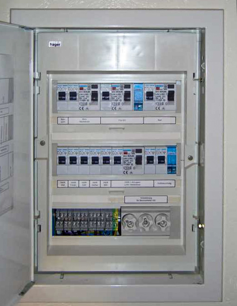
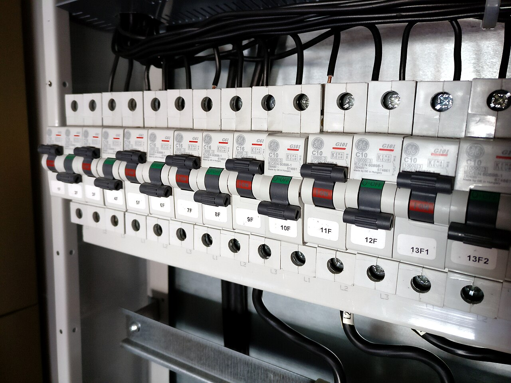

# 15.03 — Oznaczanie obwodów i opis rozdzielnicy

> **Moduł:** [15 — Rozdzielnica mieszkaniowa](README.md) · **Oznaczenia:** 🏠📋 · **Zakres SEP:** (a) (b) (c) · **Status:** ✅ pełny
>
> **Czytaj:**
>
> - PN-HD 60364-5-51 — 514 (identyfikacja i oznaczenia)
> - PN-EN 60445 — oznaczanie przewodów

[← poprzedni temat](15.02-schemat-jednokreskowy-jak-czytac-i-jak-rysowac.md) · [spis modułu](README.md) · [następny temat →](15.04-przyklad-kawalerka-zasilanie-jednofazowe.md)

## Po co to jest

Dobrze opisana rozdzielnica pozwala w nocy, po ciemku, przy latarce, wyłączyć właściwy obwód bez zgadywania. Elektrykowi skraca diagnostykę z godzin do minut. Norma wymaga, żeby obwody i aparaty były jednoznacznie oznaczone.

## Po ludzku

**Co oznaczać:**

1. **każdy aparat** — numer obwodu i krótka nazwa (np. „F5 gniazda kuchnia”), na maskownicy pod aparatem;
2. **grupy RCD** — które obwody chroni która różnicówka (np. kolorem tła opisów albo nawiasem na maskownicy);
3. **fazy** — przy obwodach jednofazowych (L1, L2, L3);
4. **przewody** — na końcach w rozdzielnicy numer obwodu (oznaczniki, koszulki, opaski) — przydaje się przy odłączaniu i pomiarach;
5. **listwy N** — którego RCD dotyczą;
6. **na drzwiczkach** — tabela obwodów i schemat jednokreskowy w kieszeni ([15.02](15.02-schemat-jednokreskowy-jak-czytac-i-jak-rysowac.md));
7. **ostrzeżenia** — znak napięcia na drzwiczkach; przy fotowoltaice i innych źródłach — informacja, że instalacja ma **więcej niż jedno źródło zasilania**;
8. **data ostatnich pomiarów** i kontakt do wykonawcy.

**Jak nazywać obwody** — po pomieszczeniu i funkcji, jak mówią domownicy: „gniazda salon ściana TV”, „oświetlenie łazienka”, „pralka”. Unikaj nazw typu „obwód 7” bez opisu.

## Jak to wygląda

*Na co patrzeć: pod każdym aparatem jest pasek opisu. Opis jest na maskownicy, a nie na drzwiczkach — po zdjęciu drzwiczek nadal wiadomo, co jest czym.*

*Na co patrzeć: każdy wyłącznik ma własną etykietę z oznaczeniem obwodu. Te same oznaczenia powinny być na schemacie i na końcach przewodów.*

## Pojęcia

| Pojęcie | Po ludzku | Termin normowy / symbol |
|---------|-----------|-------------------------|
| Oznacznik przewodu | Opisowa koszulka lub opaska na końcu przewodu | — |
| Tabela obwodów | Lista: numer, aparat, przeznaczenie | — |
| Identyfikacja | Jednoznaczne oznaczenie aparatów i przewodów | PN-HD 60364-5-51, 514 |

## Liczby do zapamiętania

| Wielkość | Wartość | Kiedy obowiązuje | Źródło |
|----------|---------|------------------|--------|
| Oznaczenie aparatu | **numer + nazwa obwodu** | każdy aparat | PN-HD 60364-5-51, 514 |
| Schemat | **w rozdzielnicy** lub przy niej | — | jw. |
| Wiele źródeł zasilania | **ostrzeżenie** na rozdzielnicy | PV, agregat | PN-HD 60364-7-712, jw. |

## W praktyce

- **Opisy trwałe** — drukowane etykiety lub drukarka do opisów; marker na taśmie wyblaknie.
- **Przewody oznaczaj od razu** przy wprowadzaniu do rozdzielnicy — później nie wiadomo, który jest który.
- **Opis listew N** — „N RCD1”, „N RCD2”.
- **Po każdej zmianie** — popraw opis i schemat.

## Błędy i zagrożenia

- ⚠️ **Opis niezgodny z rzeczywistością** — wyłączasz „łazienkę”, a w łazience nadal jest napięcie. Zawsze sprawdzaj brak napięcia ([00.02](../00-bezpieczenstwo-najpierw/00.02-sprawdzanie-braku-napiecia-probnik-dwubiegunowy.md)).
- **Brak ostrzeżenia o drugim źródle** (falownik PV, agregat) — po wyłączeniu zasilania z sieci części instalacji nadal mogą być pod napięciem.
- **Opis tylko na drzwiczkach** — po zdjęciu drzwiczek lub zmianie układu przestaje pasować.

## Przykład

**Zadanie.** Zaproponuj opis dla obwodu: wyłącznik B16, faza L2, za RCD 1, zasila gniazda w kuchni przy blacie po lewej stronie zlewu.

**Rozwiązanie.** Na maskownicy: **„F7 · L2 · gniazda kuchnia blat lewy”**, z kolorem lub znacznikiem grupy RCD 1. Na przewodach w rozdzielnicy: **„F7”** na żyle L, N i PE. W tabeli na drzwiczkach: F7, B16, YDY 3×2,5, L2, RCD 1, gniazda kuchnia blat (lewa strona zlewu).

## Pytania SEP

1. **Jakie oznaczenia powinny znajdować się w rozdzielnicy mieszkaniowej?**

Odpowiedź

Oznaczenia wszystkich aparatów z numerem i przeznaczeniem obwodu, przynależność obwodów do wyłączników różnicowoprądowych, przydział faz, oznaczenie listew N i PE, oznaczenia końców przewodów, schemat jednokreskowy lub tabela obwodów w rozdzielnicy lub przy niej, znaki ostrzegawcze oraz — jeśli instalacja ma więcej niż jedno źródło zasilania (np. fotowoltaika) — informacja o tym.

## Sprawdź się

1. Dlaczego przy instalacji z fotowoltaiką na rozdzielnicy umieszcza się ostrzeżenie o dwóch źródłach?

Odpowiedź

Bo po wyłączeniu zasilania z sieci część instalacji (strona DC paneli, czasem obwody falownika lub magazynu energii) może nadal być pod napięciem. Osoba pracująca przy rozdzielnicy musi o tym wiedzieć.

## Źródła

- PN-HD 60364-5-51 — 514 (identyfikacja, oznaczenia, schematy).
- PN-EN 60445 — oznaczanie zacisków i przewodów.
- PN-HD 60364-7-712 — instalacje fotowoltaiczne (oznaczenia).

---

[← poprzedni temat](15.02-schemat-jednokreskowy-jak-czytac-i-jak-rysowac.md) · [spis modułu](README.md) · [następny temat →](15.04-przyklad-kawalerka-zasilanie-jednofazowe.md)
