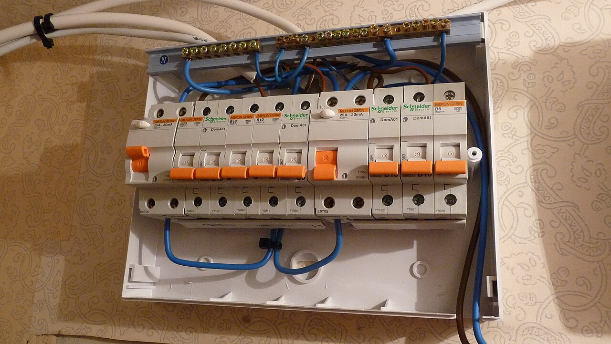
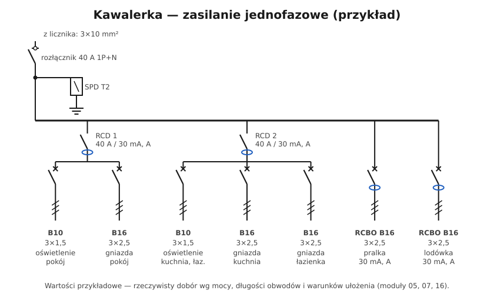

# 15.04 — Przykład: kawalerka, zasilanie jednofazowe

> **Moduł:** [15 — Rozdzielnica mieszkaniowa](README.md) · **Oznaczenia:** 🏠📋 · **Zakres SEP:** (a) (b) (c) · **Status:** ✅ pełny
>
> **Czytaj:**
>
> - Podział obwodów: [08.07](../08-wylaczniki-roznicowopradowe/08.07-podzial-obwodow-miedzy-wylaczniki.md)
> - Planowanie obwodów: [moduł 16](../16-planowanie-obwodow/README.md)

[← poprzedni temat](15.03-oznaczanie-obwodow-i-opis-rozdzielnicy.md) · [spis modułu](README.md) · [następny temat →](15.05-przyklad-mieszkanie-zasilanie-trojfazowe.md)

## Po co to jest

Przykład najmniejszej typowej rozdzielnicy: kawalerka zasilana jednofazowo. Pokazuje, jak z wymagań (RCD 30 mA na gniazdach i oświetleniu, podział obwodów, osobne obwody dla dużych odbiorników) wychodzi konkretny zestaw aparatów i jak to narysować.

## Po ludzku

**Założenia (przykładowe):**

- zasilanie jednofazowe z tablicy licznikowej na klatce, zabezpieczenie przedlicznikowe np. 25 A;
- przewód z licznika do rozdzielnicy 3×10 mm² Cu;
- pokój, kuchnia z aneksem, łazienka, przedpokój; płyta indukcyjna jednofazowa (z ograniczeniem mocy) albo ceramiczna.

**Aparaty i obwody:**

| Nr | Aparat | Przewód | Obwód |
|----|--------|---------|-------|
| — | rozłącznik 40 A 1P+N | — | główny |
| — | SPD typ 2, 1+1 | — | ochrona przeciwprzepięciowa |
| RCD 1 | 40 A / 30 mA, typ A | — | grupa 1 |
| F1 | B10 | 3×1,5 | oświetlenie pokój, przedpokój |
| F2 | B16 | 3×2,5 | gniazda pokój |
| RCD 2 | 40 A / 30 mA, typ A | — | grupa 2 |
| F3 | B10 | 3×1,5 | oświetlenie kuchnia, łazienka |
| F4 | B16 | 3×2,5 | gniazda kuchnia (blat) |
| F5 | B16 | 3×2,5 | gniazda łazienka |
| F6 | RCBO B16 / 30 mA, A | 3×2,5 | pralka |
| F7 | RCBO B16 / 30 mA, A | 3×2,5 | lodówka |
| F8 | B20 lub B25 (wg producenta) za RCD | 3×4 | płyta — opcjonalnie, jeśli jednofazowa o dużej mocy (nie ma jej na schemacie) |

**Dlaczego tak:**

- oświetlenie pokoju i gniazda kuchni są na **różnych RCD** — po zadziałaniu jednej różnicówki w mieszkaniu zostaje światło;
- **pralka i lodówka** na RCBO — zadziałanie innych obwodów ich nie wyłączy, a upływ pralki nie wyłączy lodówki;
- **suma mocy** jednoczesnych odbiorników musi zmieścić się w 25 A — przy płycie indukcyjnej często potrzebne jest ograniczenie jej mocy albo zwiększenie mocy przyłączeniowej.

## Jak to wygląda

*Na co patrzeć: dwie różnicówki, każda z własną grupą wyłączników i własną listwą N. Taki układ to podstawa rozdzielnicy kawalerki lub małego mieszkania.*

## Schemat

## Pojęcia

| Pojęcie | Po ludzku | Termin normowy / symbol |
|---------|-----------|-------------------------|
| Zasilanie jednofazowe | L, N, PE z licznika | — |
| Grupa RCD | Obwody za jedną różnicówką | — |
| Bilans mocy | Suma mocy odbiorników pracujących naraz | — |

## Liczby do zapamiętania

| Wielkość | Wartość | Kiedy obowiązuje | Źródło |
|----------|---------|------------------|--------|
| Moc przy 25 A, 1-faz. | ok. **5,75 kW** | teoretycznie | [14.03](../14-od-slupa-do-gniazdka/14.03-licznik-i-zabezpieczenie-przedlicznikowe.md) |
| Oświetlenie | **B10, 3×1,5** | typowo | [07.06](../07-zabezpieczenia-nadpradowe/07.06-koordynacja-zabezpieczenia-z-przewodem.md) |
| Gniazda | **B16, 3×2,5** | typowo | jw. |
| RCD | **30 mA, typ A**, co najmniej **2 grupy** | — | [08.07](../08-wylaczniki-roznicowopradowe/08.07-podzial-obwodow-miedzy-wylaczniki.md) |
| Moduły (przykład) | ok. **20** + rezerwa | — | obliczenie |

## W praktyce

- **Sprawdź selektywność** zabezpieczenia przedlicznikowego 25 A z B16 — przy zwarciu tuż za B16 może zadziałać i przedlicznikowe ([07.07](../07-zabezpieczenia-nadpradowe/07.07-selektywnosc-zabezpieczen.md)).
- **Płyta indukcyjna jednofazowa** ma często moc 7,2 kW przy podłączeniu dwufazowym, a przy jednej fazie wymaga ograniczenia mocy w ustawieniach (np. do 3,5–4 kW). Sprawdź instrukcję.
- **Zostaw rezerwę** na przyszłość (klimatyzacja, osobny obwód biurka).

## Błędy i zagrożenia

- **Jedna różnicówka na wszystko** — każdy upływ gasi całe mieszkanie.
- **Płyta, czajnik, piekarnik, pralka na jednym obwodzie** — przeciążenia i przegrzewanie gniazd.
- **Brak bilansu mocy** — wyłączanie zabezpieczenia przedlicznikowego na klatce.

## Przykład

**Zadanie.** W kawalerce wieczorem pracują: płyta ograniczona do 3,5 kW, piekarnik 2,5 kW, czajnik 2 kW, oświetlenie 0,2 kW, TV i komputer 0,3 kW. Czy zabezpieczenie przedlicznikowe 25 A wytrzyma?

$$P = 3{,}5 + 2{,}5 + 2 + 0{,}2 + 0{,}3 = 8{,}5\ \mathrm{kW} \qquad I = \frac{8500}{230} \approx 37\ \mathrm{A}$$

37 A > 25 A — zabezpieczenie zadziała po krótkim czasie.

**Rozwiązanie.** Nie włączać wszystkiego naraz (czajnik po zakończeniu gotowania), zastosować przekaźnik priorytetowy (płyta odcina piekarnik) albo wystąpić o zwiększenie mocy (często trójfazowe zasilanie).

## Pytania SEP

1. **Jakie zabezpieczenia i obwody powinna mieć rozdzielnica małego mieszkania zasilanego jednofazowo?**

Odpowiedź

Rozłącznik główny (izolacyjny) 1P+N, ogranicznik przepięć, co najmniej dwa wyłączniki różnicowoprądowe 30 mA (typ A) z podziałem obwodów tak, by oświetlenie i gniazda jednego pomieszczenia były w różnych grupach, wyłączniki nadprądowe dla obwodów oświetlenia (np. B10, 1,5 mm²) i gniazd (np. B16, 2,5 mm²), osobne obwody dla kuchni, łazienki i dużych odbiorników (pralka, zmywarka, płyta), najlepiej z RCBO dla urządzeń, których nie powinno się wyłączać (lodówka). Zabezpieczenia muszą być skoordynowane z przewodami i selektywne względem zabezpieczenia przedlicznikowego.

## Sprawdź się

1. Dlaczego oświetlenie pokoju i gniazda kuchni umieszczono pod różnymi RCD?

Odpowiedź

Żeby zadziałanie różnicówki z powodu usterki urządzenia w kuchni nie zostawiło mieszkańca po ciemku — światło w pokoju (i przedpokoju) działa i można spokojnie poszukać przyczyny.

## Źródła

- PN-HD 60364-4-41:2017 — 411.3.3, 411.3.4 (RCD 30 mA dla gniazd i oświetlenia).
- N SEP-E-002 — podstawy planowania instalacji w budynkach mieszkalnych.

---

[← poprzedni temat](15.03-oznaczanie-obwodow-i-opis-rozdzielnicy.md) · [spis modułu](README.md) · [następny temat →](15.05-przyklad-mieszkanie-zasilanie-trojfazowe.md)
