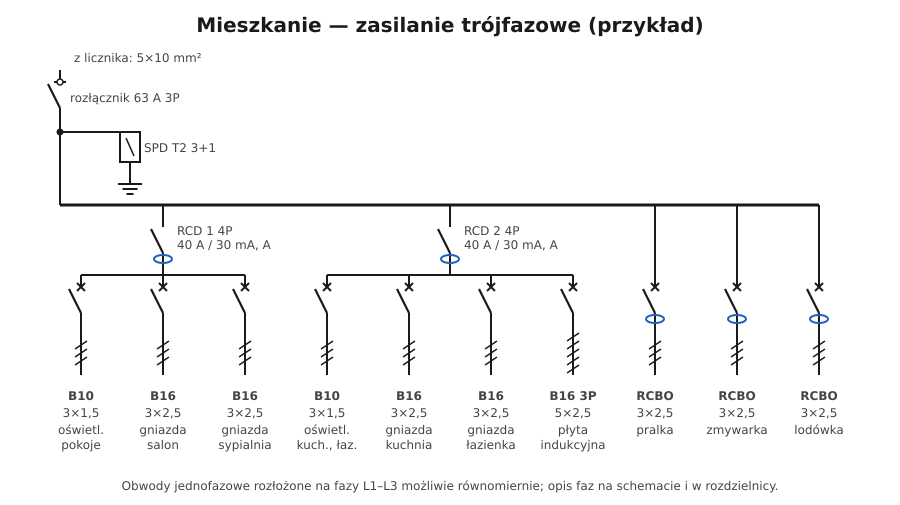

# 15.05 — Przykład: mieszkanie, zasilanie trójfazowe

> **Moduł:** [15 — Rozdzielnica mieszkaniowa](README.md) · **Oznaczenia:** 🏠📋 · **Zakres SEP:** (a) (b) (c) · **Status:** ✅ pełny
>
> **Czytaj:**
>
> - Fazy i trójfazowość: [02.03](../02-prad-przemienny-230-400/02.03-uklad-trojfazowy-230-v-i-400-v-kolejnosc-faz.md)
> - Bilans mocy: [14.03](../14-od-slupa-do-gniazdka/14.03-licznik-i-zabezpieczenie-przedlicznikowe.md)

[← poprzedni temat](15.04-przyklad-kawalerka-zasilanie-jednofazowe.md) · [spis modułu](README.md) · [następny temat →](15.06-przyklad-dom-jednorodzinny.md)

## Po co to jest

Większość nowych mieszkań ma zasilanie trójfazowe. Daje to dużo większą moc, ale wymaga przemyślanego rozkładu obwodów na fazy i różnicówek czterobiegunowych. Ten przykład pokazuje typową rozdzielnicę mieszkania 2–3-pokojowego.

## Po ludzku

**Założenia (przykładowe):**

- zasilanie trójfazowe, zabezpieczenie przedlicznikowe 3 × 25 A;
- przewód z licznika do rozdzielnicy 5×10 mm² Cu;
- płyta indukcyjna trójfazowa (lub dwufazowa), piekarnik, zmywarka, pralka, lodówka.

**Aparaty i obwody:**

| Nr | Aparat | Przewód | Faza | Obwód |
|----|--------|---------|------|-------|
| — | rozłącznik 63 A 3P | — | L1–L3 | główny |
| — | SPD typ 2, 3+1 | — | — | przepięcia |
| RCD 1 | 4P 40 A / 30 mA, A | — | — | grupa 1 |
| F1 | B10 | 3×1,5 | L1 | oświetlenie pokoje |
| F2 | B16 | 3×2,5 | L2 | gniazda salon |
| F3 | B16 | 3×2,5 | L3 | gniazda sypialnia |
| RCD 2 | 4P 40 A / 30 mA, A | — | — | grupa 2 |
| F4 | B10 | 3×1,5 | L2 | oświetlenie kuchnia, łazienka, przedpokój |
| F5 | B16 | 3×2,5 | L1 | gniazda kuchnia |
| F6 | B16 | 3×2,5 | L3 | gniazda łazienka |
| F7 | B16 3P | 5×2,5 | L1–L3 | płyta indukcyjna |
| F8 | RCBO B16 / 30 mA | 3×2,5 | L2 | pralka |
| F9 | RCBO B16 / 30 mA | 3×2,5 | L3 | zmywarka |
| F10 | RCBO B16 / 30 mA | 3×2,5 | L1 | lodówka |

**RCD czterobiegunowy z obwodami jednofazowymi.** Różnicówka 4P może chronić obwody jednofazowe rozłożone na różne fazy (F1 na L1, F2 na L2…). N tych obwodów jest wspólny — ale tylko w obrębie tej różnicówki (jej listwa N).

**Rozkład faz** — tak, żeby obwody o największym poborze (gniazda kuchni, pralka, zmywarka, piekarnik) nie siedziały na jednej fazie.

## Jak to wygląda

*Na co patrzeć: aparaty w kolejnych rzędach odpowiadają grupom ze schematu — różnicówka, pod nią jej wyłączniki. Grzebienie trójfazowe rozprowadzają fazy do kolejnych aparatów, więc kolejne wyłączniki trafiają naprzemiennie na L1, L2, L3.*

## Schemat

## Pojęcia

| Pojęcie | Po ludzku | Termin normowy / symbol |
|---------|-----------|-------------------------|
| RCD 4P | Różnicówka trójfazowa z N | — |
| Rozkład obciążenia na fazy | Równomierne rozmieszczenie obwodów 1-faz. | symetria obciążenia |
| Grzebień 3P | Listwa rozprowadzająca L1, L2, L3 naprzemiennie | — |

## Liczby do zapamiętania

| Wielkość | Wartość | Kiedy obowiązuje | Źródło |
|----------|---------|------------------|--------|
| Moc przy 3 × 25 A | ok. **17 kW** (teoretycznie, symetrycznie) | — | [14.03](../14-od-slupa-do-gniazdka/14.03-licznik-i-zabezpieczenie-przedlicznikowe.md) |
| Płyta indukcyjna 3-faz. | **B16 3P, 5×2,5** (typowo, wg producenta) | — | instrukcje producentów |
| RCD 4P | **40 A / 30 mA, typ A** (typowo) | — | — |
| Napięcie między fazami | **400 V** | — | [02.03](../02-prad-przemienny-230-400/02.03-uklad-trojfazowy-230-v-i-400-v-kolejnosc-faz.md) |

## W praktyce

- **Zrób tabelę faz** przed montażem: zsumuj moce na L1, L2, L3. Różnice nie powinny być duże.
- **Gniazda w jednej puszce podwójnej** zasilaj z jednego obwodu (jednej fazy) — dwie fazy w jednej puszce to 400 V między sąsiednimi zaciskami i pułapka przy pracach.
- **RCD 4P** przy obwodach jednofazowych: obciążenie poszczególnych biegunów jest różne, ale suma prądów jest bilansowana — działa poprawnie, o ile N wszystkich obwodów grupy wychodzi z jej listwy N.
- **Kontrolki faz** na froncie rozdzielnicy pomagają od razu zobaczyć zanik fazy ([10.04](../10-aparatura-modulowa/10.04-kontrolki-faz-przekazniki-zaniku-fazy-i.md)).

## Błędy i zagrożenia

- ⚠️ **Dwie różne fazy w jednej puszce lub jednym gnieździe podwójnym** — 400 V między zaciskami, zaskoczenie przy pracach („przecież wyłączyłem obwód”).
- **Wszystkie duże odbiorniki na L1** — przeciążanie jednej fazy, wyłączenia przedlicznikowego.
- **N obwodu z grupy RCD 1 podłączony do listwy RCD 2** — wybijanie obu.

## Przykład

**Zadanie.** Sprawdź rozkład na fazy dla mieszkania z tabeli przy jednoczesnej pracy: płyta 6 kW (po 2 kW na fazę), pralka 2 kW (L2), zmywarka 2 kW (L3), czajnik 2 kW (gniazda kuchnia, L1), lodówka 0,15 kW (L1), oświetlenie 0,3 kW (L1 i L2).

- L1: 2 + 2 + 0,15 + 0,15 = **4,3 kW** → 18,7 A,
- L2: 2 + 2 + 0,15 = **4,15 kW** → 18 A,
- L3: 2 + 2 = **4 kW** → 17,4 A.

**Wniosek.** Fazy obciążone równo, każda poniżej 25 A. Przy pracy piekarnika (2,5 kW, np. na L3) L3 wzrośnie do ok. 28 A — warto przewidzieć piekarnik na fazie z największym zapasem albo zaplanować moc przyłączeniową z zapasem.

## Pytania SEP

1. **Jak rozdziela się obwody jednofazowe w mieszkaniu zasilanym trójfazowo?**

Odpowiedź

Rozkłada się je możliwie równomiernie na trzy fazy, uwzględniając moc i jednoczesność pracy odbiorników, tak by obciążenie faz było zbliżone. Obwody o dużym poborze (kuchnia, pralka, zmywarka, piekarnik) przydziela się do różnych faz. Obwody jednofazowe mogą być chronione wspólnym wyłącznikiem różnicowoprądowym czterobiegunowym, pod warunkiem że ich przewody N są przyłączone do listwy N tego wyłącznika. Przydział faz zaznacza się na schemacie i w rozdzielnicy.

## Sprawdź się

1. Jakie napięcie jest między zaciskami fazowymi dwóch gniazd w jednej ramce, jeśli są zasilane z L1 i L2?

Odpowiedź

400 V.

## Źródła

- PN-HD 60364-4-41:2017 — ochrona uzupełniająca RCD 30 mA.
- N SEP-E-002 — podstawy planowania instalacji w budynkach mieszkalnych.
- Instrukcje producentów płyt indukcyjnych (podłączenie 1-, 2- i 3-fazowe).

---

[← poprzedni temat](15.04-przyklad-kawalerka-zasilanie-jednofazowe.md) · [spis modułu](README.md) · [następny temat →](15.06-przyklad-dom-jednorodzinny.md)
