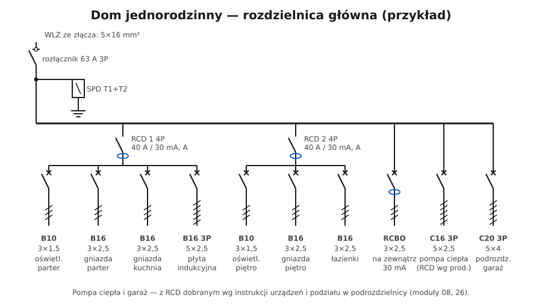

# 15.06 — Przykład: dom jednorodzinny

> **Moduł:** [15 — Rozdzielnica mieszkaniowa](README.md) · **Oznaczenia:** 🏠📋 · **Zakres SEP:** (a) (b) (c) · **Status:** ✅ pełny
>
> **Czytaj:**
>
> - Ochrona przeciwprzepięciowa: [moduł 09](../09-ochrona-przeciwprzepieciowa/README.md)
> - Fotowoltaika, pompy ciepła, wallboxy: [moduł 26](../26-fotowoltaika-pompy-wallboxy/README.md)
> - Uziemienia: [moduł 13](../13-uziemienia-i-wyrownanie/README.md)

[← poprzedni temat](15.05-przyklad-mieszkanie-zasilanie-trojfazowe.md) · [spis modułu](README.md) · [następny temat →](15.07-montaz-i-porzadek-przewodow-w-rozdzielnicy.md)

## Po co to jest

Dom jednorodzinny to większa instalacja: rozdzielnica główna, często podrozdzielnice (piętro, garaż, budynek gospodarczy), obwody zewnętrzne, pompa ciepła, fotowoltaika, ładowarka samochodu. Pokazuje, jak łączą się wszystkie moduły tej części: przyłącze, uziom, SPD, podział PEN, RCD, selektywność.

## Po ludzku

**Elementy typowego domu:**

1. **Złącze ZKP** w ogrodzeniu z licznikiem i zabezpieczeniem przedlicznikowym ([14.02](../14-od-slupa-do-gniazdka/14.02-zlacze-i-granica-wlasnosci.md)).
2. **WLZ** kablem w ziemi do domu, np. YKY 5×16 ([14.04](../14-od-slupa-do-gniazdka/14.04-wewnetrzna-linia-zasilajaca-wlz.md)).
3. **Rozdzielnica główna (RG)** w domu:
   - rozłącznik główny,
   - **SPD typu 1+2** przy linii napowietrznej lub instalacji odgromowej, inaczej typu 2 ([09.03](../09-ochrona-przeciwprzepieciowa/09.03-ograniczniki-przepiec-typu-1-2-i-3.md)),
   - punkt podziału PEN (jeśli nie ma go w złączu) połączony z **GSU i uziomem fundamentowym** ([13.03](../13-uziemienia-i-wyrownanie/13.03-glowna-szyna-uziemiajaca.md)),
   - kilka grup RCD z obwodami parteru, piętra, kuchni, łazienek,
   - obwody trójfazowe: płyta, pompa ciepła, wallbox,
   - zasilanie podrozdzielnic.
4. **Podrozdzielnice** — garaż, piętro, budynek gospodarczy: z własnym rozłącznikiem, RCD i wyłącznikami. Zasilane z RG wyłącznikiem selektywnym względem ich aparatów.
5. **Obwody zewnętrzne** (gniazda ogrodowe, oświetlenie, brama) — osobno, najlepiej z RCBO, bo są narażone na wilgoć.

**Urządzenia z falownikami** — pompa ciepła, wallbox, falownik PV — mają własne wymagania co do typu RCD, przekroju i zabezpieczenia. Najpierw instrukcja urządzenia, potem schemat ([08.03](../08-wylaczniki-roznicowopradowe/08.03-typy-ac-a-f-i-b-ktory-do-czego.md)).

## Jak to wygląda

*Na co patrzeć: rozdzielnica domu ma więcej rzędów i więcej grup RCD. Przy takiej liczbie obwodów porządek i opisy przewodów to warunek, żeby dało się ją obsługiwać i rozbudowywać.*

## Schemat

## Pojęcia

| Pojęcie | Po ludzku | Termin normowy / symbol |
|---------|-----------|-------------------------|
| Rozdzielnica główna | Pierwsza rozdzielnica za WLZ | RG |
| Podrozdzielnica | Rozdzielnica zasilana z RG (garaż, piętro) | rozdzielnica oddziałowa |
| Obwód rozdzielczy | Obwód zasilający podrozdzielnicę | — |
| Obwód odbiorczy | Obwód zasilający gniazda, oświetlenie, urządzenia | — |

## Liczby do zapamiętania

| Wielkość | Wartość | Kiedy obowiązuje | Źródło |
|----------|---------|------------------|--------|
| Czas wyłączenia obwodu rozdzielczego TN | **5 s** | zasilanie podrozdzielnic | PN-HD 60364-4-41, 411.3.2.3 |
| Czas wyłączenia obwodu odbiorczego TN | **0,4 s** | gniazda, odbiory | jw. |
| SPD przy linii napowietrznej / LPS | **typ 1+2** | — | [09.02](../09-ochrona-przeciwprzepieciowa/09.02-kategorie-wytrzymalosci-udarowej-iiv.md) |
| Spadek napięcia od licznika | ≤ **3 %** | do najdalszego odbiornika | N SEP-E-002 |

## W praktyce

- **Zacznij od bilansu mocy** i warunków przyłączenia — pompa ciepła, płyta i wallbox razem potrafią przekroczyć 20 kW.
- **Podrozdzielnica w garażu** — RCD w samej podrozdzielnicy (nie tylko w RG), żeby usterka w garażu nie wyłączała domu. Obwód zasilający zabezpiecz tak, by był selektywny względem jej wyłączników.
- **Pompa ciepła i wallbox** — osobne obwody, zabezpieczenia i RCD według instrukcji (często typ B lub A z detekcją DC dla wallboxa).
- **Fotowoltaika** — osobny obwód falownika, ograniczniki przepięć AC i DC, opis o dwóch źródłach ([15.03](15.03-oznaczanie-obwodow-i-opis-rozdzielnicy.md)).
- **Dokumentacja** — schemat jednokreskowy całego domu (RG + podrozdzielnice) i protokół pomiarów.

## Błędy i zagrożenia

- ⚠️ **Podrozdzielnica bez własnej ochrony RCD, z N i PE połączonymi w środku** — błąd układu sieci ([11.03](../11-uklady-sieci/11.03-uklad-tn-s.md)).
- **Wallbox podłączony do istniejącego obwodu gniazd** — przeciążenie i brak odpowiedniego RCD.
- **SPD typu 2 przy linii napowietrznej i instalacji odgromowej** — za słaby.
- **Brak rezerwy w RG** — przy każdej rozbudowie „kombinowanie” z dokładaniem aparatów poza rozdzielnicą.

## Przykład

**Zadanie.** Garaż 30 m od domu, w nim: gniazda 230 V, gniazdo siłowe 400 V do sprężarki (C16), oświetlenie. Jak zasilić?

**Rozwiązanie (szkic).** Z RG: wyłącznik C25 3P (selektywny względem C16 w garażu tylko częściowo — sprawdzić w tabelach), kabel YKY 5×6 w ziemi (spadek napięcia i warunek samoczynnego wyłączenia do sprawdzenia, [12.03](../12-ochrona-przeciwporazeniowa/12.03-warunek-skutecznosci-samoczynnego-wylaczenia.md)). W garażu podrozdzielnica: rozłącznik 3P, RCD 4P 40 A / 30 mA typu A, wyłączniki: B10 oświetlenie, B16 gniazda, C16 3P gniazdo siłowe. PE garażu połączony z lokalnymi połączeniami wyrównawczymi (brama metalowa, instalacje). N i PE na osobnych szynach.

## Pytania SEP

1. **Jakie elementy powinna zawierać rozdzielnica główna domu jednorodzinnego?**

Odpowiedź

Rozłącznik główny, ograniczniki przepięć (typu 1+2, jeśli dom ma instalację odgromową lub zasilanie napowietrzne, w pozostałych przypadkach typu 2), szyny N i PE z połączeniem z główną szyną uziemiającą i uziomem (oraz punktem podziału PEN, jeśli nie jest w złączu), wyłączniki różnicowoprądowe dla grup obwodów, zabezpieczenia nadprądowe obwodów odbiorczych i rozdzielczych (zasilających podrozdzielnice), z zachowaniem selektywności, a także opis obwodów i schemat.

## Sprawdź się

1. Dlaczego podrozdzielnica w garażu powinna mieć własną różnicówkę?

Odpowiedź

Żeby upływ w garażu (wilgoć, narzędzia) wyłączał tylko garaż, a nie obwody w domu, i żeby ochrona uzupełniająca była blisko odbiorników, z sensowną liczbą obwodów na jedną różnicówkę.

## Źródła

- PN-HD 60364-4-41 — czasy wyłączenia obwodów odbiorczych i rozdzielczych.
- PN-HD 60364-5-534 — ograniczniki przepięć.
- N SEP-E-002 — planowanie instalacji w budynkach mieszkalnych.

---

[← poprzedni temat](15.05-przyklad-mieszkanie-zasilanie-trojfazowe.md) · [spis modułu](README.md) · [następny temat →](15.07-montaz-i-porzadek-przewodow-w-rozdzielnicy.md)
