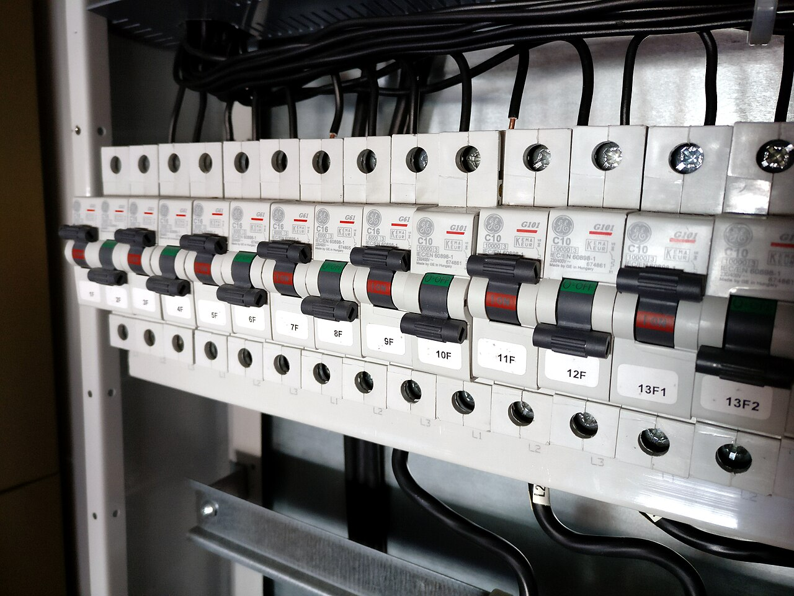

# 15.07 — Montaż i porządek przewodów w rozdzielnicy

> **Moduł:** [15 — Rozdzielnica mieszkaniowa](README.md) · **Oznaczenia:** 🏠📋 · **Zakres SEP:** (a) (b) (c) · **Status:** ✅ pełny
>
> **Czytaj:**
>
> - Złączki i połączenia: [06.04](../06-osprzet-instalacyjny/06.04-zlaczki-i-laczenie-przewodow-dlaczego-nie.md)
> - Pomiary odbiorcze: [moduł 23](../23-pomiary-odbiorcze-i-okresowe/README.md)
> - Pięć zasad: [00.01](../00-bezpieczenstwo-najpierw/00.01-piec-zasad-bezpiecznej-pracy-przy-urzadzeniach.md)

[← poprzedni temat](15.06-przyklad-dom-jednorodzinny.md) · [spis modułu](README.md) · (koniec modułu) →

## Po co to jest

Ta sama rozdzielnica, ze zgodnym schematem, może być porządna albo niebezpieczna — zależnie od tego, jak ją zmontowano. Luźny zacisk, przewód N poprowadzony do niewłaściwej listwy, dwa przewody pod zaciskiem na jeden — to typowe źródła awarii. Ten temat zbiera praktykę montażu.

## Po ludzku

**Kolejność montażu (nowa rozdzielnica):**

1. **Plan** — schemat jednokreskowy, rozmieszczenie aparatów w rzędach (grupy RCD w osobnych rzędach albo wyraźnie oddzielone).
2. **Obudowa** — wypoziomowana, przepusty tam, gdzie wchodzą przewody (zwykle od góry i od dołu).
3. **Szyny, aparaty, grzebienie, listwy N i PE** — zgodnie z planem.
4. **Wprowadzenie przewodów** — każdy oznaczony numerem obwodu ([15.03](15.03-oznaczanie-obwodow-i-opis-rozdzielnicy.md)), z zapasem długości.
5. **Podłączenie** — najpierw PE, potem N do listwy właściwej grupy, na końcu L do aparatu.
6. **Porządek** — przewody prowadzone pionowo i poziomo, w wiązkach, bez krzyżowania nad aparatami.
7. **Dokręcenie** wszystkich zacisków momentem z instrukcji; linka z tulejkami.
8. **Sprawdzenie i pomiary** przed załączeniem (ciągłość PE, izolacja, biegunowość), po załączeniu — pętla, RCD ([moduł 23](../23-pomiary-odbiorcze-i-okresowe/README.md)).
9. **Maskownica, zaślepki, opisy, schemat w drzwiczkach.**

**Zasady, które łatwo złamać:**

- **jeden przewód pod jeden zacisk** (chyba że producent wprost dopuszcza dwa przewody tego samego przekroju);
- **N obwodu idzie do listwy N tej różnicówki**, za którą jest jego L;
- **PE nie przechodzi przez RCD**;
- **przewody nie mogą zasłaniać** dźwigni ani przycisków TEST, ani być naciągnięte przez aparaty;
- **kolory** zgodne z funkcją ([05.03](../05-przewody-i-kable/05.03-kolory-zyl-i-ich-znaczenie.md)).

## Jak to wygląda

*Na co patrzeć: przewody wchodzą od góry, schodzą wiązkami po bokach, każdy z opisem. Przewody N i PE trafiają na listwy u góry. Taka rozdzielnica jest czytelna — widać, który przewód idzie do którego aparatu.*

*Na co patrzeć: przewody wychodzą prosto spod aparatów w dół, równolegle, bez krzyżowania. Każdy wyłącznik ma etykietę. Przy takim ułożeniu łatwo odłączyć jeden obwód, nie ruszając pozostałych.*

## Pojęcia

| Pojęcie | Po ludzku | Termin normowy / symbol |
|---------|-----------|-------------------------|
| Moment dokręcenia | Siła dokręcenia zacisku, podana przez producenta | N·m |
| Tulejka | Zakończenie linki w zacisku śrubowym | — |
| Wiązka | Przewody prowadzone razem, związane | — |
| Biegunowość | Poprawne podłączenie L i N | — |

## Liczby do zapamiętania

| Wielkość | Wartość | Kiedy obowiązuje | Źródło |
|----------|---------|------------------|--------|
| Przewody pod zaciskiem | **1** (chyba że producent dopuszcza więcej) | — | instrukcje aparatów |
| Moment dokręcenia | wg producenta, typowo **2–3,5 N·m** | aparaty modułowe | katalogi |
| Kolejność podłączania | **PE → N → L** | — | praktyka |
| Kolejność odłączania | **L → N → PE** | — | jw. |

## W praktyce

- **Wkrętak dynamometryczny** — przy kilkudziesięciu zaciskach różnica między „dokręcone” a „za słabo” jest niewyczuwalna ręką.
- **Po kilku tygodniach od uruchomienia** warto dokręcić zaciski ponownie — zwłaszcza przewodów o dużych przekrojach i linek.
- **Kamera termowizyjna** przy przeglądach — luźny zacisk widać jako gorący punkt pod obciążeniem.
- **Prace w istniejącej rozdzielnicy** — wyłącz, zabezpiecz, sprawdź brak napięcia; pamiętaj o zaciskach zasilających przed rozłącznikiem ([10.01](../10-aparatura-modulowa/10.01-rozlacznik-izolacyjny-wylacznik-glowny.md)).

## Błędy i zagrożenia

- ⚠️ **Luźny zacisk** — grzanie, przebarwienia, stopiona obudowa aparatu, pożar rozdzielnicy.
- ⚠️ **N obwodu z RCD 1 na listwie RCD 2** — wybijanie, a przy zadziałaniu jednego RCD — przerwa N w obwodach drugiego.
- **Dwa przewody pod zaciskiem przeznaczonym na jeden** — jeden słabo dociśnięty.
- **Plątanina przewodów nad aparatami** — nie da się wymienić aparatu bez rozbierania połowy rozdzielnicy.
- **Brak pomiarów przed oddaniem** — błędy biegunowości i nieciągłość PE wychodzą dopiero przy awarii.

## Przykład

**Sytuacja.** Nowa rozdzielnica. Po załączeniu RCD 2 wybija od razu przy załączeniu obwodu F5 (gniazda kuchnia), mimo że w kuchni nic nie jest podłączone.

**Diagnoza.** Najczęstsza przyczyna w świeżo zmontowanej rozdzielnicy: N obwodu F5 trafił do listwy N grupy RCD 1 (albo do PE). Sprawdź: L obwodu F5 jest pod RCD 2 — więc jego N musi być na listwie „N RCD2”. Po przełożeniu przewodu RCD działa ([08.06](../08-wylaczniki-roznicowopradowe/08.06-dlaczego-roznicowka-wybija-przyczyny-i-szukanie.md)).

## Pytania SEP

1. **Jakie zasady należy zachować przy montażu aparatów i przewodów w rozdzielnicy?**

Odpowiedź

Aparaty montuje się zgodnie ze schematem i instrukcjami producentów, łączy grzebieniami zamiast mostków przewodowych. Przewody wprowadza się przez przepusty, oznacza na końcach, prowadzi uporządkowanie, z zapasem długości, nie zasłaniając elementów obsługi. Pod jeden zacisk podłącza się jeden przewód (chyba że producent dopuszcza więcej), linki zakańcza tulejkami, zaciski dokręca momentem podanym przez producenta. Przewody N podłącza się do listwy N wyłącznika różnicowoprądowego chroniącego dany obwód, PE — do listwy PE, z pominięciem RCD. Przed oddaniem do użytku wykonuje się sprawdzenia i pomiary, zakłada maskownicę z zaślepkami i opisuje obwody.

2. **W jakiej kolejności przyłącza się przewody L, N i PE?**

Odpowiedź

Przy przyłączaniu najpierw przewód ochronny PE, potem neutralny N, na końcu fazowy L. Przy odłączaniu w odwrotnej kolejności: L, N, PE. Dzięki temu część przewodząca dostępna jest połączona z PE przez cały czas, gdy może się na niej pojawić napięcie.

## Sprawdź się

1. Dlaczego warto ponownie dokręcić zaciski kilka tygodni po uruchomieniu rozdzielnicy?

Odpowiedź

Bo miedź (a zwłaszcza linki i przewody o dużych przekrojach) „osiada” pod naciskiem i przy pierwszych cyklach nagrzewania, przez co zacisk może się lekko poluzować.

## Źródła

- PN-EN 61439-3 — rozdzielnice do obsługi przez osoby niewykwalifikowane.
- PN-HD 60364-5-52 — 526 (połączenia).
- Instrukcje montażu aparatów modułowych (momenty dokręcenia, liczba przewodów pod zaciskiem).

---

[← poprzedni temat](15.06-przyklad-dom-jednorodzinny.md) · [spis modułu](README.md) · (koniec modułu) →
