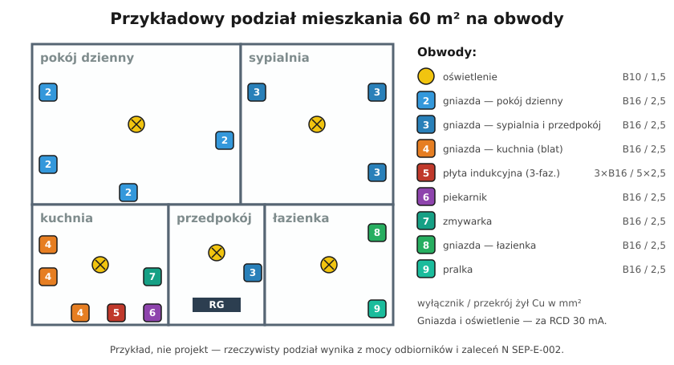

# 16.01 — Podział instalacji na obwody

> **Moduł:** [16 — Planowanie obwodów](README.md) · **Oznaczenia:** 🏠📋 · **Zakres SEP:** (a) (c) · **Status:** ✅ pełny
>
> **Czytaj:**
>
> - N SEP-E-002 — Instalacje elektryczne w budynkach mieszkalnych; [omówienie w Inżynierze Budownictwa](https://inzynierbudownictwa.pl/?p=10433)
> - Podział na różnicówki: [08.07](../08-wylaczniki-roznicowopradowe/08.07-podzial-obwodow-miedzy-wylaczniki.md)
> - Rozdzielnica: [15.02](../15-rozdzielnica-mieszkaniowa/15.02-schemat-jednokreskowy-jak-czytac-i-jak-rysowac.md)

← (początek modułu) · [spis modułu](README.md) · [następny temat →](16.02-dobor-przekroju-i-zabezpieczenia-procedura-krok.md)

## Po co to jest

Obwód to fragment instalacji zasilany przez jeden wyłącznik nadprądowy. Od tego, jak podzielisz mieszkanie na obwody, zależy, czy po zadziałaniu jednego zabezpieczenia zgaśnie jedna lampa, czy całe mieszkanie. Dobry podział ułatwia też szukanie usterek, pomiary i późniejszą rozbudowę. Na egzaminie pytają, według jakich zasad dzieli się instalację i które odbiorniki wymagają osobnych obwodów.

## Po ludzku

Pomyśl o obwodach jak o osobnych kranach w mieszkaniu. Jeśli wszystko wisi na jednym, to przy przecieku zakręcasz wodę wszędzie. Kilka kranów — zakręcasz tylko tam, gdzie cieknie.

**Zasady podziału:**

1. **Oświetlenie osobno, gniazda osobno.** Gdy zwarcie w czajniku wyłączy gniazda, w pokoju nadal jest światło i da się bezpiecznie poszukać przyczyny.
2. **Duże odbiorniki na własnych obwodach.** Płyta, piekarnik, zmywarka, pralka, suszarka, podgrzewacz wody, klimatyzator, grzejnik elektryczny — każdy osobno ([16.06](16.06-obwody-wydzielone-plyta-piekarnik-pralka.md)). Przyjmuje się, że osobny obwód należy się każdemu urządzeniu o mocy powyżej ok. 2 kW.
3. **Gniazda kuchenne nad blatem osobno.** Czajnik, ekspres i toster pracują jednocześnie i potrafią razem pobrać 16 A.
4. **Łazienka osobno.** Łatwiej spełnić jej wymagania ([17.01](../17-pomieszczenia-szczegolne/17.01-lazienka-strefy-0-1-i-2.md)).
5. **Kilka obwodów oświetlenia** w większym mieszkaniu — np. strefa dzienna i nocna. Wtedy po zadziałaniu wyłącznika nie robi się ciemno wszędzie.
6. **Obwody rozłożone na kilka różnicówek.** Jedna różnicówka nie powinna wyłączać całego mieszkania ([08.07](../08-wylaczniki-roznicowopradowe/08.07-podzial-obwodow-miedzy-wylaczniki.md)).
7. **Przy zasilaniu trójfazowym — równomiernie na fazy.** Obwody o dużej mocy rozdziela się między L1, L2 i L3 tak, żeby żadna faza nie była stale przeciążona.

**Ile obwodów?** N SEP-E-002 podaje **minimalną** liczbę obwodów oświetlenia i gniazd ogólnego przeznaczenia w zależności od powierzchni mieszkania (tabela niżej). Do tego dochodzą obwody wydzielone. W praktyce nowe mieszkanie 50–70 m² ma zwykle 10–16 obwodów.

## Jak to wygląda

*Na co patrzeć: każdy przewód wchodzący do rozdzielnicy to osobny obwód z własnym wyłącznikiem. Im lepiej zaplanowany podział, tym łatwiej opisać rozdzielnicę i znaleźć w niej usterkę po latach.*

## Schemat

## Pojęcia

| Pojęcie | Po ludzku | Termin normowy / symbol |
|---------|-----------|-------------------------|
| Obwód | Część instalacji za jednym zabezpieczeniem | obwód odbiorczy (końcowy) |
| Obwód wydzielony | Obwód dla jednego dużego odbiornika | obwód odbiorczy jednego urządzenia |
| Gniazda ogólnego przeznaczenia | Zwykłe gniazda w pokojach | gniazda wtyczkowe ogólnego przeznaczenia |
| Obciążenie symetryczne | Podobne obciążenie każdej fazy | równomierne rozłożenie na fazy |
| Rezerwa | Wolne miejsce i zapas mocy na przyszłość | — |

## Liczby do zapamiętania

| Wielkość | Wartość | Kiedy obowiązuje | Źródło |
|----------|---------|------------------|--------|
| Minimalna liczba obwodów oświetlenia i gniazd | do 50 m² — **2**; 50–75 m² — **3**; 75–100 m² — **4**; 100–125 m² — **5**; ponad 125 m² — **6** | mieszkanie; obwody wydzielone dochodzą osobno | N SEP-E-002, [Inżynier Budownictwa](https://inzynierbudownictwa.pl/?p=10433) |
| Osobny obwód | odbiornik powyżej ok. **2 kW** | praktyka | [Murator](https://muratordom.pl/instalacje/instalacja-elektryczna/instalacja-elektryczna-w-kuchni-aa-GEzk-fazJ-6PoY.html), N SEP-E-002 |
| Typowe zabezpieczenie | oświetlenie **B10**, gniazda **B16** | przewody 1,5 / 2,5 mm² Cu | [07.06](../07-zabezpieczenia-nadpradowe/07.06-koordynacja-zabezpieczenia-z-przewodem.md) |
| Rezerwa w rozdzielnicy | **20–30 %** miejsca | planowanie | [15.01](../15-rozdzielnica-mieszkaniowa/15.01-budowa-rozdzielnicy-obudowa-szyna-th35-listwy-n.md) |

## W praktyce

Jak zaplanować obwody krok po kroku:

1. **Narysuj rzut** mieszkania i zaznacz wszystkie punkty: lampy, łączniki, gniazda, odbiorniki stałe.
2. **Wypisz duże odbiorniki** z mocą i rodzajem zasilania (jedno- czy trójfazowe). Każdy dostaje własny obwód.
3. **Pogrupuj gniazda** w obwody wg pomieszczeń — tak, żeby w jednym obwodzie nie spotkały się dwa odbiorniki, które pracują długo z dużą mocą (np. grzejnik olejowy i odkurzacz).
4. **Pogrupuj oświetlenie** — co najmniej dwa obwody w większym mieszkaniu.
5. **Przypisz obwody do różnicówek** i (przy 3 fazach) do faz.
6. **Dla każdego obwodu dobierz przewód i zabezpieczenie** ([16.02](16.02-dobor-przekroju-i-zabezpieczenia-procedura-krok.md)) i sprawdź spadek napięcia ([16.03](16.03-sprawdzanie-spadku-napiecia.md)).
7. **Narysuj schemat jednokreskowy** i dobierz rozdzielnicę z rezerwą ([15.02](../15-rozdzielnica-mieszkaniowa/15.02-schemat-jednokreskowy-jak-czytac-i-jak-rysowac.md)).

## Błędy i zagrożenia

- ⚠️ **Wszystko na jednej różnicówce** — jedna usterka i całe mieszkanie bez prądu, także bez światła na klatce schodowej w domu.
- **Gniazda i oświetlenie pokoju na jednym obwodzie** — zwarcie w lampce nocnej gasi całe światło.
- **Pralka i zmywarka „na zwykłych gniazdach”** razem z czajnikiem — wyłącznik zadziała przy każdym jednoczesnym grzaniu.
- **Wszystkie duże odbiorniki na jednej fazie** przy zasilaniu trójfazowym — przegrzane zabezpieczenie przedlicznikowe w tej fazie, a dwie pozostałe niemal bez obciążenia.
- **Brak rezerwy** — po dwóch latach brakuje obwodu na klimatyzację albo wallbox i trzeba kuć ściany.

## Przykład

**Zadanie.** Mieszkanie 62 m²: pokój dzienny z aneksem kuchennym, sypialnia, pokój dziecka, łazienka, przedpokój. Odbiorniki: płyta indukcyjna 7,2 kW (trójfazowa), piekarnik 3,5 kW, zmywarka, pralka. Zasilanie trójfazowe. Zaproponuj podział.

**Rozwiązanie.**

- Oświetlenie: **2 obwody** (strefa dzienna; strefa nocna + łazienka + przedpokój) — B10, 1,5 mm².
- Gniazda ogólne: **3 obwody** (pokój dzienny; sypialnia + pokój dziecka; przedpokój) — B16, 2,5 mm². Razem z oświetleniem 5 obwodów — więcej niż minimum 3 z tabeli dla 50–75 m².
- Gniazda kuchenne nad blatem: **1 obwód**, B16, 2,5 mm².
- Łazienka (gniazda): **1 obwód**, B16, 2,5 mm².
- Wydzielone: płyta (3 × B16, 5 × 2,5 mm²), piekarnik, zmywarka, pralka — **4 obwody**.
- Razem **11 obwodów**. Rozłożenie na fazy: L1 — piekarnik, gniazda pokoju dziennego, oświetlenie 1; L2 — zmywarka, gniazda kuchenne, oświetlenie 2, przedpokój; L3 — pralka, gniazda sypialni, łazienka; płyta — na trzech fazach.
- Różnicówki: dwie, każda z oświetleniem i częścią gniazd, albo RCBO dla każdego obwodu.

## Pytania SEP

1. **Według jakich zasad dzieli się instalację mieszkania na obwody?**

Odpowiedź

Oddziela się obwody oświetlenia od obwodów gniazd. Duże odbiorniki (płyta, piekarnik, zmywarka, pralka, podgrzewacz wody, klimatyzacja) zasila się z osobnych obwodów. Gniazda dzieli się na kilka obwodów wg pomieszczeń, osobno kuchnia nad blatem i łazienka. Liczba obwodów oświetlenia i gniazd nie może być mniejsza niż podaje N SEP-E-002 dla danej powierzchni mieszkania. Obwody rozkłada się na kilka wyłączników różnicowoprądowych, a przy zasilaniu trójfazowym — równomiernie na fazy. Zostawia się rezerwę w rozdzielnicy.

2. **Dlaczego obwody oświetlenia i gniazd powinny być oddzielone?**

Odpowiedź

Żeby uszkodzenie odbiornika podłączonego do gniazda (zwarcie, upływ) i zadziałanie zabezpieczenia nie pozbawiało pomieszczenia światła. Brak oświetlenia utrudnia znalezienie usterki i grozi wypadkiem. Oddzielenie pozwala też dobrać mniejsze zabezpieczenie i przekrój dla oświetlenia oraz ułatwia pomiary.

## Sprawdź się

1. Mieszkanie ma 85 m². Ile co najmniej obwodów oświetlenia i gniazd ogólnego przeznaczenia przewiduje N SEP-E-002? Czy płyta indukcyjna wlicza się do tej liczby?

Odpowiedź

Co najmniej **4** (przedział 75–100 m²). Płyta się nie wlicza — to obwód wydzielony, który dochodzi ponad tę liczbę.

2. Na rzucie (schemat wyżej) znajdź obwód, który obsługuje dwa pomieszczenia.

Odpowiedź

Obwód **3** — gniazda w sypialni i w przedpokoju. Oświetlenie (obwód 1) obejmuje wszystkie pomieszczenia — w większym mieszkaniu warto je podzielić na dwa obwody.

## Źródła

- N SEP-E-002 — Instalacje elektryczne w obiektach budowlanych. Instalacje elektryczne w budynkach mieszkalnych. Podstawy planowania; omówienie: [Rozdzielnice elektryczne i skrzynki telekomunikacyjne we współczesnym mieszkaniu — Inżynier Budownictwa](https://inzynierbudownictwa.pl/?p=10433).
- [Instalacja elektryczna w kuchni — Murator](https://muratordom.pl/instalacje/instalacja-elektryczna/instalacja-elektryczna-w-kuchni-aa-GEzk-fazJ-6PoY.html).
- PN-HD 60364-3 — ocena ogólnych charakterystyk (podział instalacji na obwody).

---

← (początek modułu) · [spis modułu](README.md) · [następny temat →](16.02-dobor-przekroju-i-zabezpieczenia-procedura-krok.md)
