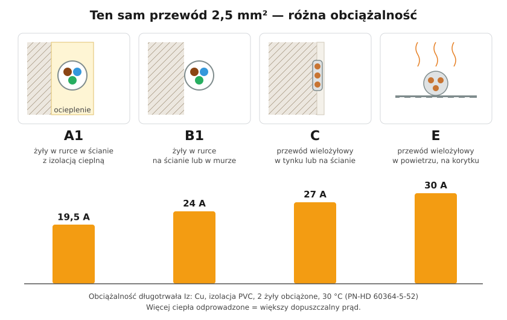
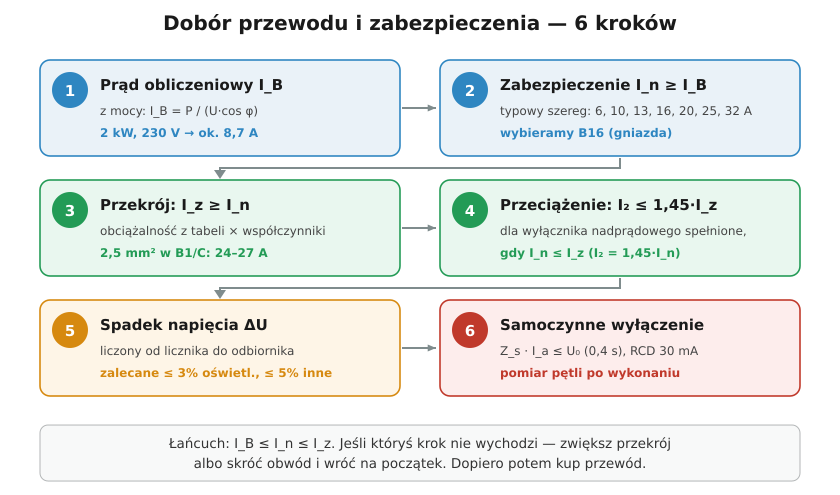

# 16.02 — Dobór przekroju i zabezpieczenia — procedura krok po kroku

> **Moduł:** [16 — Planowanie obwodów](README.md) · **Oznaczenia:** 🏠📋 · **Zakres SEP:** (a) (c) · **Status:** ✅ pełny
>
> **Czytaj:**
>
> - PN-HD 60364-4-43 — ochrona przed prądem przetężeniowym
> - PN-HD 60364-5-52 — dobór przewodów, obciążalność
> - Przypomnienie: [05.04](../05-przewody-i-kable/05.04-przekroj-i-obciazalnosc-pradowa.md), [07.06](../07-zabezpieczenia-nadpradowe/07.06-koordynacja-zabezpieczenia-z-przewodem.md), [12.03](../12-ochrona-przeciwporazeniowa/12.03-warunek-skutecznosci-samoczynnego-wylaczenia.md)

[← poprzedni temat](16.01-podzial-instalacji-na-obwody.md) · [spis modułu](README.md) · [następny temat →](16.03-sprawdzanie-spadku-napiecia.md)

## Po co to jest

W poprzednich modułach poznałeś osobno obciążalność przewodów, charakterystyki wyłączników, spadek napięcia i warunek samoczynnego wyłączenia. Tu składamy to w jedną procedurę, którą przechodzi się dla każdego obwodu przed zakupem przewodu. Komisja SEP często prosi o opisanie kolejnych kroków albo o dobranie zabezpieczenia do konkretnego przewodu.

## Po ludzku

Dobór to łańcuch trzech prądów: **ile płynie** (I_B) ≤ **przy ilu wyłącznik zadziała** (I_n) ≤ **ile wytrzyma przewód** (I_z). Do tego dwa sprawdzenia: czy na końcu przewodu nie zabraknie napięcia (ΔU) i czy przy zwarciu na obudowie wyłącznik zadziała dość szybko (pętla zwarcia).

**Krok 1 — prąd obliczeniowy I_B.** Z mocy odbiorników:

- jednofazowo: $I_B = \dfrac{P}{U \cos\varphi}$, U = 230 V;
- trójfazowo: $I_B = \dfrac{P}{\sqrt{3}\, U \cos\varphi}$, U = 400 V.

Dla grzałek cos φ = 1. Dla obwodu gniazd nie sumuje się mocy wszystkich możliwych urządzeń — przyjmuje się, ile realnie pracuje naraz (współczynnik jednoczesności).

**Krok 2 — zabezpieczenie I_n ≥ I_B.** Wybierz najbliższy wyższy prąd z szeregu: 6, 10, 13, 16, 20, 25, 32 A. Charakterystykę dobierz do odbiornika: B dla gniazd i oświetlenia, C przy dużych prądach rozruchu ([07.04](../07-zabezpieczenia-nadpradowe/07.04-charakterystyki-b-c-i-d.md)).

**Krok 3 — przekrój: I_z ≥ I_n.** Z tablicy obciążalności dla **sposobu ułożenia** (A1, B1, C, E…), z poprawkami na temperaturę otoczenia i grupowanie przewodów ([05.04](../05-przewody-i-kable/05.04-przekroj-i-obciazalnosc-pradowa.md), [05.05](../05-przewody-i-kable/05.05-sposoby-ukladania-przewodow-a1-b1-c-e-i-ich.md)). Liczy się **najgorszy odcinek** trasy — np. przejście przez ocieploną ścianę.

**Krok 4 — warunek przeciążeniowy I₂ ≤ 1,45 I_z.** Dla wyłączników nadprądowych I₂ = 1,45 I_n, więc warunek spełnia się sam, gdy I_n ≤ I_z. Dla wkładek gG (I₂ = 1,6 I_n) trzeba mieć I_n ≤ 0,9 I_z.

**Krok 5 — spadek napięcia.** Sprawdź, czy przy I_B na końcu obwodu napięcie nie spadnie za bardzo ([16.03](16.03-sprawdzanie-spadku-napiecia.md)). Jeśli spada — większy przekrój.

**Krok 6 — samoczynne wyłączenie i zwarcia.** Sprawdź, czy impedancja pętli zwarcia pozwoli wyłącznikowi zadziałać w 0,4 s ($Z_s \cdot I_a \le U_0$, [12.03](../12-ochrona-przeciwporazeniowa/12.03-warunek-skutecznosci-samoczynnego-wylaczenia.md)), a zdolność zwarciowa wyłącznika jest większa od spodziewanego prądu zwarcia ([07.05](../07-zabezpieczenia-nadpradowe/07.05-zdolnosc-zwarciowa-6-ka-10-ka.md)). W gotowej instalacji potwierdza to pomiar ([23.04](../23-pomiary-odbiorcze-i-okresowe/23.04-impedancja-petli-zwarcia.md)).

## Jak to wygląda

*Na co patrzeć: ten sam przewód 2,5 mm² ma obciążalność od 19,5 A do 30 A — zależnie od tego, gdzie leży. Krok 3 zaczyna się od ustalenia sposobu ułożenia na całej trasie.*

## Schemat

## Pojęcia

| Pojęcie | Po ludzku | Termin normowy / symbol |
|---------|-----------|-------------------------|
| Prąd obliczeniowy | Ile prądu realnie płynie w obwodzie | prąd obliczeniowy obwodu, $I_B$ |
| Prąd znamionowy zabezpieczenia | „Numer” wyłącznika, np. 16 A | $I_n$ |
| Obciążalność długotrwała | Ile prądu przewód zniesie bez przegrzania | $I_z$ |
| Prąd zadziałania | Prąd, przy którym zabezpieczenie na pewno zadziała w czasie umownym | $I_2$ |
| Współczynnik jednoczesności | Jaka część odbiorników pracuje naraz | $k_j$ |

## Liczby do zapamiętania

| Wielkość | Wartość | Kiedy obowiązuje | Źródło |
|----------|---------|------------------|--------|
| Prąd 1-fazowy | $I_B = P / (230 \cdot \cos\varphi)$; **1 kW ≈ 4,35 A** | cos φ = 1 | — |
| Prąd 3-fazowy | $I_B = P / (\sqrt{3} \cdot 400 \cdot \cos\varphi)$; **1 kW ≈ 1,44 A** na fazę | odbiornik symetryczny, cos φ = 1 | — |
| Łańcuch doboru | $I_B \le I_n \le I_z$ i $I_2 \le 1{,}45 I_z$ | zawsze | PN-HD 60364-4-43, 433.1 |
| Szereg prądów wyłączników | 6, 10, 13, 16, 20, 25, 32, 40, 50, 63 A | wyłączniki nadprądowe | PN-EN 60898-1 |
| Typowe pary | **1,5 mm² — B10**, **2,5 mm² — B16**, **4 mm² — B20/B25**, **6 mm² — B32** | Cu, PVC, ułożenie C, bez grupowania | tablice obciążalności, praktyka |

## W praktyce

- **Dobierz do najgorszego miejsca.** Jeśli przewód na 2 m wchodzi w ocieploną ścianę albo leży w wiązce z pięcioma innymi, to tam liczysz obciążalność.
- **Nie „podnoś” wyłącznika, gdy wybija.** Jeśli B16 zadziałał od przeciążenia, rozwiązaniem jest drugi obwód, nie B20 na przewodzie 2,5 mm².
- **Dokumentuj** — dla każdego obwodu zapisz: I_B, wyłącznik, przewód, sposób ułożenia, długość. Przyda się przy pomiarach i rozbudowie.
- **Producent urządzenia ma ostatnie słowo** — jeśli instrukcja płyty każe dać 3 × B16 i 5 × 2,5 mm² albo inny przekrój, stosuj się do niej.

## Błędy i zagrożenia

- ⚠️ **Wyłącznik większy niż obciążalność przewodu** (np. B20 na 1,5 mm²) — przewód grzeje się i niszczy izolację, zanim wyłącznik zareaguje.
- **Pominięcie poprawek** na temperaturę i grupowanie — przewody w gęstej wiązce na strychu latem.
- **Dobór „z pamięci”** bez sprawdzenia długości — długi obwód do garażu spełnia I_z, ale ma za duży spadek napięcia i za dużą impedancję pętli.
- **Charakterystyka C „na wszelki wypadek”** — ponad dwa razy większy prąd I_a, łatwiej przekroczyć dopuszczalną impedancję pętli.

## Przykład

**Zadanie.** Obwód gniazd w warsztacie: piła 1,8 kW i odkurzacz 1,2 kW mogą pracować razem, cos φ ≈ 0,9. Przewód YDYp 3 × 2,5 mm² pod tynkiem (sposób C), ale 3 m trasy przechodzi w peszlu przez ocieploną ścianę (A2, obciążalność ok. 18,5 A). Długość 22 m. Dobierz zabezpieczenie.

**Rozwiązanie.**

1. $I_B = \dfrac{1800 + 1200}{230 \cdot 0{,}9} \approx 14{,}5$ A.
2. I_n ≥ 14,5 A → **16 A**. Silnik piły ma prąd rozruchu — rozważ charakterystykę C.
3. Najgorszy odcinek: A2, $I_z \approx 18{,}5$ A ≥ 16 A — **spełnione**.
4. I₂ = 1,45 · 16 = 23,2 A ≤ 1,45 · 18,5 = 26,8 A — **spełnione**.
5. ΔU przy 14,5 A: $\Delta U = \dfrac{2 \cdot 22 \cdot 14{,}5}{56 \cdot 2{,}5} \approx 4{,}6$ V, czyli **2,0 %** — w normie.
6. Dla C16: $Z_{s,max} = 230 / 160 = 1{,}44\ \Omega$; dla B16: 2,88 Ω. Jeśli pomiar pokaże np. 1,1 Ω — C16 formalnie przejdzie, ale nie spełni oceny z zapasem ⅔ (0,96 Ω, [12.03](../12-ochrona-przeciwporazeniowa/12.03-warunek-skutecznosci-samoczynnego-wylaczenia.md)); B16 przejdzie z dużym zapasem. Wybór: **B16**, a jeśli przy rozruchu piły wybija — **C16** po sprawdzeniu pętli.

## Pytania SEP

1. **Jakie warunki musi spełniać zabezpieczenie przewodu przed przeciążeniem?**

Odpowiedź

Dwa warunki z PN-HD 60364-4-43: $I_B \le I_n \le I_z$ oraz $I_2 \le 1{,}45 \cdot I_z$, gdzie I_B — prąd obliczeniowy obwodu, I_n — prąd znamionowy zabezpieczenia, I_z — obciążalność długotrwała przewodu, I_2 — prąd zadziałania zabezpieczenia w czasie umownym. Dla wyłączników nadprądowych I_2 = 1,45 I_n, więc drugi warunek jest spełniony, gdy spełniony jest pierwszy.

2. **Opisz kolejne kroki doboru przewodu i zabezpieczenia obwodu.**

Odpowiedź

Wyznaczyć prąd obliczeniowy z mocy odbiorników; dobrać prąd znamionowy i charakterystykę zabezpieczenia; dobrać przekrój, którego obciążalność (dla sposobu ułożenia, z poprawkami) jest nie mniejsza od prądu zabezpieczenia; sprawdzić warunek I_2 ≤ 1,45 I_z; sprawdzić spadek napięcia; sprawdzić skuteczność samoczynnego wyłączenia (impedancja pętli zwarcia) i wytrzymałość zwarciową przewodu oraz zdolność zwarciową aparatu. Po wykonaniu — pomiary.

## Sprawdź się

1. Przewód 1,5 mm² w tynku (I_z ≈ 19,5 A) zabezpieczono B20. Co jest nie tak?

Odpowiedź

I_n = 20 A > I_z = 19,5 A — pierwszy warunek nie jest spełniony. Przewód może być długo przeciążony bez zadziałania wyłącznika. Właściwy wyłącznik: B10 (typowo) albo najwyżej B16.

## Źródła

- PN-HD 60364-4-43 — ochrona przed prądem przetężeniowym, p. 433 i 434.
- PN-HD 60364-5-52 — dobór i montaż wyposażenia elektrycznego. Oprzewodowanie, załącznik B (obciążalność).
- PN-EN 60898-1 — wyłączniki nadprądowe (prądy znamionowe, I₂ = 1,45 I_n).

---

[← poprzedni temat](16.01-podzial-instalacji-na-obwody.md) · [spis modułu](README.md) · [następny temat →](16.03-sprawdzanie-spadku-napiecia.md)
