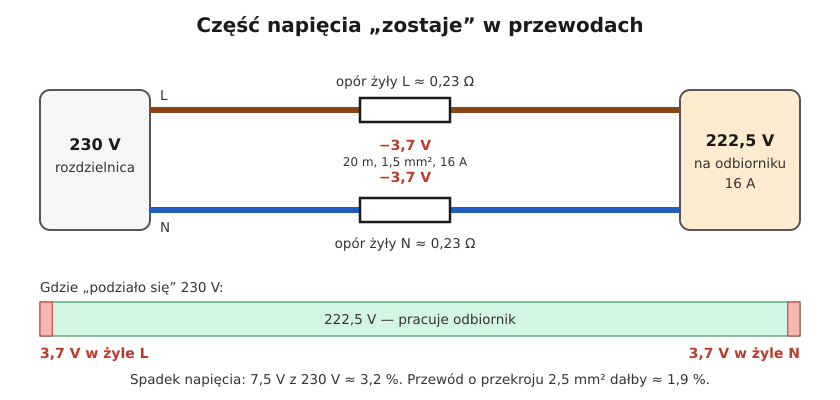
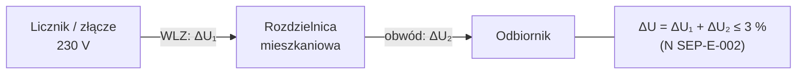

# 16.03 — Sprawdzanie spadku napięcia

> **Moduł:** [16 — Planowanie obwodów](README.md) · **Oznaczenia:** 🏠📋 · **Zakres SEP:** (a) (c) · **Status:** ✅ pełny
>
> **Czytaj:**
>
> - PN-HD 60364-5-52, załącznik G (informacyjny) — spadek napięcia
> - N SEP-E-002 — spadek napięcia w instalacji mieszkaniowej
> - Podstawy: [01.06](../01-prad-napiecie-opor/01.06-grzanie-przewodow-i-spadek-napiecia.md)

[← poprzedni temat](16.02-dobor-przekroju-i-zabezpieczenia-procedura-krok.md) · [spis modułu](README.md) · [następny temat →](16.04-strefy-instalacyjne-i-trasy-przewodow.md)

## Po co to jest

Każdy przewód ma opór, więc część napięcia „zostaje” na przewodzie. Przy długim i cienkim obwodzie na końcu jest wyraźnie mniej niż 230 V: silnik startuje z trudem, LED-y mrugają, grzałka ma mniejszą moc. Duży spadek napięcia oznacza też dużą impedancję pętli zwarcia, czyli wolniejsze działanie zabezpieczeń. Komisja pyta o dopuszczalne wartości i wzór.

## Po ludzku

Przewód to jak wąż ogrodowy: im dłuższy i węższy, tym słabszy strumień na końcu. Spadek napięcia rośnie, gdy:

- rośnie **długość** przewodu,
- rośnie **prąd** (moc odbiornika),
- maleje **przekrój**,
- przewód jest z **aluminium** zamiast miedzi (gorzej przewodzi),
- przewód jest **gorący** (opór miedzi rośnie z temperaturą).

W obwodzie jednofazowym prąd płynie **tam i z powrotem** — dlatego we wzorze jest **2 × długość**. W symetrycznym obwodzie trójfazowym prąd wraca innymi fazami i liczy się inaczej.

**Wzory (przewody do 16 mm², gdzie można pominąć reaktancję):**

- jednofazowo: $\Delta U\% = \dfrac{200 \cdot P \cdot l}{\gamma \cdot S \cdot U^2}$, U = 230 V,
- trójfazowo (symetrycznie): $\Delta U\% = \dfrac{100 \cdot P \cdot l}{\gamma \cdot S \cdot U^2}$, U = 400 V,

gdzie P — moc w W, l — długość przewodu (w jedną stronę) w m, S — przekrój w mm², γ — konduktywność: miedź ok. **56**, aluminium ok. **34** m/(Ω·mm²).

Prostsza wersja dla 1 fazy z prądu: $\Delta U = \dfrac{2 \cdot l \cdot I}{\gamma \cdot S}$ [V].

**Spadek liczy się od licznika (albo złącza) do odbiornika** — czyli sumuje się spadki na WLZ, w obwodzie i ewentualnie w podrozdzielnicy.

## Jak to wygląda

*Na co patrzeć: napięcie „gubi się” na obu przewodach — fazowym i neutralnym. Dlatego w obwodzie jednofazowym długość liczymy podwójnie.*

## Schemat

## Pojęcia

| Pojęcie | Po ludzku | Termin normowy / symbol |
|---------|-----------|-------------------------|
| Spadek napięcia | O ile mniej napięcia jest na końcu przewodu | $\Delta U$ [V], $\Delta U\%$ |
| Konduktywność | Jak dobrze materiał przewodzi | $\gamma$ [m/(Ω·mm²)] |
| Rezystywność | Odwrotność konduktywności | $\rho = 1/\gamma$ |
| Długość obwodu | Odległość od rozdzielnicy do odbiornika wzdłuż trasy przewodu | $l$ [m] |

## Liczby do zapamiętania

| Wielkość | Wartość | Kiedy obowiązuje | Źródło |
|----------|---------|------------------|--------|
| Spadek 1-faz. | $\Delta U\% = \dfrac{200 P l}{\gamma S U^2}$ | przekroje do ok. 16 mm², U = 230 V | — |
| Spadek 3-faz. | $\Delta U\% = \dfrac{100 P l}{\gamma S U^2}$ | obciążenie symetryczne, U = 400 V | — |
| Konduktywność γ | Cu **56**, Al **34** m/(Ω·mm²) | ok. 20 °C; w temperaturze pracy opór większy o ok. 20 % | dane materiałowe |
| Dopuszczalny spadek od licznika do odbiornika | **3 %** | budynki mieszkalne | N SEP-E-002 |
| Zalecany maks. spadek od złącza | **3 %** oświetlenie, **5 %** inne | instalacje zasilane z sieci publicznej nN | PN-HD 60364-5-52, zał. G |
| Ile to woltów | 3 % z 230 V = **6,9 V**; 5 % = **11,5 V** | — | — |

## W praktyce

- **Licz do najdalszego punktu obwodu** i przy prądzie obliczeniowym (dla gniazd — przy prądzie zabezpieczenia, jeśli chcesz mieć zapas).
- **Długie obwody** (garaż, budynek gospodarczy, ogród, wallbox) — prawie zawsze wymagają większego przekroju niż „z tabeli obciążalności”.
- **Pomiar** — porównaj napięcie w gnieździe bez obciążenia i z obciążeniem (np. czajnik 2 kW). Różnica to spadek napięcia na obwodzie przy tym prądzie. Robi się to tylko przyrządem z kategorią pomiarową odpowiednią do instalacji ([22](../22-przyrzady-pomiarowe/README.md)).
- **Duży spadek = duża impedancja pętli** — zwiększenie przekroju poprawia jedno i drugie.

## Błędy i zagrożenia

- **Liczenie tylko jednej długości** w obwodzie jednofazowym — wynik dwa razy za mały.
- **Pominięcie WLZ** — w starym bloku z długim WLZ aluminiowym spadek na samym WLZ może zjeść większość dopuszczalnych 3 %.
- **Przedłużacz 25 m 1 mm² do kosiarki 1,6 kW** — spadek kilkanaście woltów, silnik się grzeje, a przy zwarciu wyłącznik może nie zadziałać dość szybko.
- **Taśmy LED 12 V** — tu spadek liczy się osobno i jest dużo bardziej dokuczliwy ([18.06](../18-oswietlenie/18.06-tasmy-led-i-ich-zasilanie.md)).

## Przykład

**Zadanie.** Obwód do garażu wolnostojącego: długość 40 m, odbiorniki do 3,5 kW (cos φ = 1), przewód miedziany. Sprawdź 2,5 mm² i 4 mm². Spadek na WLZ wynosi 0,5 %.

**Rozwiązanie.** $I = 3500 / 230 \approx 15{,}2$ A.

- 2,5 mm²: $\Delta U = \dfrac{2 \cdot 40 \cdot 15{,}2}{56 \cdot 2{,}5} \approx 8{,}7$ V → **3,8 %**; razem z WLZ **4,3 %** — za dużo (dopuszczalne 3 %).
- 4 mm²: $\Delta U = \dfrac{2 \cdot 40 \cdot 15{,}2}{56 \cdot 4} \approx 5{,}4$ V → **2,4 %**; razem z WLZ **2,9 %** — mieści się, ale na styk.
- Wybór: **4 mm²** (albo 6 mm², jeśli w garażu planowane są większe odbiorniki lub ładowanie samochodu).

## Pytania SEP

1. **Od czego zależy spadek napięcia w przewodzie i jak go obliczyć?**

Odpowiedź

Od długości przewodu, prądu (mocy) odbiornika, przekroju i materiału żył (konduktywności), a także temperatury przewodu. Dla obwodu jednofazowego $\Delta U\% = 200 P l / (\gamma S U^2)$, dla trójfazowego symetrycznego $\Delta U\% = 100 P l / (\gamma S U^2)$, gdzie γ ≈ 56 dla miedzi i ≈ 34 dla aluminium. Dla przekrojów do kilkunastu mm² pomija się reaktancję przewodu.

2. **Jaki jest dopuszczalny spadek napięcia w instalacji mieszkaniowej?**

Odpowiedź

N SEP-E-002 przyjmuje 3 % od licznika do najdalszego odbiornika. PN-HD 60364-5-52 (załącznik informacyjny G) zaleca dla instalacji zasilanych z publicznej sieci nN nie więcej niż 3 % dla oświetlenia i 5 % dla innych odbiorników, licząc od złącza.

## Sprawdź się

1. Dwa obwody: 20 m przewodu 1,5 mm² z prądem 8 A i 20 m przewodu 2,5 mm² z prądem 14 A. Który ma większy spadek?

Odpowiedź

Pierwszy: $2 \cdot 20 \cdot 8 / (56 \cdot 1{,}5) \approx 3{,}8$ V. Drugi: $2 \cdot 20 \cdot 14 / (56 \cdot 2{,}5) = 4{,}0$ V. Drugi ma nieco większy spadek, ale to prawie tyle samo (oba ok. 1,7 %) — większy przekrój zrównoważył większy prąd. Oba mieszczą się w 3 %.

## Źródła

- PN-HD 60364-5-52 — załącznik G (informacyjny): spadek napięcia w instalacjach odbiorczych.
- N SEP-E-002 — instalacje w budynkach mieszkalnych (dopuszczalny spadek napięcia).
- [01.06 — Grzanie przewodów i spadek napięcia](../01-prad-napiecie-opor/01.06-grzanie-przewodow-i-spadek-napiecia.md).

---

[← poprzedni temat](16.02-dobor-przekroju-i-zabezpieczenia-procedura-krok.md) · [spis modułu](README.md) · [następny temat →](16.04-strefy-instalacyjne-i-trasy-przewodow.md)
