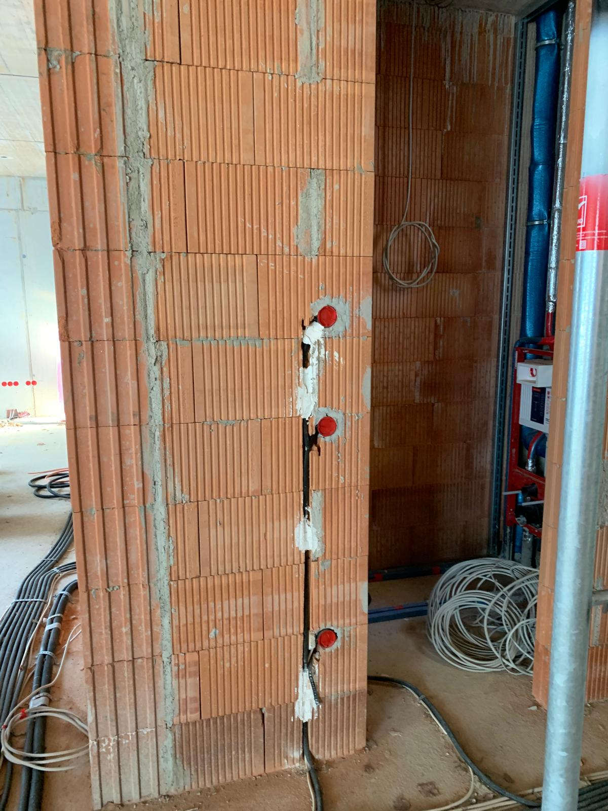
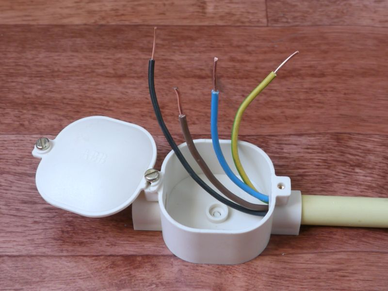
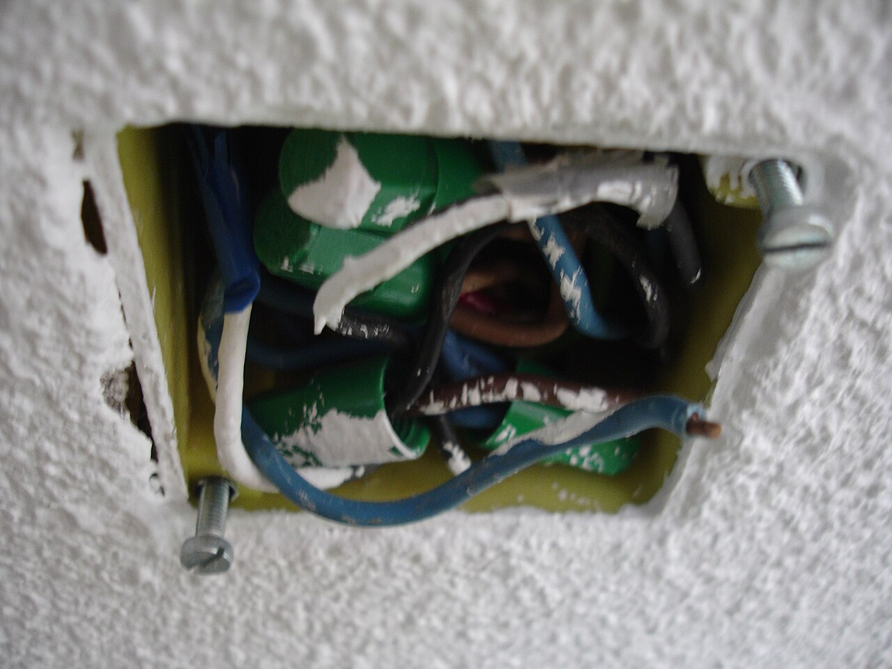
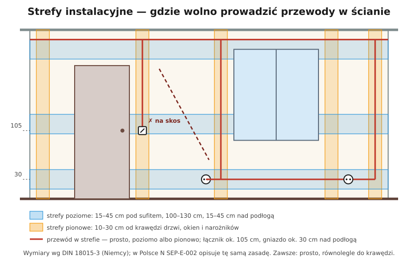

# 16.04 — Strefy instalacyjne i trasy przewodów

> **Moduł:** [16 — Planowanie obwodów](README.md) · **Oznaczenia:** 🏠📋 · **Zakres SEP:** (a) (c) · **Status:** ✅ pełny
>
> **Czytaj:**
>
> - N SEP-E-002 — prowadzenie przewodów w budynkach mieszkalnych; [ZPE — e-materiały do kształcenia zawodowego](https://zpe.gov.pl/a/DxddThkId)
> - DIN 18015-3 — strefy instalacyjne 🇩🇪 ([omówienie: Baunetz Wissen](https://www.baunetzwissen.de/elektro/fachwissen/leitungen-verteiler/leitungsverlegung-und-installationszonen-153012))
> - Wykonanie bruzd: [19.06](../19-prace-krok-po-kroku/19.06-bruzdy-puszki-i-prowadzenie-przewodow-w-scianie.md)

[← poprzedni temat](16.03-sprawdzanie-spadku-napiecia.md) · [spis modułu](README.md) · [następny temat →](16.05-wysokosci-montazu-i-liczba-gniazd.md)

## Po co to jest

Przewód schowany w ścianie jest niewidoczny przez dziesiątki lat. Jeśli leży w przewidywalnym miejscu, nikt go nie przewierci przy wieszaniu półki. Jeśli biegnie na skos „najkrótszą drogą” — prędzej czy później ktoś trafi w niego wiertłem. Strefy instalacyjne to umowa, gdzie wolno prowadzić przewody, i jedna z najczęstszych spraw przy remontach.

## Po ludzku

Zasada jest jedna: **przewody w ścianie biegną tylko prosto — poziomo albo pionowo — w umówionych pasach.** Wtedy z położenia gniazda czy łącznika wiadomo, gdzie jest przewód.

**Pasy poziome** (strefy wg DIN 18015-3, w Polsce ta sama zasada w N SEP-E-002):

- **górny** — 15–45 cm pod sufitem (w praktyce ok. 30 cm),
- **środkowy** — 100–130 cm nad podłogą (na wysokości łączników i gniazd kuchennych),
- **dolny** — 15–45 cm nad podłogą (na wysokości gniazd).

**Pasy pionowe** — 10–30 cm od krawędzi drzwi, okien i narożników ścian (w praktyce ok. 15 cm od ościeżnicy). Pionowo przewód schodzi od pasa górnego do łącznika lub gniazda — **zawsze pionowo nad lub pod osprzętem**.

**Puszki** — w miejscach rozgałęzień, w pasie górnym albo przy osprzęcie; muszą pozostać **dostępne** (nie pod płytkami, nie za zabudową na stałe).

**Gdzie jeszcze:**

- **sufit** — przewody do lamp w rurkach lub w bruzdach w stropie, prosto, równolegle do ścian;
- **podłoga** — w rurkach osłonowych w warstwie wylewki, najlepiej w pasach przy ścianach; dokumentuj zdjęciami przed wylaniem;
- **ściany g-k** — przewody w peszlu lub przewody do tego przeznaczone, puszki do płyt g-k;
- **ocieplenie** — unikać; jeśli trzeba, policzyć mniejszą obciążalność ([05.05](../05-przewody-i-kable/05.05-sposoby-ukladania-przewodow-a1-b1-c-e-i-ich.md)).

## Jak to wygląda

*Na co patrzeć: puszki ułożone jedna nad drugą, a przewód biegnie między nimi pionowo, w jednej linii. Z położenia puszek od razu widać, gdzie w tynku będzie przewód.*

*Na co patrzeć: przewody wchodzą do puszki przez rurkę osłonową. Taka puszka zawsze ma pokrywkę dostępną bez kucia — tam są połączenia, które kiedyś trzeba będzie sprawdzić.*

*Na co patrzeć: tak wygląda puszka „przepchana” przewodami. Brakuje w niej miejsca na porządne połączenia. Lepiej przewidzieć większą lub dodatkową puszkę niż wciskać wszystko do jednej.*

## Schemat

## Pojęcia

| Pojęcie | Po ludzku | Termin normowy / symbol |
|---------|-----------|-------------------------|
| Strefa instalacyjna | Pas ściany, w którym wolno prowadzić przewody | Installationszone (DIN 18015-3) |
| Bruzda | Rowek w ścianie na przewód | — |
| Puszka rozgałęźna | Puszka z połączeniami przewodów | [06.03](../06-osprzet-instalacyjny/06.03-puszki-instalacyjne-i-rozgalezne.md) |
| Rurka osłonowa (peszel) | Rurka chroniąca przewód, pozwala go wymienić | rura instalacyjna, PN-EN 61386 |
| Instalacja podtynkowa / natynkowa | W ścianie / na ścianie | — |

## Liczby do zapamiętania

| Wielkość | Wartość | Kiedy obowiązuje | Źródło |
|----------|---------|------------------|--------|
| Strefa pozioma górna | **15–45 cm** pod sufitem (praktyka PL: ok. **30 cm**) | ściany w pomieszczeniach mieszkalnych | DIN 18015-3 🇩🇪, [ZPE](https://zpe.gov.pl/a/DxddThkId) |
| Strefa pozioma dolna | **15–45 cm** nad podłogą | jw. | DIN 18015-3 🇩🇪 |
| Strefa pozioma środkowa | **100–130 cm** nad podłogą | jw. | jw. |
| Strefa pionowa | **10–30 cm** od drzwi, okien, narożników (praktyka PL: ok. **15 cm** od krawędzi) | jw. | DIN 18015-3 🇩🇪, [ZPE](https://zpe.gov.pl/a/DxddThkId) |
| Strefy w łazience | przewody w strefach 1 i 2 — natynkowo albo na głębokości ≥ **5 cm** | łazienki | [Inżynier Budownictwa](https://inzynierbudownictwa.pl/?p=11855), [17.01](../17-pomieszczenia-szczegolne/17.01-lazienka-strefy-0-1-i-2.md) |

## W praktyce

- **Przed wierceniem** — popatrz na osprzęt: nad i pod gniazdem oraz łącznikiem jest przewód. Użyj wykrywacza przewodów, ale nie ufaj mu bezgranicznie.
- **Zrób zdjęcia ścian i podłóg przed tynkowaniem i wylewką** — z miarką w kadrze. To najtańsza dokumentacja powykonawcza.
- **Przewody w rurkach** w podłodze i stropie pozwalają je kiedyś wymienić bez kucia.
- **Nie łącz przewodów w tynku** bez puszki. Każde połączenie musi być w dostępnej puszce lub w osprzęcie.
- **Krzyżowanie z innymi instalacjami** (woda, gaz, CO) — z odstępem, nie w jednej bruździe ([19.06](../19-prace-krok-po-kroku/19.06-bruzdy-puszki-i-prowadzenie-przewodow-w-scianie.md)).

## Błędy i zagrożenia

- ⚠️ **Przewód na skos przez ścianę** — „oszczędność” 2 m przewodu, a potem przewiercony przewód pod napięciem i porażenie albo pożar w ścianie.
- ⚠️ **Puszka zatynkowana albo zakryta płytkami** — połączenie, które się grzeje, a nikt nie wie, gdzie jest.
- **Przewody w wylewce bez rurek** — uszkodzenia przy wylewaniu, brak możliwości wymiany.
- **Bruzdy poziome w ścianach nośnych i cienkich działowych** bez zgody konstruktora — osłabienie ściany.
- **Przewód przypadkowo „przepuszczony” przez ocieplenie** — przegrzewanie się na odcinku, którego nikt nie liczył.

## Przykład

**Zadanie.** Gniazdo na wysokości 30 cm stoi 80 cm od narożnika pokoju. Chcesz powiesić półkę 50 cm nad nim i 20 cm w bok. Czy wiercenie jest bezpieczne?

**Rozwiązanie.** Jeśli instalację wykonano zgodnie ze strefami, przewód do gniazda schodzi **pionowo nad gniazdem** z pasa górnego (albo biegnie poziomo w pasie dolnym). Punkt 50 cm nad gniazdem i 20 cm w bok jest poza pionem gniazda i poza pasem dolnym — wiercenie powinno być bezpieczne. Ale w starych budynkach przewody bywały prowadzone dowolnie — przed wierceniem sprawdź wykrywaczem, a obwód warto wyłączyć.

## Pytania SEP

1. **Jak powinny być prowadzone przewody wtynkowe i podtynkowe w pomieszczeniach mieszkalnych?**

Odpowiedź

Wyłącznie w liniach prostych, poziomych i pionowych, równolegle do krawędzi ścian i stropów, w wyznaczonych strefach instalacyjnych: poziomo w pasie pod sufitem (ok. 30 cm), na wysokości osprzętu i nad podłogą, pionowo w pasach przy drzwiach, oknach i narożnikach (ok. 15 cm od krawędzi) oraz pionowo nad lub pod osprzętem. Połączenia i rozgałęzienia wykonuje się w dostępnych puszkach. Przewody nie mogą biec na skos.

## Sprawdź się

1. Na schemacie wyżej znajdź przewód, który narusza zasady.

Odpowiedź

Przewód przerywany biegnący na skos między drzwiami a oknem. Nie leży w żadnej strefie i nie da się go przewidzieć z położenia osprzętu.

## Źródła

- N SEP-E-002 — Instalacje elektryczne w budynkach mieszkalnych (prowadzenie przewodów); [E-materiały ZPE: prowadzenie przewodów i montaż osprzętu](https://zpe.gov.pl/a/DxddThkId).
- 🇩🇪 DIN 18015-3:2016 — Elektrische Anlagen in Wohngebäuden. Leitungsführung und Anordnung der Betriebsmittel; [omówienie: Leitungsverlegung und Installationszonen — Baunetz Wissen](https://www.baunetzwissen.de/elektro/fachwissen/leitungen-verteiler/leitungsverlegung-und-installationszonen-153012).
- PN-HD 60364-5-52 — prowadzenie oprzewodowania.

---

[← poprzedni temat](16.03-sprawdzanie-spadku-napiecia.md) · [spis modułu](README.md) · [następny temat →](16.05-wysokosci-montazu-i-liczba-gniazd.md)
