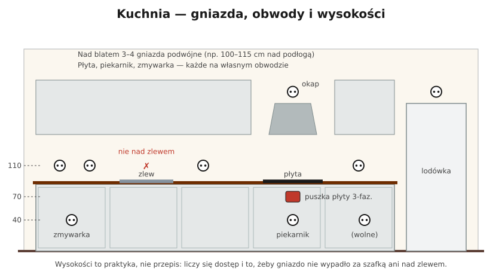
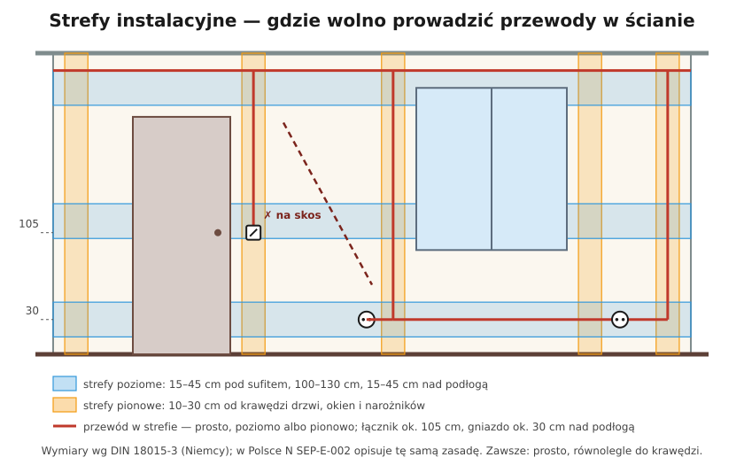

# 16.05 — Wysokości montażu i liczba gniazd

> **Moduł:** [16 — Planowanie obwodów](README.md) · **Oznaczenia:** 🏠📋 · **Zakres SEP:** (a) (c) · **Status:** ✅ pełny
>
> **Czytaj:**
>
> - N SEP-E-002 — rozmieszczenie osprzętu; [ZPE](https://zpe.gov.pl/a/DxddThkId)
> - Rozplanowanie gniazd w kuchni: [Murator](https://muratordom.pl/instalacje/instalacja-elektryczna/instalacja-elektryczna-w-kuchni-aa-GEzk-fazJ-6PoY.html)
> - Strefy: [16.04](16.04-strefy-instalacyjne-i-trasy-przewodow.md)

[← poprzedni temat](16.04-strefy-instalacyjne-i-trasy-przewodow.md) · [spis modułu](README.md) · [następny temat →](16.06-obwody-wydzielone-plyta-piekarnik-pralka.md)

## Po co to jest

Za mało gniazd to przedłużacze i rozgałęźniki na stałe — przegrzane wtyczki i plątanina pod biurkiem. Łącznik w złym miejscu irytuje codziennie. Wysokości osprzętu nie są sztywnym przepisem, ale przyjęte wartości wiążą się ze strefami instalacyjnymi: dzięki nim wiadomo, gdzie biegną przewody.

## Po ludzku

**Wysokości (od gotowej podłogi):**

- **łączniki** — ok. **105 cm** (praktyka: 100–110 cm), ok. **15 cm** od ościeżnicy, **po stronie klamki**;
- **gniazda w pokojach** — ok. **30 cm**;
- **gniazda nad blatem kuchennym** — ok. 20–30 cm nad blatem, czyli ok. **110–120 cm** ([17.02](../17-pomieszczenia-szczegolne/17.02-kuchnia.md));
- **gniazda przy biurku, łóżku, telewizorze** — można wyżej (np. 50–80 cm nad biurkiem, nad szafką nocną), ale w pionie nad gniazdem z dołu albo w strefie środkowej;
- **gniazdo w łazience** — poza strefami 0–2 ([17.01](../17-pomieszczenia-szczegolne/17.01-lazienka-strefy-0-1-i-2.md));
- **budynki dostępne dla osób z niepełnosprawnościami** — łączniki i gniazda w zasięgu ręki z wózka; wysokości ustala projekt.

**Liczba gniazd.** W Polsce nie ma przepisu, który narzuca liczbę gniazd w pokoju. Kieruj się tym, co będzie podłączone:

- **przy każdej ścianie** dłuższej niż ok. 2–3 m — gniazdo (podwójne),
- **przy łóżku** — po obu stronach,
- **przy biurku i telewizorze** — grupa 3–4 gniazd (komputer, monitor, ładowarki, sprzęt RTV),
- **przy drzwiach** — gniazdo do odkurzacza,
- **kuchnia** — 3–4 podwójne nad blatem plus gniazda dla urządzeń w zabudowie,
- **przedpokój, balkon, garaż** — przynajmniej po jednym.

Gniazdo podwójne kosztuje prawie tyle samo co pojedyncze, a rozgałęźnik zostaje na lata. Lepiej o jedno gniazdo za dużo.

## Jak to wygląda

*Na co patrzeć: w kuchni gniazda są na kilku wysokościach — nad blatem, za urządzeniami w szafkach i w szafce okapowej. Każda wysokość ma uzasadnienie: dostęp i miejsce na wtyczkę.*

## Schemat

## Pojęcia

| Pojęcie | Po ludzku | Termin normowy / symbol |
|---------|-----------|-------------------------|
| Osprzęt | Gniazda, łączniki, puszki | sprzęt instalacyjny |
| Gotowa podłoga | Poziom po położeniu wykończenia | — |
| Gniazdo podwójne | Dwa gniazda w jednej ramce | — |
| Ramka wielokrotna | Kilka elementów osprzętu w jednej ramce | — |

## Liczby do zapamiętania

| Wielkość | Wartość | Kiedy obowiązuje | Źródło |
|----------|---------|------------------|--------|
| Łącznik | ok. **105 cm** nad podłogą, ok. **15 cm** od ościeżnicy, po stronie klamki | pomieszczenia mieszkalne | N SEP-E-002, [ZPE](https://zpe.gov.pl/a/DxddThkId) |
| Gniazdo w pokoju | ok. **30 cm** nad podłogą | jw. | jw. |
| Gniazdo nad blatem | **20–30 cm** nad blatem (ok. 110–120 cm nad podłogą) | kuchnia | [Murator](https://muratordom.pl/instalacje/instalacja-elektryczna/instalacja-elektryczna-w-kuchni-aa-GEzk-fazJ-6PoY.html) |
| Gniazda dla urządzeń w zabudowie | **30–50 cm** nad podłogą, w sąsiedniej szafce | kuchnia | jw. |
| Łącznik światła łazienki | **na zewnątrz** łazienki, po stronie klamki | praktyka | [ZPE](https://zpe.gov.pl/a/DxddThkId) |

## W praktyce

- **Przejdź mieszkanie z planem mebli.** Gniazdo za szafą jest bezużyteczne, a łącznik za otwartymi drzwiami — irytujący.
- **Ustal wysokość od gotowej podłogi** — przy wylewce i panelach to kilka centymetrów różnicy, przy ramkach wielokrotnych widać każdy milimetr.
- **Ramki wielokrotne** — puszki osadza się w jednej linii, z rozstawem zgodnym z systemem osprzętu (zwykle 71 mm), najlepiej z użyciem puszek łączonych lub szablonu.
- **Gniazda przy podłodze w łazience i kuchni** — z daleka od miejsc, gdzie stoi woda.
- **Na zewnątrz łazienki** łącznik, w środku najwyżej przycisk lub łącznik poza strefami.

## Błędy i zagrożenia

- **Rozgałęźnik zasilający rozgałęźnik** — przegrzane styki pierwszej wtyczki, ryzyko pożaru.
- **Gniazdo tuż nad zlewem lub płytą** — zalanie, gorąco, para.
- **Łącznik po stronie zawiasów** — za otwartymi drzwiami, po ciemku.
- **Osprzęt „gdzie wypadło”**, poza pionem nad lub pod przewodem — nikt potem nie odtworzy trasy.

## Przykład

**Zadanie.** Sypialnia 14 m²: łóżko podwójne pod jedną ścianą, biurko pod oknem, szafa przy drzwiach, telewizor naprzeciwko łóżka. Rozplanuj gniazda.

**Rozwiązanie.**

- Przy łóżku: **2 × gniazdo podwójne** (po obu stronach, ok. 30 cm albo nad szafkami nocnymi).
- Przy biurku: **gniazdo potrójne lub 2 × podwójne** nad blatem biurka (np. 80–90 cm), w pionie w strefie przy oknie.
- Telewizor: **gniazdo podwójne** + gniazdo antenowe/sieciowe, na wysokości zawieszenia lub za szafką RTV.
- Przy drzwiach: **gniazdo pojedyncze** do odkurzacza (nie za szafą).
- Łącznik: przy drzwiach po stronie klamki, 105 cm; opcjonalnie łącznik schodowy przy łóżku ([18.03](../18-oswietlenie/18.03-uklad-schodowy-i-krzyzowy-schematy.md)).
- Razem ok. **11–12 gniazd** w kilku punktach — wszystkie na jednym obwodzie gniazd sypialni (B16, 2,5 mm²), bo nie ma tu dużych odbiorników.

## Pytania SEP

1. **Na jakiej wysokości instaluje się zwykle łączniki i gniazda w pomieszczeniach mieszkalnych?**

Odpowiedź

Łączniki ok. 105 cm nad podłogą, przy drzwiach po stronie klamki, ok. 15 cm od ościeżnicy. Gniazda w pokojach ok. 30 cm nad podłogą, w kuchni nad blatem ok. 100–120 cm (20–30 cm nad blatem). Osprzęt montuje się w pionie nad lub pod przewodem prowadzonym w strefach instalacyjnych. W łazience gniazda tylko poza strefami 0, 1 i 2.

## Sprawdź się

1. Dlaczego łącznik oświetlenia łazienki często montuje się na zewnątrz łazienki?

Odpowiedź

Bo w łazience łączniki 230 V są niedopuszczalne w strefach 0, 1 i 2, a na zewnątrz nie ma problemu z wilgocią i mokrymi rękami. To też wygodne — włączasz światło przed wejściem.

## Źródła

- N SEP-E-002 — Instalacje elektryczne w budynkach mieszkalnych. Podstawy planowania; [E-materiały ZPE](https://zpe.gov.pl/a/DxddThkId).
- [Instalacja elektryczna w kuchni — Murator](https://muratordom.pl/instalacje/instalacja-elektryczna/instalacja-elektryczna-w-kuchni-aa-GEzk-fazJ-6PoY.html).
- [Instalacje elektryczne w budynkach mieszkalnych bez barier — Inżynier Budownictwa](https://inzynierbudownictwa.pl/instalacje-elektryczne-w-budynkach-mieszkalnych-bez-barier/).

---

[← poprzedni temat](16.04-strefy-instalacyjne-i-trasy-przewodow.md) · [spis modułu](README.md) · [następny temat →](16.06-obwody-wydzielone-plyta-piekarnik-pralka.md)
