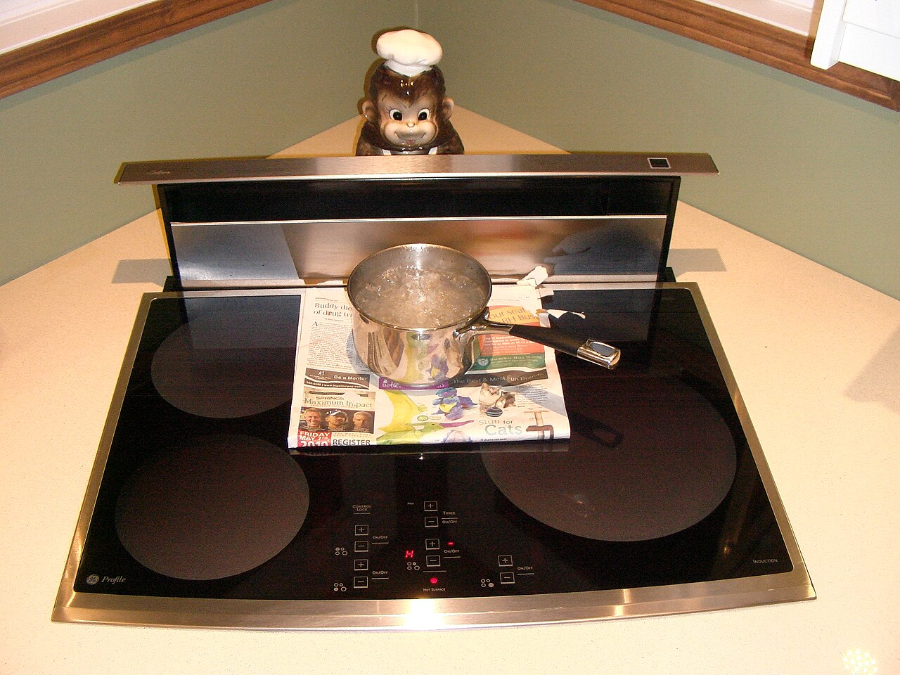
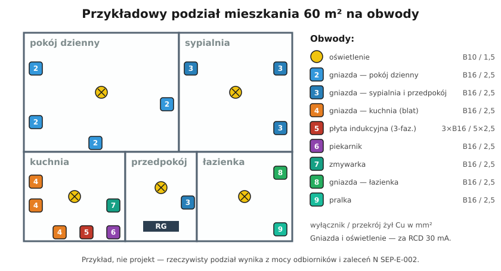

# 16.06 — Obwody wydzielone: płyta, piekarnik, pralka, zmywarka

> **Moduł:** [16 — Planowanie obwodów](README.md) · **Oznaczenia:** 🏠📋 · **Zakres SEP:** (a) (c) · **Status:** ✅ pełny
>
> **Czytaj:**
>
> - N SEP-E-002 — obwody odbiorników o dużej mocy; [Inżynier Budownictwa](https://inzynierbudownictwa.pl/?p=10433)
> - Podłączenie płyty krok po kroku: [19.04](../19-prace-krok-po-kroku/19.04-podlaczenie-plyty-indukcyjnej.md)
> - Typy RCD: [08.03](../08-wylaczniki-roznicowopradowe/08.03-typy-ac-a-f-i-b-ktory-do-czego.md)

[← poprzedni temat](16.05-wysokosci-montazu-i-liczba-gniazd.md) · [spis modułu](README.md) · (koniec modułu) →

## Po co to jest

Płyta indukcyjna, piekarnik, pralka czy zmywarka pobierają kilka kilowatów, i to przez długi czas. Na wspólnym obwodzie z gniazdami w pokoju wyłącznik działałby przy każdym praniu. Do tego część z nich wymaga zasilania trójfazowego albo podłączenia na stałe. To temat, z którym każdy remont kuchni i łazienki się spotyka.

## Po ludzku

**Obwód wydzielony** = jeden odbiornik, jeden wyłącznik, jeden przewód. Zalety:

- duży odbiornik nie przeciąża innych obwodów,
- usterka w pralce wyłącza tylko pralkę,
- przekrój i zabezpieczenie dobiera się dokładnie do urządzenia.

**Typowe zestawienie** (zawsze sprawdź instrukcję urządzenia — ona jest najważniejsza):

| Odbiornik | Moc typowa | Zasilanie | Zabezpieczenie | Przewód Cu |
|-----------|-----------|-----------|----------------|-----------|
| Płyta indukcyjna | 7–7,5 kW | 3-fazowe (lub 2 fazy + N wg instrukcji), na stałe | 3 × B16 (lub 2 × B16) | 5 × 2,5 mm² |
| Piekarnik | 3–3,6 kW | 1-fazowe, gniazdo lub na stałe | B16 | 3 × 2,5 mm² |
| Zmywarka | 2–2,2 kW | 1-fazowe, gniazdo | B16 | 3 × 2,5 mm² |
| Pralka, suszarka | 2–2,3 kW | 1-fazowe, gniazdo | B16 | 3 × 2,5 mm² |
| Podgrzewacz przepływowy | 9–24 kW | 3-fazowe, na stałe | wg instrukcji (np. 3 × 32 A) | wg instrukcji (np. 5 × 6 mm²) |
| Bojler (zasobnik) | 1,5–2 kW | 1-fazowe | B16 / B10 | 3 × 2,5 / 1,5 mm² |

**Płyta indukcyjna** ma zwykle listwę zaciskową z mostkami. Ustawienie mostków zależy od tego, czy zasilasz ją z jednej, dwóch czy trzech faz ([19.04](../19-prace-krok-po-kroku/19.04-podlaczenie-plyty-indukcyjnej.md)). Prowadzi się do niej przewód 5 × 2,5 mm² do puszki pod blatem — nawet jeśli dziś podłączasz dwie fazy, piąta żyła daje swobodę na przyszłość.

**Ochrona różnicowoprądowa.** Gniazda (do 32 A) muszą mieć RCD 30 mA. Odbiorniki stałe nie zawsze, ale w mieszkaniu zwykle obejmuje się nimi wszystko, co jest w kuchni i łazience. Pralki, zmywarki i płyty mają silniki lub falowniki — dlatego co najmniej **typ A** albo **F** zamiast AC ([08.03](../08-wylaczniki-roznicowopradowe/08.03-typy-ac-a-f-i-b-ktory-do-czego.md)). Dobrym rozwiązaniem jest RCBO dla każdego takiego obwodu — usterka grzałki pralki nie wyłącza wtedy zmywarki.

## Jak to wygląda

*Na co patrzeć: płyta ma zwykle 4 pola i moc łączną ponad 7 kW. Pod blatem jest puszka przyłączeniowa z przewodem 5-żyłowym — płyty nie podłącza się wtyczką do zwykłego gniazda.*

## Schemat

## Pojęcia

| Pojęcie | Po ludzku | Termin normowy / symbol |
|---------|-----------|-------------------------|
| Obwód wydzielony | Obwód dla jednego urządzenia | obwód odbiorczy |
| Podłączenie na stałe | Bez wtyczki, przewód w zaciskach | przyłączenie stałe |
| Mostki w płycie | Zworki łączące zaciski listwy płyty | wg instrukcji producenta |
| RCBO | Wyłącznik nadprądowy z różnicówką w jednym | [08.04](../08-wylaczniki-roznicowopradowe/08.04-rcbo-wylacznik-nadpradowy-z-czlonem.md) |

## Liczby do zapamiętania

| Wielkość | Wartość | Kiedy obowiązuje | Źródło |
|----------|---------|------------------|--------|
| Płyta indukcyjna | **3 × B16**, przewód **5 × 2,5 mm²**, puszka pod blatem | typowa płyta 7–7,5 kW; zawsze wg instrukcji | instrukcje producentów, praktyka |
| Piekarnik, zmywarka, pralka | **B16**, **3 × 2,5 mm²**, każdy osobno | typowo 2–3,6 kW | N SEP-E-002 (osobne obwody) |
| RCD dla obwodów z silnikiem/falownikiem | typ **A** lub **F** (nie AC) | pralki, zmywarki, płyty, pompy ciepła | zalecenia producentów, [08.03](../08-wylaczniki-roznicowopradowe/08.03-typy-ac-a-f-i-b-ktory-do-czego.md) |
| Moc 3-faz. na fazę | **7,2 kW ≈ 3 × 2,4 kW** → ok. **10,4 A** na fazę | płyta na 3 fazach | $I = P / (\sqrt{3} \cdot 400)$ |

## W praktyce

- **Instrukcja urządzenia przed zakupem przewodu.** Podaje przekrój, zabezpieczenie i sposób podłączenia — zwłaszcza dla płyt i podgrzewaczy przepływowych.
- **Puszka płyty** ok. 60–70 cm nad podłogą, za szafką pod płytą, z zapasem przewodu.
- **Gniazdo pralki** poza strefami łazienki ([17.01](../17-pomieszczenia-szczegolne/17.01-lazienka-strefy-0-1-i-2.md)); gniazdo zmywarki w szafce obok, nie za urządzeniem.
- **Przy zasilaniu jednofazowym** płyta 7,2 kW nie pracuje z pełną mocą — ustawia się ogranicznik mocy w płycie (wg instrukcji) albo zwiększa moc przyłączeniową ([14.05](../14-od-slupa-do-gniazdka/14.05-moc-przylaczeniowa-i-taryfy.md)).

## Błędy i zagrożenia

- ⚠️ **Płyta podłączona przewodem 3 × 2,5 mm² z mostkami „na jedną fazę” i B16** — przy pełnej mocy prąd ok. 30 A; jeśli ktoś „naprawi” wybijanie wyłącznikiem B32 — przegrzany przewód.
- ⚠️ **Zamienione N z fazą przy mostkowaniu płyty** — 400 V na module przeznaczonym na 230 V, spalona elektronika.
- **Pralka na przedłużaczu** — przegrzana wtyczka przy grzaniu wody przez 30 minut.
- **RCD typu AC przy pralce z falownikiem** — różnicówka może nie zadziałać przy prądzie upływu z elementami stałymi.

## Przykład

**Zadanie.** Kuchnia w mieszkaniu z zasilaniem trójfazowym: płyta 7,4 kW, piekarnik 3,5 kW, zmywarka 2,1 kW. Dobierz obwody i rozłóż na fazy.

**Rozwiązanie.**

- Płyta: $I = 7400 / (\sqrt{3} \cdot 400) \approx 10{,}7$ A na fazę (przy pełnej mocy rozłożonej na 3 fazy) → **3 × B16**, przewód **5 × 2,5 mm²**.
- Piekarnik: $I = 3500 / 230 \approx 15{,}2$ A → **B16**, **3 × 2,5 mm²**, np. faza L1.
- Zmywarka: $I = 2100 / 230 \approx 9{,}1$ A → **B16**, **3 × 2,5 mm²**, faza L2.
- Gniazda nad blatem → faza L3, żeby najcięższe obciążenia jednofazowe były na różnych fazach.
- RCD: typ A, 30 mA — najlepiej RCBO dla piekarnika i zmywarki.

## Pytania SEP

1. **Jak zasila się i zabezpiecza płytę indukcyjną w mieszkaniu?**

Odpowiedź

Z osobnego obwodu, zwykle trójfazowo (lub dwufazowo wg instrukcji), przewodem 5 × 2,5 mm² Cu doprowadzonym do puszki przyłączeniowej pod blatem, przez wyłącznik nadprądowy 3 × B16 (albo trójbiegunowy B16). Płytę podłącza się na stałe, a mostki na listwie zaciskowej ustawia zgodnie z instrukcją i liczbą faz. Obwód objęty ochroną różnicowoprądową, najlepiej typu A.

2. **Które odbiorniki w mieszkaniu powinny mieć osobne obwody i dlaczego?**

Odpowiedź

Odbiorniki dużej mocy: płyta grzejna lub kuchenka elektryczna, piekarnik, zmywarka, pralka, suszarka, podgrzewacz wody, grzejniki elektryczne, klimatyzator, mikrofalówka (jeśli duża). Pobierają kilka kilowatów przez długi czas, więc na wspólnym obwodzie przeciążałyby go i powodowały zadziałanie zabezpieczeń. Osobny obwód pozwala dobrać przekrój i zabezpieczenie do urządzenia i ogranicza skutki usterki do jednego odbiornika.

## Sprawdź się

1. Płyta 7,2 kW podłączona do jednej fazy. Jaki prąd pobiera przy pełnej mocy? Czy wystarczy B16?

Odpowiedź

$7200 / 230 \approx 31$ A. B16 zadziała przy dłuższym gotowaniu na kilku polach. Rozwiązanie: zasilanie 2- lub 3-fazowe albo ogranicznik mocy w płycie (np. do 3,5 kW) — zgodnie z instrukcją. Nie wolno dać B32 na przewód 2,5 mm².

## Źródła

- N SEP-E-002 — obwody odbiorników o dużej mocy; [omówienie — Inżynier Budownictwa](https://inzynierbudownictwa.pl/?p=10433).
- [Instalacja elektryczna w kuchni — Murator](https://muratordom.pl/instalacje/instalacja-elektryczna/instalacja-elektryczna-w-kuchni-aa-GEzk-fazJ-6PoY.html).
- Instrukcje montażu płyt indukcyjnych (rozdział „Podłączenie elektryczne”) — u każdego producenta.

---

[← poprzedni temat](16.05-wysokosci-montazu-i-liczba-gniazd.md) · [spis modułu](README.md) · (koniec modułu) →
