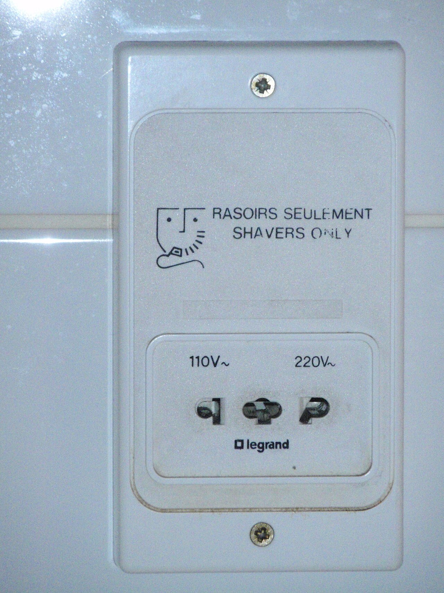
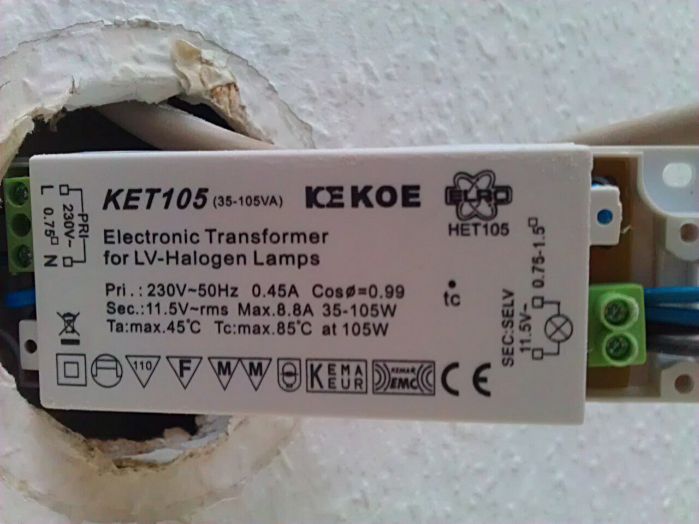
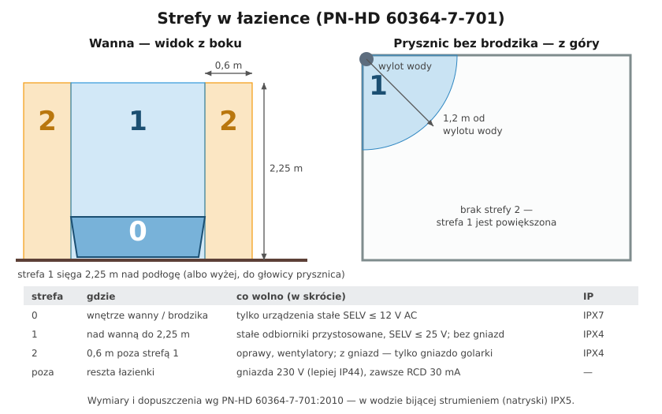
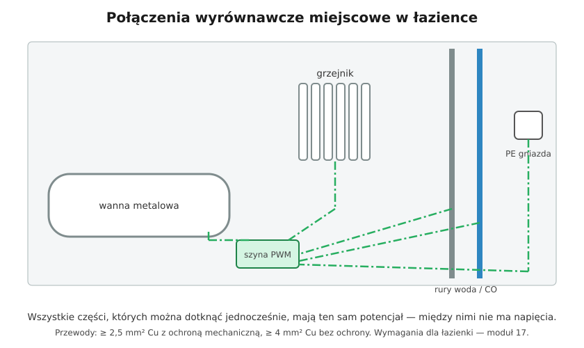

# 17.01 — Łazienka: strefy 0, 1 i 2

> **Moduł:** [17 — Pomieszczenia i miejsca szczególne](README.md) · **Oznaczenia:** 🏠📋 · **Zakres SEP:** (a) (c) (d) · **Status:** ✅ pełny
>
> **Czytaj:**
>
> - PN-HD 60364-7-701:2010 — Wymagania dotyczące specjalnych instalacji lub lokalizacji. Pomieszczenia wyposażone w wannę lub prysznic
> - Omówienia: [Inżynier Budownictwa — wymagania w pomieszczeniach kąpielowych](https://inzynierbudownictwa.pl/?p=11855), [Inżynier Budownictwa — pralka obok prysznica](https://inzynierbudownictwa.pl/czy-pralka-moze-stac-obok-prysznica/)
> - Połączenia wyrównawcze: [13.05](../13-uziemienia-i-wyrownanie/13.05-polaczenia-wyrownawcze-miejscowe.md); SELV: [12.04](../12-ochrona-przeciwporazeniowa/12.04-izolacja-podwojna-separacja-elektryczna-selv-i.md); IP: [06.05](../06-osprzet-instalacyjny/06.05-stopnie-ochrony-ip.md)

← (początek modułu) · [spis modułu](README.md) · [następny temat →](17.02-kuchnia.md)

## Po co to jest

W łazience człowiek jest mokry, często bosy i dotyka metalowych baterii, a skóra ma tam bardzo mały opór. Prąd, który w pokoju tylko by „kopnął”, w wannie może zabić. Dlatego łazienka ma własny arkusz normy z podziałem na strefy i zaostrzonymi wymaganiami. To jedno z najczęstszych pytań na egzaminie i najczęstszy temat przy remoncie.

## Po ludzku

Wokół wanny i prysznica norma rysuje **trzy strefy** — im bliżej wody, tym ostrzej:

- **Strefa 0** — **wnętrze wanny lub brodzika** (przy prysznicu bez brodzika — warstwa 10 cm nad podłogą w zasięgu strefy 1). Tu może być tylko urządzenie stałe, przeznaczone do tej strefy, zasilane **SELV do 12 V AC** (30 V DC). Np. oświetlenie w wannie z hydromasażem.
- **Strefa 1** — przestrzeń **nad wanną lub brodzikiem do wysokości 2,25 m** nad podłogą (albo do głowicy prysznica, jeśli wisi wyżej). Przy prysznicu **bez brodzika** — w promieniu **1,2 m** od wylotu wody. Tu tylko odbiorniki stałe przeznaczone do tej strefy (np. podgrzewacz wody, wentylator, oprawa) i SELV do 25 V AC. **Żadnych gniazd ani łączników 230 V.**
- **Strefa 2** — pas **0,6 m** wokół strefy 1, też do 2,25 m. Oprawy, wentylatory, grzejniki przystosowane do strefy. Z gniazd dopuszczalne jest tylko **gniazdo golarki** z transformatorem separacyjnym. Przy prysznicu bez brodzika strefy 2 nie ma — strefa 1 jest powiększona do 1,2 m.
- **Poza strefami** — reszta łazienki. Tu mogą być zwykłe gniazda 230 V, najlepiej bryzgoszczelne (IP44).

**Stopnie ochrony:** strefy 1 i 2 — co najmniej **IPX4**; tam, gdzie myje się strumieniem wody (np. w łaźniach publicznych) — **IPX5**; strefa 0 — **IPX7**.

**Ochrona różnicowoprądowa:** **wszystkie obwody** w łazience — oświetlenie, gniazda, grzejniki, pralka — za **RCD 30 mA**. Wyjątki: obwody SELV i PELV oraz separacja elektryczna dla jednego odbiornika (gniazdo golarki). Różnicówka nie musi wisieć w łazience — wystarczy w rozdzielnicy.

**Połączenia wyrównawcze miejscowe** — łączą metalowe rury wody i ogrzewania wchodzące do łazienki i przewody PE obwodów ([13.05](../13-uziemienia-i-wyrownanie/13.05-polaczenia-wyrownawcze-miejscowe.md)). Wanny metalowej na nieprzewodzącej podłodze, zasilanej rurami z tworzywa, nie trzeba łączyć — nie jest częścią przewodzącą obcą.

**Przewody** w strefach 1 i 2 — tylko te, które zasilają urządzenia w tych strefach; natynkowo albo w ścianie na głębokości co najmniej **5 cm**.

## Jak to wygląda

*Na co patrzeć: gniazdo golarki ma w środku transformator separacyjny i nie przyjmie zwykłej wtyczki z bolcem. To jedyne gniazdo dopuszczone w strefie 2. Suszarki do włosów do niego nie podłączysz — jego moc to kilkanaście–kilkadziesiąt watów.*

*Na co patrzeć: napis SELV i napięcie wyjściowe 11,5 V. Zasilacz jest poza strefami (w suficie podwieszanym), a oprawa 12 V może być nad wanną. Do strefy 0 — tylko urządzenia przeznaczone do zanurzenia, IPX7.*

## Schemat

## Pojęcia

| Pojęcie | Po ludzku | Termin normowy / symbol |
|---------|-----------|-------------------------|
| Strefa 0, 1, 2 | Przestrzenie wokół wanny i prysznica o rosnących wymaganiach | PN-HD 60364-7-701 |
| SELV | Bardzo niskie napięcie z izolowanego źródła, bez połączenia z ziemią | obwód SELV |
| Gniazdo golarki | Gniazdo z transformatorem separacyjnym | zespół zasilający do golarek, PN-EN 61558-2-5 |
| IPX4 / IPX5 / IPX7 | Ochrona przed bryzgami / strumieniem / zanurzeniem | PN-EN 60529 |
| Połączenia wyrównawcze miejscowe | Przewody łączące metal w łazience z PE | 701.415.2 |

## Liczby do zapamiętania

| Wielkość | Wartość | Kiedy obowiązuje | Źródło |
|----------|---------|------------------|--------|
| Wysokość strefy 1 i 2 | **2,25 m** nad podłogą | lub do głowicy prysznica, jeśli wyżej | PN-HD 60364-7-701 |
| Szerokość strefy 2 | **0,6 m** od strefy 1 | wanna, brodzik | jw. |
| Strefa 1 przy prysznicu bez brodzika | **1,2 m** od wylotu wody, bez strefy 2 | — | jw. |
| SELV w strefie 0 | ≤ **12 V AC** / 30 V DC | urządzenia stałe do strefy 0 | jw. |
| SELV w strefach 1–2 | ≤ **25 V AC** / 60 V DC | — | jw., [Inżynier Budownictwa](https://inzynierbudownictwa.pl/?p=11855) |
| IP | strefa 0 **IPX7**; strefy 1, 2 **IPX4**; strumień wody **IPX5** | — | jw. |
| RCD | **30 mA** dla **wszystkich** obwodów łazienki | poza SELV/PELV i separacją | jw. |
| Przewody w strefach 1, 2 | natynkowo albo ≥ **5 cm** w głąb ściany | — | jw. |

## W praktyce

- **Zanim zaplanujesz gniazdo — narysuj strefy na planie łazienki** (ściana z wanną, ściana z prysznicem) i zaznacz pas 0,6 m. Gniazdo przy umywalce prawie zawsze da się postawić poza strefą 2.
- **Pralka w łazience** — najlepiej poza strefą 2 (ponad 60 cm od kabiny). Jeśli musi stać w strefie 2, to tylko taka o IPX4 (albo za ścianką do 2,25 m), a jej gniazdo — poza strefami ([Inżynier Budownictwa](https://inzynierbudownictwa.pl/czy-pralka-moze-stac-obok-prysznica/)).
- **Łącznik światła** — najprościej na zewnątrz, przy drzwiach.
- **Ogrzewanie podłogowe elektryczne** — mata z metalowym ekranem lub siatką połączoną z PE, za RCD 30 mA.
- **Lustro z oświetleniem i grzejnik drabinkowy** — tylko jako urządzenia przeznaczone do danej strefy (sprawdź IP i instrukcję), podłączone na stałe przez puszkę poza strefą lub w wykonaniu do strefy.
- **Nowsze wydanie normy.** Istnieje europejskie wydanie HD 60364-7-701:2024 🇬🇧. Przy projekcie sprawdź, które wydanie PN obowiązuje w dniu wykonania.

## Błędy i zagrożenia

- ⚠️ **Zwykłe gniazdo przy wannie** „bo suszarka” — w strefie 1 lub 2 to błąd zagrażający życiu.
- ⚠️ **Brak RCD 30 mA na obwodach łazienki**, szczególnie w starych blokach — żadne inne zabezpieczenie nie zadziała dość szybko przy porażeniu mokrego człowieka.
- ⚠️ **Suszarka lub grzejnik elektryczny na przedłużaczu z pokoju** — urządzenie spada do wanny, a obwód z pokoju często nie ma RCD.
- **Oprawy halogenowe 230 V nad prysznicem** bez IPX4 — woda w oprawie, upływ, korozja.
- **Transformator 12 V w strefie 1** — zasilacz to nie oprawa; musi być poza strefami albo w wykonaniu do strefy.

## Przykład

**Zadanie.** W łazience wanna stoi wzdłuż ściany, a umywalka na tej samej ścianie — jej krawędź jest 75 cm od krawędzi wanny. Gdzie przy umywalce można powiesić gniazdo: 40 cm od umywalki w stronę wanny czy 40 cm od umywalki po jej drugiej stronie?

**Rozwiązanie.** Strefa 2 kończy się 60 cm od krawędzi wanny.

- Gniazdo 40 cm od umywalki **w stronę wanny** jest 75 − 40 = **35 cm** od wanny — **w strefie 2**. Niedopuszczalne.
- Gniazdo po **drugiej stronie** umywalki jest co najmniej 75 + szerokość umywalki + 40 cm od wanny — **poza strefami**. Dopuszczalne: IP44, za RCD 30 mA.

## Pytania SEP

1. **Omów strefy w pomieszczeniach z wanną lub prysznicem.**

Odpowiedź

Wg PN-HD 60364-7-701: strefa 0 — wnętrze wanny lub brodzika; strefa 1 — przestrzeń nad wanną lub brodzikiem do wysokości 2,25 m od podłogi (przy prysznicu bez brodzika — w promieniu 1,2 m od wylotu wody); strefa 2 — pas o szerokości 0,6 m wokół strefy 1 do wysokości 2,25 m (przy prysznicu bez brodzika nie występuje). W strefie 0 tylko urządzenia stałe SELV do 12 V AC, IPX7. W strefach 1 i 2 co najmniej IPX4 (IPX5 przy strumieniu wody). Gniazd i łączników 230 V w strefach 0, 1 i 2 nie instaluje się, wyjątek — gniazdo golarki w strefie 2. Wszystkie obwody łazienki chroni się RCD 30 mA.

2. **Jakie środki ochrony stosuje się w łazience?**

Odpowiedź

Samoczynne wyłączenie zasilania z ochroną uzupełniającą wyłącznikiem różnicowoprądowym o IΔn ≤ 30 mA we wszystkich obwodach; bardzo niskie napięcie SELV/PELV (w strefie 0 do 12 V AC); separację elektryczną dla pojedynczego odbiornika (gniazdo golarki). Dodatkowo połączenia wyrównawcze miejscowe łączące części przewodzące obce wchodzące do łazienki z przewodami ochronnymi, dobór urządzeń o odpowiednim stopniu IP i ograniczenia dotyczące rozmieszczenia osprzętu w strefach.

3. **Czy w strefie 2 łazienki można zainstalować gniazdo wtyczkowe?**

Odpowiedź

Tylko gniazdo do golarek zasilane z transformatora separacyjnego (zespół zasilający do golarek wg PN-EN 61558-2-5) albo gniazdo obwodu SELV. Zwykłe gniazda 230 V instaluje się wyłącznie poza strefami, za wyłącznikiem różnicowoprądowym 30 mA.

## Sprawdź się

1. W tabeli na schemacie przy strefie 1 znajdź, czego tam nie wolno. Czy wentylator 230 V IPX4 przeznaczony do strefy 1 jest dopuszczalny?

Odpowiedź

W strefie 1 nie wolno instalować gniazd ani łączników 230 V. Wentylator stały, przeznaczony do strefy 1 i o stopniu IPX4, jest dopuszczalny — zasilony z obwodu chronionego RCD 30 mA.

## Źródła

- PN-HD 60364-7-701:2010 — Instalacje elektryczne niskiego napięcia. Część 7-701: Wymagania dotyczące specjalnych instalacji lub lokalizacji. Pomieszczenia wyposażone w wannę lub prysznic.
- [Wymagania stawiane instalacji elektrycznej w pomieszczeniach kąpielowych — Inżynier Budownictwa](https://inzynierbudownictwa.pl/?p=11855).
- [Czy pralka może stać obok prysznica? — Inżynier Budownictwa](https://inzynierbudownictwa.pl/czy-pralka-moze-stac-obok-prysznica/).
- 🇬🇧 HD 60364-7-701:2024 — nowe wydanie europejskie arkusza 701.

---

← (początek modułu) · [spis modułu](README.md) · [następny temat →](17.02-kuchnia.md)
