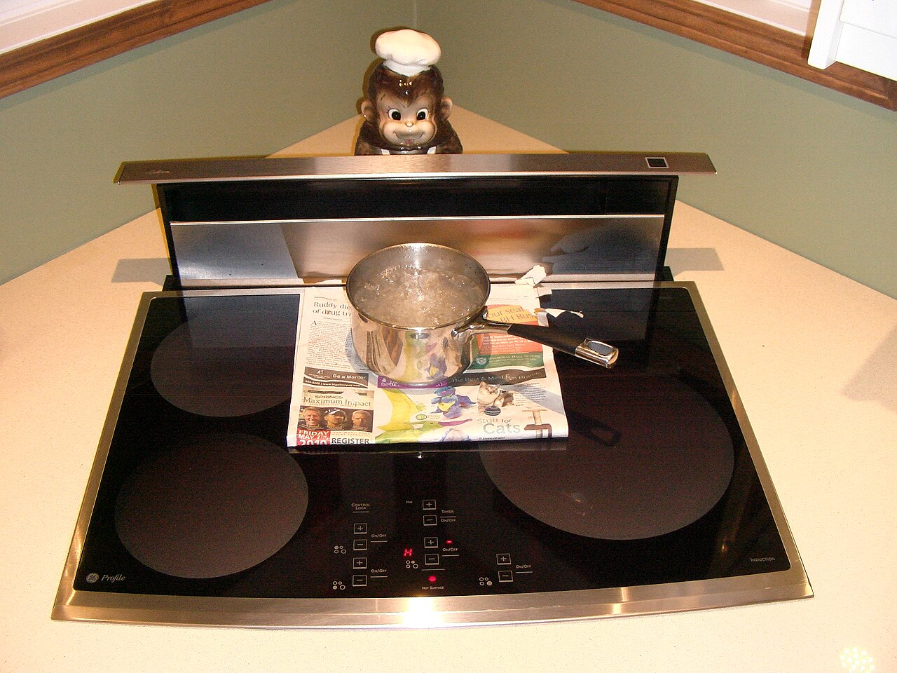
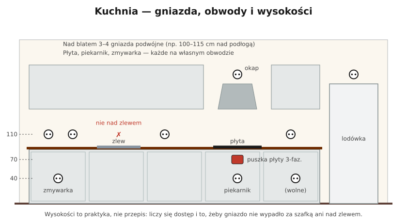

# 17.02 — Kuchnia

> **Moduł:** [17 — Pomieszczenia i miejsca szczególne](README.md) · **Oznaczenia:** 🏠📋 · **Zakres SEP:** (a) (c) (d) · **Status:** ✅ pełny
>
> **Czytaj:**
>
> - N SEP-E-002 — obwody w kuchni
> - [Instalacja elektryczna w kuchni — Murator](https://muratordom.pl/instalacje/instalacja-elektryczna/instalacja-elektryczna-w-kuchni-aa-GEzk-fazJ-6PoY.html)
> - Obwody wydzielone: [16.06](../16-planowanie-obwodow/16.06-obwody-wydzielone-plyta-piekarnik-pralka.md)

[← poprzedni temat](17.01-lazienka-strefy-0-1-i-2.md) · [spis modułu](README.md) · [następny temat →](17.03-garaz-i-warsztat.md)

## Po co to jest

Kuchnia nie ma osobnego arkusza normy jak łazienka, ale to pomieszczenie o największej mocy w mieszkaniu: płyta, piekarnik, zmywarka, czajnik, ekspres, mikrofalówka. Do tego woda, para i tłuszcz. Źle zaplanowana kuchnia to wybijające wyłączniki, rozgałęźniki na blacie i gniazda w miejscach, gdzie zalewa je woda.

## Po ludzku

**Zasady dla kuchni:**

1. **Duże urządzenia na własnych obwodach** — płyta, piekarnik, zmywarka; często też mikrofalówka i lodówka ([16.06](../16-planowanie-obwodow/16.06-obwody-wydzielone-plyta-piekarnik-pralka.md)).
2. **Gniazda nad blatem na osobnym obwodzie** (albo dwóch) — czajnik 2,2 kW i ekspres 1,5 kW razem dają ok. 16 A. W dużej kuchni dwa obwody nad blatem pozwalają włączyć jednocześnie więcej urządzeń.
3. **Wszystkie gniazda za RCD 30 mA** — to wymóg dla gniazd do 32 A ([12.05](../12-ochrona-przeciwporazeniowa/12.05-ochrona-uzupelniajaca.md)).
4. **Gniazda nad blatem** ok. 20–30 cm nad blatem, **nie bezpośrednio nad zlewem i płytą**, rozłożone tam, gdzie się pracuje (3–4 podwójne).
5. **Gniazda dla urządzeń w zabudowie** — w sąsiedniej szafce (30–50 cm nad podłogą), żeby dało się wyjąć wtyczkę bez wysuwania zmywarki.
6. **Okap** — gniazdo lub puszka w szafce okapowej, ukryte.
7. **Lodówka** — gniazdo obok lub nad nią; warto zastanowić się, czy nie dać jej osobnego RCBO, żeby usterka czajnika nie wyłączyła lodówki na cały urlop.
8. **Oświetlenie** — ogólne plus podszafkowe (często taśmy LED, [18.06](../18-oswietlenie/18.06-tasmy-led-i-ich-zasilanie.md)).

## Jak to wygląda

*Na co patrzeć: płyta zajmuje blat, nad nią i obok nie ma miejsca na gniazda — para i gorące naczynia. Okap blatowy (wysuwany) też potrzebuje zasilania — puszka w szafce pod blatem.*

## Schemat

## Pojęcia

| Pojęcie | Po ludzku | Termin normowy / symbol |
|---------|-----------|-------------------------|
| Gniazda nad blatem | Gniazda robocze do drobnego AGD | gniazda wtyczkowe ogólnego przeznaczenia |
| Urządzenie do zabudowy | Zmywarka, piekarnik, lodówka w szafce | — |
| Puszka przyłączeniowa | Puszka z zaciskami do podłączenia na stałe | — |
| Współczynnik jednoczesności | Ile urządzeń pracuje naraz | $k_j$ |

## Liczby do zapamiętania

| Wielkość | Wartość | Kiedy obowiązuje | Źródło |
|----------|---------|------------------|--------|
| Gniazda nad blatem | **20–30 cm** nad blatem, typowo **3–4 podwójne** | kuchnia | [Murator](https://muratordom.pl/instalacje/instalacja-elektryczna/instalacja-elektryczna-w-kuchni-aa-GEzk-fazJ-6PoY.html) |
| Gniazda za urządzeniami w zabudowie | **30–50 cm** nad podłogą, w sąsiedniej szafce | jw. | jw. |
| Gniazd na obwodzie nad blatem | najwyżej ok. **5** pojedynczych miejsc zasilania | praktyka | jw. |
| Czajnik + ekspres | 2,2 + 1,5 kW ≈ **16 A** | jednoczesna praca | $I = P/U$ |
| RCD | **30 mA** dla gniazd | gniazda do 32 A | PN-HD 60364-4-41, 411.3.3 |

## W praktyce

- **Plan kuchni od meblarza przed bruzdami.** Wysokość blatu, położenie zlewu, płyty, szafek i urządzeń w zabudowie decyduje o każdym gnieździe.
- **Gniazda w listwie nad blatem lub w panelu ściennym** — sprawdź, czy przewody i puszki są w strefach, a nie w ścianie pod płytkami w dowolnym miejscu.
- **Wyspa kuchenna** — przewody w podłodze w rurkach, gniazda w wyspie montowane w osprzęcie do mebli (z pokrywką lub wysuwane).
- **Zmywarka i lodówka** — nie stawiaj ich gniazda bezpośrednio za urządzeniem: przy każdej usterce trzeba wyjmować urządzenie z zabudowy.

## Błędy i zagrożenia

- ⚠️ **Gniazdo bezpośrednio nad zlewem** — woda w gnieździe, porażenie przez mokre ręce.
- ⚠️ **Rozgałęźnik na blacie** do czajnika, ekspresu i tostera — przegrzana wtyczka w gnieździe.
- **Jeden obwód na całą kuchnię** — wybijanie przy każdym śniadaniu.
- **Gniazdo nad płytą** — tłuszcz i para, stopione obudowy wtyczek.
- **Puszka płyty bez zapasu przewodu** — płyty nie da się wyjąć z blatu bez odłączania na ślepo.

## Przykład

**Zadanie.** Kuchnia z blatem 3 m: zlew w środku, płyta na prawym końcu. Na blacie pracują czajnik (2,2 kW), ekspres (1,5 kW), toster (0,9 kW) i robot (1,0 kW). Ile obwodów nad blatem?

**Rozwiązanie.** Wszystko naraz: $2{,}2 + 1{,}5 + 0{,}9 + 1{,}0 = 5{,}6$ kW, czyli ok. 24 A — za dużo na jeden B16. Realnie razem pracują 2–3 urządzenia (ok. 4 kW, 17 A). Rozwiązanie: **dwa obwody nad blatem** po B16 — gniazda po lewej stronie zlewu na jednym, po prawej (między zlewem a płytą) na drugim. Czajnik i ekspres podłącza się wtedy do różnych obwodów.

## Pytania SEP

1. **Jak zaplanować instalację elektryczną w kuchni?**

Odpowiedź

Duże odbiorniki (płyta lub kuchenka, piekarnik, zmywarka) zasila się z osobnych obwodów, płytę zwykle trójfazowo i na stałe przez puszkę przyłączeniową. Gniazda nad blatem na osobnym obwodzie (lub dwóch), ok. 20–30 cm nad blatem, nie nad zlewem ani płytą. Gniazda dla urządzeń w zabudowie w sąsiednich szafkach. Wszystkie gniazda za RCD 30 mA, dla urządzeń z silnikami i elektroniką typ A. Oświetlenie na obwodzie oświetleniowym.

## Sprawdź się

1. Na schemacie kuchni wskaż, które gniazdo jest celowo pominięte i dlaczego.

Odpowiedź

Nad zlewem nie ma gniazda (zaznaczone czerwonym ✗) — woda i mokre ręce. Gniazda nad blatem są po obu stronach zlewu, w pewnej odległości od niego.

## Źródła

- [Instalacja elektryczna w kuchni — Murator](https://muratordom.pl/instalacje/instalacja-elektryczna/instalacja-elektryczna-w-kuchni-aa-GEzk-fazJ-6PoY.html).
- N SEP-E-002 — Instalacje elektryczne w budynkach mieszkalnych. Podstawy planowania.
- PN-HD 60364-4-41 — p. 411.3.3 (ochrona uzupełniająca gniazd).

---

[← poprzedni temat](17.01-lazienka-strefy-0-1-i-2.md) · [spis modułu](README.md) · [następny temat →](17.03-garaz-i-warsztat.md)
