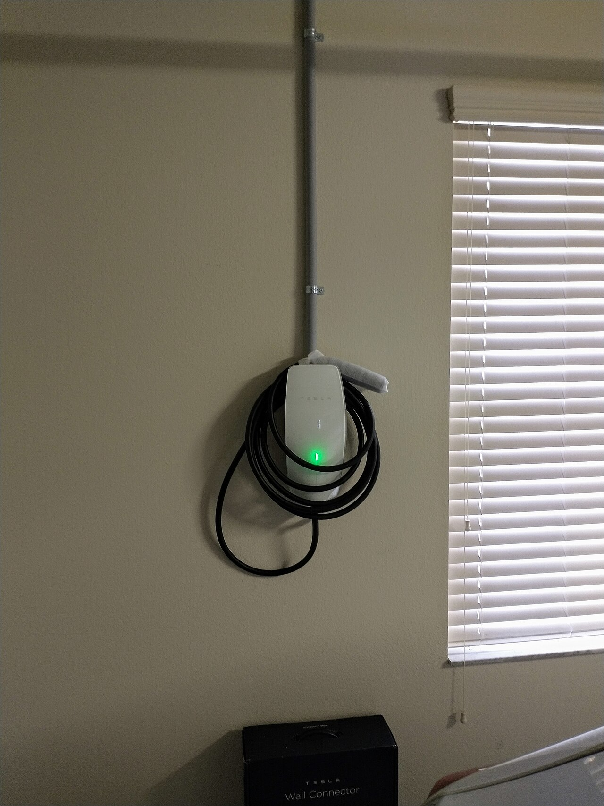
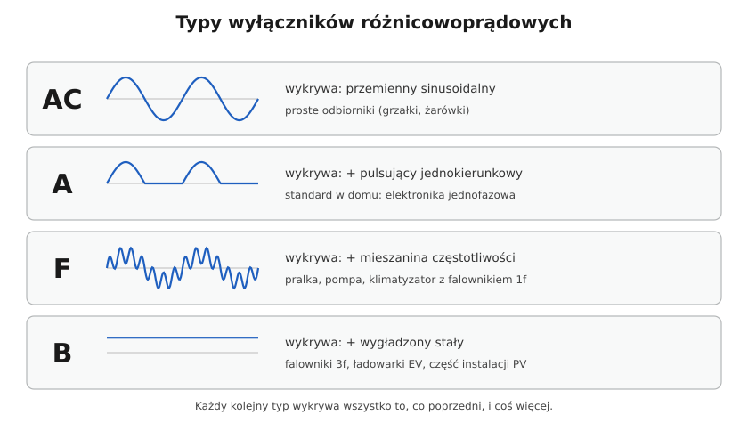

# 17.03 — Garaż i warsztat

> **Moduł:** [17 — Pomieszczenia i miejsca szczególne](README.md) · **Oznaczenia:** 🏠📋 · **Zakres SEP:** (a) (c) (d) · **Status:** ✅ pełny
>
> **Czytaj:**
>
> - PN-HD 60364-7-722 — zasilanie pojazdów elektrycznych; [26.05](../26-fotowoltaika-pompy-wallboxy/26.05-wallbox-i-ladowanie-samochodu.md)
> - PN-HD 60364-7-706 — przestrzenie ograniczone powierzchniami przewodzącymi
> - Gniazda siłowe CEE: [06.01](../06-osprzet-instalacyjny/06.01-gniazda-wtyczkowe-jednofazowe-z-bolcem.md); IP: [06.05](../06-osprzet-instalacyjny/06.05-stopnie-ochrony-ip.md)

[← poprzedni temat](17.02-kuchnia.md) · [spis modułu](README.md) · [następny temat →](17.04-instalacje-zewnetrzne-i-ogrod.md)

## Po co to jest

Garaż i warsztat to miejsce, gdzie są elektronarzędzia, kompresor, spawarka, a coraz częściej ładowarka samochodu. Jest tu kurz, wilgoć z mokrego auta, ryzyko uderzenia i przecięcia przewodu. Norma nie ma osobnego arkusza dla garażu, ale zasady ogólne i arkusze dla ładowania pojazdów oraz ciasnych przestrzeni metalowych dotyczą go bezpośrednio.

## Po ludzku

**Instalacja odporna na warunki:**

- **IP44** dla gniazd i opraw w garażu, gdzie jest wilgoć i kurz; tam, gdzie myje się auto wężem — wyżej (IPX5).
- **Przewody natynkowe w rurkach lub korytkach** — chronione przed uszkodzeniem, szczególnie nisko na ścianach.
- **Oprawy z kloszem** — odporne na uderzenie i kurz.

**Gniazda:**

- jednofazowe 230 V do elektronarzędzi — kilka, rozstawione wzdłuż stołu warsztatowego,
- **gniazdo trójfazowe CEE 16 A (czerwone, 5 styków)** — do kompresora, piły stołowej, spawarki,
- wszystkie gniazda do 32 A za **RCD 30 mA**.

**Silniki** (kompresor, piła) mają duży prąd rozruchu — czasem trzeba wyłącznika o charakterystyce C ([07.04](../07-zabezpieczenia-nadpradowe/07.04-charakterystyki-b-c-i-d.md)). Długi obwód do wolnostojącego garażu wymaga sprawdzenia spadku napięcia ([16.03](../16-planowanie-obwodow/16.03-sprawdzanie-spadku-napiecia.md)).

**Ładowanie samochodu (PN-HD 60364-7-722):**

- każdy punkt ładowania na **własnym obwodzie**,
- **RCD co najmniej typu A, 30 mA** dla każdego punktu,
- ochrona przed prądem stałym upływu: **RCD typu B** albo urządzenie wykrywające prąd stały **6 mA** (RDC-DD), często wbudowane w wallbox,
- szczegóły — [26.05](../26-fotowoltaika-pompy-wallboxy/26.05-wallbox-i-ladowanie-samochodu.md).

Ładowanie z **gniazda domowego** przez ładowarkę przenośną to kilkanaście godzin ciągłego obciążenia blisko 10 A — gniazdo i przewód muszą być w dobrym stanie, bez przedłużacza.

**Praca w ciasnych przestrzeniach metalowych** (kanał garażowy z blachą, zbiornik, kocioł — PN-HD 60364-7-706): lampy ręczne i narzędzia na **SELV** albo przez **separację** (jeden odbiornik na jedno uzwojenie), a transformator **poza** tą przestrzenią ([12.04](../12-ochrona-przeciwporazeniowa/12.04-izolacja-podwojna-separacja-elektryczna-selv-i.md)).

## Jak to wygląda

*Na co patrzeć: przewód zasilający biegnie w rurce natynkowej od sufitu — w garażu to typowe i dobre rozwiązanie. Wallbox ma własny obwód z rozdzielnicy, z odpowiednią różnicówką.*

*Na co patrzeć: gniazdo i wtyczka CEE (PN-EN 60309) — czerwone 400 V, pięć styków. W warsztacie zasila kompresor czy piłę trójfazową. Pokrywka gniazda zamyka się na sprężynie.*

## Schemat

## Pojęcia

| Pojęcie | Po ludzku | Termin normowy / symbol |
|---------|-----------|-------------------------|
| Gniazdo CEE | Gniazdo „przemysłowe” z blokadą położenia | PN-EN 60309 |
| Punkt ładowania | Gniazdo lub wallbox do ładowania auta | punkt połączenia, PN-HD 60364-7-722 |
| RDC-DD | Moduł wykrywający prąd stały upływu 6 mA | PN-EN 62955 |
| Przestrzeń ograniczona przewodząca | Ciasne wnętrze z metalu, w którym trudno się odsunąć | PN-HD 60364-7-706 |

## Liczby do zapamiętania

| Wielkość | Wartość | Kiedy obowiązuje | Źródło |
|----------|---------|------------------|--------|
| Gniazda w garażu | **IP44**; przy myciu strumieniem **IPX5** | wilgoć, kurz | [06.05](../06-osprzet-instalacyjny/06.05-stopnie-ochrony-ip.md) |
| RCD gniazd | **30 mA** | gniazda do 32 A | PN-HD 60364-4-41, 411.3.3 |
| Punkt ładowania EV | osobny obwód; RCD ≥ **typ A 30 mA** + ochrona DC (**typ B** lub RDC-DD **6 mA**) | każdy punkt | PN-HD 60364-7-722 |
| Ciasna przestrzeń metalowa | lampy ręczne **SELV**, narzędzia SELV lub separacja; źródło **na zewnątrz** | kanały, zbiorniki | PN-HD 60364-7-706 |

## W praktyce

- **Zaplanuj zapas** — przewód 5 × 4 lub 5 × 6 mm² do garażu, nawet jeśli dziś stoi tam tylko kosiarka. Wallbox 11 kW to 3 × 16 A ciągłego obciążenia.
- **Wyłącznik „warsztatowy”** — osobny rozłącznik dla gniazd warsztatu, żeby jednym ruchem odciąć narzędzia po pracy.
- **Oświetlenie nad maszynami wirującymi** — źródła o małym migotaniu (dobrej jakości LED); migoczące światło może dawać efekt stroboskopowy — wirująca tarcza wygląda na nieruchomą.
- **Przedłużacze bębnowe** — rozwijaj całkowicie przy dużym obciążeniu ([01.06](../01-prad-napiecie-opor/01.06-grzanie-przewodow-i-spadek-napiecia.md)).

## Błędy i zagrożenia

- ⚠️ **Ładowanie auta z przedłużacza** — wiele godzin blisko 10 A, przegrzane styki, pożar w garażu z samochodem.
- ⚠️ **Lampa 230 V w kanale garażowym** albo szlifierka 230 V w metalowym zbiorniku — uszkodzenie izolacji i człowiek dotykający dookoła metalu.
- **Przewody na ścianie bez osłon** na wysokości zderzaka i kół — przecięte drzwiami, rowerem, kosiarką.
- **RCD typu AC dla wallboxa** — nie wykryje prądu z składową stałą, może zostać „oślepiony”.

## Przykład

**Zadanie.** Wolnostojący garaż 30 m od domu. Planowane: oświetlenie, 4 gniazda 230 V, gniazdo CEE 16 A dla kompresora 2,2 kW (3-faz.) i w przyszłości wallbox 11 kW. Jak to zasilić?

**Rozwiązanie.** Kabel ziemny **YKY 5 × 10 mm²** (lub 5 × 6 mm² po sprawdzeniu spadku i pętli) z rozdzielnicy domu do **podrozdzielnicy w garażu** ([17.04](17.04-instalacje-zewnetrzne-i-ogrod.md)). W domu zabezpieczenie linii, np. C32 lub bezpieczniki, z selektywnością wobec przedlicznikowego. W garażu: rozłącznik, RCD 30 mA typ A dla oświetlenia i gniazd, B10 oświetlenie, B16 gniazda, C16 3P dla gniazda CEE, oraz miejsce na obwód wallboxa (B16 3P lub C16 3P wg instrukcji, z RCD typu A + RDC-DD lub typ B). Spadek napięcia dla 11 kW na 30 m, 6 mm² Cu: $\Delta U\% = 100 \cdot 11000 \cdot 30 / (56 \cdot 6 \cdot 400^2) \approx 0{,}6$ % — w porządku.

## Pytania SEP

1. **Jakie wymagania stawia się obwodom zasilającym punkty ładowania samochodów elektrycznych?**

Odpowiedź

Wg PN-HD 60364-7-722: każdy punkt ładowania zasila się z osobnego obwodu odbiorczego z własnym zabezpieczeniem nadprądowym; każdy punkt chroni się wyłącznikiem różnicowoprądowym o IΔn ≤ 30 mA, co najmniej typu A; dodatkowo stosuje się ochronę przed stałoprądowym prądem upływu — RCD typu B albo urządzenie RDC-DD wyłączające przy 6 mA DC (często wbudowane w stację ładowania).

2. **Jak zasilać lampy ręczne do pracy w zbiorniku lub kanale rewizyjnym?**

Odpowiedź

Bardzo niskim napięciem SELV z transformatora bezpieczeństwa umieszczonego poza przestrzenią ograniczoną powierzchniami przewodzącymi (PN-HD 60364-7-706). Narzędzia ręczne — SELV albo przez separację elektryczną, z jednym odbiornikiem na jedno uzwojenie wtórne transformatora separacyjnego, transformator również na zewnątrz.

## Sprawdź się

1. Dlaczego zwykła różnicówka typu AC nie wystarcza dla wallboxa?

Odpowiedź

Ładowarka zawiera prostowniki i może wytworzyć prąd upływu ze składową stałą. Różnicówka typu AC go nie wykrywa, a typ A może zostać przez niego „nasycona” i nie zadziałać. Stąd wymóg typu A (minimum) plus ochrony DC — typu B albo RDC-DD 6 mA.

## Źródła

- PN-HD 60364-7-722 — Zasilanie pojazdów elektrycznych.
- PN-HD 60364-7-706 — Przestrzenie ograniczone powierzchniami przewodzącymi.
- PN-HD 60364-4-41 — ochrona uzupełniająca gniazd (411.3.3).
- PN-EN 60309 — wtyczki i gniazda przemysłowe; PN-EN 62955 — RDC-DD.

---

[← poprzedni temat](17.02-kuchnia.md) · [spis modułu](README.md) · [następny temat →](17.04-instalacje-zewnetrzne-i-ogrod.md)
