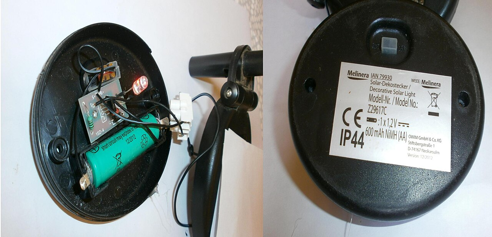
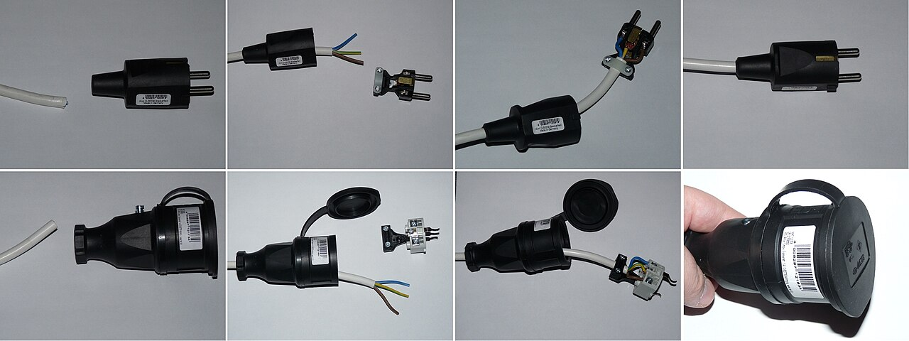
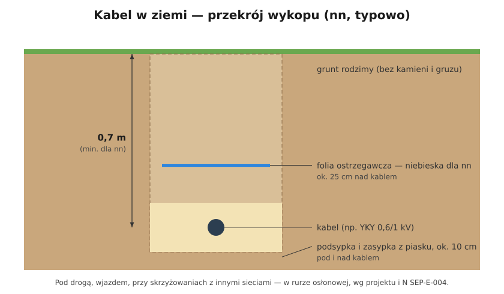

# 17.04 — Instalacje zewnętrzne i ogród

> **Moduł:** [17 — Pomieszczenia i miejsca szczególne](README.md) · **Oznaczenia:** 🏠📋 · **Zakres SEP:** (a) (c) (d) · **Status:** ✅ pełny
>
> **Czytaj:**
>
> - N SEP-E-004 — Elektroenergetyczne i sygnalizacyjne linie kablowe. Projektowanie i budowa
> - PN-HD 60364-7-714 — instalacje oświetlenia zewnętrznego; [Murator — instalacja w ogrodzie](https://muratordom.pl/instalacje/instalacja-elektryczna/jak-ukladac-instalacje-elektryczna-w-ogrodzie-aa-SV5j-wkz2-zuYq.html)
> - Kabel w ziemi: [05.06](../05-przewody-i-kable/05.06-przewody-bezhalogenowe-i-kable-ziemne.md)

[← poprzedni temat](17.03-garaz-i-warsztat.md) · [spis modułu](README.md) · [następny temat →](17.05-tymczasowa-instalacja-na-budowie.md)

## Po co to jest

Gniazdo na tarasie, oświetlenie ścieżki, zasilanie bramy, pompa w oczku wodnym. Na zewnątrz jest deszcz, mróz, słońce, ziemia, łopata i kosiarka. Człowiek stoi na mokrej trawie — ma dobry kontakt z ziemią. Wymagania są więc ostrzejsze: RCD, odpowiednie IP i kable przeznaczone do ziemi.

## Po ludzku

**Ochrona:**

- **RCD 30 mA** dla gniazd do 32 A i dla urządzeń ruchomych używanych na zewnątrz (kosiarka, nożyce do żywopłotu) — wymóg PN-HD 60364-4-41 ([12.05](../12-ochrona-przeciwporazeniowa/12.05-ochrona-uzupelniajaca.md));
- najlepiej **osobny obwód (albo kilka) na zewnątrz** z własną różnicówką — usterka lampy w ogrodzie nie wyłącza domu.

**Osprzęt i oprawy:**

- gniazdo na ścianie domu — **co najmniej IP44**, z klapką; w miejscach bardziej narażonych lepiej IP54–IP65;
- słupek z gniazdami w ogrodzie — IP44 lub wyżej, na stabilnym fundamencie;
- oprawy ogrodowe — IP44 (ściana pod okapem) do IP65/IP67 (w gruncie, najazdowe);
- metalowe słupki i oprawy klasy I — połączone z PE.

**Kable w ziemi** (N SEP-E-004, [05.06](../05-przewody-i-kable/05.06-przewody-bezhalogenowe-i-kable-ziemne.md)):

- tylko **kable ziemne** (np. **YKY**), nie przewody YDY;
- głębokość **0,7 m**, na podsypce z piasku 10 cm i przykryte 10 cm piasku;
- **folia ostrzegawcza** (niebieska dla nN) ok. 25 cm nad kablem;
- **rury osłonowe** przy wejściu do budynku, pod drogą i podjazdem, przy skrzyżowaniach z innymi instalacjami;
- **odstępy** od rur wody, kanalizacji i gazu.

**Oświetlenie 12 V lub 24 V** (SELV) w ogrodzie to dobry wybór — przy uszkodzeniu przewodu łopatą nic się nie stanie człowiekowi. Zasilacz stoi w budynku lub w szczelnej obudowie.

**Oczko wodne, fontanna** — osobny arkusz (PN-HD 60364-7-702): w wodzie tylko pompy i oprawy przeznaczone do zanurzenia, zasilane SELV albo za RCD 30 mA, zgodnie z instrukcją.

## Jak to wygląda

*Na co patrzeć: na tabliczce znamionowej oprawy ogrodowej szukaj kodu IP (tu IP44) i oznaczeń klasy. Uszczelka między obudową a kloszem decyduje o tym, czy IP będzie dotrzymane po latach.*

*Na co patrzeć: na zewnątrz — tylko przewody w izolacji gumowej i gniazda z klapką. Przedłużacz „pokojowy” z PVC twardnieje na mrozie i pęka.*

## Schemat

## Pojęcia

| Pojęcie | Po ludzku | Termin normowy / symbol |
|---------|-----------|-------------------------|
| Kabel ziemny | Kabel z powłoką do układania w gruncie | np. YKY 0,6/1 kV |
| Folia ostrzegawcza | Taśma nad kablem, ostrzega przy kopaniu | N SEP-E-004 |
| Rura osłonowa | Rura chroniąca kabel na przejściach | — |
| Instalacja oświetlenia zewnętrznego | Lampy w ogrodzie, na podjeździe, przy ścieżkach | PN-HD 60364-7-714 |
| Oczko wodne, fontanna | Zbiorniki wodne z pompami | PN-HD 60364-7-702 |

## Liczby do zapamiętania

| Wielkość | Wartość | Kiedy obowiązuje | Źródło |
|----------|---------|------------------|--------|
| Głębokość kabla nN | **0,7 m** | grunt bez ruchu pojazdów | N SEP-E-004 |
| Podsypka i zasypka piaskiem | **10 cm** pod i nad kablem | — | jw., [Murator](https://muratordom.pl/instalacje/instalacja-elektryczna/jak-ukladac-instalacje-elektryczna-w-ogrodzie-aa-SV5j-wkz2-zuYq.html) |
| Folia ostrzegawcza | ok. **25 cm** nad kablem, niebieska | nN | jw. |
| Rura na skrzyżowaniu | wystaje **0,5 m** z każdej strony | skrzyżowania | [Murator](https://muratordom.pl/instalacje/instalacja-elektryczna/jak-ukladac-instalacje-elektryczna-w-ogrodzie-aa-SV5j-wkz2-zuYq.html) |
| Gniazdo zewnętrzne | ≥ **IP44**, lepiej IP54–IP65; **RCD 30 mA** | — | PN-HD 60364-4-41, 411.3.3 |

## W praktyce

- **Zrób szkic trasy kabla z wymiarami** od stałych punktów (narożnik domu, ogrodzenie) i zdjęcia otwartego wykopu.
- **Kabel z zapasem przekroju** — oświetlenie dziś, pompa i brama jutro.
- **Puszki w gruncie** — tylko szczelne, przeznaczone do tego, z żelowymi złączkami; lepiej łączyć w słupkach nad ziemią.
- **Gniazdo przy tarasie** z wyłącznikiem w domu — można wyłączyć, gdy nie jest używane.
- **Zmierzchówka i czujnik ruchu** — do oświetlenia zewnętrznego ([10.03](../10-aparatura-modulowa/10.03-programatory-czasowe-i-wylaczniki-zmierzchowe.md)).

## Błędy i zagrożenia

- ⚠️ **Przewód YDY zakopany w ziemi** — izolacja nie jest do tego przeznaczona; po kilku latach upływ, a bez RCD — napięcie na mokrej trawie.
- ⚠️ **Brak RCD na obwodzie ogrodu** — przecięty przewód kosiarki, człowiek na mokrej trawie.
- **Kabel płytko, bez folii** — przecięty przy sadzeniu drzewa.
- **Oprawa IP44 w gruncie** — w ziemi zbiera się woda; potrzebne IP67/IP68.
- **Metalowy słupek oświetleniowy bez PE**.

## Przykład

**Zadanie.** Oświetlenie ścieżki: 8 lamp po 5 W LED, ścieżka 25 m. Dwie opcje: 230 V albo 24 V z zasilacza w garażu. Porównaj.

**Rozwiązanie.**

- **230 V:** kabel YKY 3 × 1,5 mm² na 0,7 m, lampy klasy I z PE lub klasy II, obwód B10 za RCD 30 mA. Prąd mały (40 W ≈ 0,2 A), spadek pomijalny. Wymaga starannego wykonania połączeń w gruncie lub w słupkach.
- **24 V SELV:** zasilacz 60 W w garażu, przewód do ziemi dla systemów niskonapięciowych; 40 W / 24 V ≈ 1,7 A; dla 25 m przewodu 1,5 mm²: $\Delta U = 2 \cdot 25 \cdot 1{,}7 / (56 \cdot 1{,}5) \approx 1{,}0$ V (ok. 4 %) — do przyjęcia dla LED; przy uszkodzeniu kabla brak zagrożenia porażeniem.
- Wybór: dla oświetlenia ogrodowego **24 V** jest bezpieczniejsze i prostsze w eksploatacji.

## Pytania SEP

1. **Jak układa się kabel w ziemi do zasilania budynku gospodarczego?**

Odpowiedź

Stosuje się kabel ziemny (np. YKY o napięciu 0,6/1 kV) o przekroju dobranym do obciążenia, spadku napięcia i warunku samoczynnego wyłączenia. Układa się go na głębokości co najmniej 0,7 m (N SEP-E-004) na warstwie piasku, przykrywa piaskiem, nad kablem kładzie folię ostrzegawczą. Na skrzyżowaniach z drogami i innymi instalacjami oraz przy wejściu do budynku — w rurach osłonowych. Zachowuje się odstępy od innych sieci i sporządza dokumentację trasy.

2. **Jakie wymagania stawia się gniazdom wtyczkowym instalowanym na zewnątrz budynku?**

Odpowiedź

Gniazda do 32 A muszą być objęte ochroną uzupełniającą RCD 30 mA (dotyczy też obwodów urządzeń ruchomych używanych na zewnątrz). Gniazda muszą mieć stopień ochrony odpowiedni do warunków — co najmniej IP44 (z pokrywką), a w miejscach bardziej narażonych wyższy. Przewody zasilające muszą być odporne na warunki zewnętrzne i uszkodzenia mechaniczne.

## Sprawdź się

1. Na przekroju wykopu (schemat) — po co jest folia nad kablem, skoro kabel i tak leży w piasku?

Odpowiedź

Folia ostrzega kopiącego, zanim dotrze do kabla: łopata najpierw trafia w folię (ok. 25 cm nad kablem). Piasek chroni kabel przed kamieniami i ułatwia odprowadzanie ciepła, ale nie ostrzega.

## Źródła

- N SEP-E-004 — Elektroenergetyczne i sygnalizacyjne linie kablowe. Projektowanie i budowa.
- [Jak układać instalację elektryczną w ogrodzie — Murator](https://muratordom.pl/instalacje/instalacja-elektryczna/jak-ukladac-instalacje-elektryczna-w-ogrodzie-aa-SV5j-wkz2-zuYq.html).
- PN-HD 60364-7-714 — instalacje oświetlenia zewnętrznego; PN-HD 60364-7-702 — baseny i fontanny.
- PN-HD 60364-4-41 — p. 411.3.3.

---

[← poprzedni temat](17.03-garaz-i-warsztat.md) · [spis modułu](README.md) · [następny temat →](17.05-tymczasowa-instalacja-na-budowie.md)
