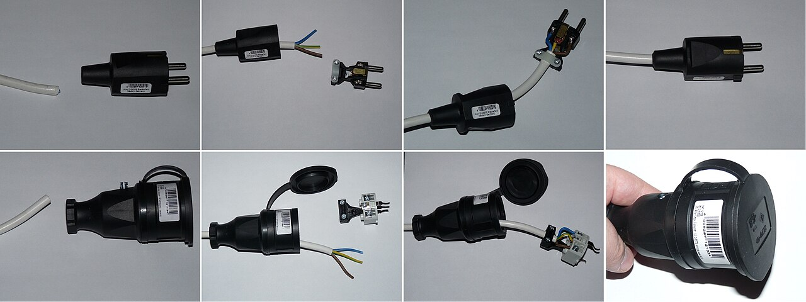
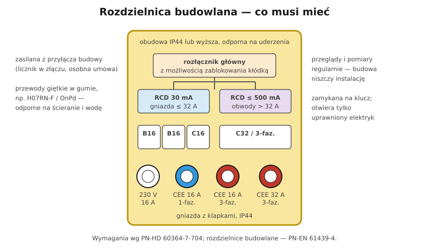

# 17.05 — Tymczasowa instalacja na budowie

> **Moduł:** [17 — Pomieszczenia i miejsca szczególne](README.md) · **Oznaczenia:** 🏠📋 · **Zakres SEP:** (a) (c) (d) · **Status:** ✅ pełny
>
> **Czytaj:**
>
> - PN-HD 60364-7-704:2018 — Instalacje na terenie budowy i rozbiórki
> - PN-EN 61439-4 — rozdzielnice budowlane (ACS)
> - 🇬🇧 [Temporary installations on construction sites — NEN 1010 §704 guide](https://nen.sulerr.com/en/guides/nen-1010/704-bouwplaatsen)

[← poprzedni temat](17.04-instalacje-zewnetrzne-i-ogrod.md) · [spis modułu](README.md) · (koniec modułu) →

## Po co to jest

Budowa domu zaczyna się od prądu na placu budowy: betoniarka, piły, wiertarki, oświetlenie, kontener. Instalacja tymczasowa pracuje w błocie, deszczu i wśród ciężkiego sprzętu, a korzystają z niej ludzie z różnych ekip. Dlatego ma osobny arkusz normy. Jeśli budujesz dom, ta rozdzielnica będzie stała na Twojej działce przez rok albo dłużej.

## Po ludzku

**Skąd prąd?** Zakład energetyczny (OSD) wykonuje **przyłącze budowlane** — złącze z licznikiem na granicy działki, na osobną umowę (zwykle w taryfie budowlanej). Za licznikiem stoi **rozdzielnica budowlana**.

**Co musi mieć rozdzielnica budowlana** (PN-HD 60364-7-704, PN-EN 61439-4):

- **wytrzymałą obudowę**, co najmniej **IP44**, odporną na uderzenia, zamykaną;
- **urządzenie do odłączania zasilania**, które da się **zablokować w pozycji otwartej** (kłódką) — żeby nikt nie włączył prądu, gdy ktoś pracuje przy instalacji;
- **RCD 30 mA** dla obwodów gniazd **do 32 A** (i narzędzi ręcznych) — bez wyjątków;
- **RCD ≤ 500 mA** dla obwodów gniazd **powyżej 32 A**;
- **gniazda z pokrywkami**: 230 V i CEE (niebieskie 230 V, czerwone 400 V);
- opis obwodów.

Zamiast RCD dla gniazd można zastosować SELV/PELV albo separację (jeden odbiornik na transformator), ale to rzadkość.

**Przewody**: giętkie w izolacji i powłoce gumowej, odporne na ścieranie i wodę (np. **H07RN-F**, OnPd). Prowadzone tak, żeby nie przejeżdżał po nich sprzęt — górą albo w osłonach.

**Kontrole**: rozdzielnicę i przewody sprawdza się często — budowa niszczy wszystko. Uszkodzone przewody i wtyczki wymienia się, nie oklejają taśmą.

## Jak to wygląda

*Na co patrzeć: na budowie większość urządzeń (betoniarka, piła stołowa, nagrzewnica) ma wtyczki CEE. Wtyczka i gniazdo muszą być całe — pęknięta obudowa to dostęp do części czynnych.*

*Na co patrzeć: przewód w gumie i gniazdo z klapką — tak powinien wyglądać przedłużacz na budowie. Zwykły przedłużacz domowy w błocie to proszenie się o porażenie.*

## Schemat

## Pojęcia

| Pojęcie | Po ludzku | Termin normowy / symbol |
|---------|-----------|-------------------------|
| Przyłącze budowlane | Tymczasowe przyłącze z licznikiem na czas budowy | — |
| Rozdzielnica budowlana | Skrzynka z zabezpieczeniami i gniazdami na budowie | ACS, PN-EN 61439-4 |
| Rozłącznik z blokadą | Główny wyłącznik zamykany kłódką | urządzenie do odłączania |
| H07RN-F | Przewód giętki w gumie, do ciężkich warunków | PN-EN 50525-2-21 |

## Liczby do zapamiętania

| Wielkość | Wartość | Kiedy obowiązuje | Źródło |
|----------|---------|------------------|--------|
| RCD gniazd | **30 mA** | gniazda do **32 A** i narzędzia ręczne | PN-HD 60364-7-704 |
| RCD gniazd dużych | ≤ **500 mA** | gniazda powyżej 32 A | jw. |
| Obudowa rozdzielnicy | ≥ **IP44** | na zewnątrz | PN-EN 61439-4, [przewodnik 704 🇬🇧](https://nen.sulerr.com/en/guides/nen-1010/704-bouwplaatsen) |
| Odłącznik główny | z możliwością **zablokowania w pozycji otwartej** | zawsze | PN-HD 60364-7-704 |
| Przewody | giętkie w gumie, np. **H07RN-F** | ciężkie warunki, woda | jw. |

## W praktyce

- **Rozdzielnica na stojaku**, nie na ziemi; w miejscu, gdzie nie zaleje jej woda i nie najedzie koparka.
- **Nikt poza uprawnionym elektrykiem nie grzebie w rozdzielnicy** — obudowa zamknięta na klucz, dostępne tylko gniazda i dźwignie.
- **Przycisk TEST różnicówek** — regularnie, na budowie nawet co tydzień ([08.05](../08-wylaczniki-roznicowopradowe/08.05-przycisk-test-i-okresowe-sprawdzanie.md)).
- **Po zakończeniu budowy** — przyłącze budowlane zamienia się na docelowe; często złącze zostaje, zmienia się umowę i taryfę ([14.05](../14-od-slupa-do-gniazdka/14.05-moc-przylaczeniowa-i-taryfy.md)).

## Błędy i zagrożenia

- ⚠️ **„Zwykła” skrzynka z gniazdami bez RCD** — porażenie w błocie, przy betoniarce, przy uszkodzonym przewodzie piły.
- ⚠️ **Przewody przejechane przez wywrotkę**, pocięte, sklejone taśmą — części czynne odsłonięte w kałuży.
- **Przedłużacze z izolacją PVC** na mrozie — pękają.
- **Mostkowanie wybijającej różnicówki** — „bo betoniarka wybija”. Przyczyną jest usterka, którą trzeba naprawić ([08.06](../08-wylaczniki-roznicowopradowe/08.06-dlaczego-roznicowka-wybija-przyczyny-i-szukanie.md)).

## Przykład

**Zadanie.** Na budowie domu potrzebne są: betoniarka 230 V 0,8 kW, piła stołowa 400 V 3 kW, nagrzewnica 400 V 9 kW (gniazdo CEE 32 A), elektronarzędzia i oświetlenie. Jakie RCD?

**Rozwiązanie.**

- Gniazda 230 V (betoniarka, elektronarzędzia, oświetlenie) — **RCD 30 mA**.
- Gniazdo CEE 16 A (piła) — gniazdo do 32 A, więc też **RCD 30 mA**.
- Gniazdo CEE 32 A (nagrzewnica) — prąd znamionowy 32 A, czyli „do 32 A włącznie” — **RCD 30 mA**. RCD ≤ 500 mA wystarcza dopiero dla gniazd powyżej 32 A (np. CEE 63 A).
- Wniosek: w typowej rozdzielnicy budowy domu wszystkie gniazda mają RCD 30 mA (najlepiej kilka, żeby jedna usterka nie zatrzymywała całej budowy).

## Pytania SEP

1. **Jakie wymagania dotyczą instalacji elektrycznej na placu budowy?**

Odpowiedź

Wg PN-HD 60364-7-704: zasilanie przez rozdzielnice budowlane zgodne z PN-EN 61439-4, o odpowiednim stopniu ochrony (zwykle co najmniej IP44) i wytrzymałości mechanicznej; na zasilaniu urządzenie do odłączania z możliwością zablokowania w pozycji otwartej; obwody gniazd do 32 A i narzędzi ręcznych chronione RCD 30 mA (albo SELV, PELV, separacja), gniazda powyżej 32 A — RCD do 500 mA; przewody giętkie odporne na ścieranie i wodę (np. H07RN-F), chronione przed uszkodzeniem; częste kontrole stanu instalacji.

## Sprawdź się

1. Dlaczego główny rozłącznik rozdzielnicy budowlanej musi dać się zablokować kłódką?

Odpowiedź

Na budowie pracuje wiele ekip. Elektryk, który naprawia instalację, musi mieć pewność, że nikt w tym czasie nie załączy zasilania — to jedna z pięciu zasad bezpieczeństwa: zabezpieczenie przed ponownym załączeniem ([00.01](../00-bezpieczenstwo-najpierw/00.01-piec-zasad-bezpiecznej-pracy-przy-urzadzeniach.md)).

## Źródła

- PN-HD 60364-7-704:2018 — Instalacje na terenie budowy i rozbiórki.
- PN-EN 61439-4 — Rozdzielnice budowlane (ACS).
- 🇬🇧 [Temporary installations on construction and demolition sites — przewodnik do NEN 1010 §704](https://nen.sulerr.com/en/guides/nen-1010/704-bouwplaatsen).

---

[← poprzedni temat](17.04-instalacje-zewnetrzne-i-ogrod.md) · [spis modułu](README.md) · (koniec modułu) →
