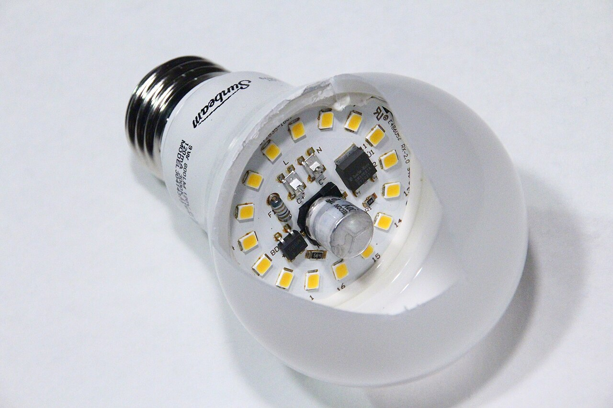
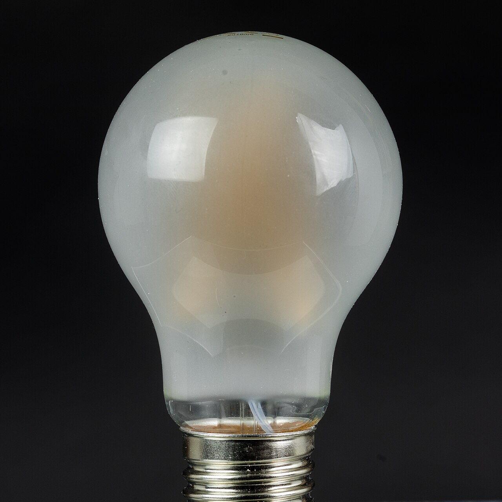
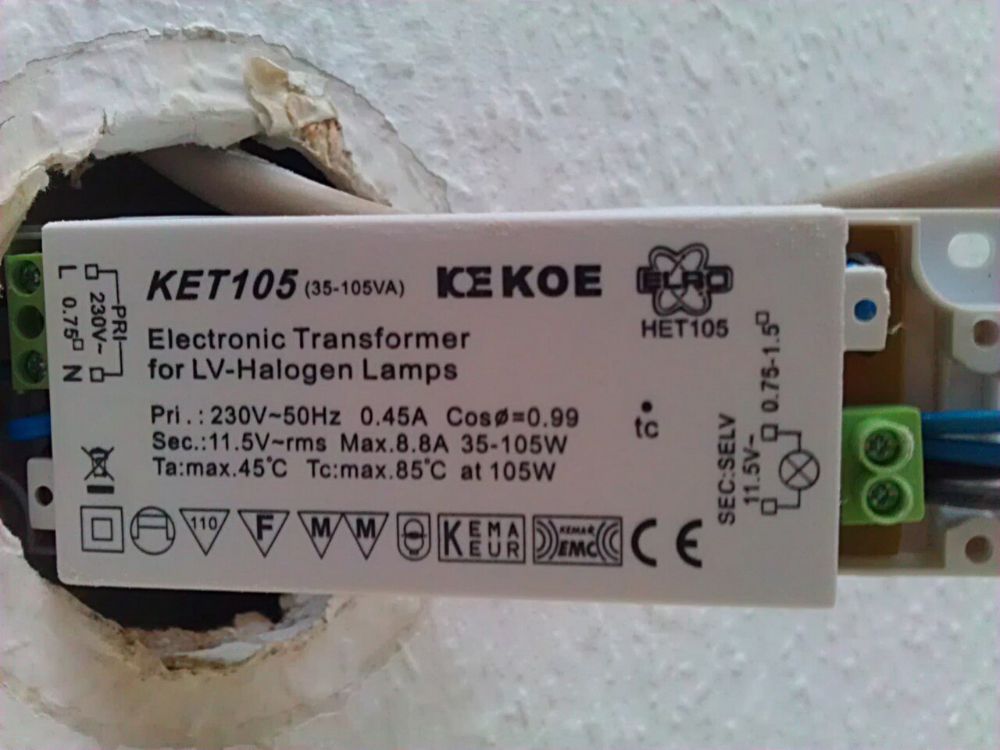
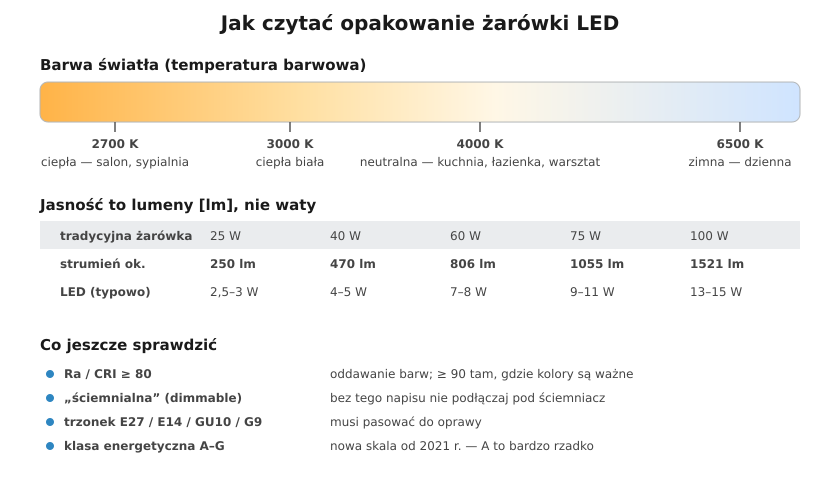

# 18.01 — Źródła światła i zasilacze LED

> **Moduł:** [18 — Oświetlenie](README.md) · **Oznaczenia:** 🏠 · **Zakres SEP:** (a) (c) · **Status:** ✅ pełny
>
> **Czytaj:**
>
> - Rozporządzenie Komisji (UE) 2019/2020 — ekoprojekt źródeł światła; (UE) 2019/2015 — etykiety energetyczne (nowa skala A–G od 1.09.2021)
> - Rozporządzenie Komisji (UE) nr 1194/2012 — tablica odpowiedników żarówek (lumeny)
> - Migające i żarzące się LED: [20.07](../20-diagnostyka-usterek/20.07-migajace-i-zarzace-sie-led.md)

← (początek modułu) · [spis modułu](README.md) · [następny temat →](18.02-lacznik-jednobiegunowy-i-swiecznikowy-schematy.md)

## Po co to jest

Żarówka „setka” zniknęła ze sklepów, a na opakowaniach LED pojawiły się lumeny, kelwiny i Ra. Do tego zasilacze: do taśmy, do downlightów, do paneli. Elektryk powinien umieć dobrać źródło światła do pomieszczenia i zasilacz do źródła — i wiedzieć, dlaczego czasem kilkanaście opraw LED wybija wyłącznik w chwili włączenia.

## Po ludzku

**Źródła światła — krótka historia:**

- **żarówka tradycyjna** — rozgrzany drut; 90 % energii idzie w ciepło. Wycofana w UE;
- **halogen** — trochę lepsza żarówka; również wycofywana;
- **świetlówka kompaktowa i liniowa** — rtęć w środku; wycofane z większości zastosowań;
- **LED** — dioda świecąca plus elektronika (zasilacz) w trzonku lub obok oprawy. Dziś standard.

**Jak czytać opakowanie LED:**

- **lumeny [lm]** — ile światła daje. 806 lm ≈ dawna „sześćdziesiątka”. Waty mówią tylko, ile prądu bierze;
- **barwa [K]** — 2700–3000 K ciepła (salon, sypialnia), 4000 K neutralna (kuchnia, łazienka, warsztat), 5000–6500 K zimna;
- **Ra (CRI)** — jak wiernie oddaje kolory; ≥ 80 w domu, ≥ 90 tam, gdzie ważne są kolory (makijaż, kuchnia, pracownia);
- **„ściemnialna”** — tylko wtedy pod ściemniacz ([18.05](18.05-sciemniacze-i-wspolpraca-z-led.md));
- **trzonek** — E27, E14, GU10 (230 V), GU5.3/MR16 (12 V), G9;
- **klasa energetyczna** — nowa skala A–G (od 2021 r.); typowa LED ma dziś klasę E–F, a A to rzadkość.

**Zasilacze LED** — dwa główne rodzaje:

- **stałonapięciowe (CV)** — dają stałe napięcie, np. **12 V lub 24 V DC**. Do taśm LED i modułów z własnymi rezystorami ([18.06](18.06-tasmy-led-i-ich-zasilanie.md));
- **stałoprądowe (CC)** — dają stały prąd, np. **350 mA, 700 mA**; napięcie dopasowuje się do diod. Do opraw i paneli, w których diody łączy się szeregowo. Nie zamieniaj ich — zasilacz CV do modułu CC spali diody.

Zasilacze bezpieczne mają oznaczenie **SELV** — wyjście jest oddzielone od sieci izolacją wzmocnioną ([12.04](../12-ochrona-przeciwporazeniowa/12.04-izolacja-podwojna-separacja-elektryczna-selv-i.md)).

**Prąd załączania.** Zasilacz LED w chwili włączenia ładuje kondensatory i przez ułamek milisekundy pobiera prąd kilkadziesiąt razy większy od znamionowego. Jeden zasilacz — bez znaczenia. Dwadzieścia opraw na jednym obwodzie i łączniku — wyłącznik B10 może zadziałać przy włączeniu, a styki łącznika się sklejają. Producenci opraw podają, **ile sztuk wolno podłączyć pod wyłącznik B10/B16**.

## Jak to wygląda

*Na co patrzeć: diody są na metalowym krążku, który odprowadza ciepło. W środku widać kondensator i scalak zasilacza — to on przetwarza 230 V AC na prąd diod. Gdy LED „pada”, zwykle psuje się zasilacz, a nie diody.*

*Na co patrzeć: żarówka „filament” z zewnątrz wygląda jak tradycyjna. W środku są paski z wieloma małymi diodami. Na opakowaniu sprawdź lumeny, barwę i oznaczenie „ściemnialna”.*

*Na co patrzeć: transformator elektroniczny do halogenów 12 V. Przy wymianie halogenów MR16 na LED taki transformator często nie współpracuje z LED (za małe obciążenie) — LED migają. Wtedy wymienia się go na zasilacz LED 12 V DC lub AC zgodny z żarówkami.*

## Schemat

## Pojęcia

| Pojęcie | Po ludzku | Termin normowy / symbol |
|---------|-----------|-------------------------|
| Strumień świetlny | Ile światła daje źródło | $\Phi$ [lm] |
| Skuteczność świetlna | Ile lumenów z jednego wata | [lm/W] |
| Temperatura barwowa | Ciepła czy zimna barwa | CCT [K] |
| Wskaźnik oddawania barw | Jak wiernie widać kolory | Ra, CRI |
| Zasilacz CV / CC | Stałe napięcie / stały prąd | driver LED |
| Prąd załączania | Krótki „skok” prądu przy włączeniu | inrush current |

## Liczby do zapamiętania

| Wielkość | Wartość | Kiedy obowiązuje | Źródło |
|----------|---------|------------------|--------|
| Odpowiedniki żarówek | 25 W ≈ **250 lm**; 40 W ≈ **470 lm**; 60 W ≈ **806 lm**; 75 W ≈ **1055 lm**; 100 W ≈ **1521 lm** | żarówki ogólnego przeznaczenia | rozp. (UE) nr 1194/2012 |
| Barwa | **2700–3000 K** ciepła, **4000 K** neutralna, **6500 K** zimna | — | — |
| Ra | ≥ **80** w domu, ≥ **90** przy ocenie kolorów | — | praktyka |
| Typowe napięcia zasilaczy CV | **12 V**, **24 V** DC | taśmy, moduły | katalogi |
| Typowe prądy zasilaczy CC | **350**, **500**, **700** mA | oprawy, panele | katalogi |
| Skala etykiet energetycznych | **A–G**, nowa od **1.09.2021** | źródła światła w UE | rozp. (UE) 2019/2015 |

## W praktyce

- **Dobierz lumeny do pomieszczenia**, nie waty. Pokój 15 m² — łącznie zwykle 1500–3000 lm, kuchnia i łazienka — więcej.
- **Jedna barwa w jednym pomieszczeniu** — mieszanie 3000 K i 4000 K wygląda źle.
- **Zasilacz w dostępnym miejscu** — nad sufitem podwieszanym przy otworze oprawy, nie zamurowany. Zasilacze się psują.
- **Wiele opraw na jednym łączniku** — sprawdź w karcie katalogowej liczbę zasilaczy na wyłącznik i dopuszczalny prąd załączania łącznika (oznaczenie dla LED na łącznikach i przekaźnikach).
- **Żarzenie po wyłączeniu** — łącznik w N zamiast w L, łącznik z podświetleniem albo indukowanie w długim przewodzie ([20.07](../20-diagnostyka-usterek/20.07-migajace-i-zarzace-sie-led.md)).

## Błędy i zagrożenia

- ⚠️ **Zasilacz bez oznaczenia SELV** i bez znaku CE z internetu w suficie z płyt g-k — przegrzanie, pożar, a przy uszkodzeniu napięcie sieci na „bezpiecznych” 12 V.
- **Zasilacz CV do oprawy CC (lub odwrotnie)** — spalone diody albo brak świecenia.
- **Zbyt dużo zasilaczy na jednym łączniku/przekaźniku** — zgrzane styki, światło, którego nie da się wyłączyć.
- **LED w szczelnej oprawie bez przewidzianego chłodzenia** — szybka utrata jasności i awaria.
- **Żarówka LED nieprzeznaczona do ściemniania** pod ściemniaczem — migotanie, buczenie, przegrzanie.

## Przykład

**Zadanie.** W salonie było 6 halogenów GU10 po 50 W (ok. 350 lm każdy). Na co je wymienić i ile energii się zaoszczędzi przy 4 h świecenia dziennie?

**Rozwiązanie.** LED GU10 ok. 350–400 lm to typowo **4–5 W**. Barwa 2700–3000 K (salon), Ra ≥ 80. Moc: 6 × 50 = 300 W → 6 × 5 = 30 W. Oszczędność 270 W × 4 h × 365 = **ok. 394 kWh rocznie**. Jeśli halogeny były na ściemniaczu — kupić LED ściemnialne i sprawdzić zgodność ściemniacza ([18.05](18.05-sciemniacze-i-wspolpraca-z-led.md)).

## Pytania SEP

1. **Jakie parametry opisują źródło światła?**

Odpowiedź

Strumień świetlny w lumenach (ilość światła), moc w watach, skuteczność świetlna w lm/W, temperatura barwowa w kelwinach (barwa światła), wskaźnik oddawania barw Ra, trwałość w godzinach, rodzaj trzonka, napięcie zasilania, możliwość ściemniania, klasa energetyczna. Dla LED dodatkowo rodzaj zasilacza (stałonapięciowy lub stałoprądowy).

2. **Czym różni się zasilacz LED stałonapięciowy od stałoprądowego?**

Odpowiedź

Stałonapięciowy (CV) utrzymuje stałe napięcie wyjściowe (np. 12 V lub 24 V DC), a prąd zależy od podłączonego obciążenia — służy do taśm i modułów LED z własnymi rezystorami lub układami ograniczającymi prąd. Stałoprądowy (CC) utrzymuje stały prąd (np. 350 mA, 700 mA), a napięcie wyjściowe dopasowuje się do łańcucha diod — służy do opraw i paneli z diodami łączonymi szeregowo. Zasilacza nie wolno zamienić na drugi typ.

## Sprawdź się

1. Na opakowaniu: „7 W, 806 lm, 4000 K, Ra 80, E27, nie ściemnialna”. Do jakiego pomieszczenia pasuje i czego z nią nie robić?

Odpowiedź

Odpowiednik dawnej żarówki 60 W o neutralnej barwie — dobra do kuchni, łazienki, przedpokoju, warsztatu. Nie podłączać pod ściemniacz.

## Źródła

- Rozporządzenie Komisji (UE) nr 1194/2012 — wymogi ekoprojektu dla lamp kierunkowych, LED i powiązanego wyposażenia (tablica odpowiedników).
- Rozporządzenie Komisji (UE) 2019/2020 — ekoprojekt źródeł światła; Rozporządzenie delegowane Komisji (UE) 2019/2015 — etykiety energetyczne źródeł światła.
- PN-EN 61347 — urządzenia sterujące lamp (zasilacze LED).

---

← (początek modułu) · [spis modułu](README.md) · [następny temat →](18.02-lacznik-jednobiegunowy-i-swiecznikowy-schematy.md)
